# هموگلوبین، انتقال گازها و ارزیابی کم‌خونی

**درس:** هماتولوژی
**مبحث:** هماتولوژی - ساختار و متابولیسم هموگلوبین، انتقال گازها، همولیز و ارزیابی کم‌خونی - جلسه 10 کلاس
**تاریخ تولید جزوه:** 2026-10-28T10:49:55

## ۱. مقدمه و کلیات

این جلسه به ساختار و ساخته‌شدن هموگلوبین، انتقال اکسیژن و دی‌اکسیدکربن، منحنی تفکیک اکسیژن ـ هموگلوبین، عمر و تخریب گلبول قرمز، همولیز داخل عروقی و خارج عروقی و رویکرد آزمایشگاهی و بالینی به کم‌خونی می‌پردازد. همچنین شاخص‌های CBC، ارزیابی مغز استخوان و کم‌خونی آپلاستیک بررسی می‌شوند.

## ۲. متن اصلی جزوه

### ساختار هموگلوبین

هموگلوبین (hemoglobin) از چهار زنجیره تشکیل شده است و هر زنجیره یک ساختار هِم دارد. هر هِم دارای یک اتم آهن دو ظرفیتی (⁺Fe²) می باشد و برای عملکرد، باید آهن داشته باشد.

بخش گلوبینی هموگلوبین به‌وسیلهٔ ژن‌هایی کد می‌شود که روی کروموزوم‌های ۱۱ و ۱۶ قرار دارند. از این ژن‌ها RNA ساخته می‌شود و پس از طی مراحل لازم، ترجمه (translation) صورت می‌گیرد و رشتهٔ گلوبینی ساخته می‌شود. این رشته در سیتوپلاسم می‌ماند تا بخش هِم ساخته شود و با آن ترکیب شود.

> [BOX:DEFINITION]
> **هموگلوبین (hemoglobin)**
> مولکولی متشکل از چهار زنجیره است که هر زنجیره یک ساختار  هِم دارد. هر مولکول هموگلوبین چهار اتم آهن دوظرفیتی (⁺Fe²) دارد.

### ساخته‌شدن هِم و اتصال آن به گلوبین

ساخت هِم در میتوکندری و با سوکسینیل‌کوآ (succinyl-CoA) و گلیسین آغاز می‌شود، در سیتوپلاسم ادامه می‌یابد و مراحل انتهایی دوباره در میتوکندری انجام می‌شوند. آهن جذب‌شده به سلول اریتروئیدی می‌رسد و وارد سیتوپلاسم و سپس میتوکندری می‌شود. آنزیم فروکلاتاز (ferrochelatase) آهن را در وسط مولکول پروتوپورفیرین قرار می‌دهد و ساختار چهارحلقه‌ای هِم شکل می‌گیرد.

آهن دو ظرفیتی هموگلوبین می‌تواند با شش اتم یا مولکول پیوند برقرار کند. پس با چهار پیوند به این حلقه‌ها متصل است؛ یک جایگاه آن برای اتصال به گلوبین و جایگاه دیگر برای اتصال به اکسیژن در دسترس قرار می‌گیرد.

پس از ساخته‌شدن هِم و رفتن آن به سیتوپلاسم، هِم به گلوبین متصل می‌شود. دو زنجیرهٔ گلوبینی با هم دایمر می‌سازند و دو دایمر با هم تترامر می‌سازند؛ به این ترتیب مولکول هموگلوبین شکل می‌گیرد.

> [BOX:DEFINITION]
> **هِم**
> ساختار چهارحلقه‌ای که آهن در وسط آن قرار می‌گیرد و جایگاه‌هایی برای اتصال به گلوبین و اکسیژن دارد.

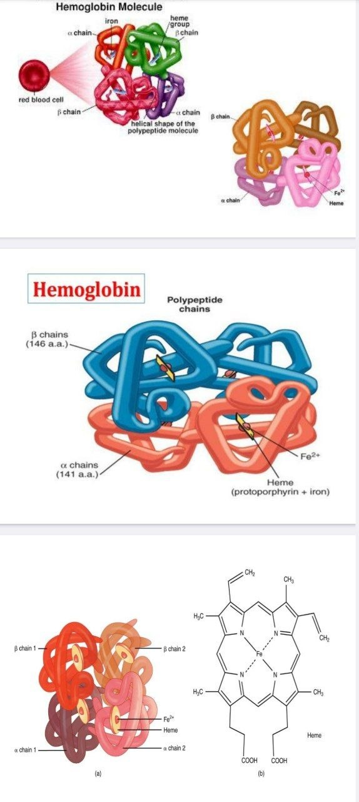

### تولید و بلوغ گلبول قرمز

هموگلوبین در گلبول قرمز مرتب تولید می‌شود. گلبول قرمز در مرحلهٔ ارتوکروماتیک هسته‌اش را بیرون می‌اندازد، چون دیگر به رونویسی از ژن‌ها نیاز ندارد. سپس به رتیکولوسیت تبدیل می‌شود، حدود ۴۸ تا ۷۲ ساعت در مغز استخوان می‌ماند و بعد وارد جریان خون می‌شود و به گلبول قرمز بالغ تبدیل می‌شود.

### انتقال اکسیژن و دی‌اکسیدکربن

#### دریافت و تحویل اکسیژن

گلبول قرمز اکسیژن را در ریه می‌گیرد و به بافت‌ها می‌رساند. در ریه فشار اکسیژن بالاست. ریه عروق بسیار ریزی دارد به طوریکه گلبول‌های قرمز در کیسه‌های هوایی با اکسیژن تماس پیدا می‌کنند. به‌دلیل فشار بالای اکسیژن، اکسیژن وارد خون می‌شود و به گلبول قرمز جذب می‌شود. اکسیژن به آهن دوظرفیتی متصل می‌شود؛ ترکیب حاصل اکسی‌هموگلوبین (oxyhemoglobin) نام دارد و به‌وسیلهٔ گلبول قرمز جابه‌جا می‌شود.

> [BOX:DEFINITION]
> **اکسی‌هموگلوبین (oxyhemoglobin)**
> ترکیبی که از اتصال اکسیژن به آهن دوظرفیتی هموگلوبین حاصل می‌شود و به‌وسیلهٔ گلبول قرمز جابه‌جا می‌شود.

در جایی که فشار اکسیژن پایین است، مانند کنار بافت‌ها، اکسیژن از هموگلوبین جدا و به بافت تحویل داده می‌شود. خون در شریان ریوی، با وجود این‌که رگ از نوع شریان است، اکسیژن کمی دارد و از قلب به ریه می‌آید. پس از اکسیژن‌گیری، به قلب برمی‌گردد و قلب آن را به اندام‌های دیگر می‌فرستد. کنار اندام‌ها فشار اکسیژن پایین است و فعالیت سلول‌ها باعث افزایش تولید دی‌اکسیدکربن (CO₂) می‌شود. در نتیجه، اکسیژن به‌وسیلهٔ شیب غلظت از هموگلوبین جدا و وارد سلول‌های بدن می‌شود؛ سلول‌ها نیز دی‌اکسیدکربن را به گلبول قرمز می‌دهند.

#### انتقال CO₂ و کلر شیفت

مقدار کمی از CO₂ به هموگلوبین متصل می‌شود، اما بخش عمدهٔ آن با آب ترکیب و به H₂CO₃ تبدیل می‌شود. در گلبول قرمز آنزیم کربنیک انهیدراز (carbonic anhydrase) وجود دارد که واکنش را در هر دو جهت پیش می‌برد. H₂CO₃ تجزیه می‌شود و ⁺H و ⁻HCO₃ می‌سازد.

بخش زیادی از CO₂ به‌صورت ⁻HCO₃ از گلبول قرمز خارج می‌شود و به‌وسیلهٔ پلاسما منتقل می‌شود. برای حفظ تعادل یونی، با خروج بی‌کربنات، یون کلر وارد گلبول قرمز می‌شود؛ به این پدیده کلر شیفت (chloride shift) می‌گویند.به همین دلیل یکی از ویژگی‌های هموگلوبین را نقش بافری و ایجاد بالانس الکترولیت می‌دانند.
 مقداری از CO₂ نیز به هموگلوبین متصل می‌ماند و همراه گلبول قرمز به ریه برمی‌گردد.

> [BOX:DEFINITION]
> **کلر شیفت (chloride shift)**
> برای حفظ تعادل یونی، با خروج بی‌کربنات از گلبول قرمز، کلر وارد آن می‌شود.

در ریه چرخه برعکس می‌شود:

1. اکسیژن وارد گلبول قرمز می‌شود و به هموگلوبین متصل می‌شود؛ این اتصال ⁺H آزاد می‌کند.
2. با واسطهٔ کربنیک انهیدراز، ⁺H با ⁻HCO₃ ترکیب می‌شود و H₂CO₃ می‌سازد.
3. H₂CO₃ به آب و CO₂ تجزیه می‌شود.
4. کربن دی اکسیدی که در کنار بافت‌ها به هموگلوبین گلبول قرمز باند شده و یا توسط پلاسما منتقل شده است، به شکل بی‌کربنات دوباره وارد گلبول قرمز می‌شود و کلری که وارد گلبول قرمز شده بود، از آن خارج می‌شود.

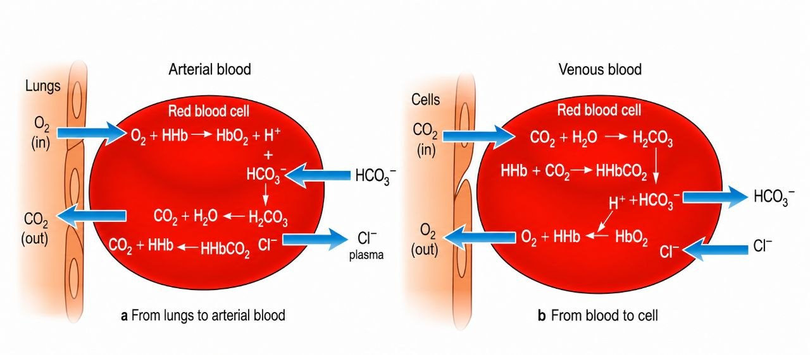

به این ترتیب، تعادل یونی حفظ می‌شود، اکسیژن به بافت می‌رسد و CO₂ به ریه منتقل می‌شود. در کتاب‌های شیمی بالینی نیز به کلر شیفت اشاره می‌شود: کنار اندام‌ها کلر وارد گلبول قرمز می‌شود و در ریه از آن خارج می‌شود. این فرایند یکی از کارهای هموگلوبین و گلبول قرمز است و نشان می‌دهد هموگلوبین در حفظ تعادل اسید ـ باز و الکترولیت‌ها نیز نقش دارد.

### اختلال در اکسیژن‌رسانی و تعادل اسید ـ باز

اسیدوز (acidosis) و آلکالوز (alkalosis) از وضعیت‌های اورژانسی بدن‌اند. در اسیدوز، pH می‌تواند افت کند. این اختلال‌ها ممکن است در مسمومیت‌ها، ورود ترکیبات شیمیایی خاص به بدن یا مشکلات کلیه و ریه ایجاد شوند و بر عملکرد گلبول قرمز اثر بگذارند.

در جریان دم(inspiration)، ریه اکسیژن می‌گیرد و آن را به گلبول قرمز می‌رساند. اگر راه‌های هوایی ریه دچار انسداد شوند، اکسیژن کمتری به بافت ریه می‌رسد. در بیماری انسدادی مزمن ریه (COPD; chronic obstructive pulmonary disease)، التهاب‌ها و عفونت‌های مزمن می‌توانند بافت نای و نایژه‌ها را متورم و مجرا را باریک‌تر کنند. در نتیجه، راه رسیدن اکسیژن به ریه‌ها مسدود می‌شود، اندام‌ها دچار هیپوکسی می‌شوند و قلب بزرگ می‌شود. در این افراد ممکن است هموگلوبین به شکل نرمال وجود داشته باشد، ولی فشار اکسیژن پایین باشد. این وضعیت در افراد سیگاری و نیز در شرایطی که دود سنگین یا ترکیبات دیگر استنشاق شود، دیده می‌شود. بیماری‌هایی که با نقص کمپلمان همراه‌اند نیز ممکن است به‌مرور التهاب ایجاد کنند. در کرونا، آنفلوانزا و سرماخوردگی نیز افزایش ترشحات می‌تواند انتقال اکسیژن را در ریه کند و اکسیژن‌رسانی را مختل کند.

> [BOX:EXAMPLE]
> در بیماری انسدادی مزمن ریه (COPD; chronic obstructive pulmonary disease)، التهاب‌ها و عفونت‌های مزمن می‌توانند بافت نای و نایژه‌ها را متورم و مجرا را باریک‌تر کنند؛ در نتیجه، راه رسیدن اکسیژن به ریه‌ها محدود می‌شود و اندام‌ها دچار هیپوکسی می‌شوند.

### اتصال تعاونی اکسیژن به هموگلوبین

وقتی گلبول قرمز به بافت ریه می‌رسد، اکسیژن ابتدا به زنجیرهٔ آلفا متصل می‌شود. چهار زنجیره از نظر موقعیت فضایی می‌توانند روی هم حرکت کنند و زاویهٔ آن‌ها تغییر کند. وقتی گلبول قرمز CO₂ را به ریه آورده و هنوز اکسیژن نگرفته است، آهن درون مولکول هِم قرار دارد و در دسترس نیست. با بالا رفتن فشار اکسیژن، **ابتدا در زنجیرهٔ آلف**ا پیوندهایی که به آن‌ها salt bridge (پل نمکی) می‌گویند، شکسته می‌شوند. سپس آهن در دسترس قرار می‌گیرد و اکسیژن به آن متصل می‌شود. این اتصال باعث چرخش بیشتر زنجیرهٔ آلفا می‌شود و زنجیره‌های بعدی با سرعت بیشتری اکسیژن می‌گیرند.

#### منحنی تفکیک اکسیژن ـ هموگلوبین

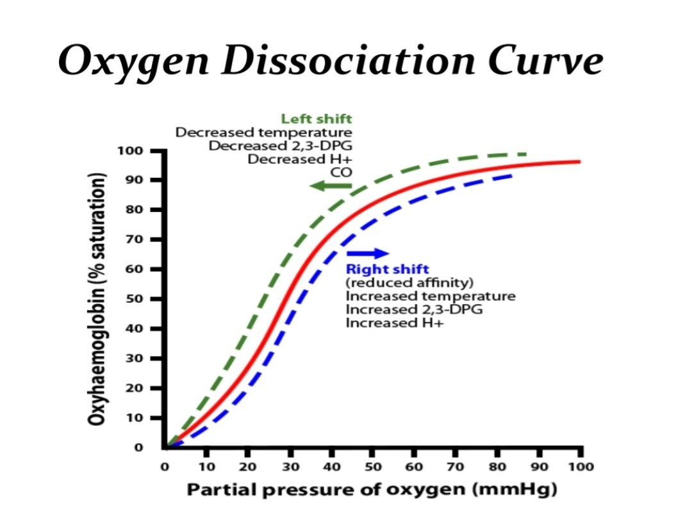

نمودار این واکنش در ابتدا کند است؛ زیرا فشار اکسیژن باید بالا برود تا زنجیرهٔ اول واکنش نشان دهد و تغییر زاویه ایجاد شود. سپس زنجیره‌های بعدی پشت‌سرهم از اکسیژن اشباع می‌شوند. به این نمودار، منحنی تَجَزای اکسیژن ـ هموگلوبین (oxygen dissociation curve) می‌گویند.

هرچه فشار اکسیژن بالا برود، مولکول‌های هموگلوبین بیشتر اشباع می‌شوند تا جاییکه کاملاً اشباع شوند. منحنی هموگلوبین، سیگموئید (sigmoid) است، چون هموگلوبین چهار زنجیره دارد و زنجیره‌ها به‌صورت اولویت‌بندی شده اکسیژن می‌گیرند: اول زنجیرهٔ آلفا اکسیژن می‌گیرد، موقعیت فضایی تغییر می‌کند و این تغییر به زنجیره‌های بعدی منتقل می‌شود؛ در نتیجه، سرعت اشباع بالا می‌رود و کل هموگلوبین از اکسیژن اشباع می‌شود.

#### جابه‌جایی منحنی و عوامل مؤثر

این منحنی پویا و داینامیک است و می‌تواند به راست یا چپ جابه‌جا شود (Shift to right & Shift to left). عوامل جابه‌جایی منحنی به راست عبارت‌اند از افزایش ⁺H، یعنی کاهش pH؛ افزایش CO₂؛ افزایش دمای بدن؛ و افزایش ۲،۳-DPG.

در ریه، ⁺H به آزادشدن بار CO₂ و گرفتن اکسیژن کمک می‌کند. هر عاملی که منحنی را به راست ببرد، تمایل هموگلوبین به اکسیژن را کم می‌کند؛ در نتیجه، اکسیژن راحت‌تر و سریع‌تر در اختیار بافت‌ها قرار می‌گیرد. هر عاملی که منحنی را به چپ ببرد، تمایل هموگلوبین به اکسیژن را افزایش می‌دهد؛ هموگلوبین اکسیژن را به بافت می‌آورد، اما به‌راحتی آن را تحویل نمی‌دهد.

#### نقش گلیکولیز و ۲،۳-DPG

گلبول قرمز مسیر گلیکولیز (glycolysis) را طی می‌کند. گلوکز تنها غذای گلبول قرمز است؛ گلبول قرمز میتوکندری ندارد تا اسیدهای چرب بسوزاند یا متابولیسم پروتئین انجام دهد. هنگام عبور گلوکز از غشا، فسفاتش را از دست می‌دهد و پس از ورود دوباره فسفریله می‌شود و گلوکز-۶-فسفات (glucose-6-phosphate) را درون سلول می‌سازد. این ترکیب برای گلبول قرمز بسیار اهمیت دارد و می‌تواند وارد مسیر پنتوز فسفات (pentose phosphate pathway) شود.

مسیر پنتوز فسفات برای گلبول قرمز حیاتی است، چون در آن NADPH تولید می‌شود. گلبول قرمز وسیله‌ای برای مبارزه با عوامل اکسیداتیو ندارد و NADPH را برای این کار مصرف می‌کند. بنابراین وقتی عامل اکسیدان وارد خون می‌شود، گلبول قرمز NADPH مصرف می‌کند تا گلوتاتیون، که ابزار دفاعی گلبول قرمز در برابر عوامل اکسیداتیو است، دوباره احیا شود.

در ادامهٔ مسیر متابولیسمی گلوکز، آنزیم موتاز (mutase) وارد عمل می‌شود و ترکیبات مسیر به فروکتوز-۱،۶-بیس‌فسفات و سپس، با عملکرد آلدولاز، به ترکیبات بعدی تبدیل می‌شوند. ترکیب ۱،۳-بیس‌فسفوگلیسرات به‌وسیلهٔ آنزیم موتاز به ۲،۳-DPG تبدیل می‌شود. این واکنش برگشت‌پذیر است. ۲،۳-DPG یکی از عوامل تسهیل‌کنندهٔ تحویل اکسیژن به بافت‌هاست. وقتی ۲،۳-DPG وارد گلبول قرمز می‌شود، به زنجیرهٔ بتا متصل می‌شود و آرایش زنجیره‌ها را تغییر می‌دهد تا اکسیژن راحت‌تر از آهن جدا شود.

> [BOX:DEFINITION]
> **۲،۳-DPG**
> یکی از عوامل تسهیل‌کنندهٔ تحویل اکسیژن به بافت‌هاست؛ به زنجیرهٔ بتا متصل می‌شود و آرایش زنجیره‌ها را تغییر می‌دهد تا اکسیژن راحت‌تر از آهن جدا شود.

هنگام ورزش و فعالیت بدنی، دمای داخلی بدن بالا می‌رود، اندام‌ها فعال‌تر می‌شوند، ۲،۳-DPG و CO₂ تولید می‌شوند و pH پایین می‌آید؛ در نتیجه، منحنی به راست شیفت می‌کند.

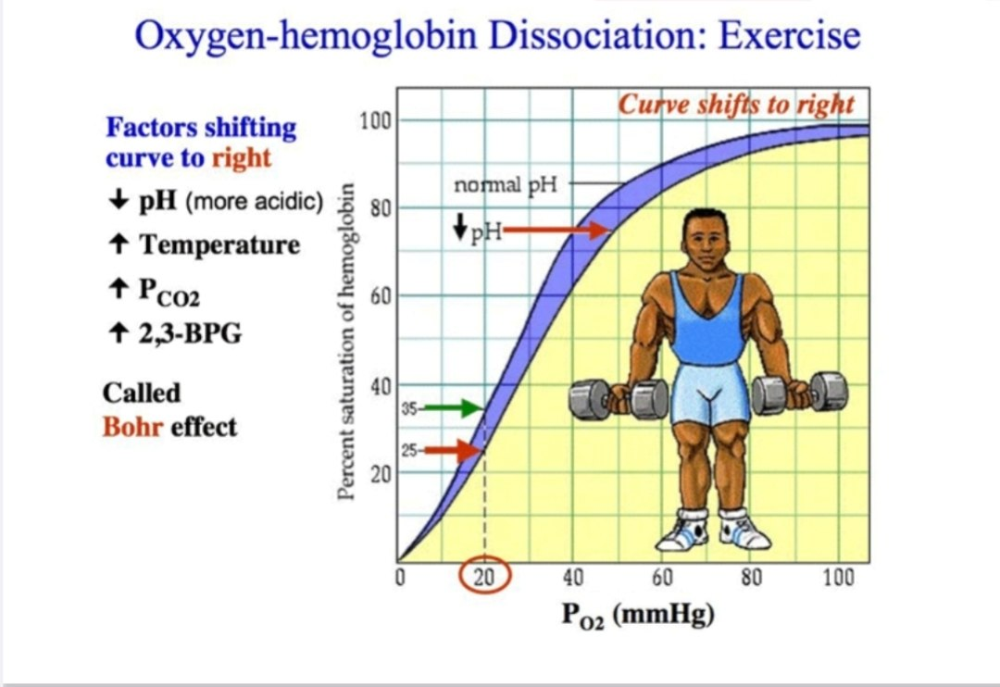

برعکس، در آلکالوز، وقتی H⁺، CO₂ و ۲،۳-DPG کم شوند و فعالیت متابولیک پایین بیاید، منحنی به چپ شیفت می‌کند. در نمودار، شرایط اسیدی باعث شیفت به راست و آلکالوز باعث شیفت به چپ می‌شود.

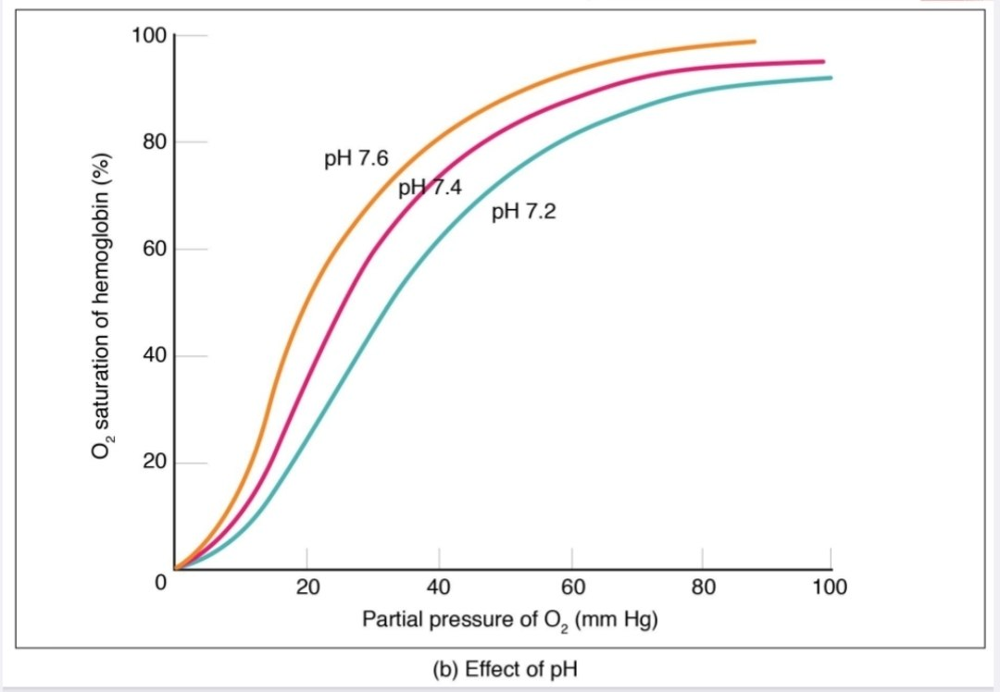

#### مقایسهٔ هموگلوبین و میوگلوبین

میوگلوبین (myoglobin) ساختاری شبیه هموگلوبین دارد، اما تک‌زنجیره‌ای است و در بافت ماهیچه‌ای قرار دارد تا اکسیژن را برای ماهیچه ذخیره کند. هنگام فعالیت بدنی، ماهیچه‌ها به اکسیژن بیشتری نیاز دارند و میوگلوبین در ذخیرهٔ اکسیژن نقش دارد.

میوگلوبین چون یک زنجیره دارد، به همکاری چهار زنجیره نیاز ندارد؛ با افزایش فشار اکسیژن اشباع می‌شود و نمودار آن هایپربولیک (hyperbolic) است. در مقابل، نمودار هموگلوبین سیگموئید است؛ هموگلوبین برای اشباع‌شدن به همکاری چهار زنجیره نیاز دارد، اما میوگلوبین یک زنجیره دارد و اکسیژن می‌گیرد تا اشباع شود.

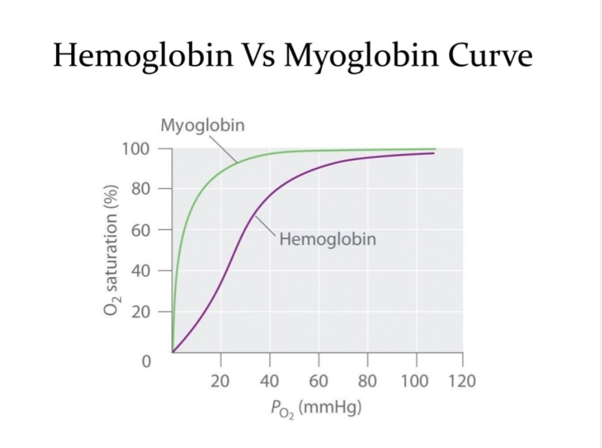

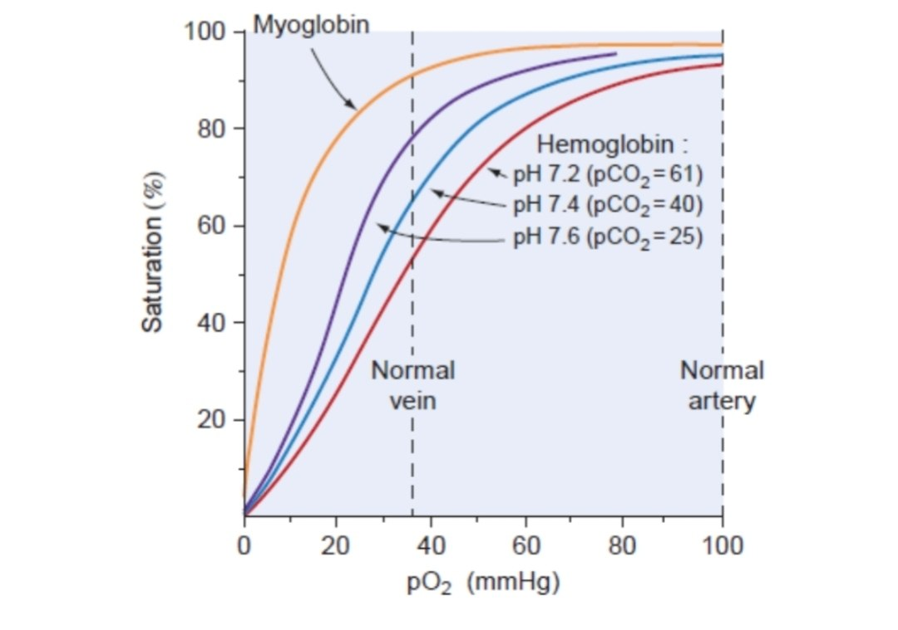

#### P50

از منحنی تفکیک اکسیژن، پارامتری به نام P50 استخراج می‌شود. P50 فشاری از اکسیژن است که ۵۰ درصد مولکول‌های هموگلوبین را اشباع می‌کند و مقدار طبیعی آن حدود ۲۶ تا ۲۷ است.

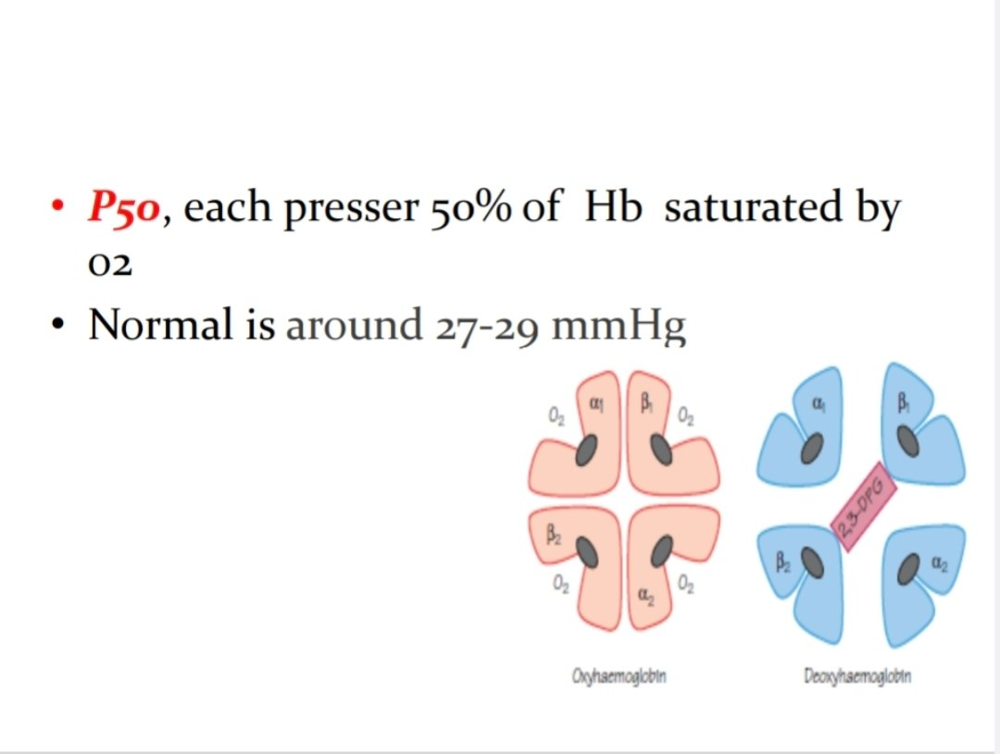

> [BOX:DEFINITION]
> **P50**
> فشاری از اکسیژن است که ۵۰ درصد هموگلوبین را اشباع می‌کند؛ مقدار طبیعی آن حدود ۲۶ تا ۲۷ است.

اگر P50 کاهش پیدا کند، هموگلوبین در فشار پایین‌تری از اکسیژن اشباع می‌شود. اگر P50 افزایش پیدا کند، برای اشباع‌شدن هموگلوبین فشار اکسیژن بالاتری لازم است.

### عمر گلبول قرمز و تجزیهٔ هموگلوبین

#### عمر و تخریب گلبول قرمز

گلبول قرمز حدود ۱۲۰ روز عمر می‌کند. در هر ثانیه حدود ۵۰ هزار گلبول قرمز لایز می‌شوند و رتیکولوسیت‌ها جای آن‌ها را می‌گیرند. گلبول‌های قرمز با رسیدن به پایان عمرشان تجزیه می‌شوند. روزانه حدود ۶ گرم هموگلوبین turnover می‌شود؛ یعنی به‌دلیل پایان عمر گلبول‌های قرمز، هموگلوبین تجزیه و دوباره تولید می‌شود. طحال محل اصلی تخریب گلبول‌های قرمز پیر است و مقدار کمی از آنها نیز در کبد تخریب می‌شود.

وقتی گلبول قرمز پیر می‌شود، آنتی‌ژن‌هایی روی غشایش ظاهر می‌شوند که به آن‌ها آنتی‌ژن‌های پیری می‌گوییم. ماکروفاژهای ویژه‌ای به اسم Littoral cell در طحال وجود دارند که اختصاصا گلبول‌های قرمز پیر را شناسایی و تجزیه می‌کنند و مرتب گلبول‌های قرمز را بررسی می‌کنند. بنابراین گلبول قرمز در مغز استخوان تولید می‌شود، به خون محیطی می‌رسد و پس از انجام وظیفه‌اش در طحال تخریب می‌شود. بدن اجزای تخریب‌شده را بازیافت و دوباره استفاده می‌کند.

#### اریتروپوئز مؤثر و غیرمؤثر

- **اریتروپوئز مؤثر (effective erythropoiesis):** گلبول قرمزی که در مغز استخوان تولید شود و به خون محیطی برسد، حاصل اریتروپوئز مؤثر است.
- **اریتروپوئز غیرمؤثر (ineffective erythropoiesis):** بعضی گلبول‌های قرمز نابسامان‌اند و همان‌جا در مغز استخوان تخریب می‌شوند؛ آن‌ها به جریان خون محیطی نمی‌رسند و مربوط به اریتروپوئز غیرمؤثرند.

> [BOX:DEFINITION]
> **اریتروپوئز مؤثر (effective erythropoiesis)**
> تولید گلبول قرمز در مغز استخوان که به رسیدن آن به خون محیطی منجر می‌شود.

> [BOX:DEFINITION]
> **اریتروپوئز غیرمؤثر (ineffective erythropoiesis)**
> حالتی که در آن بعضی گلبول‌های قرمز نابسامان در مغز استخوان تخریب می‌شوند و به جریان خون محیطی نمی‌رسند.

برای ارزیابی effective erythropoiesis، رتیکولوسیت‌ها را اندازه‌گیری می‌کنیم؛ حضور رتیکولوسیت در خون نشان می‌دهد که خونسازی مؤثر انجام شده است.

#### بازیافت هِم و مسیر بیلی‌روبین

هموگلوبین گلبول قرمز پس از تخریب از هم جدا می‌شود. آنزیم هِم اکسیژناز (heme oxygenase) هِم را از گلوبین جدا می‌کند.

- گلوبین به اسیدهای آمینه تجزیه می‌شود و بدن از آن‌ها برای ساخت پروتئین‌های دیگر استفاده می‌کند.
- بخش هِم به بیلی‌وردین (biliverdin) تبدیل می‌شود و سپس با مصرف NADPH و به‌وسیلهٔ آنزیم احیاکننده به بیلی‌روبین تبدیل می‌شود.

> [BOX:DEFINITION]
> **هِم اکسیژناز (heme oxygenase)**
> آنزیمی که هِم را از گلوبین جدا می‌کند.

بیلی‌روبین تولید شده در طحال در آب حل نمی‌شود؛ آلبومین آن را به کبد می‌برد. کبد بیلی‌روبین را وارد سلول‌های پارانشیمی می‌کند و با متصل کردن به آنزیم UDP-g (Uridine Diphosphate - glucuronosyltransferase) آن را گلوکورونایزد می‌کند؛ در نتیجه، direct bilirubin (بیلی‌روبینِ مستقیم) ساخته می‌شود. این بیلی‌روبین وارد صفرا شده و در کیسهٔ صفرا ذخیره می‌شود. با تحریک دستگاه گوارش، صفرا آزاد می‌شود و این عوامل همراه با نمک‌های صفراوی به جذب چربی کمک می‌کنند.

در دستگاه گوارش، باکتری‌ها بیلی‌روبین مستقیم را به یوروبیلی‌نوژن (urobilinogen) یا مزوبیلی‌نوژن (mesobilinogen) تبدیل می‌کنند. بخشی از این مواد دوباره از روده جذب خون می‌شود و از کلیه دفع می‌شود؛ بخشی نیز از راه مدفوع دفع می‌شود و به آن استرکوبیلین (stercobilin) می‌گوییم. بنابراین در این مسیر، indirect bilirubin، direct bilirubin، یوروبیلی‌نوژنِ ادرار و استرکوبیلینِ مدفوع را داریم.

> [BOX:DEFINITION]
> استرکوبیلین، باقی‌مانده ی پروداکت های بیلی‌روبین است که از طریق مدفوع دفع می‌شود.

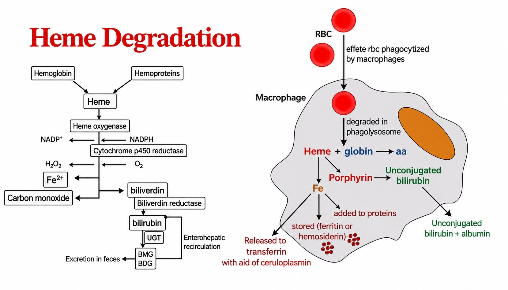

### همولیز داخل عروقی و خارج عروقی

#### برداشت مواد آزادشده پس از همولیز داخل عروقی

گلبول قرمز پیر عمدتاً در طحال تخریب می‌شود، اما درصد کمی از گلبول‌های قرمز ممکن است در جریان خون محیطی لایز شوند. آهن دوظرفیتی آزادشده در خون خطرناک است. بنابراین مولکول‌هایی در خون وجود دارند که آن را می‌گیرند و برای بازیافت به کبد می‌برند.

اگر گلبول‌های قرمز درون عروق لیز شوند، در خون scavengerهایی وجود دارند که مواد آزادشده را می‌گیرند و جابه‌جا می‌کنند:

- هاپتوگلوبین (haptoglobin) پروتئینی است که به بخش گلوبینی هموگلوبین آزادشده متصل می‌شود.
- هِموپکسین (hemopexin) نیز scavenger دیگری است که هِم را می‌گیرد.

> [BOX:DEFINITION]
> **هاپتوگلوبین (haptoglobin)**
> پروتئینی که به بخش گلوبینی هموگلوبین آزادشده متصل می‌شود.

> [BOX:DEFINITION]
> **هِموپکسین (hemopexin)**
> scavenger دیگری که هِم آزادشده را می‌گیرد.

این عوامل، مواد آزادشده را به کبد می‌برند. اگر میزان لایز زیاد شود، هموگلوبین آزاد در خون افزایش پیدا می‌کند و بخشی از آن از کلیه دفع می‌شود. به دفع هموگلوبینِ آزاد در ادرار، هموگلوبینوری (hemoglobinuria) می‌گوییم.

> [BOX:DEFINITION]
> **هموگلوبینوری (hemoglobinuria)**
> دفع هموگلوبینِ آزاد در ادرار.

> [BOX:DEFINITION]
> **هماچوری (hematuria)**
> به دفع گلبول قرمز یا هموگلوبین یا میوگلوبین در ادرار گفته میشود.

سلول‌های کلیه آهن را بی‌دلیل دفع نمی‌کنند، چون آهن برای بدن ضروری است. سلول‌های اپی‌تلیال کلیه هموگلوبین و آهن را جذب می‌کنند. اگر هموگلوبین آزاد در خون زیاد باشد، سلول‌های کلیه بار زیادی از آهن جذب می‌کنند و سنگین شده و ممکن است از غشای پایه جدا شوند و وارد ادرار شوند. بنابراین اگر رسوب ادرار را برای آهن رنگ‌آمیزی کنیم، آهن را می‌توان تشخیص داد؛ به این وضعیت هموسیدرینوری (hemosiderinuria) می‌گوییم.

> [BOX:DEFINITION]
> **هموسیدرینوری (hemosiderinuria)**
> وضعیتی که در آن آهن را می‌توان در رسوب ادرارِ رنگ‌آمیزی‌شده تشخیص داد.

پس از لایز داخل عروقی، هاپتوگلوبین و هِموپکسین به هموگلوبین یا هِم آزاد متصل می‌شوند. اگر ظرفیت آن‌ها کافی نباشد، مقداری از هموگلوبین از راه ادرار دفع می‌شود و مقداری نیز به شکل هموسیدرینوری دیده می‌شود. اگر میزان هموگلوبین آزاد باز هم افزایش یابد، بخشی از آن به آلبومین متصل می‌شود. آهن هموگلوبین آزاد می‌تواند از ⁺Fe² به ⁺Fe³ اکسید شده و هموگلوبین به مت‌هموگلوبین تبدیل شود؛ اتصال آن به آلبومین، مت‌هم‌آلبومین (methemalbumin) می‌سازد. آلبومین یک carrier عمومی در بدن است و methemalbumin را نیز به کبد می‌برد.

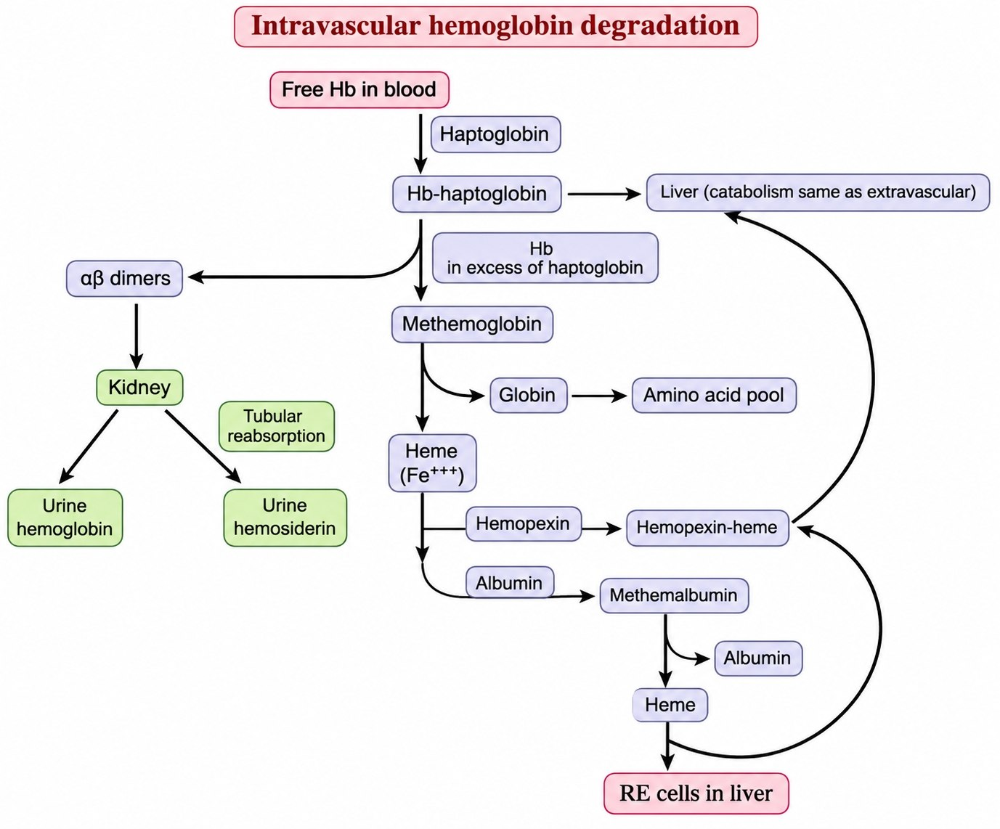

#### یافته‌های آزمایشگاهی در همولیز داخل عروقی (intravascular hemolysis)

در آزمایشگاه و با روش الیزا، فرم **آزاد** هاپتوگلوبین و هِموپکسین را اندازه‌گیری می‌کنیم. در لیز داخل عروقی، این مقادیر کاهش پیدا می‌کنند، چون به هموگلوبین یا هِم آزاد متصل و مصرف شده‌اند. مت‌هم‌آلبومین در خون افزایش پیدا می‌کند.

اگر نمونهٔ پلاسما از فردی که همولیز دارد گرفته شود، هموگلوبین آزادشده می‌تواند رنگ پلاسما را نارنجی کند؛ هرچه پلاسما نارنجی‌تر باشد، هموگلوبین آزاد بیشتری در آن وجود دارد (هموسیدرینوری). گلبول قرمز مثل کیسه‌ای پر از آنزیم LDH است؛ با لیز آن، LDH در خون بالا می‌رود.

در همولیز داخل عروقی، هاپتوگلوبین و هِموپکسین کاهش می‌یابند و مت‌هم‌آلبومین، هموگلوبینوری، هموسیدرینوری و LDH افزایش پیدا می‌کنند. در تخریب خارج عروقی(extravascular) نیز فرآورده‌های بیلی‌روبینی، از جمله بیلی‌روبین غیرمستقیم و مستقیم، افزایش می‌یابند.

هر مولکول هموگلوبینی که تخریب می‌شود، یک مول CO آزاد می‌کند. با دستگاه‌های اندازه‌گیری CO، در بازدم می‌توان مقدار CO را سنجید و از آن به‌عنوان شاخصی از تخریب گلبول‌های قرمز استفاده کرد. این یافته‌ها را می‌توان در آزمایشگاه پایش کرد و بر اساس آن‌ها در تشخیص نوع کم‌خونی کمک گرفت.

#### نمونه‌هایی از همولیز داخل عروقی

بعضی کم‌خونی‌ها باعث لایز داخل عروقی گلبول قرمز می‌شوند، از جمله:

- کمبود G6PD (G6PD deficiency)، که در آن بعضی افراد پس از خوردن یا حتی بوییدن باقلا دچار همولیز می‌شوند.
- تزریق خون ناسازگار، که می‌تواند همولیز سریع و خطرناک ایجاد کند.
- میکروآنژیوپاتیک همولیتیک آنمی (microangiopathic hemolytic anemia)، که در آن گلبول‌های قرمز هنگام عبور از عروق کوچک به لخته‌های ریز برخورد می‌کنند و لایز می‌شوند. این وضعیت در بیماری‌هایی مثل TTP، DIC و HUS دیده می‌شود.
- بدکارکردن دریچهٔ قلب در افرادی که دریچهٔ قلبشان عمل شده است.
- هموگلوبینوری حمله‌ای شبانه (paroxysmal nocturnal hemoglobinuria; PNH)، که در آن گلبول‌های قرمز در عروق لایز می‌شوند.
- ساخت اتوآنتی‌بادی علیه گلبول‌های قرمز خود فرد؛ در این حالت، خودایمنی باعث لایز گلبول قرمز می‌شود.

> [BOX:EXAMPLE]
> نمونه‌های همولیز داخل عروقی شامل کمبود G6PD (G6PD deficiency)، تزریق خون ناسازگار، میکروآنژیوپاتیک همولیتیک آنمی در TTP، DIC و HUS، بدکارکردن دریچهٔ قلبِ عمل‌شده، هموگلوبینوری حمله‌ای شبانه (PNH) و ساخت اتوآنتی‌بادی علیه گلبول‌های قرمز خود فرد است.

#### همولیز خارج عروقی (extravascular hemolysis)

همولیز خارج عروقی یعنی میزان تخریب گلبول‌های قرمز در خارج عروق، عمدتاً در طحال، بسیار افزایش پیدا کند. در این حالت بیلی‌روبین غیرمستقیم بالا می‌رود و یوروبیلی‌نوژن ادرار و استرکوبیلین مدفوع نیز افزایش پیدا می‌کنند.

> [BOX:DEFINITION]
> **همولیز خارج عروقی**
> افزایش تخریب گلبول‌های قرمز در خارج عروق، عمدتاً در طحال.

نمونه‌هایی از این وضعیت عبارت‌اند از هموگلوبینوپاتی‌ها، تالاسمی و کم‌خونی داسی‌شکل (sickle cell anemia). در این بیماری‌ها عمر گلبول قرمز ممکن است به‌جای ۱۲۰ روز، به ۱۰ تا ۱۳ روز برسد و گلبول قرمز کوتاه‌عمر در طحال تخریب شود.(بالا رفتن turnover)

بیماری‌هایی نیز وجود دارند که غشای گلبول قرمز را مختل می‌کنند. گلبول قرمز طبیعی شکل بایکونکیو دارد تا بتواند از عروق باریک ریه عبور کند و اکسیژن بگیرد. اگر غشا و شکل آن تغییر کند، مورفولوژی نیز عوض می‌شود. برای مثال، در اسفروسیتوز (spherocytosis)، گلبول قرمز شکل کروی پیدا می‌کند و ظرفیت طبیعی تغییر شکل را ندارد. وقتی وارد طحال می‌شود، تحت استرس قرار می‌گیرد و این گلبول‌هایی که از قبل غشای آسیب‌دیده دارند، تخریب می‌شوند.

> [BOX:EXAMPLE]
> در اسفروسیتوز (spherocytosis)، گلبول قرمز شکل کروی پیدا می‌کند و ظرفیت طبیعی تغییر شکل را ندارد؛ هنگام ورود به طحال تحت استرس قرار می‌گیرد و گلبول‌هایی که غشای آسیب‌دیده دارند، تخریب می‌شوند.

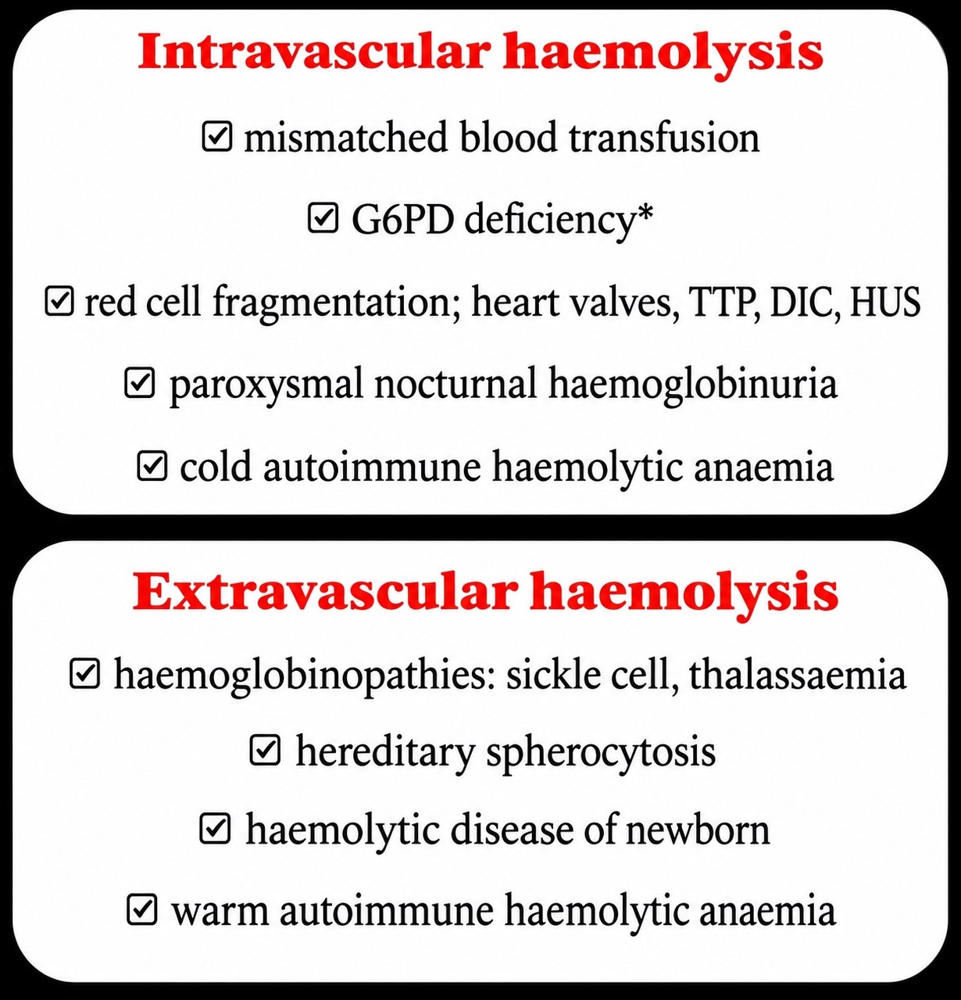

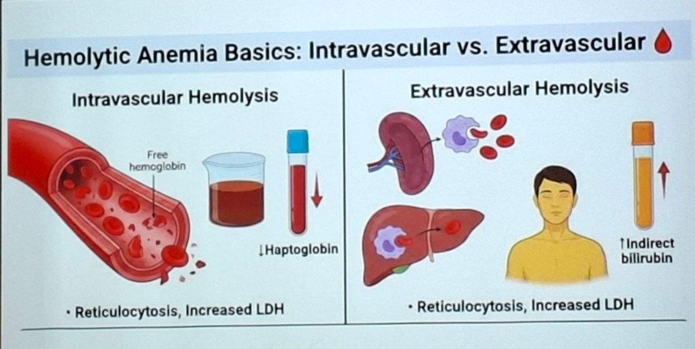

### ارزیابی بیمار مبتلا به کم‌خونی

#### آستانه‌های تشخیصی هموگلوبین

برای تشخیص کم‌خونی، راهنمای WHO سال ۲۰۲۶ را در نظر می‌گیریم:

- در کودکان ۶ تا ۲۳ ماهه، هموگلوبین باید بالاتر از ۱۰٫۵ باشد؛ مقدار کمتر از ۱۰٫۵ کم‌خونی محسوب می‌شود.
- در خانم‌های باردار، هموگلوبین کمتر از ۱۱ کم‌خونی است.
- بزرگسالان: در خانم‌ها، مقدار کمتر از ۱۲ و در آقایان، کمتر از ۱۳ نشان‌دهندهٔ کم‌خونی است.
- در خلاصهٔ جدول: در مردان زیر ۱۳، در خانم‌های غیرباردار زیر ۱۲، در خانم‌های باردار زیر ۱۱ و در کودکان زیر ۱۱ باید به کم‌خونی توجه کرد.

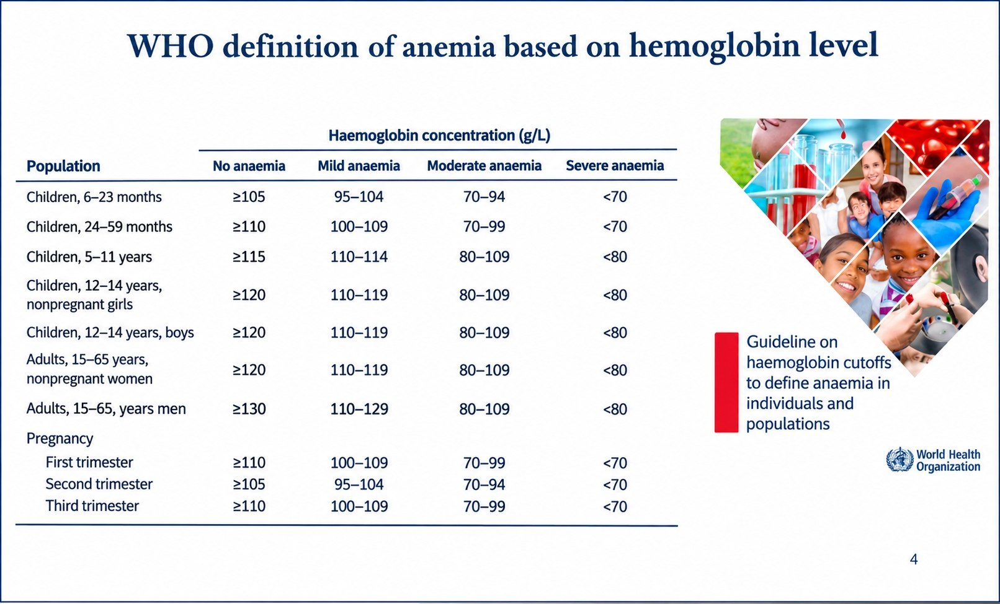

سازمان بهداشت جهانی(WHO) می‌گوید حدود ۱٫۶ میلیارد نفر در دنیا کم‌خونی دارند. آمار ایران نشان می‌دهد حدود ۲۰ تا ۳۰ درصد خانم‌ها کم‌خونی دارند.

#### شرح‌حال و ملاحظات روزانه

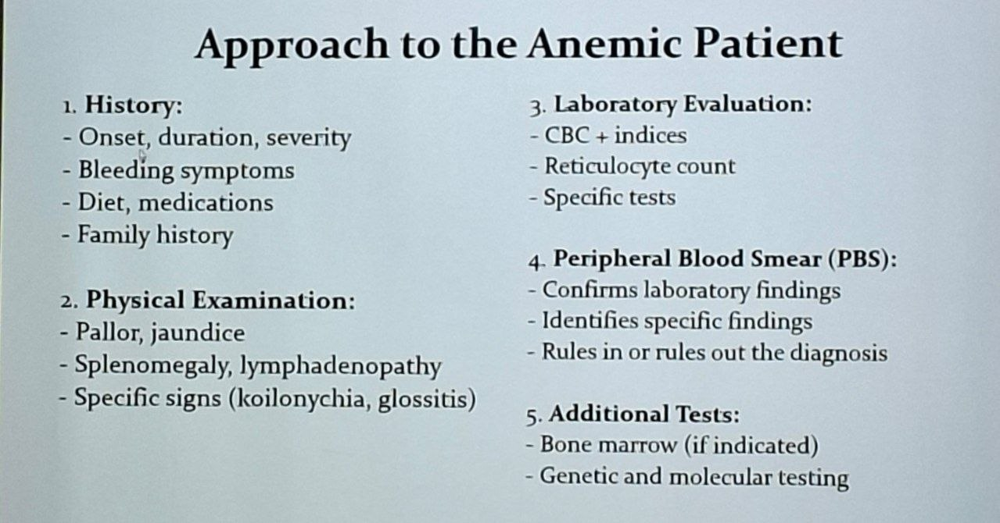

در رویکرد به کم‌خونی، پزشک ابتدا شرح‌حال می‌گیرد و موارد زیر را بررسی می‌کند:

- مشکل ناگهانی بوده یا دوره‌ای؟
- از چه زمانی شروع شده است؟
- علائم خون‌ریزی، به‌ویژه خون‌ریزی از دستگاه گوارش، وجود دارد؟
- رژیم غذایی بیمار چگونه است؟
- الگوی خواب و بیداری بیمار چگونه است؟

بیدارماندن در شب و خوابیدن در روز تعادل داخلی بدن را به هم می‌زند. ساعت‌های بیولوژیک بدن را نمی‌توان با رفتار جابه‌جا کرد؛ باید رفتار را با آن‌ها هماهنگ کرد. در خواب عمیق، پس از دو ساعت ترشح هورمون رشد شروع می‌شود. هورمون رشد فقط برای رشد قد نیست و برای متابولیسم پایه نیز لازم است.

پارامترهای هماتولوژی تغییرات روزانه دارند؛ میزان آهن خون معمولاً اول صبح بیشترین مقدار را دارد (زیرا turnover بیشتر و اریتروپوئزیس قوی‌تری درحال انجام است).

#### معاینهٔ بالینی

پزشک رنگ‌پریدگی بیمار را بررسی می‌کند؛ منظور رنگ‌پریدگی واقعی است، نه رنگ‌پریدگی ناشی از ترس. زردی (jaundice؛ ایکتر یا یرقان) نیز بررسی می‌شود. ملتحمه را نگاه می‌کنند؛ رنگ ملتحمه می‌تواند در ارزیابی وضعیت هموگلوبین کمک‌کننده باشد. در این ارزیابی، اگر ملتحمه قرمز باشد، هموگلوبین بالاتر از ۹ در نظر گرفته می‌شود.

در نوزادان تشخیص ایکتر، به‌خصوص از ظاهر پوست، دشوارتر است؛ برای تشخیص زردی، پوست شکم یا ران را بررسی می‌کنند.

##### اسپلینومگالی

وجود اسپلینومگالی (splenomegaly) نیز بررسی می‌شود. طحال پشت معده و زیر دیافراگم است و به‌طور طبیعی با لمس حس نمی‌شود. اگر با لمس قابل تشخیص باشد، می‌گوییم طحال قابل لمس (palpable) است و اندازه‌اش افزایش یافته است. اگر طحال تا خط میانی آناتومیک برسد، بزرگی آن را با عنوان اسپلینومگالی توصیف می‌کنیم و اگر از خط میانی عبور کند، به آن Huge splenomegaly می‌گوییم. این تعاریف در طبقه‌بندی بیماری‌ها کمک می‌کنند.

##### یافته‌های دیگر

یافته‌های خون محیطی و علائم بالینی نیز اهمیت دارند، از جمله:

- ناخن قاشقی‌شکل، یا کویلونیشیا (koilonychia)
- پیکا (pica)، یا میل به خوردن مواد عجیب‌وغریب
- گلوسیت آتروفیک (atrophic glossitis): زبان قرمز و متورم با پرزهای از بین رفته و صاف
- ایکتر
- اسپلینومگالی
- اختلالات عصبی
- تب و کاهش وزن، که همراه کم‌خونی ممکن است به عفونت یا بدخیمی مربوط باشند
- لنفادنوپاتی، یعنی بزرگ‌شدن غدد لنفاوی، که ممکن است کم‌خونی ناشی از لوکمی یا لنفوم را مطرح کند
- پتشی، یعنی خون‌ریزی پوستی نقطه‌ای، و اکیموزیس، یعنی خون‌ریزی‌های وسیع‌تر؛ اگر این یافته‌ها همراه کم‌خونی باشند، باید احتمال کم‌خونی آپلاستیک یا لوسمی را در نظر گرفت.

زبان، کف دست و دیگر یافته‌های ظاهری نیز در معاینهٔ فیزیکی بررسی می‌شوند.

> [BOX:DEFINITION]
> **پیکا (pica)**
> میل به خوردن مواد عجیب‌وغریب.

> [BOX:DEFINITION]
> **لنفادنوپاتی**
> بزرگ‌شدن غدد لنفاوی.

> [BOX:DEFINITION]
> **پتشی**
> خون‌ریزی پوستی نقطه‌ای.

> [BOX:DEFINITION]
> **اکیموزیس**
> خون‌ریزی‌های وسیع‌تر.

> [BOX:EXAMPLE]
> تب و کاهش وزن همراه کم‌خونی ممکن است به عفونت یا بدخیمی مربوط باشند؛ لنفادنوپاتی ممکن است کم‌خونی ناشی از لوکمی یا لنفوم را مطرح کند؛ پتشی و اکیموزیس همراه کم‌خونی احتمال کم‌خونی آپلاستیک یا لوسمی را مطرح می‌کنند.

#### علائم عمومی کم‌خونی

بیمار معمولاً خسته و ضعیف است و با فعالیت کم احساس می‌کند دیگر توان ندارد. با فعالیت فیزیکی مختصر دچار نفس‌نفس‌زدن می‌شود؛ تنفسش کوتاه و سطحی است، نه عمیق.

ممکن است بیمار تپش قلب (palpitation) داشته باشد. بیمار معمولاً ضربان قلبش را حس نمی‌کند، اما اگر صدای ضربان قلب را احساس کند، به آن پالپیتیشن می‌گوییم. در کم‌خونی، قلب تلاش می‌کند خون را پمپ کند، اما خون کافی برای پمپاژ در اختیار ندارد.

> [BOX:DEFINITION]
> **تپش قلب (palpitation)**
> احساس‌کردن ضربان قلب؛ در توصیف درس، بیمار ممکن است صدای ضربان قلب را احساس کند.

### بررسی‌های آزمایشگاهی و طبقه‌بندی کم‌خونی

#### CBC و MCV

در آزمایش‌ها، CBC کمک می‌کند کم‌خونی را دقیق‌تر طبقه‌بندی کنیم. یکی از شاخص‌های مهم MCV است. MCV طبیعی حدود ۸۰ تا ۹۴ فمتولیتر است:

- اگر MCV بالاتر از ۹۴ باشد، گلبول‌های قرمز بزرگ و ماکروسیتیک (macrocytic) شده‌اند.
- اگر MCV از ۱۱۰ بیشتر باشد، به مگالوبلاستیک (megaloblastic) فکر می‌کنیم.
- اگر MCV زیر ۸۰ باشد، گلبول‌ها کوچک و میکروسیتیک (microcytic) هستند.

برخی بیماران ماکروسیتیک هستند، اما کم‌خونی مگالوبلاستیک ندارند؛ از جمله بیماران مبتلا به الکلیسم، بیماری کبدی (liver disease)، هیپوتیروئیدی، بارداری و سندرم میلودیسپلاستیک (myelodysplastic syndrome; MDS).

در کم‌خونی میکروسیتیک(پایین بودن MCV) به موارد زیر فکر می‌کنیم: کمبود آهن، تالاسمی، اختلالات مربوط به غشا، کم‌خونی سیدروبلاستیک (sideroblastic anemia) و مسمومیت با سرب. یافته‌های دیگر در کنار MCV تشخیص را اختصاصی‌تر می‌کنند.

#### رتیکولوسیت، RI و RPI

رتیکولوسیت درصدی از سلول‌های خون است و این درصد نشان می‌دهد چه مقدار رتیکولوسیت در خون وجود دارد. برای این‌که بدانیم چه میزان از آن را مغز استخوان تولید کرده است با توجه به هماتوکریت بیمار، رتیکولوسیت ایندکس (reticulocyte index; RI) را محاسبه می‌کنیم.

رتیکولوسیت ایندکس به‌تنهایی نشان نمی‌دهد که مغز استخوان با همان سرعت رتیکولوسیت تولید می‌کند یا نه؛ به همین دلیل شاخص تولید رتیکولوسیت (reticulocyte production index; RPI) را نیز به دست می‌آوریم. هرچه بیمار کم‌خون‌تر باشد، زمان بلوغ رتیکولوسیت کمتر می‌شود و این را باید در فرمول وارد کرد.

RPI به افتراق نوع کم‌خونی کمک می‌کند:

- اگر RPI بیشتر از ۲ باشد و بیمار کم‌خون باشد، مغز استخوان به‌شدت فعال است و در حال تولید سلول است. چون بیمار همچنان کم‌خون است، باید به این فکر کنیم که گلبول‌های قرمز در جایی تخریب می‌شوند؛ برای مثال، در کم‌خونی‌های همولیتیک.
- اگر RPI کمتر از ۲ و بیمار کم‌خون باشد، مغز استخوان به‌اندازهٔ کافی کار نمی‌کند؛ برای مثال، ممکن است کمبود آهن یا کم‌خونی آپلاستیک وجود داشته باشد.

> [BOX:DEFINITION]
> **شاخص تولید رتیکولوسیت (reticulocyte production index; RPI)**
> شاخصی که با درنظرگرفتن وضعیت کم‌خونی و زمان بلوغ رتیکولوسیت، برای کمک به افتراق نوع کم‌خونی به‌دست می‌آید. شاخص تولید رتیکولوسیت، معیاری برای ارزیابی میزان واقعی پاسخ مغز استخوان به کم‌خونی است.

#### RDW و ارتباط آن با MCV

RDW را نیز در کنار MCV بررسی می‌کنیم. RDW-CV بیشتر در آزمایش‌ها گزارش می‌شود، اما RDW-SD قابل‌اعتمادتر است. RDW-CV از روی نمودار محاسبه می‌شود:

**RDW-CV = (SD ÷ MCV) × ۱۰۰**

بنابراین RDW-CV تحت‌تأثیر MCV قرار می‌گیرد؛ اگر MCV کم شود، RDW-CV ممکن است به‌طور خودکار زیاد شود و این می‌تواند خطا ایجاد کند.

ترکیب MCV و RDW می‌تواند جهت‌دهنده باشد:

- MCV پایین و RDW طبیعی: به بیماری‌هایی مثل تالاسمی مینور فکر می‌کنیم.
- MCV و RDW هر دو طبیعی: بیماری مزمن را در نظر می‌گیریم.
- MCV بالا و RDW طبیعی: ممکن است کم‌خونی آپلاستیک مطرح شود.
- MCV و RDW هر دو بالا: به کمبود B9 ، B12 یا فولات فکر می‌کنیم.

### اصطلاحات مربوط به رده‌های خونی و شکل سلول

اگر یک ردهٔ سلولی خون کاهش پیدا کند، به آن یونی‌سایتوپنی (unicytopenia) می‌گوییم؛ اگر دو رده کاهش پیدا کنند، بای‌سایتوپنی (bicytopenia) است؛ و اگر همهٔ رده‌های خونی، یعنی اریتروئیدی، میلوئیدی و پلاکتی، کاهش پیدا کنند، پان‌سایتوپنی (pancytopenia) داریم.

> [BOX:DEFINITION]
> **یونی‌سایتوپنی (unicytopenia)**
> کاهش یک ردهٔ سلولی خون.

> [BOX:DEFINITION]
> **بای‌سایتوپنی (bicytopenia)**
> کاهش دو ردهٔ سلولی خون.

> [BOX:DEFINITION]
> **پان‌سایتوپنی (pancytopenia)**
> کاهش همهٔ رده‌های خونی، یعنی اریتروئیدی، میلوئیدی و پلاکتی.

دیسپلازی (dysplasia) یعنی بدشکلی یا بدقوارگی سلول. دیسپوکیلوسایتوز (dispoikilocytosis) به تغییرات مختلف شکل سلول‌ها گفته می‌شود. در هماتولوژی و گزارش‌های پاتولوژی و سایتولوژی با اصطلاح دیسپلازی روبه‌رو می‌شوید. دیسپلازی الزاماً بدخیمی نیست؛ این اصطلاح به بدشکل‌شدن اشاره دارد. برای مثال، در سندرم میلودیسپلاستیک(MDS)، سلول‌های خونی بدشکل می‌شوند.

> [BOX:DEFINITION]
> **دیسپلازی (dysplasia)**
> بدشکلی یا بدقوارگی سلول؛ این اصطلاح به بدشکل‌شدن اشاره دارد و الزاماً به معنی بدخیمی نیست.

> [BOX:DEFINITION]
> **دیسپوکیلوسایتوز (dispoikilocytosis)**
> تغییرات شکل مختلف سلول‌ها.

> [BOX:EXAMPLE]
> در سندرم میلودیسپلاستیک، سلول‌های خونی بدشکل می‌شوند.

### کم‌خونی آپلاستیک

در کم‌خونی آپلاستیک (aplastic anemia)، هر سه ردهٔ اریتروئیدی، میلوئیدی و مگاکاریوسیتی کاهش می‌یابند؛ بنابراین بیمار پان‌سایتوپنی دارد. هموگلوبین و هماتوکریت پایین‌اند، شمارش RBC پایین است، پلاکت پایین است و گرانولوسیت‌ها نیز کاهش می‌یابند. کاهش پلاکت که وظیفه جلوگیری از خون‌ریزی را دارد، باعث تمایل به خون‌ریزی می‌شود و کاهش گرانولوسیت‌ها تمایل به عفونت را بالا می‌برد.

> [BOX:DEFINITION]
> **کم‌خونی آپلاستیک (aplastic anemia)**
> کاهشی که در آن هر سه ردهٔ اریتروئیدی، میلوئیدی و مگاکاریوسیتی درگیر می‌شوند و بیمار پان‌سایتوپنی دارد.

#### بررسی مغز استخوان

برای افتراق کم‌خونی آپلاستیک از بدخیمی‌های خونی، از مغز استخوان نمونه می‌گیریم. هنگام نمونه‌گیری از مغز استخوان(Bone marrow examination) دو نمونه می‌گیریم: بیوپسی (biopsy) و آسپیراسیون (aspiration).

- بیوپسی یعنی نمونه‌برداری از فرد زنده.
- نمونه‌برداری پس از مرگ، اتوپسی (autopsy) است.
- اگر مایع یا سوسپانسیون سلولی با کشیدن نمونه گرفته شود، آسپیراسیون نام دارد.

در نمونه‌گیری مغز استخوان، هم بیوپسی و هم آسپیراسیون انجام می‌شود.

> [BOX:DEFINITION]
> **بیوپسی (biopsy)**
> نمونه‌برداری از فرد زنده.

> [BOX:DEFINITION]
> **اتوپسی (autopsy)**
> نمونه‌برداری پس از مرگ.

> [BOX:DEFINITION]
> **آسپیراسیون (aspiration)**
> گرفتن مایع یا سلول با کشیدن نمونه.

در این بیماران ممکن است آسپیراسیون خشک (dry tap) باشد؛ یعنی هرچه می‌کشیم، چیزی به داخل سرنگ نمی‌آید، چون سلول کافی وجود ندارد. به این وضعیت می‌گوییم مغز استخوان خشک است. در نمونهٔ بیوپسی این بیماران، وقتی سلول‌های خونساز کاهش یافته‌اند، سلول‌های استرومایی جای آن‌ها را می‌گیرند و به‌ویژه سلول‌های چربی افزایش می‌یابند؛ بنابراین، در نمونهٔ بیوپسی سلول‌های چربی جایگزین سلول‌های خونساز شده‌اند.

> [BOX:DEFINITION]
> **آسپیراسیون خشک (dry tap)**
> وضعیتی که در آن با کشیدن نمونه، چیزی به داخل سرنگ نمی‌آید؛ در این درس، علت بیان‌شده کافی‌نبودن سلول‌هاست.

کم‌خونی آپلاستیک به دو دستهٔ اکتسابی(acquired) و مادرزادی تقسیم می‌شود و نوع مادرزادی آن می‌تواند کم‌خونی فانکونی (Fanconi anemia) باشد.
نکته: کم‌خونی فانکونی با سندروم فانکونی متفاوت است.

> [BOX:EXAMPLE]
> کم‌خونی فانکونی (Fanconi anemia) از انواع مادرزادی کم‌خونی آپلاستیک است.

## ۳. جداول مرور سریع

### ساخته‌شدن هموگلوبین و بلوغ گلبول قرمز

| مرحله یا جزء | محل یا فرایند توصیف‌شده |
|---|---|
| آغاز ساخت هِم | در میتوکندری، با سوکسینیل‌کوآ (succinyl-CoA) و گلیسین |
| ادامهٔ ساخت هِم | در سیتوپلاسم |
| مراحل انتهایی ساخت هِم | دوباره در میتوکندری |
| جای‌گیری آهن | فروکلاتاز (ferrochelatase) آهن را در وسط پروتوپورفیرین قرار می‌دهد |
| اتصال هِم به گلوبین | پس از ساخته‌شدن هِم و رفتن آن به سیتوپلاسم |
| تشکیل هموگلوبین | دو زنجیرهٔ گلوبینی دایمر و دو دایمر تترامر می‌سازند |

| مرحله | رویداد یا زمان |
|---|---|
| مرحلهٔ ارتوکروماتیک | گلبول قرمز هسته‌اش را بیرون می‌اندازد، چون دیگر به رونویسی از ژن‌ها نیاز ندارد |
| رتیکولوسیت | حدود ۴۸ تا ۷۲ ساعت در مغز استخوان می‌ماند |
| ورود به جریان خون | رتیکولوسیت وارد جریان خون می‌شود و به گلبول قرمز بالغ تبدیل می‌شود |

### انتقال گازها و کلر شیفت

| محل | فشار اکسیژن و جابه‌جایی گازها |
|---|---|
| ریه | فشار اکسیژن بالاست؛ اکسیژن وارد خون می‌شود و به آهن دوظرفیتی هموگلوبین متصل می‌شود |
| شریان ریوی | خون اکسیژن کمی دارد و از قلب به ریه می‌آید |
| کنار بافت‌ها و اندام‌ها | فشار اکسیژن پایین است؛ اکسیژن از هموگلوبین جدا و به بافت تحویل داده می‌شود؛ سلول‌ها CO₂ را به گلبول قرمز می‌دهند |

| محل | جابه‌جایی بی‌کربنات و کلر | رویدادهای مرتبط با CO₂ |
|---|---|---|
| کنار بافت‌ها | HCO₃⁻ از گلبول قرمز خارج می‌شود و کلر وارد آن می‌شود | CO₂ وارد گلبول قرمز می‌شود؛ بخشی به هموگلوبین متصل می‌ماند و بخش عمده با آب ترکیب و به H₂CO₃ تبدیل می‌شود |
| ریه | HCO₃⁻ دوباره وارد گلبول قرمز می‌شود و کلر از آن خارج می‌شود | H⁺ با HCO₃⁻ ترکیب می‌شود و H₂CO₃ می‌سازد؛ H₂CO₃ به آب و CO₂ تجزیه می‌شود |

### منحنی تفکیک اکسیژن ـ هموگلوبین و ۲،۳-DPG

| جهت جابه‌جایی منحنی | عوامل یا پیامدهای بیان‌شده |
| --- | --- |
| به راست | افزایش ⁺H و کاهش pH، افزایش CO₂، افزایش دمای بدن، افزایش ۲،۳-DPG؛ کاهش تمایل هموگلوبین به اکسیژن و تحویل راحت‌تر و سریع‌تر اکسیژن به بافت‌ها |
| به چپ | افزایش تمایل هموگلوبین به اکسیژن؛ هموگلوبین اکسیژن را به بافت می‌آورد، اما به‌راحتی آن را تحویل نمی‌دهد |

| شرایط بیان‌شده | تغییرات همراه | جهت شیفت منحنی |
|---|---|---|
| ورزش و فعالیت بدنی | افزایش دمای داخلی بدن، فعالیت اندام‌ها، تولید ۲،۳-DPG و CO₂ و کاهش pH | راست |
| آلکالوز و فعالیت متابولیک پایین | کاهش H⁺، CO₂ و ۲،۳-DPG و پایین‌بودن فعالیت متابولیک | چپ |

| ویژگی | هموگلوبین | میوگلوبین (myoglobin) |
|---|---|---|
| تعداد زنجیره‌ها | چهار زنجیره | یک زنجیره |
| محل یا نقش بیان‌شده | اکسیژن را به بافت‌ها می‌رساند | در بافت ماهیچه‌ای قرار دارد و اکسیژن را برای ماهیچه ذخیره می‌کند |
| اشباع‌شدن با اکسیژن | به همکاری چهار زنجیره نیاز دارد | به همکاری چهار زنجیره نیاز ندارد |
| شکل نمودار | سیگموئید (sigmoid) | هایپربولیک (hyperbolic) |

| تغییر P50 | فشار اکسیژن لازم برای اشباع‌شدن هموگلوبین |
|---|---|
| کاهش P50 | پایین‌تر است |
| افزایش P50 | بالاتر است |

### عمر، اریتروپوئز و بازیافت هموگلوبین

| ویژگی | مقدار یا محل |
|---|---|
| عمر گلبول قرمز | حدود ۱۲۰ روز |
| لیز گلبول قرمز | حدود ۵۰ هزار گلبول در هر ثانیه |
| turnover هموگلوبین | حدود ۶ گرم در روز |
| محل اصلی تخریب گلبول‌های قرمز پیر | طحال |
| محل دیگر تخریب | کبد، به مقدار کم |

| نوع اریتروپوئز | سرنوشت گلبول قرمز |
|---|---|
| مؤثر | در مغز استخوان تولید می‌شود و به خون محیطی می‌رسد |
| غیرمؤثر | گلبول نابسامان در مغز استخوان تخریب می‌شود و به خون محیطی نمی‌رسد |

| مرحله | تبدیل یا جابه‌جایی |
|---|---|
| جداسازی اجزای هموگلوبین | هِم اکسیژناز، هِم را از گلوبین جدا می‌کند |
| گلوبین | به اسیدهای آمینه تجزیه می‌شود و برای ساخت پروتئین‌های دیگر به‌کار می‌رود |
| هِم | به بیلی‌وردین و سپس با مصرف NADPH به بیلی‌روبین تبدیل می‌شود |
| انتقال بیلی‌روبین نامحلول در آب | آلبومین آن را به کبد می‌برد |
| کبد | با اتصال گلوکورونید به‌وسیلهٔ UDP-glucuronyl transferase، بیلی‌روبین مستقیم ساخته می‌شود |
| صفرا و دستگاه گوارش | بیلی‌روبین مستقیم وارد صفرا می‌شود؛ باکتری‌های دستگاه گوارش آن را به یوروبیلی‌نوژن یا مزوبیلی‌نوژن تبدیل می‌کنند |
| دفع | بخشی از مواد جذب و از کلیه دفع می‌شود؛ بخشی از راه مدفوع به‌صورت استرکوبیلین دفع می‌شود |

### همولیز

| ماده یا یافته | شرح بیان‌شده |
|---|---|
| هاپتوگلوبین | به بخش گلوبینی هموگلوبین آزادشده متصل می‌شود |
| هِموپکسین | هِم آزادشده را می‌گیرد |
| هموگلوبینوری | دفع هموگلوبین در ادرار |
| هماچوری | وجود گلبول قرمز در ادرار |
| هموسیدرینوری | تشخیص آهن در رسوب ادرارِ رنگ‌آمیزی‌شده |
| مت‌هم‌آلبومین (methemalbumin) | با اتصال مت‌هموگلوبین به آلبومین ساخته می‌شود |

| نوع تخریب یا یافته | تغییرات بیان‌شده |
|---|---|
| همولیز داخل عروقی | هاپتوگلوبین و هِموپکسین کاهش می‌یابند |
| همولیز داخل عروقی | مت‌هم‌آلبومین، هموگلوبینوری، هموسیدرینوری و LDH افزایش پیدا می‌کنند |
| همولیز داخل عروقی | هموگلوبین آزاد می‌تواند پلاسما را نارنجی کند؛ نارنجی‌ترشدن با هموگلوبین آزاد بیشتر همراه است |
| تخریب خارج عروقی | فرآورده‌های بیلی‌روبینی، از جمله بیلی‌روبین غیرمستقیم و مستقیم، افزایش می‌یابند |
| تخریب گلبول قرمز | هر مولکول هموگلوبین تخریب‌شده یک مول CO آزاد می‌کند؛ CO بازدم می‌تواند شاخصی از تخریب گلبول‌های قرمز باشد |

| نوع یا نمونه | محل یا یافتهٔ بیان‌شده |
|---|---|
| همولیز خارج عروقی | تخریب گلبول قرمز خارج عروق، عمدتاً در طحال |
| همولیز خارج عروقی | افزایش بیلی‌روبین غیرمستقیم، یوروبیلی‌نوژن ادرار و استرکوبیلین مدفوع |
| هموگلوبینوپاتی‌ها، تالاسمی و کم‌خونی داسی‌شکل | عمر گلبول قرمز ممکن است به ۱۰ تا ۱۳ روز برسد و گلبول کوتاه‌عمر در طحال تخریب شود |
| اسفروسیتوز | گلبول قرمز کروی و دارای ظرفیت تغییر شکل کمتر است و در طحال تحت استرس قرار می‌گیرد |

### آستانه‌های هموگلوبین و شاخص‌های آزمایشگاهی

| گروه | آستانهٔ بیان‌شده برای کم‌خونی |
|---|---|
| کودکان ۶ تا ۲۳ ماهه | هموگلوبین کمتر از ۱۰٫۵ |
| خانم‌های باردار | هموگلوبین کمتر از ۱۱ |
| خانم‌ها | هموگلوبین کمتر از ۱۲ |
| آقایان | هموگلوبین کمتر از ۱۳ |
| خلاصهٔ جدول کودکان | زیر ۱۱؛ با آستانهٔ ۱۰٫۵ ذکرشده برای کودکان ۶ تا ۲۳ ماهه تفاوت دارد و در review آمده است |

| MCV یا گروه | توصیف یا موارد همراه |
|---|---|
| حدود ۸۰ تا ۹۴ فمتولیتر | محدودهٔ طبیعی ذکرشده |
| بالاتر از ۹۴ | گلبول‌های قرمز بزرگ و ماکروسیتیک |
| بیشتر از ۱۱۰ | به مگالوبلاستیک فکر می‌کنیم |
| زیر ۸۰ | گلبول‌های قرمز کوچک و میکروسیتیک |
| ماکروسیتیک، بدون کم‌خونی مگالوبلاستیک | الکلیسم، بیماری کبدی، هیپوتیروئیدی، بارداری و MDS |
| کم‌خونی میکروسیتیک | کمبود آهن، تالاسمی، اختلالات مربوط به غشا، کم‌خونی سیدروبلاستیک و مسمومیت با سرب |

| RPI در بیمار کم‌خون | تفسیر بیان‌شده | نمونهٔ مطرح‌شده |
|---|---|---|
| بیشتر از ۲ | مغز استخوان به‌شدت فعال است؛ چون بیمار همچنان کم‌خون است، تخریب گلبول قرمز مطرح می‌شود | کم‌خونی‌های همولیتیک |
| کمتر از ۲ | مغز استخوان به‌اندازهٔ کافی کار نمی‌کند | کمبود آهن یا کم‌خونی آپلاستیک |

| MCV | RDW | مورد یا تفسیر مطرح‌شده |
|---|---|---|
| پایین | طبیعی | بیماری‌هایی مثل تالاسمی مینور |
| طبیعی | طبیعی | بیماری مزمن |
| بالا | طبیعی | ممکن است کم‌خونی آپلاستیک مطرح شود |
| بالا | بالا | کمبود B12 یا فولات |

### اصطلاحات رده‌های خونی و کم‌خونی آپلاستیک

| اصطلاح | تعداد رده‌های کاهش‌یافته یا معنی |
|---|---|
| یونی‌سایتوپنی | یک ردهٔ سلولی خون کاهش یافته است |
| بای‌سایتوپنی | دو رده کاهش یافته‌اند |
| پان‌سایتوپنی | همهٔ رده‌های اریتروئیدی، میلوئیدی و پلاکتی کاهش یافته‌اند |
| دیسپلازی | بدشکلی یا بدقوارگی سلول؛ الزاماً بدخیمی نیست |
| دیسپوکیلوسایتوز | تغییرات شکل مختلف سلول‌ها |

| رده یا یافته | وضعیت در کم‌خونی آپلاستیک |
|---|---|
| ردهٔ اریتروئیدی، میلوئیدی و مگاکاریوسیتی | هر سه کاهش می‌یابند |
| هموگلوبین و هماتوکریت | پایین |
| شمارش RBC | پایین |
| پلاکت | پایین؛ کاهش آن باعث تمایل به خون‌ریزی می‌شود |
| گرانولوسیت‌ها | کاهش می‌یابند؛ کاهش آن‌ها تمایل به عفونت را بالا می‌برد |
| نوع بیماری | اکتسابی یا مادرزادی |
| نمونهٔ نوع مادرزادی | کم‌خونی فانکونی |

| روش یا یافته | شرح |
|---|---|
| بیوپسی | نمونه‌برداری از فرد زنده |
| آسپیراسیون | گرفتن مایع یا سلول با کشیدن نمونه |
| اتوپسی | نمونه‌برداری پس از مرگ |
| آسپیراسیون خشک (dry tap) | چیزی با کشیدن نمونه وارد سرنگ نمی‌شود |
| بیوپسی مغز استخوان در کم‌خونی آپلاستیک | سلول‌های خونساز کاهش می‌یابند؛ سلول‌های استرومایی و به‌ویژه سلول‌های چربی جای آن‌ها را می‌گیرند |

## ۴. اصطلاحات و تعاریف

> [BOX:DEFINITION]
> **هموگلوبین (hemoglobin)**
> مولکولی متشکل از چهار زنجیره است که هر زنجیره ساختار خودش را دارد و هر مولکول آن چهار اتم آهن دوظرفیتی (Fe²⁺) دارد.

> [BOX:DEFINITION]
> **هِم**
> ساختار چهارحلقه‌ای که آهن در وسط آن قرار می‌گیرد و جایگاه‌هایی برای اتصال به گلوبین و اکسیژن دارد.

> [BOX:DEFINITION]
> **اکسی‌هموگلوبین (oxyhemoglobin)**
> ترکیبی که از اتصال اکسیژن به آهن دوظرفیتی هموگلوبین حاصل می‌شود و به‌وسیلهٔ گلبول قرمز جابه‌جا می‌شود.

> [BOX:DEFINITION]
> **کلر شیفت (chloride shift)**
> برای حفظ تعادل یونی، با خروج بی‌کربنات از گلبول قرمز، کلر وارد آن می‌شود.

> [BOX:DEFINITION]
> **اتصال تعاونی اکسیژن به هموگلوبین**
> پس از اتصال اکسیژن به زنجیرهٔ اول و تغییر موقعیت فضایی، زنجیره‌های بعدی با سرعت بیشتری اکسیژن می‌گیرند.

> [BOX:DEFINITION]
> **منحنی تفکیک اکسیژن ـ هموگلوبین (oxygen dissociation curve)**
> نمودار واکنش اشباع‌شدن هموگلوبین با اکسیژن در فشارهای مختلف اکسیژن است.

> [BOX:DEFINITION]
> **۲،۳-DPG**
> یکی از عوامل تسهیل‌کنندهٔ تحویل اکسیژن به بافت‌هاست؛ به زنجیرهٔ بتا متصل می‌شود و آرایش زنجیره‌ها را تغییر می‌دهد تا اکسیژن راحت‌تر از آهن جدا شود.

> [BOX:DEFINITION]
> **P50**
> فشاری از اکسیژن است که هموگلوبین را ۵۰ درصد اشباع می‌کند؛ مقدار طبیعی آن حدود ۲۶ تا ۲۷ است.

> [BOX:DEFINITION]
> **اریتروپوئز مؤثر (effective erythropoiesis)**
> تولید گلبول قرمز در مغز استخوان که به رسیدن آن به خون محیطی منجر می‌شود.

> [BOX:DEFINITION]
> **اریتروپوئز غیرمؤثر (ineffective erythropoiesis)**
> حالتی که در آن بعضی گلبول‌های قرمز نابسامان در مغز استخوان تخریب می‌شوند و به جریان خون محیطی نمی‌رسند.

> [BOX:DEFINITION]
> **هِم اکسیژناز (heme oxygenase)**
> آنزیمی که هِم را از گلوبین جدا می‌کند.

> [BOX:DEFINITION]
> **هاپتوگلوبین (haptoglobin)**
> پروتئینی که به بخش گلوبینی هموگلوبین آزادشده متصل می‌شود.

> [BOX:DEFINITION]
> **هِموپکسین (hemopexin)**
> scavenger دیگری که هِم آزادشده را می‌گیرد.

> [BOX:DEFINITION]
> **هموگلوبینوری (hemoglobinuria)**
> دفع هموگلوبین در ادرار.

> [BOX:DEFINITION]
> **هماچوری (hematuria)**
> وجود گلبول قرمز در ادرار.

> [BOX:DEFINITION]
> **هموسیدرینوری (hemosiderinuria)**
> وضعیتی که در آن آهن را می‌توان در رسوب ادرارِ رنگ‌آمیزی‌شده تشخیص داد.

> [BOX:DEFINITION]
> **همولیز خارج عروقی**
> افزایش تخریب گلبول‌های قرمز در خارج عروق، عمدتاً در طحال.

> [BOX:DEFINITION]
> **اسپلینومگالی (splenomegaly)**
> بزرگی طحال که در این توصیف زمانی به این عنوان خوانده می‌شود که طحال تا خط میانی آناتومیک برسد؛ اگر از خط میانی عبور کند، massive splenomegaly نامیده می‌شود.

> [BOX:DEFINITION]
> **پیکا (pica)**
> میل به خوردن مواد عجیب‌وغریب.

> [BOX:DEFINITION]
> **لنفادنوپاتی**
> بزرگ‌شدن غدد لنفاوی.

> [BOX:DEFINITION]
> **پتشی**
> خون‌ریزی پوستی نقطه‌ای.

> [BOX:DEFINITION]
> **اکیموزیس**
> خون‌ریزی‌های وسیع‌تر.

> [BOX:DEFINITION]
> **تپش قلب (palpitation)**
> احساس‌کردن ضربان قلب؛ در توصیف درس، بیمار ممکن است صدای ضربان قلب را احساس کند.

> [BOX:DEFINITION]
> **شاخص تولید رتیکولوسیت (reticulocyte production index; RPI)**
> شاخصی که با درنظرگرفتن وضعیت کم‌خونی و زمان بلوغ رتیکولوسیت، برای کمک به افتراق نوع کم‌خونی به‌دست می‌آید.

> [BOX:DEFINITION]
> **یونی‌سایتوپنی (unicytopenia)**
> کاهش یک ردهٔ سلولی خون.

> [BOX:DEFINITION]
> **بای‌سایتوپنی (bicytopenia)**
> کاهش دو ردهٔ سلولی خون.

> [BOX:DEFINITION]
> **پان‌سایتوپنی (pancytopenia)**
> کاهش همهٔ رده‌های خونی، یعنی اریتروئیدی، میلوئیدی و پلاکتی.

> [BOX:DEFINITION]
> **دیسپلازی (dysplasia)**
> بدشکلی یا بدقوارگی سلول؛ این اصطلاح به بدشکل‌شدن اشاره دارد و الزاماً به معنی بدخیمی نیست.

> [BOX:DEFINITION]
> **دیسپوکیلوسایتوز (dispoikilocytosis)**
> تغییرات شکل مختلف سلول‌ها.

> [BOX:DEFINITION]
> **کم‌خونی آپلاستیک (aplastic anemia)**
> کاهشی که در آن هر سه ردهٔ اریتروئیدی، میلوئیدی و مگاکاریوسیتی درگیر می‌شوند و بیمار پان‌سایتوپنی دارد.

> [BOX:DEFINITION]
> **بیوپسی (biopsy)**
> نمونه‌برداری از فرد زنده.

> [BOX:DEFINITION]
> **اتوپسی (autopsy)**
> نمونه‌برداری پس از مرگ.

> [BOX:DEFINITION]
> **آسپیراسیون (aspiration)**
> گرفتن مایع یا سلول با کشیدن نمونه.

> [BOX:DEFINITION]
> **آسپیراسیون خشک (dry tap)**
> وضعیتی که در آن با کشیدن نمونه، چیزی به داخل سرنگ نمی‌آید؛ در این درس، علت بیان‌شده کافی‌نبودن سلول‌هاست.

## ۵. خود‌ارزیابی

### سوالات تشریحی

> [QUESTION:ESSAY:1]
> ساخت هِم از کجا آغاز می‌شود، در چه بخش‌هایی ادامه می‌یابد و آهن چگونه در ساختار آن قرار می‌گیرد؟
> [ANSWER]
> ساخت هِم در میتوکندری با سوکسینیل‌کوآ و گلیسین آغاز می‌شود، در سیتوپلاسم ادامه می‌یابد و مراحل انتهایی دوباره در میتوکندری انجام می‌شوند. فروکلاتاز آهن را در وسط پروتوپورفیرین قرار می‌دهد و ساختار چهارحلقه‌ای هِم شکل می‌گیرد.

> [QUESTION:ESSAY:2]
> در بافت‌ها چه تغییری در جابه‌جایی اکسیژن و CO₂ رخ می‌دهد و کلر شیفت چگونه به حفظ تعادل یونی کمک می‌کند؟
> [ANSWER]
> کنار بافت‌ها فشار اکسیژن پایین است و اکسیژن از هموگلوبین جدا و به بافت تحویل داده می‌شود؛ سلول‌ها CO₂ را به گلبول قرمز می‌دهند. بخش عمدهٔ CO₂ به H₂CO₃ و سپس به H⁺ و HCO₃⁻ تبدیل می‌شود. با خروج HCO₃⁻ از گلبول قرمز، کلر وارد آن می‌شود و به حفظ تعادل یونی کمک می‌کند.

> [QUESTION:ESSAY:3]
> عوامل جابه‌جایی منحنی تفکیک اکسیژن ـ هموگلوبین به راست را نام ببرید و اثر این جابه‌جایی بر تمایل هموگلوبین به اکسیژن و تحویل اکسیژن را توضیح دهید.
> [ANSWER]
> افزایش H⁺ و کاهش pH، افزایش CO₂، افزایش دمای بدن و افزایش ۲،۳-DPG منحنی را به راست می‌برند. این جابه‌جایی تمایل هموگلوبین به اکسیژن را کم می‌کند و اکسیژن راحت‌تر و سریع‌تر در اختیار بافت‌ها قرار می‌گیرد.

> [QUESTION:ESSAY:4]
> مسیر تجزیه و بازیافت بخش‌های گلوبین و هِم را تا رسیدن فرآورده‌های بیلی‌روبینی و دفع آن‌ها شرح دهید.
> [ANSWER]
> هِم اکسیژناز هِم را از گلوبین جدا می‌کند. گلوبین به اسیدهای آمینه تجزیه می‌شود و برای ساخت پروتئین‌های دیگر به‌کار می‌رود. هِم به بیلی‌وردین و سپس به بیلی‌روبین تبدیل می‌شود. آلبومین بیلی‌روبین نامحلول در آب را به کبد می‌برد؛ با اتصال گلوکورونید به‌وسیلهٔ UDP-glucuronyl transferase، بیلی‌روبین مستقیم ساخته می‌شود. در دستگاه گوارش، باکتری‌ها آن را به یوروبیلی‌نوژن یا مزوبیلی‌نوژن تبدیل می‌کنند؛ بخشی از مواد از کلیه و بخشی به‌شکل استرکوبیلین از مدفوع دفع می‌شود.

> [QUESTION:ESSAY:5]
> در کم‌خونی آپلاستیک چه تغییراتی در رده‌های خونی دیده می‌شود و نمونه‌گیری مغز استخوان چه یافته‌هایی می‌تواند نشان دهد؟
> [ANSWER]
> هر سه ردهٔ اریتروئیدی، میلوئیدی و مگاکاریوسیتی کاهش می‌یابند و بیمار پان‌سایتوپنی دارد؛ هموگلوبین، هماتوکریت، RBC، پلاکت و گرانولوسیت‌ها پایین‌اند. ممکن است آسپیراسیون خشک باشد. در بیوپسی، سلول‌های خونساز کاهش یافته‌اند و سلول‌های استرومایی، به‌ویژه سلول‌های چربی، جای آن‌ها را می‌گیرند.

### سوالات تستی

> [QUESTION:MCQ:1]
> کدام توصیف دربارهٔ تشکیل هموگلوبین با محتوای درس سازگار است؟
> [OPTION:A] دو زنجیرهٔ گلوبینی دایمر و دو دایمر تترامر می‌سازند
> [OPTION:B] چهار زنجیرهٔ گلوبینی ابتدا به یک زنجیره تبدیل می‌شوند
> [OPTION:C] هِم پیش از ساخته‌شدن گلوبین در هسته به آن متصل می‌شود
> [OPTION:D] آهن درون هموگلوبین فقط به اکسیژن متصل می‌شود و جایگاه دیگری ندارد
> [ANSWER]
> [CORRECT:A]
> دو زنجیرهٔ گلوبینی دایمر و دو دایمر تترامر می‌سازند و مولکول هموگلوبین شکل می‌گیرد.

> [QUESTION:MCQ:2]
> با خروج HCO₃⁻ از گلبول قرمز کنار بافت‌ها، در کلر شیفت چه اتفاقی می‌افتد؟
> [OPTION:A] کلر از گلبول قرمز خارج می‌شود
> [OPTION:B] کلر وارد گلبول قرمز می‌شود
> [OPTION:C] HCO₃⁻ به هموگلوبین متصل می‌شود
> [OPTION:D] آهن از هِم جدا می‌شود
> [ANSWER]
> [CORRECT:B]
> برای حفظ تعادل یونی، با خروج بی‌کربنات کلر وارد گلبول قرمز می‌شود.

> [QUESTION:MCQ:3]
> کدام تغییر به جابه‌جایی منحنی اکسیژن ـ هموگلوبین به راست کمک می‌کند؟
> [OPTION:A] کاهش CO₂
> [OPTION:B] کاهش دمای بدن
> [OPTION:C] افزایش H⁺
> [OPTION:D] کاهش ۲،۳-DPG
> [ANSWER]
> [CORRECT:C]
> افزایش H⁺، یعنی کاهش pH، از عوامل جابه‌جایی منحنی به راست است.

> [QUESTION:MCQ:4]
> کدام مقایسهٔ هموگلوبین و میوگلوبین درست است؟
> [OPTION:A] هر دو تک‌زنجیره‌ای‌اند و نمودارشان هایپربولیک است
> [OPTION:B] هموگلوبین چهار زنجیره و نمودار سیگموئید دارد؛ میوگلوبین تک‌زنجیره‌ای و نمودارش هایپربولیک است
> [OPTION:C] میوگلوبین چهار زنجیره دارد و به همکاری زنجیره‌ها نیاز دارد
> [OPTION:D] هموگلوبین تک‌زنجیره‌ای است و برای ماهیچه اکسیژن ذخیره می‌کند
> [ANSWER]
> [CORRECT:B]
> هموگلوبین چهار زنجیره و منحنی سیگموئید دارد؛ میوگلوبین تک‌زنجیره‌ای است و نمودار آن هایپربولیک است.

> [QUESTION:MCQ:5]
> P50 در این درس به چه معناست؟
> [OPTION:A] فشاری از اکسیژن که هموگلوبین را ۵۰ درصد اشباع می‌کند
> [OPTION:B] تعداد زنجیره‌های گلوبینی در یک مولکول هموگلوبین
> [OPTION:C] زمان ماندن رتیکولوسیت در مغز استخوان
> [OPTION:D] مقدار هموگلوبین turnoverشده در روز
> [ANSWER]
> [CORRECT:A]
> P50 فشار اکسیژنی است که هموگلوبین را ۵۰ درصد اشباع می‌کند؛ مقدار طبیعی آن حدود ۲۶ تا ۲۷ است.

> [QUESTION:MCQ:6]
> در اریتروپوئز غیرمؤثر چه اتفاقی می‌افتد؟
> [OPTION:A] گلبول قرمز تولیدشده به خون محیطی می‌رسد
> [OPTION:B] گلبول قرمز نابسامان در مغز استخوان تخریب می‌شود و به خون محیطی نمی‌رسد
> [OPTION:C] گلبول قرمز در طحال به رتیکولوسیت تبدیل می‌شود
> [OPTION:D] رتیکولوسیت در خون به بیلی‌وردین تبدیل می‌شود
> [ANSWER]
> [CORRECT:B]
> در اریتروپوئز غیرمؤثر، بعضی گلبول‌های قرمز نابسامان در مغز استخوان تخریب می‌شوند و به خون محیطی نمی‌رسند.

> [QUESTION:MCQ:7]
> کدام مجموعه با همولیز داخل عروقی سازگار است؟
> [OPTION:A] افزایش هاپتوگلوبین و هِموپکسین، همراه کاهش LDH
> [OPTION:B] کاهش هاپتوگلوبین و هِموپکسین، همراه افزایش LDH
> [OPTION:C] کاهش بیلی‌روبین و افزایش رتیکولوسیت در ادرار
> [OPTION:D] افزایش هاپتوگلوبین و کاهش هموگلوبین آزاد
> [ANSWER]
> [CORRECT:B]
> در همولیز داخل عروقی، هاپتوگلوبین و هِموپکسین کاهش می‌یابند و LDH افزایش پیدا می‌کند.

> [QUESTION:MCQ:8]
> کدام یافته با همولیز خارج عروقی در متن مرتبط شده است؟
> [OPTION:A] کاهش یوروبیلی‌نوژن ادرار
> [OPTION:B] افزایش بیلی‌روبین غیرمستقیم و یوروبیلی‌نوژن ادرار
> [OPTION:C] کاهش استرکوبیلین مدفوع
> [OPTION:D] افزایش هاپتوگلوبین آزاد به‌عنوان یافتهٔ مشخص
> [ANSWER]
> [CORRECT:B]
> در همولیز خارج عروقی، بیلی‌روبین غیرمستقیم، یوروبیلی‌نوژن ادرار و استرکوبیلین مدفوع افزایش می‌یابند.

> [QUESTION:MCQ:9]
> اگر MCV زیر ۸۰ باشد، گلبول‌های قرمز چگونه توصیف می‌شوند؟
> [OPTION:A] ماکروسیتیک
> [OPTION:B] میکروسیتیک
> [OPTION:C] مگالوبلاستیک به‌طور قطعی
> [OPTION:D] طبیعی
> [ANSWER]
> [CORRECT:B]
> MCV زیر ۸۰ به گلبول‌های قرمز کوچک و میکروسیتیک اشاره دارد.

> [QUESTION:MCQ:10]
> در کم‌خونی آپلاستیک، نمونهٔ بیوپسی مغز استخوان چه تغییری را نشان می‌دهد؟
> [OPTION:A] افزایش سلول‌های خونساز و کاهش سلول‌های چربی
> [OPTION:B] کاهش سلول‌های خونساز و جایگزینی آن‌ها با سلول‌های استرومایی، به‌ویژه سلول‌های چربی
> [OPTION:C] تبدیل سلول‌های چربی به گلبول‌های قرمز بالغ
> [OPTION:D] افزایش ردهٔ مگاکاریوسیتی به‌تنهایی
> [ANSWER]
> [CORRECT:B]
> در بیوپسی، سلول‌های خونساز کاهش می‌یابند و سلول‌های استرومایی، به‌ویژه سلول‌های چربی، جای آن‌ها را می‌گیرند.

## ۶. موارد نیازمند بررسی

## ۷. ادیتور و منابع استفاده‌شده

**ادیتور:** زهرا نظریان

**منابع استفاده‌شده:**

- صوت درس

## ۸. گزارش تکمیل بودن محتوا

**برآورد تقریبی تکمیل محتوا:** حدود ۱۰۰٪ از محتوای ارائه‌شده در متن ورودی بازتاب یافته است.

- ✓ پوشش محتوای اسلایدهای ارائه‌شده در متن ورودی
- ✓ پوشش محتوای صوت درسِ بازتاب‌یافته در متن ورودی
- ⚠ یک مورد نیازمند بررسی باقی مانده است: تفاوت آستانهٔ هموگلوبین کودکان (۱۰٫۵ در برابر ۱۱)
- ⚠ نام فایل اسلاید و اطلاعات نویسنده در ورودی مشخص نشده‌اند.
