# تالاسمی: ژنتیک، تظاهرات و بررسی آزمایشگاهی؛ اختلالات هموگلوبین(هموگلوبینوپاتی)

**درس:** هماتولوژی
**مبحث:** خون‌شناسی-تالاسمی، اختلالات هموگلوبین (هموگلوبینوپاتی‌ها) و بررسی‌های تشخیصی در آزمایشگاه-جلسه 11 کلاس
**تاریخ تولید جزوه:** 2026-11-01T16:25:22

## ۱. مقدمه و کلیات

در این درس **مورفولوژی گلبول قرمز و inclusionها، تظاهرات تالاسمی ماژور بتا، وراثت و پیشگیری از تالاسمی، ژن‌های globin و انواع هموگلوبین و اختلالات آن، انواع تالاسمی بتا و روش‌های بررسی آزمایشگاهی تالاسمی مینور** مطرح می‌شوند.

## ۲. متن اصلی جزوه

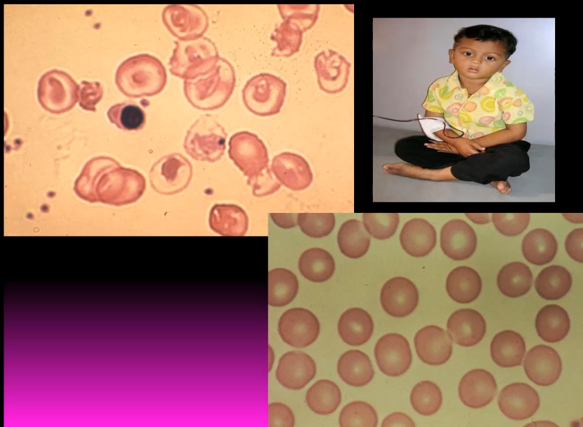

### تالاسمی ماژور بتا: تظاهرات و پیامدها

**کودک مبتلا به تالاسمی ماژور بتا** ممکن است **شکم بزرگی** داشته باشد، زیرا **طحال و کبد او بزرگ شده‌اند(هپاتومگالی و اسپلنومگالی)** طحال طبیعی زیر دندهٔ چپ قرار دارد، اما در این کودک بزرگ شده و پایین آمده است. **طحال و کبد خون‌سازی می‌کنند**، درحالی‌که پس از تولد دیگر نباید در این اندام‌ها خون‌سازی وجود داشته باشد.

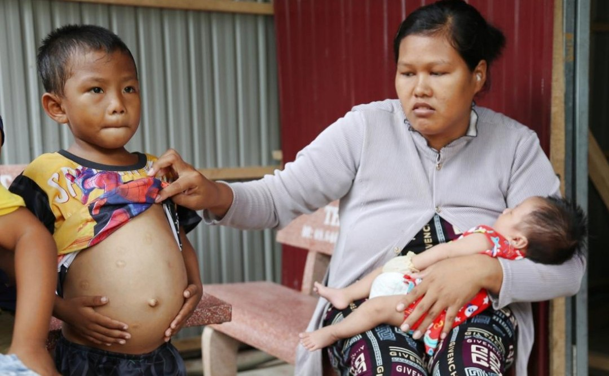

این کودک با **تزریق خون** به این سن رسیده است، اما **تالاسمی ماژور می‌تواند تغییرات استخوانی ایجاد کند: استخوان‌ها پهن می‌شوند، بینی حالت زین اسب پیدا می‌کند، پیشانی پهن می‌شود و دندان‌ها نامرتب می‌شوند.**

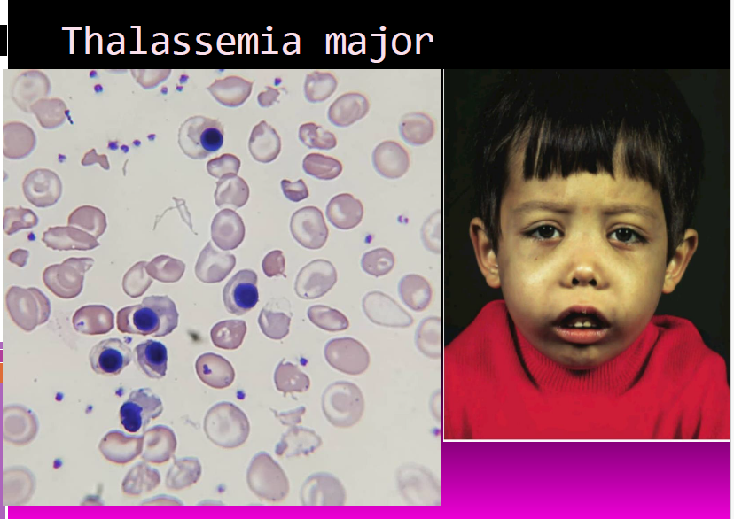

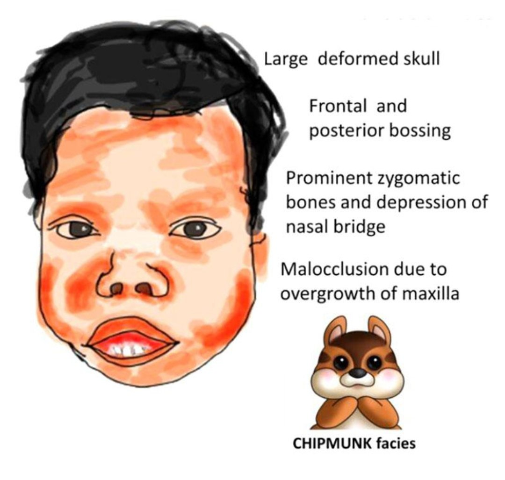

بسیاری از این کودکان، حتی با تزریق خون، در ۱۰ تا ۱۲سالگی فوت می‌کنند و زندگی‌شان به تزریق خون وابسته است. گلبول‌های قرمز در طحال گیر می‌افتند و بیمار به تزریق خون وابسته می‌شود.

هر کیسهٔ خون حدود یک میلی‌گرم آهن دارد. با تزریق ۲۵۰ سی‌سی خون، ۲۵۰ میلی‌گرم آهن وارد بدن می‌شود.

آهن می‌تواند آن‌قدر در بدن تجمع پیدا کند که در قلب، کبد، غدد درون‌ریز و پانکراس رسوب کند. بیمار ممکن است دیابت بگیرد و کبدش از کار بیفتد. اگر بیمار زنده بماند، پیوند نیز مشکلات خودش را دارد؛ اگر هم به او رسیدگی نشود، ممکن است در ۱۲ یا ۱۳سالگی بمیرد.

**بیماری که به‌موقع خون دریافت کرده است، ممکن است دچار تغییرات استخوانی نشده باشد.** با تزریق خون، هموگلوبین او را به ۱۲ یا ۱۳ رسانده‌اند تا خون‌سازی خودش متوقف شود و استخوان‌هایش تغییر نکنند. وقتی بیمار به سن مناسب رسیده، پیوند انجام داده‌اند و احتمالاً چهره و استخوان‌های او تغییر زیادی نکرده‌اند. این درمان به مراقبت زیادی نیاز دارد: خانواده باید تزریق خون به‌موقع و خارج‌کردن به‌موقع آهن اضافی را پیگیری کنند، donor پیدا شود و **HLA antigen**ها بررسی شوند تا donor مناسب باشد.

### وراثت و پیشگیری از تالاسمی ماژور

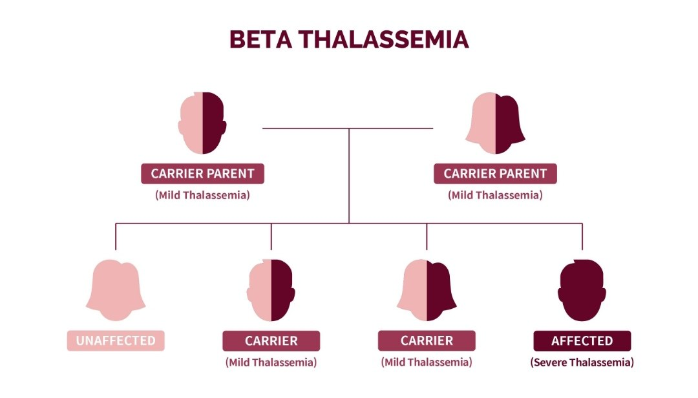

**تالاسمی ماژور حاصل ازدواج دو فرد ناقل ژن تالاسمی است.** در جمعیت دانشجویان یک کلاس نیز دست‌کم چند نفر ناقل‌اند. به همین دلیل، پیش از ازدواج پدر و مادر را آزمایش می‌کنند تا این مشکل تشخیص داده شود. **کارشناس آزمایشگاه باید نتیجه را با دقت بررسی کند؛ اگر تالاسمی در بررسی زوج تشخیص داده نشود، خانواده ممکن است با پیامدهای جدی روبه‌رو شود.**

اگر زوج، با وجود علاقهٔ زیاد، ازدواج کنند، در هفته‌های ۸ تا ۱۲ بارداری می‌توان از **DNA** جنین نمونه گرفت و تشخیص داد که جنین تالاسمی دارد یا نه. در صورت نیاز این کار را انجام می‌دهند، اما پس از تولد کودک دیگر این روش فایده‌ای ندارد.

برای کاهش تالاسمی ماژور بتا در جامعه، باید ناقلان شناسایی شوند و مشاورهٔ ژنتیک بگیرند تا پیامدهای بیماری کودک برایشان توضیح داده شود. اگر زوج با وجود آگاهی از خطر ازدواج کنند، در هفته‌های ۸ تا ۱۲ بارداری می‌توان از جنین نمونه گرفت و بیماری را تشخیص داد؛ اما نمونه‌گیری با سوزن برای مادر و جنین خطرهایی دارد. بهتر است ناقلان شناسایی شوند.

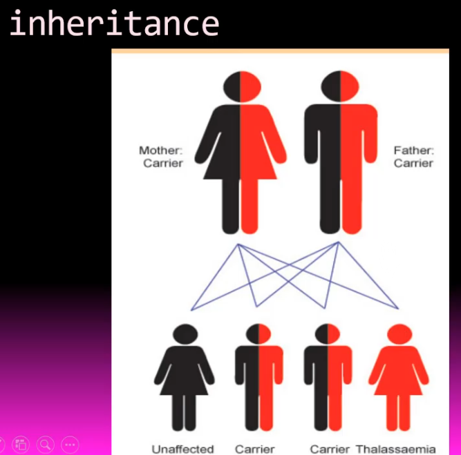

اگر دو فرد مبتلا به تالاسمی مینور با هم ازدواج کنند، در هر بارداری احتمال فرزند سالم ۲۵٪، فرزند ناقل ۵۰٪ و فرزند مبتلا به تالاسمی ماژور ۲۵٪ است. کودک مبتلا به تالاسمی ماژور ممکن است هر روز به بیمارستان برود و برای خارج‌کردن آهن بدن آمپول بزند؛ گاهی نیز پیوند سلول‌های بنیادی انجام می‌شود تا زنده بماند. نتیجهٔ هر بارداری احتمالی است؛ ممکن است خانواده چند فرزند داشته باشد و هرکدام در گروه متفاوتی قرار بگیرند.

اگر دو ناقل تالاسمی با هم ازدواج کنند، در دوران بارداری می‌توان با هدایت سونوگرافی از جفت نمونه بیوپسی گرفت. **CVS** مخفف **chorionic villus sampling** و به معنی **نمونه‌برداری از پرزهای جفت** است. شانس موفقیت آن بیش از ۹۹٪ است، از هفتهٔ دهم به بعد انجام می‌شود و تشخیص حدود ۴۸ ساعت طول می‌کشد. این روش خطر از دست‌رفتن جنین را نیز دارد، یعنی حدود 1 درصد.

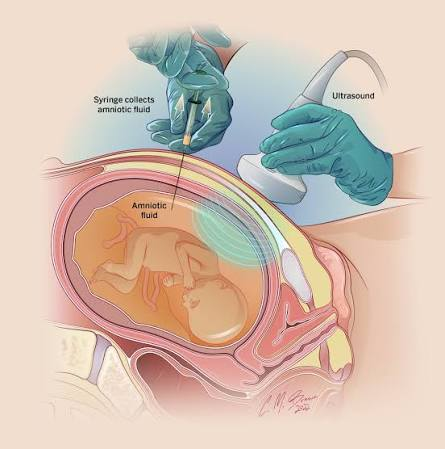

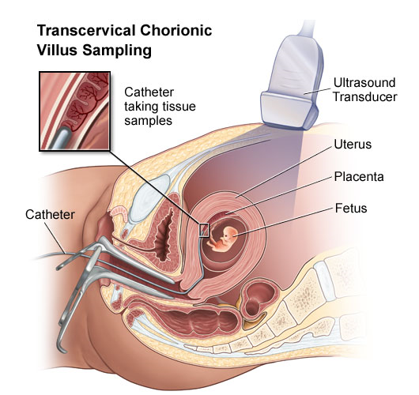

با **amniocentesis** نیز می‌توان از مایعی که اطراف جنین است نمونه گرفت. شانس موفقیت این روش حدود ۹۹٪ است و از هفتهٔ پانزدهم بارداری به بعد انجام می‌شود. جواب ممکن است ۲ تا ۱۶ روز طول بکشد. این روش نیز خطر از دست‌رفتن جنین دارد.

روش دیگر، **گرفتن خون جنین از بند ناف** است. از 20 هفتگی به بعد انجام می‌شود و حدود 20 ساعت زمان پاسخ دهی آن است. حدود 2 درصد شانس از دست رفتن جنین در این روش وجود دارد.

### تعریف تالاسمی و تعادل زنجیره‌های هموگلوبین

> [BOX:DEFINITION]
> **تالاسمی (Thalssemia)**
> عدم تعادل زنجیره‌های هموگلوبین در گلبول قرمز؛ یکی از زنجیره‌ها ساخته می‌شود، اما زنجیرهٔ دیگر کم ساخته می‌شود یا اصلاً ساخته نمی‌شود.

**این عدم تعادل یعنی یکی از زنجیره‌ها ساخته می‌شود، اما زنجیرهٔ دیگر کم ساخته می‌شود یا اصلاً ساخته نمی‌شود. در نتیجه، زنجیره‌ها با هم جفت نمی‌شوند؛ زنجیرهٔ ساخته‌شده رسوب می‌کند و گلبول قرمز را از بین می‌برد.**

در ***حالت طبیعی*** می‌توان **ژن‌های آلفا و بتا** را **مانند دو کفهٔ ترازو** در نظر گرفت: **وقتی ژن‌ها فعال‌اند، دو طرف متعادل‌اند؛ آلفاها با بتاها و نیز با دلتاها جفت می‌شوند و زنجیرهٔ اضافی نداریم.**

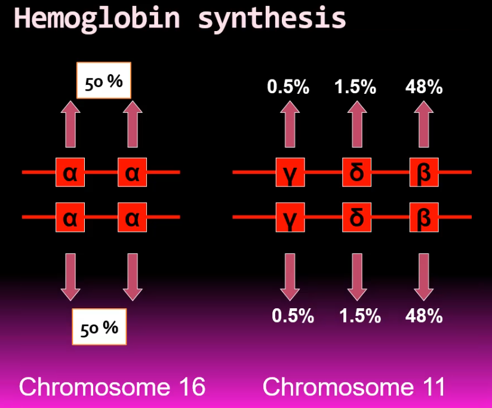

در ***تالاسمی مینور*** چون **یکی از ژن‌های بتا کم‌کار است یا کار نمی‌کند**، **مقدار بتا کم می‌شود، درحالی‌که آلفا ساخته می‌شود.** **آلفاها به‌اندازهٔ کافی بتا ندارند تا با آن جفت شوند. مقداری از آلفاها با دلتا یا گاما جفت می‌شوند، اما سنتز این زنجیره‌ها زیاد نیست؛ بنابراین آلفای اضافی رسوب می‌کند و به گلبول قرمز آسیب می‌زند.**

### ژن‌های گلوبین (globin) و انواع هموگلوبین

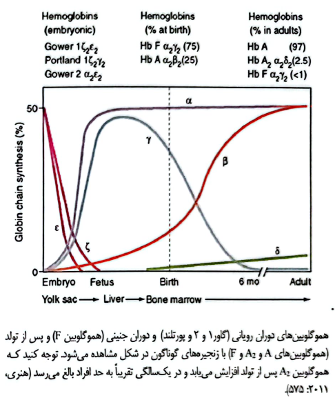

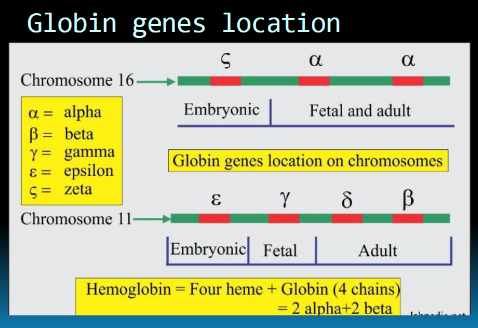

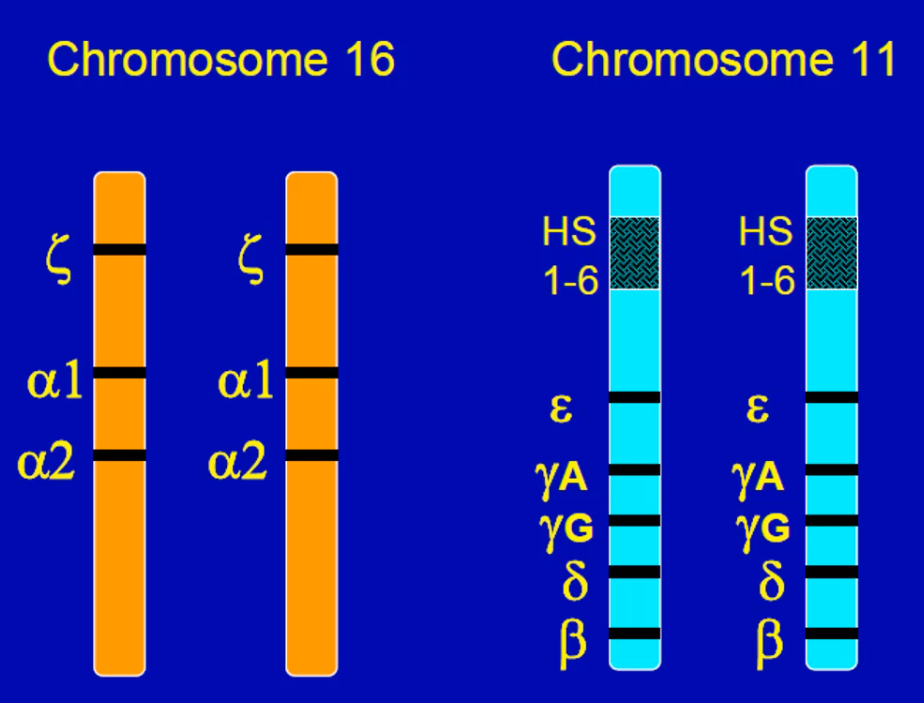

#### ژن‌های آلفا و زتا

در **شکل کروموزوم شمارهٔ ۱۶**، **یک هاپلوتایپ (haplotype) از پدر و یک هاپلوتایپ از مادر به ارث می‌بریم. هر فرد چهار ژن آلفا دارد: دو ژن آلفا از پدر و دو ژن آلفا از مادر؛ پس ژنوتایپ به صورت aa/aa نوشته می‌شود.**

ژن‌های **alpha-1** و **alpha-2** وجود دارند و **فرآوردهٔ ژن alpha-2 از فرآوردهٔ alpha-1 بیشتر است**؛ اما برای ساده‌تر شدن، در اینجا **alpha-1** و **alpha-2** را جداگانه نمی‌نویسیم. دو ژن **زتا** نیز داریم؛ یکی از پدر و یکی از مادر. **زتا در دوران رویانی و جنینی فعال است.**

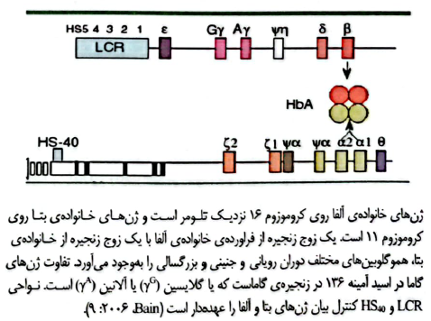

#### ژن‌های بتا و ساخت هموگلوبین

**ژن‌های بتا روی کروموزوم شمارهٔ ۱۱** قرار دارند و یک نسخه از پدر و یک نسخه از مادر به ارث می‌رسد. در این مجموعه(شکل بالا)، ژن‌های **اپسیلون**، دو ژن **گاما** ــ یکی **گاما آلانین** و دیگری **گاما گلیسین** ــ و ژن‌های **دلتا** و **بتا** را نیز در نظر می‌گیریم. این ژن‌ها **گلوبین** (**globin)** می‌سازند. **گلوبین** محصول ریبوزوم و **هم** (**heme)** محصول میتوکندری است؛ این دو با هم ترکیب می‌شوند و هموگلوبین را می‌سازند.(در جلسات قبل کامل توضیح داده شده؛ رجوع به جلسات قبل)

**انواع هموگلوبین** شامل موارد زیر است:

- دو زنجیرهٔ آلفا و دو زنجیرهٔ بتا، **هموگلوبین** **A** یا **HbA** را می‌سازند: **α2β2**.
- دو زنجیرهٔ آلفا با دو زنجیرهٔ دلتا، **HbA2** یا **α2δ2** را می‌سازند.
- دو زنجیرهٔ آلفا با دو زنجیرهٔ گاما، **HbF** یا **α2γ2** را تشکیل می‌دهند.
- هموگلوبین‌های رویانی نیز وجود دارند؛ از جمله **ζ2ε2**، **α2ε2** و **ζ2γ2**. این‌ها هموگلوبین‌های دوران رویانی‌اند؛ در این دوران **اپسیلون** شبیه بتا و **زتا** شبیه آلفا عمل می‌کند.

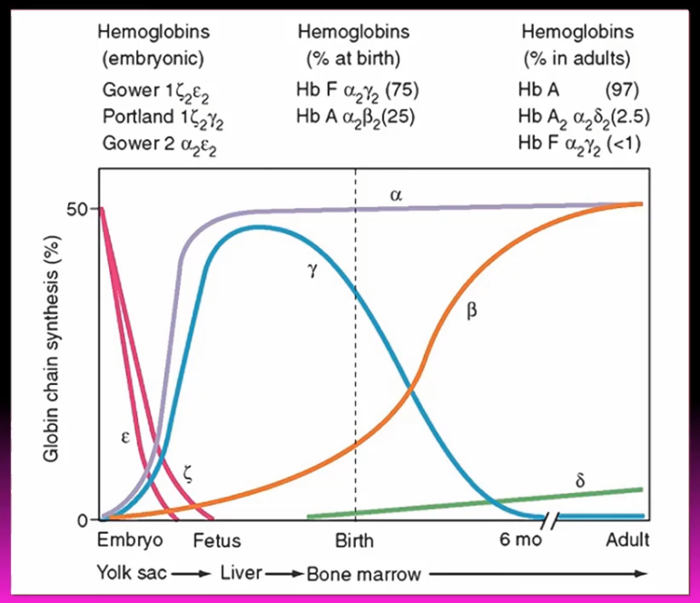

**دوران رویانی** (**embryonic**) معمولاً **تا سه‌ماهگی جنینی** است؛ **از سه‌ماهگی تا پایان بارداری(نه ماهگی)** **دوران جنینی** (**fetal)** است و پس از آن نوزاد به دنیا می‌آید.

#### درصد انواع هموگلوبین و switching

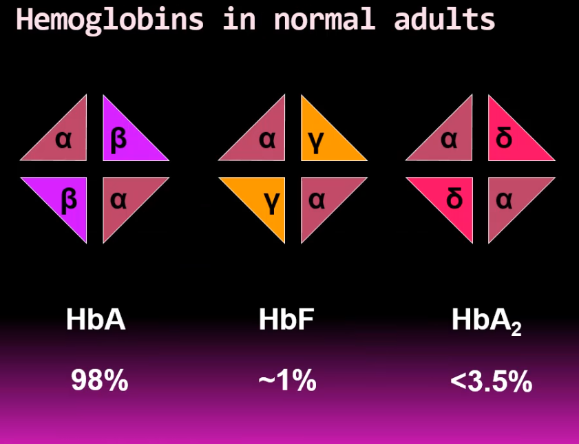

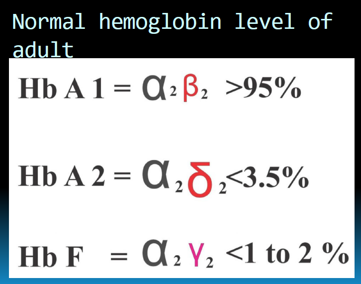

در فرد بالغ، بیش از ۹۵٪ هموگلوبین **HbA** یا **α2β2** است، **HbA2** یا **α2δ2** کمتر از ۳٫۵٪ و **HbF** کمتر از ۱ تا ۲٪ است. در بدو تولد مقدار HbF حدود 60 تا 85% و HbA حدود 40% است؛ یعنی HbA2 در بدو تولد وجود ندارد. **در حالت طبیعی زنجیرهٔ آزادی که جفت نشده باشد، دیده نمی‌شود.**

**هنگام تولد، مقدار HbF بیشتر است:** **HbF** حدود ۶۰ تا ۸۵٪، **HbA** حدود ۱۵ تا ۴۰٪ و **HbA2** وجود ندارد یا مقدارش بسیار کم و غیرقابل‌شناسایی است.

مقداری **HbA2** **پس از تولد** ساخته می‌شود و معمولاً در یک تا دو سالگی به مقدار بالغین، یعنی کمتر از ۳٫۵٪، می‌رسد. **HbF** به‌تدریج کاهش می‌یابد و **HbA** افزایش پیدا می‌کند. به این تغییر **سوییچینگ** (**switching)**  **هموگلوبین** می‌گویند: **ژن گاما** خاموش می‌شود و **ژن بتا** افزایش پیدا می‌کند. معمولاً در دو سالگی **HbF** به کمتر از ۲٪ می‌رسد.

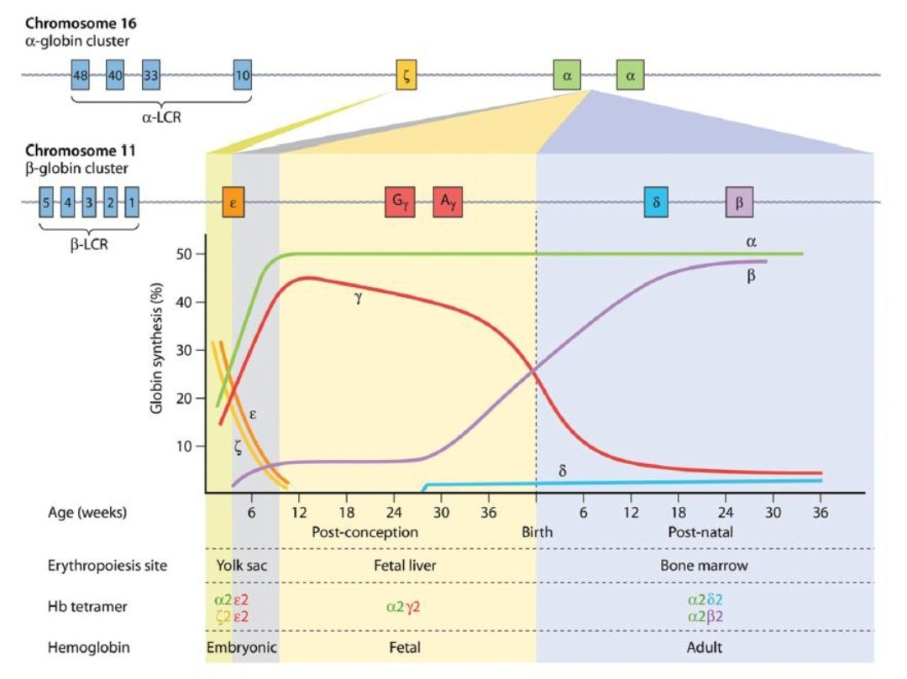

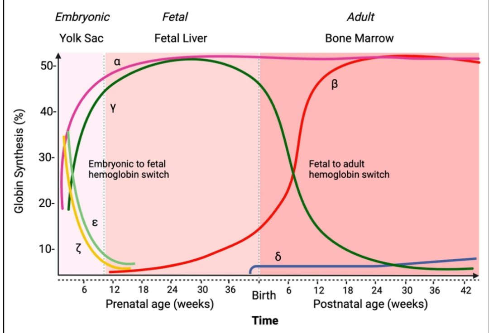

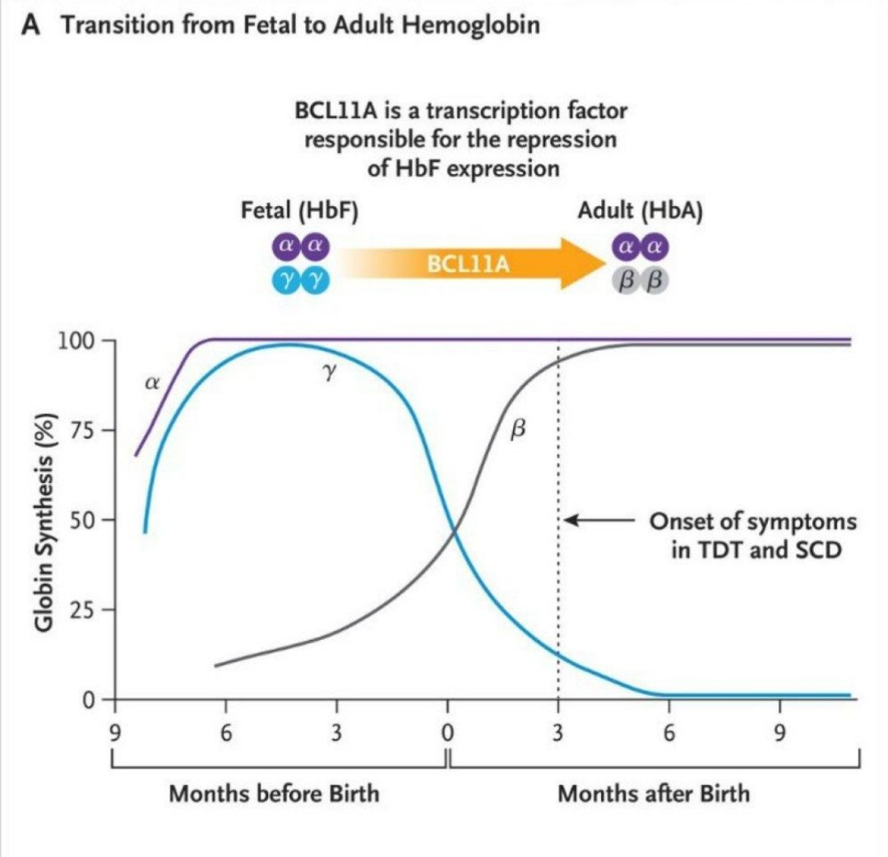

در switching هموگلوبین، **E****KLF1** و **BCL11A** نقش دارند و در خاموش‌شدن **گاما** و افزایش **بتا** مشارکت می‌کنند(نقش مهم در سوییچینگ)

> [BOX:IMPORTANT]
> در switching هموگلوبین، **KLF1** و **BCL11A** نقش دارند و در خاموش‌شدن **گاما** و افزایش **بتا** مشارکت می‌کنند.

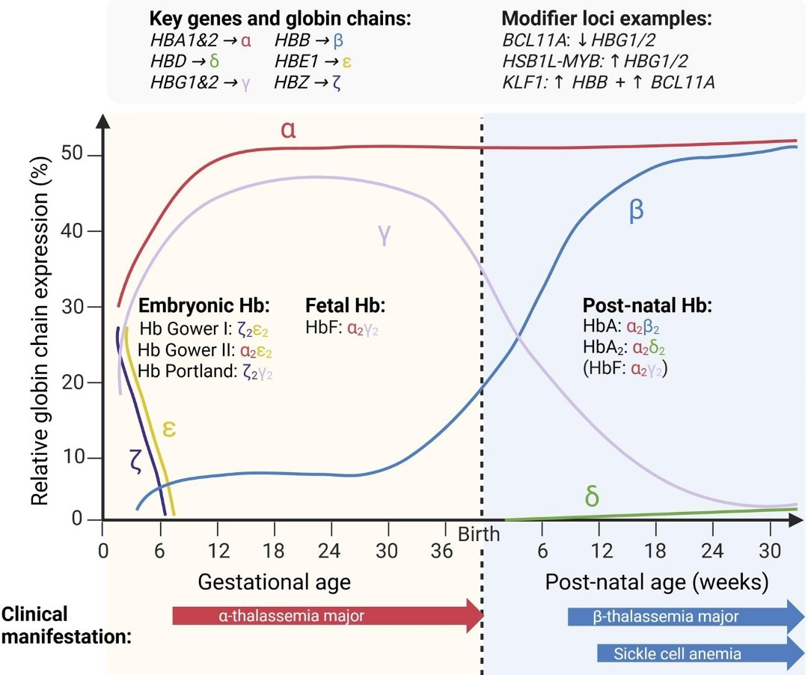

#### تنظیم ژنتیکی و CRISPR-Cas9 یا CRISPR CASPASE 9

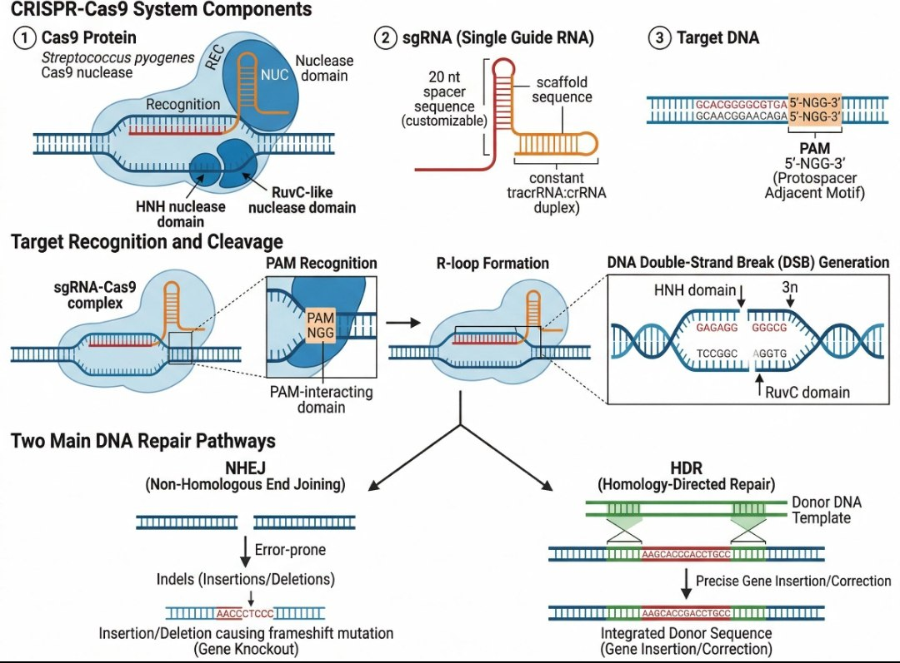

فناوری **CRISPR-Cas9** نیز **برای ویرایش ژن** وجود دارد: **سلول مادرِ فرد مبتلا به تالاسمی را می‌گیرند، ژن معیوب را در محل جهش برش می‌دهند و ژن سالم را جایگزین می‌کنند.** این فناوری تا حدی موفق بوده، اما هنوز فراگیر نشده است. تغییر هر ویژگی ژنتیکی موضوع دیگری است؛ خلقت پیچیده‌تر از این هاست.

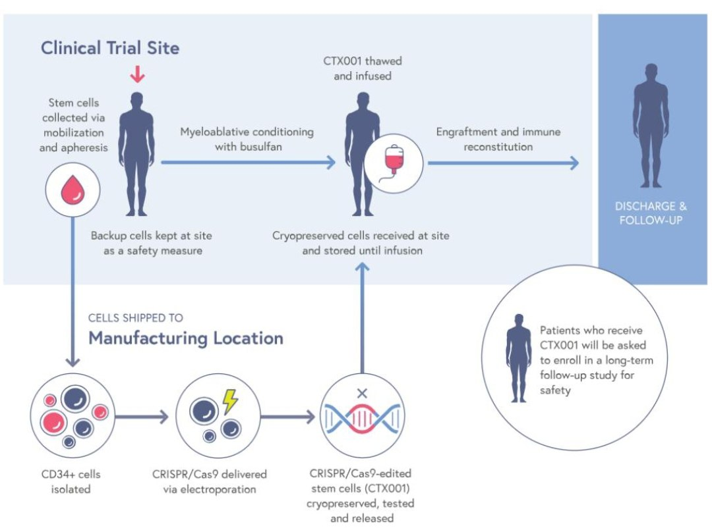

برای ساخته‌شدن همین هموگلوبین، دست‌کم ۹ تا ۱۰ آنزیم باید پشت‌سرهم کار کنند و نبودن یکی از آن‌ها کار را مختل می‌کند. تنظیم آهن بدن نیز به گیرنده‌ها، **ترنسفرین**، **هپسیدین**، **IRP** و **ژن‌های متعدد** وابسته است؛ حدود ۳۰ ژن باید برای تنظیم آهن بدن کار کنند. این فقط نمونه‌ای کوچک از پیچیدگی بدن است.

### انواع تالاسمی بتا

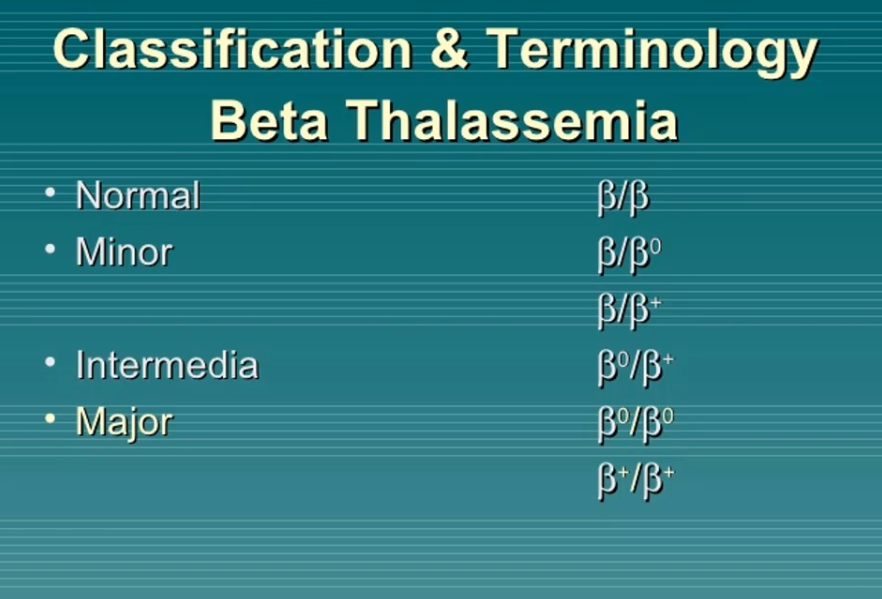

#### تالاسمی مینور بتا و beta-plus و beta-zero

برای ساخت زنجیرهٔ بتا به **دو ژن بتای سالم** نیاز است؛ یکی از پدر و دیگری از مادر. **اگر یکی از ژن‌های بتا معیوب باشد، تالاسمی مینور بتا****(Minor Thalassemia)** **ایجاد می‌شود**. اگر ژن بتا **مقداری کار کند**، **beta-plus** است؛ اگر ژن بتا **اصلاً بتا نسازد**، **beta-zero** است. در **beta-zero**، یکی از ژن‌های بتا کار می‌کند و ژن دیگر هیچ بتایی نمی‌سازد. در **beta-plus** نیز یک ژن سالم است و ژن دیگر حدود ۵ تا ۳۰٪ مقدار طبیعی کار می‌کند.

تالاسمی مینور بتا شایع است و افراد مبتلا معمولاً زندگی عادی دارند. هموگلوبین آن‌ها ممکن است حدود ۲ گرم از افراد هم‌سن‌وسال و هم‌جنسشان کمتر باشد؛ برای مثال، هموگلوبین یک آقا ممکن است ۱۲ و هموگلوبین یک خانم ۱۱ باشد و مشکلی هم نداشته باشند.

> [BOX:EXAMPLE]
> برای نمونه، هموگلوبین یک آقا ممکن است ۱۲ و هموگلوبین یک خانم ۱۱ باشد و مشکلی هم نداشته باشند.

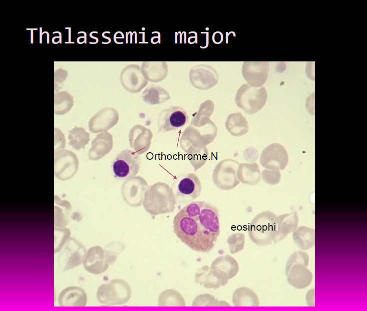

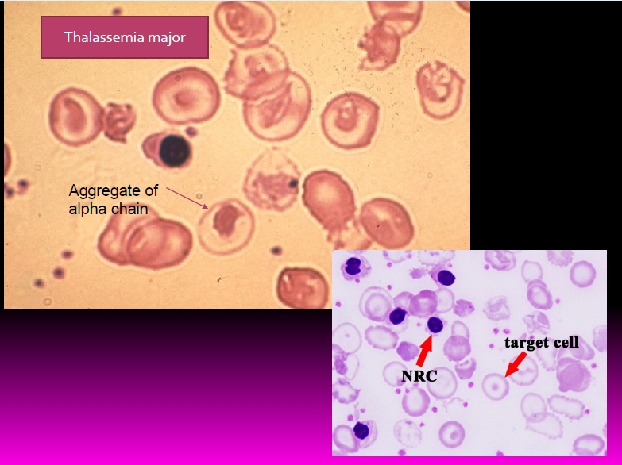

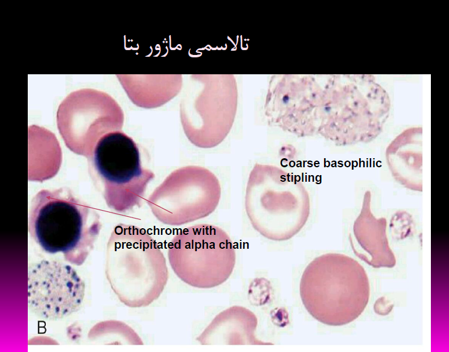

اگر **هر دو ژن بتا معیوب** باشند، **تالاسمی ماژور بتا (Major Thalassemia)** ایجاد می‌شود. این بیماری را نخستین‌بار دکتر کولی (Dr. Cooley) در ناحیهٔ مدیترانه توصیف کرد و به آن Cooley’s anemia نیز می‌گویند. نام‌های **Mediterranean anemia** و **بیماری دریا** نیز برای آن به کار رفته‌اند، چون نخستین‌بار کنار دریای مدیترانه کشف شد.

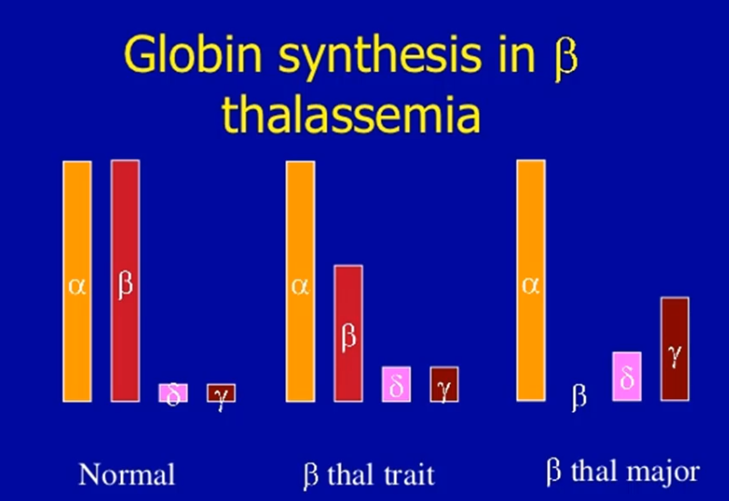

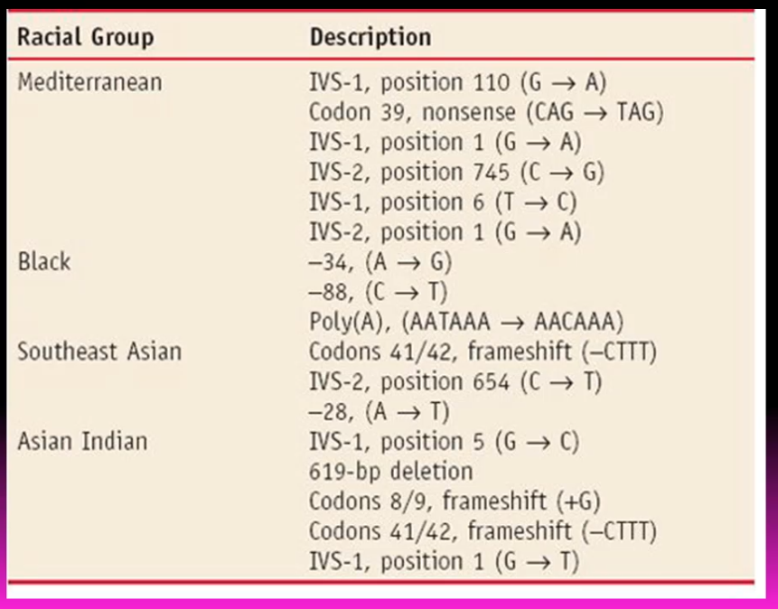

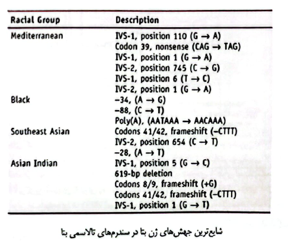

#### (Heterozygous & homozygous) هموزیگوت و هتروزیگوت

> [BOX:DEFINITION]
> **Heterozygous و homozygous**
>  اصطلاح **هوموزیگوت** **Homozygous** یعنی هر دو کروموزوم ژن معیوب دارند و **هتروزیگوت** **Heterozygous** یعنی یکی از آن‌ها گرفتار است.

به تالاسمی‌های مینور، **تالاسمی های هتروزیگوت** یا **heterozygous thalassemia** هم می‌گویند. **Heterozygous** یعنی یک کروموزوم گرفتار است؛ برای مثال، فرد مبتلا به تالاسمی بتای heterozygous همان فرد مبتلا به مینور است. به تالاسمی های ماژور، **تالاسمی های هوموزیگوت** یا **Homozygous Thalassemia** می‌گویند. Homozygous یعنی هر دو کروموزوم ژن معیوب دارند و heterozygous یعنی یکی از آن‌ها گرفتار است.

> [BOX:IMPORTANT]
> Minor Thalassemia = Heterozygous Thalassemia /
> Major Thalassemia = Homozygous Thalassemia /

در مینور، یکی از ژن‌های بتا کار نمی‌کند یا کم‌کار است؛ به‌ترتیب beta-zero یا beta-plus. در **هموگلوبین لپور** (**Hb Lepore)**، **دلتا و بتا در هم ادغام شده‌اند، اما نسخهٔ دیگر سالم است. اگر نسخهٔ دیگر هم معیوب باشد، وضعیت دیگر مینور نیست و بیماری شدیدتر می‌شود.**

### انواع مینور delta-beta و Hb Lepore (هموگلوبین لپور)

#### جهش کدون ۳۹ و جهش‌های بتا

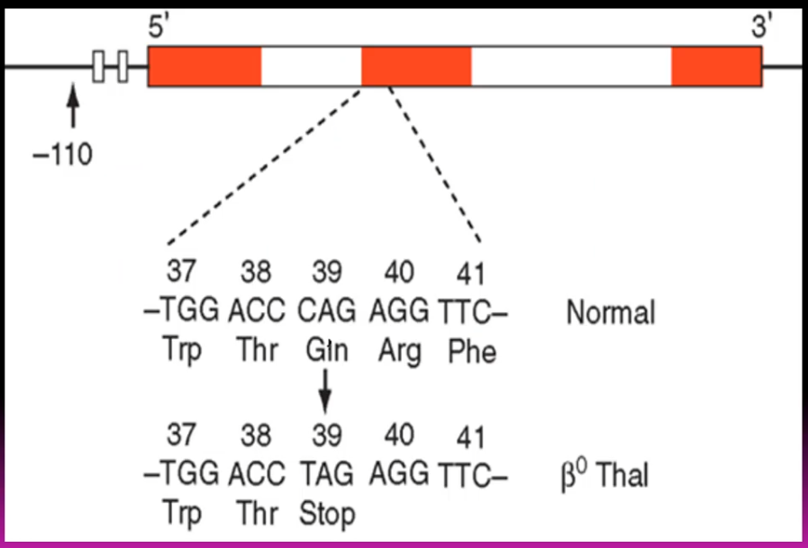

ژن هموگلوبین سه **exon** دارد و جهش ممکن است در **exon**ها یا **intron**ها رخ دهد. در **exon** شمارهٔ ۲، کدون مربوط به **amino acid** شمارهٔ ۳۹ را در نظر بگیرید: کدون طبیعی **CAG** است و **glutamine** را رمزگذاری می‌کند.

- **Exon** شمارهٔ ۱ اسیدهای آمینهٔ ۱ تا ۳۱ را کد می‌کند.
- **Exon** شمارهٔ ۲ اسیدهای آمینهٔ ۳۲ تا ۱۰۴ را کد می‌کند.
- **Exon** شمارهٔ ۳ اسیدهای آمینهٔ ۱۰۵ تا ۱۴۲ را کد می‌کند.

زنجیرهٔ بتا ۱۴۲ اسیدآمینه دارد؛ این بخش‌ها به هم متصل می‌شوند و **globin** ساخته می‌شود.

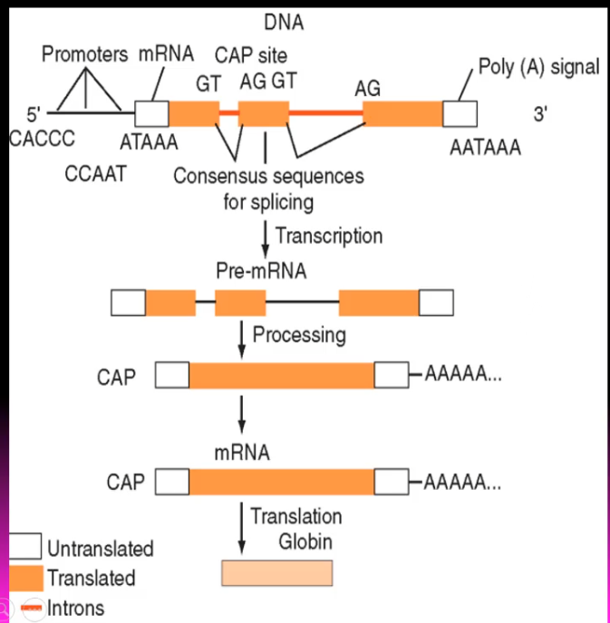

اگر جهش، کدون شمارهٔ ۳۹ را از **CAG** به **TAG** تبدیل کند، کدون **stop** ایجاد می‌شود. در این صورت، زنجیره تا اسیدآمینهٔ ۳۸ ساخته می‌شود و در ۳۹ متوقف می‌شود؛ زنجیرهٔ کامل بتا ساخته نمی‌شود و این جهش **beta-zero** ایجاد می‌کند. در ایران جهش‌های مختلفی، از جمله در **intron 1**، **intron 2** و کدون ۳۹، وجود دارند. با **PCR** می‌توان مشخص کرد فرد در کدام کدون یا ناحیه جهش دارد.

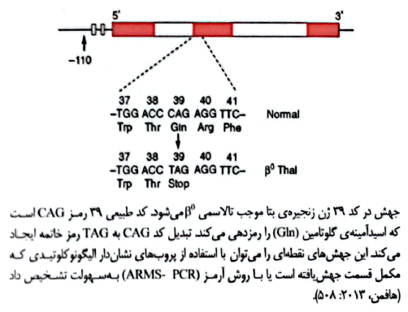

#### Hb Lepore هموگلوبین لپور یا

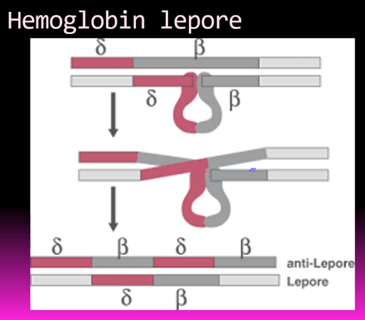

گاهی کراسینگ اوور (**crossing-over)** رخ می‌دهد و ژنی به وجود می‌آید که بخشی از **دلتا** و بخشی از **بتا** در آن ادغام شده‌اند. در این حالت، یک **هاپلوتایپ** از پدر یا مادر به ارث می‌رسد که ژن **delta-beta** در آن ادغام و **fusion** شده است. زنجیرهٔ حاصل همچنان ۱۴۲ اسیدآمینه دارد و بخشی از آن از دلتا و بخشی دیگر از بتا آمده است. هموگلوبین حاصل به‌صورت **α2δβ2** نوشته می‌شود و هموگلوبین لپور **Hb Lepore** نام دارد؛ این هموگلوبین محصول ادغام **دلتا** و **بتا** است.

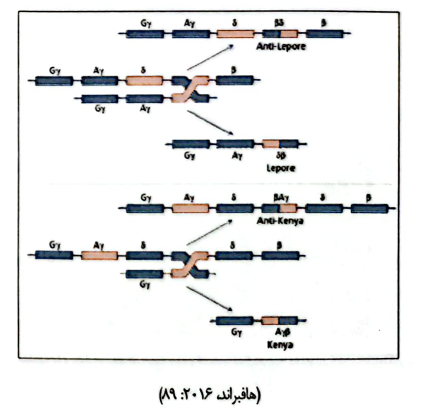

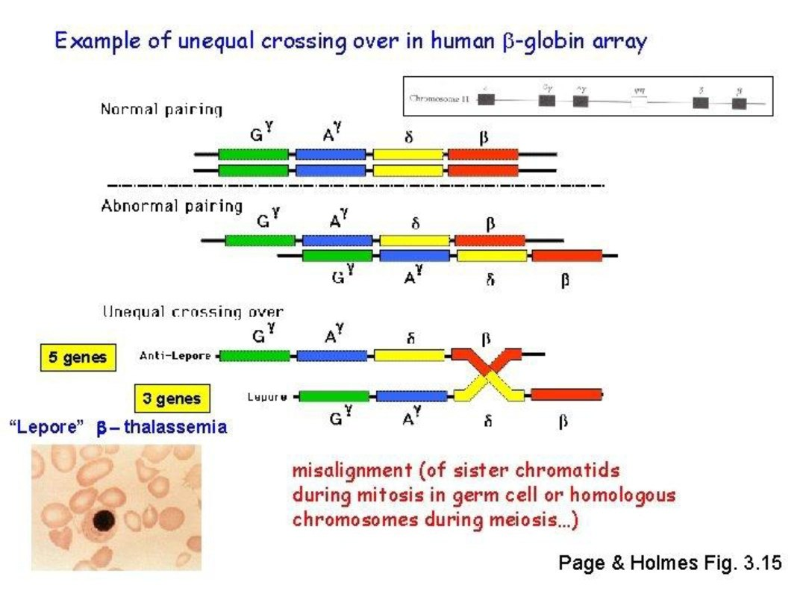

در **Hb Lepore**، بخشی از توالی بتا با دلتا جایگزین شده است. فاکتورهای رونویسی که باید ژن را فعال کنند، به‌جای ناحیهٔ بتا در ناحیهٔ دلتا قرار می‌گیرند. ژن دلتا به‌طور طبیعی کم‌کار است و کمتر از ۳٫۵٪ هموگلوبین می‌سازد، درحالی‌که بتا در حالت طبیعی فعال است و باید به‌اندازهٔ آلفا زنجیره بسازد. وقتی دلتا در مسیر بیان بتا قرار می‌گیرد، زنجیرهٔ حاصل کمتر ساخته می‌شود؛ مقدار آن حدود ۵ تا ۱۰٪ حالت طبیعی است و به تعادل با آلفا نمی‌رسد. این هم **نوعی تالاسمی مینور** است.

اگر یک نفر تالاسمی مینور بتا و نفر دیگر مینور دلتا-بتا داشته باشد، ممکن است فرزندشان تالاسمی ماژور شود. اگر هر دو نفر Hb Lepore داشته باشند، ممکن است فرزندشان **Hb Lepore/Lepore** و مبتلا باشد. **Hb Lepore** را در آزمایشگاه با الکتروفورز هموگلوبین یا **hemoglobin electrophoresis** سریع تشخیص می‌دهیم، چون جایگاه مشخصی در الکتروفورز دارد. تا اینجا سه نوع مینور مطرح شد: **beta-zero**، **beta-plus** و ادغام **delta-beta** که **Hb Lepore** می‌سازد.

#### حذف delta-beta

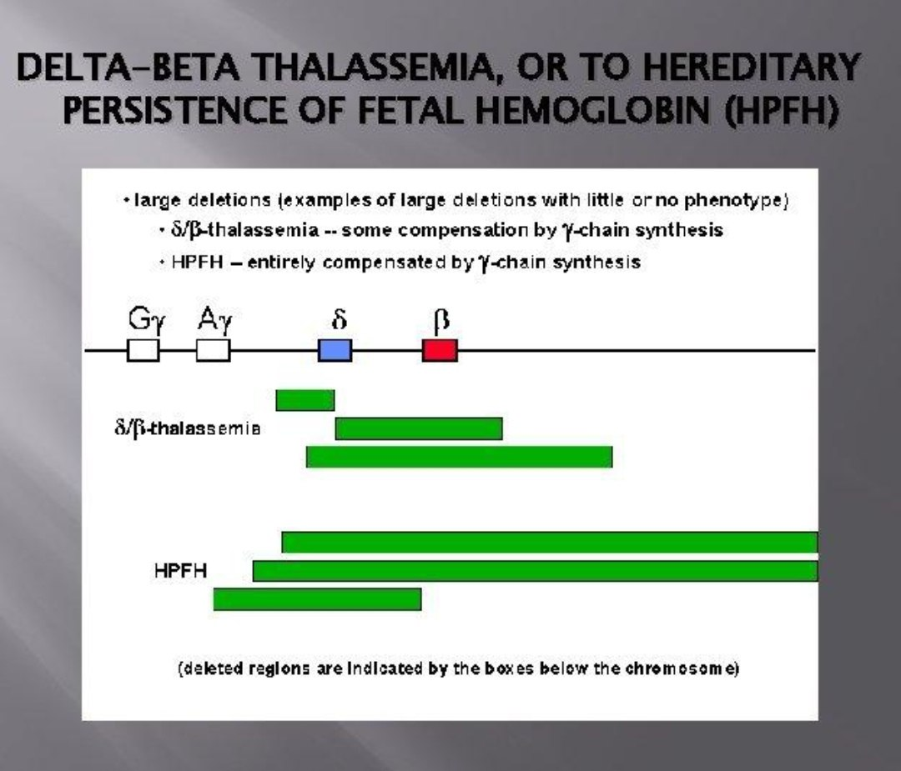

حالت دیگری نیز وجود دارد که در آن، در یک کروموزوم هر دو ژن دلتا و بتا حذف شده‌اند؛ به آن **تالاسمی مینور دلتا-بتا**  **delta-beta** **thalassemia** می‌گویند. اگر ژن‌های **دلتا** و **بتا** روی یک کروموزوم حذف شوند، **گاما** برای جبران افزایش می‌یابد. در این حالت نیز microcytic hypochromia داریم.

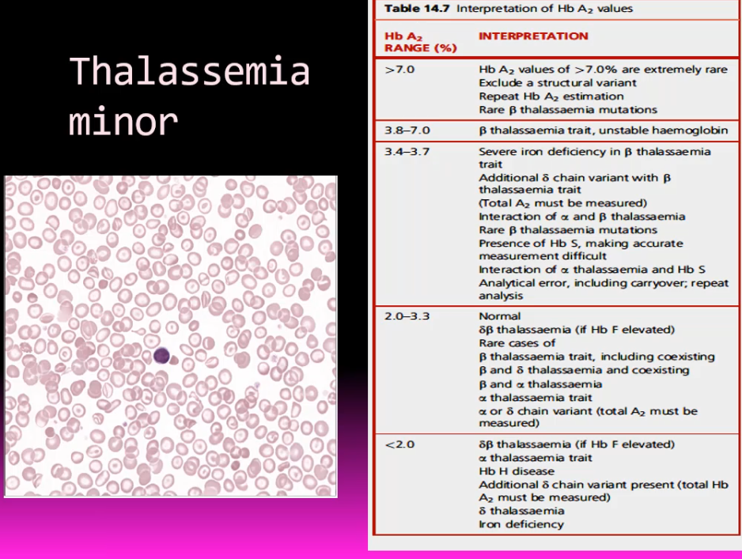

این وضعیت در **Hb Lepore** هم دیده می‌شود، اما در **delta-beta**، مقدار**HbF** یا **گاما** افزایش می‌یابد و ممکن است ۵ تا ۲۰٪ هموگلوبین را تشکیل دهد. در مواردی که **HbF** به این میزان بالا نمی‌رود، این الگو دیده نمی‌شود. بنابراین، در فردی با **microcytic hypochromia**، اگر **HbF** حدود ۵ تا ۲۰٪ باشد، باید به **delta-beta thalassemia** فکر کرد.

در انواع کلاسیک، یعنی **beta-zero** و **beta-plus**، مقدار **HbA2** بالا می‌رود؛ اما در انواع دیگر مینور، **HbA2** طبیعی یا کمتر از طبیعی است. در **delta-beta** یک ژن دلتا حذف شده و در **Hb Lepore** نیز دلتا با بتا ادغام شده است؛ بنابراین، برخلاف نوع کلاسیک، **HbA2** افزایش پیدا نمی‌کند.

> [BOX:IMPORTANT]
> در انواع کلاسیک، یعنی **beta-zero** و **beta-plus**، مقدار **HbA2** بالا می‌رود؛ اما در انواع دیگر مینور، **HbA2** طبیعی یا کمتر از طبیعی است. در **delta-beta** یک ژن دلتا حذف شده و در **Hb Lepore** نیز دلتا با بتا ادغام شده است؛ بنابراین، برخلاف نوع کلاسیک، **HbA2** افزایش پیدا نمی‌کند.

### بررسی آزمایشگاهی تالاسمی مینور

#### CBC و شاخص‌های گلبولی

قدم اول در بررسی آزمایشگاهی، انجام **CBC** است. در **CBC** ممکن است **microcytic hypochromia** دیده شود؛ معمولاً **RBC count** بیشتر از ۵٫۵ میلیون، **MCV** پایین، **MCH** پایین و **RDW** طبیعی است. این الگو با فقر آهن تفاوت دارد، چون در فقر آهن **RDW** افزایش پیدا می‌کند.

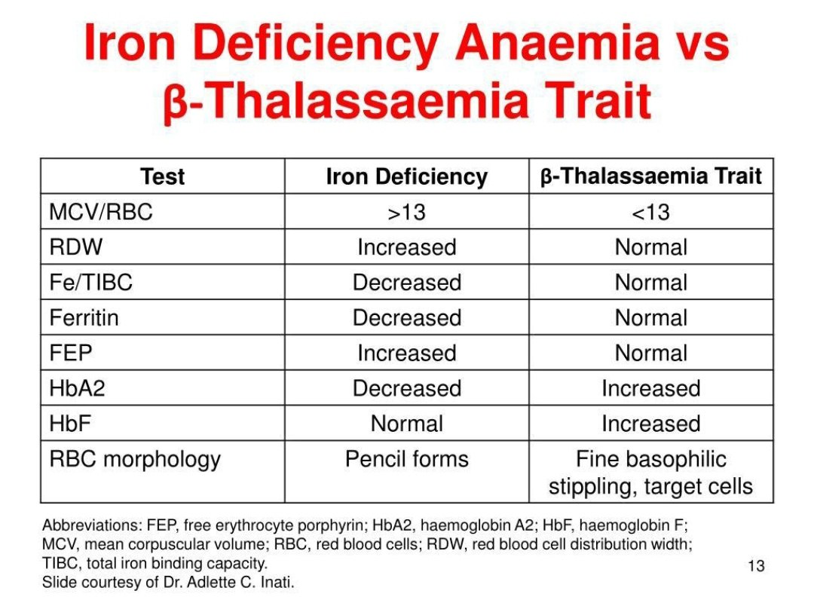

در تالاسمی مینور، گلبول‌ها یکدست **microcytic hypochromic** هستند و **RDW** طبیعی است؛ در فقر آهن، اندازهٔ گلبول‌ها متفاوت و **RDW** بالا است. **RBC count** در تالاسمی مینور معمولاً بیشتر از ۵٫۵ میلیون است. اگر **MCV** هر دو نفر کمتر از ۸۰ باشد، باید بررسی‌های بعدی و مشاوره انجام شود.

#### تغییرات MCV با سن

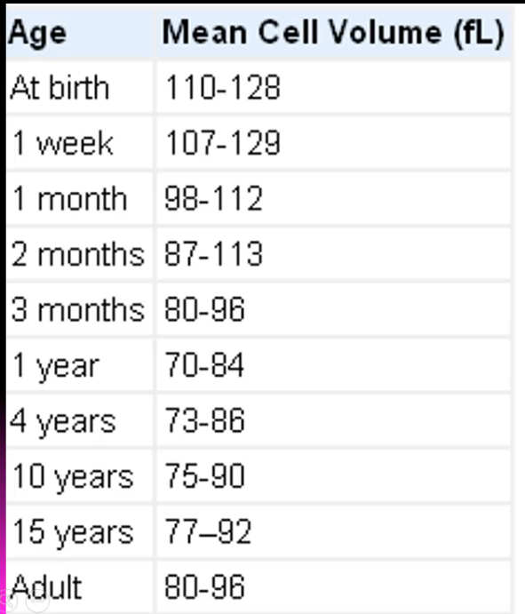

**MCV** در طول زندگی تغییر می‌کند:

- در بدو تولد و تا حدود ۲۸ روزگی، گلبول‌ها بزرگ‌اند.
- در یک‌سالگی **MCV** حدود ۷۰ تا ۸۰ است.
- بعضی رفرنس‌ها حداقل **MCV** طبیعی کودکان را «۷۰ به‌اضافهٔ سن» در نظر می‌گیرند؛ مثلاً برای کودک پنج‌ساله حدود ۷۵ و برای کودک شش‌ساله حدود ۷۶ را می‌توان طبیعی دانست، هرچند کمتر از ۸۰ است.
- بعد از ۱۵سالگی **MCV** باید حدود ۸۰ تا ۹۶ باشد و دیگر تغییرات فیزیولوژیک کودکی را ندارد.

بنابراین، **MCV** حدود ۷۳ ممکن است برای کودک سه‌ساله طبیعی باشد، هرچند بعضی دستگاه‌ها مقدار کمتر از ۸۰ را پایین گزارش می‌کنند.

> [BOX:EXAMPLE]
>مقدار **MCV** حدود ۷۳ ممکن است برای کودک سه‌ساله طبیعی باشد، هرچند بعضی دستگاه‌ها مقدار کمتر از ۸۰ را پایین گزارش می‌کنند.

#### HbA2 و hemoglobin electrophoresis

پس از مشاهدهٔ **microcytic hypochromia**، قدم بعدی اندازه‌گیری **HbA2** است. در تالاسمی مینور بتا، به‌دلیل کم‌کاری یا غیرفعال‌بودن ژن بتا، ژن **دلتا** فعال‌تر می‌شود و تا حدی آن را جبران می‌کند. در نتیجه، **HbA2** که در افراد طبیعی کمتر از ۳٫۵٪ است، به ۳٫۵٪ یا بیشتر می‌رسد و ممکن است تا ۷٪ هم برسد.

بنابراین، اگر فرد **microcytic hypochromic** باشد، آزمایش بعدی **hemoglobin electrophoresis** است. این آزمایش **درصد انواع هموگلوبین فرد را اندازه می‌گیرد**؛ در درس‌های بعد دربارهٔ چگونگی جداکردن هموگلوبین‌ها توضیح داده می‌شود.

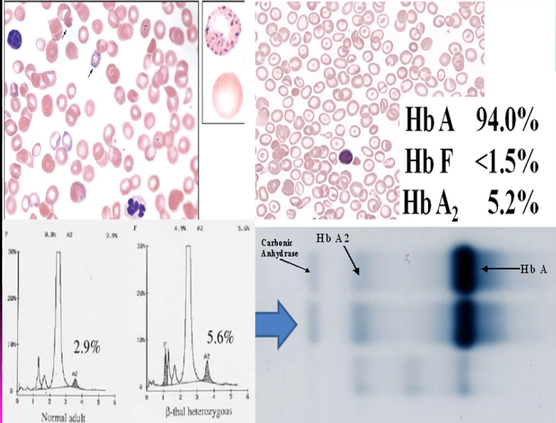

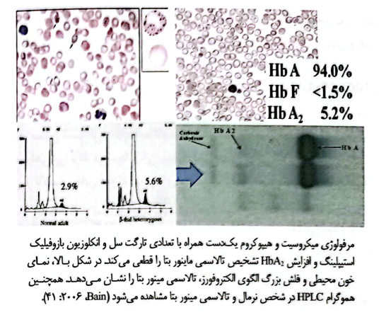

در یک نمونه، فرد **microcytic hypochromic** بوده و **hemoglobin electrophoresis** نتایج زیر را نشان داده است:

- **HbA** برابر ۹۴٪
- **HbF** کمتر از ۱٫۵٪
- **HbA2** بیشتر از ۳٫۵٪

با توجه به **morphology** گلبول‌ها و **HbA2** بالاتر از ۳٫۵٪، تشخیص به نفع تالاسمی مینور بتاست. اگر همسر او نیز همین وضعیت را داشته باشد، ممکن است هر دو ناقل تالاسمی ماژور بتا باشند؛ اگر فقط یکی ناقل باشد و دیگری سالم، خطر تولد فرزند مبتلا به ماژور مطرح نیست.

> [BOX:EXAMPLE]
> نمونهٔ **hemoglobin electrophoresis**: **HbA** برابر ۹۴٪، **HbF** کمتر از ۱٫۵٪ و **HbA2** بیشتر از ۳٫۵٪؛ همراه با **microcytic hypochromia**، تشخیص به نفع تالاسمی مینور بتاست.

#### غربالگری جمعیت با فرمول‌ها

برای شناسایی ناقلان تالاسمی در جمعیت بزرگ، مثلاً در مدرسه یا دبیرستان، باید **تست غربالگری** انجام داد. سه فرمول برای جداکردن تالاسمی مینور از فقر آهن مطرح شد؛ از جمله **Mentzer**، **Green and King** و **DF**

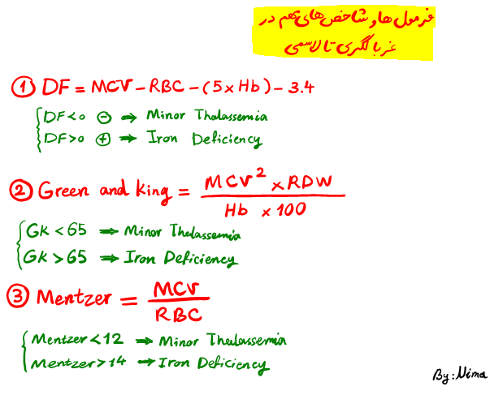

مثال) برای دو بیمار، مقادیر زیر داده شد:

| بیمار | MCV | MCH | RBC count | Hb | RDW |
| --- | ---: | ---: | ---: | ---: | --- |
| شمارهٔ ۱ | ۶۰ | — | ۶ میلیون | ۱۲ | 12 |
| شمارهٔ ۲ | ۷۰ | ۲۲ | ۴٫۵ میلیون | ۱۱ | 16 |

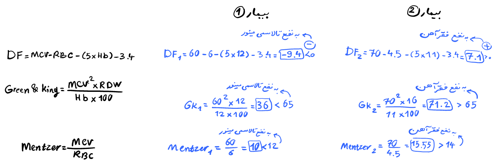

نتیجهٔ **DF** **منفی به نفع تالاسمی مینور و مثبت به نفع فقر آهن** است. **Mentzer** **کمتر از ۱۲ به نفع تالاسمی مینور و بیشتر از ۱۴ به نفع فقر آهن** است؛ بین این دو مقدار ممکن است هر دو مشکل وجود داشته باشند. **Green and King** **بیشتر از ۶۵ به نفع فقر آهن و کمتر از ۶۵ به نفع تالاسمی مینور** است.

استفاده از این فرمول‌ها **پیش از ۱۵سالگی** ممنوع است؛ در **خانم باردار** نیز نباید از آن‌ها استفاده کرد و همچنین نباید در فرد **normocytic normochromic** به کار روند. **این فرمول‌ها فقط برای فرد بالغی هستند که microcytic hypochromic باشد.**

> [BOX:IMPORTANT]
> استفاده از فرمول های غربالگری تالاسمی فقط در افراد بالغی که **microcytic hypochromic هستند مجاز است.
> در افراد زیر استفاده از فرمول مجاز نیست: افراد کمتر از 15 سال، خانم های باردار، افراد** **normocytic normochromic**

#### بررسی نمونهٔ خانمی با نتایج متغیر

در تصویر زیر نتایج آزمایش خانمی که ناقل تالاسمی است را طی یک سال متوالی مشاهده می‌کنید:

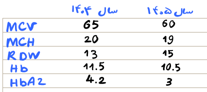

این خانم می‌خواهد با فردی ازدواج کند که او نیز ناقل است. با توجه به نتایج آزمایش می‌توان این نکات را بررسی کرد: احتمال دارد کمبود آهن روی تالاسمی مینور سوار شده باشد. در تالاسمی مینور، **RDW** معمولاً طبیعی است؛ اگر **RDW** بالا برود، باید به فقر آهن هم فکر کرد. فردی که تالاسمی مینور دارد ممکن است بعداً دچار فقر آهن شود؛ تالاسمی مینور ارثی است و ممکن است فرد از ابتدا مینور بوده باشد و فقر آهن نیز به آن اضافه شده باشد.
 **در چنین مواردی نباید تنها با یک فرمول دربارهٔ ازدواج تصمیم گرفت؛ این فرمول‌ها برای غربالگری جمعیت‌اند و برای تصمیم‌گیری قطعی کافی نیستند.**

**مثلا Ferritin** یک **acute-phase protein** است. اگر فرد سرماخورده باشد یا التهاب داشته باشد، **ferritin** ممکن است بالا برود؛ بنابراین، ممکن است نتوان تنها با **ferritin** وضعیت آهن بدن را مشخص کرد و آزمایش‌های تکمیلی لازم باشد.

گاهی **تست ژنتیک** لازم می‌شود، اما **جواب آن حدود دو هفته طول می‌کشد** و ممکن است زوج برای ازدواج عجله داشته باشند و کارت دعوتشان را هم پخش کرده باشند.

راه دیگر، **بررسی والدین** است. **اگر فرد تالاسمی مینور داشته باشد، چون تالاسمی ارثی است، معمولاً باید پدر یا مادر او نیز مینور باشد. خواهر یا برادر ممکن است سالم باشند، چون ژن می‌تواند به هر فرزند به شکل متفاوتی به ارث برسد.** بررسی والدین می‌تواند کمک‌کننده باشد. اگر یکی از پدر و مادر تالاسمی مینور داشته باشد و شاخص‌های فرد نیز با آن سازگار باشند، احتمال دارد خود فرد ناقل باشد.

اگر فرد قبلاً به‌طور قطعی تالاسمی مینور بتا داشته و **HbA2** او بالا بوده، اما بعداً فقر آهن نیز به آن اضافه شود، **HbA2** ممکن است پایین بیاید و به محدودهٔ طبیعی نزدیک شود؛ برای مثال، از ۳٫۶٪ به حدود ۲٫۵٪ برسد. بنابراین، **ممکن است فرد مبتلا به تالاسمی مینور بتا در آزمایش جدید HbA2 طبیعی داشته باشد.** **در این حالت باید دو ماه آهن‌درمانی شود و سپس CBC و HbA2 تکرار شوند. اگر HbA2 پس از آهن‌درمانی بالا رفت، به نفع تالاسمی مینور بتاست؛ اگر بالا نرفت، ممکن است فقر آهن مطرح باشد.**

راه دیگر، **یافتن جهش شایع با** **PCR** است. اگر زوجی که برای ازدواج مراجعه کرده‌اند بر ازدواج اصرار داشته باشند، می‌توان جهش ژنتیکی هر دو را با **PCR** بررسی کرد؛ برای مثال، ممکن است یکی کدون ۳۹ و دیگری کدون ۳۷ داشته باشد. اگر زن باردار شود، از پرزهای جفت نمونه می‌گیرند و جهش‌ها را بررسی می‌کنند: اگر هر دو جهش در جنین وجود داشته باشند، جنین ماژور است؛ اگر یکی یا هیچ‌کدام وجود داشته باشد، وضعیت متفاوت خواهد بود. این روش‌ها و راه‌های دیگر برای تشخیص در دسترس‌اند.

> [BOX:EXAMPLE]
> اگر فرد قبلاً به‌طور قطعی تالاسمی مینور بتا داشته و **HbA2** او بالا بوده، اما بعداً فقر آهن نیز به آن اضافه شود، **HbA2** ممکن است از ۳٫۶٪ به حدود ۲٫۵٪ برسد.

> [BOX:EXAMPLE]
> در بررسی جهش با **PCR** ممکن است یکی از زوج‌ها کدون ۳۹ و دیگری کدون ۳۷ داشته باشد.

## ۳. جداول مرور سریع

### شکل‌ها و یافته‌های گلبول قرمز

| شکل یا یافته | توصیف |
|---|---|
| **basophilic stippling** | نوعی inclusion در مسمومیت با سرب |
| **stomatocyte** | سلولی با شکل شبیه دهان ماهی |
| **Bite cell** | هموگلوبین دناتوره‌شده پس از خورده‌شدن به‌وسیلهٔ **macrophage**های طحال از کنارهٔ سلول برداشته شده است؛ ردّ به‌جامانده مربوط به **Heinz body** است. |
| **Macro-ovalocyte** | سلولی بزرگ و شبیه تخم‌مرغ |
| **elliptocyte** | طول سلول بیش از دو برابر عرض آن است. |
| **ovalocyte** | طول سلول از عرض آن بیشتر است، اما لزوماً دو برابر نیست. |

### تالاسمی ماژور بتا: تظاهرات، پیامدها و مراقبت

| جنبه | مطالب مطرح‌شده |
|---|---|
| بزرگی شکم | ناشی از بزرگ‌شدن طحال و کبد؛ طحال بزرگ شده و پایین آمده است. |
| خون‌سازی | طحال و کبد کودک خون‌سازی می‌کنند، درحالی‌که پس از تولد دیگر نباید در این اندام‌ها خون‌سازی وجود داشته باشد. |
| وابستگی به تزریق خون | گلبول‌های قرمز در طحال گیر می‌افتند و بیمار به تزریق خون وابسته می‌شود. |
| تغییرات استخوانی | پهن‌شدن استخوان‌ها، بینی زین اسبی، پیشانی پهن و دندان‌های نامرتب |
| پیامدهای تجمع آهن | رسوب در قلب، کبد، غدد درون‌ریز و پانکراس؛ احتمال دیابت و ازکارافتادن کبد |
| مراقبت و پیوند | تزریق خون و خارج‌کردن آهن اضافی باید به‌موقع پیگیری شوند؛ باید donor پیدا شود و **HLA antigen**ها بررسی شوند. |
| پیامد سنی مطرح‌شده | بسیاری از کودکان، حتی با تزریق خون، در ۱۰ تا ۱۲سالگی فوت می‌کنند؛ در صورت نرسیدن به بیمار نیز مرگ در ۱۲ یا ۱۳سالگی مطرح شد. |

### احتمال‌های وراثتی در هر بارداری

| نتیجهٔ هر بارداری در صورت ازدواج دو فرد مبتلا به تالاسمی مینور | احتمال |
|---|---:|
| فرزند سالم | ۲۵٪ |
| فرزند ناقل | ۵۰٪ |
| فرزند مبتلا به تالاسمی ماژور | ۲۵٪ |

### روش‌های نمونه‌گیری پیش از تولد

| روش نمونه‌گیری | نمونه و زمان انجام | شانس موفقیت و زمان پاسخ | نکتهٔ مربوط به خطر |
|---|---|---|---|
| **CVS** | نمونه از پرزهای جفت با هدایت سونوگرافی؛ از هفتهٔ دهم به بعد | شانس موفقیت بیش از ۹۹٪؛ تشخیص حدود ۴۸ ساعت | خطر از دست‌رفتن جنین وجود دارد؛ مقدار دقیق نامشخص است. |
| **amniocentesis** | نمونه از مایعی که اطراف جنین است؛ از هفتهٔ پانزدهم به بعد | شانس موفقیت حدود ۹۹٪؛ پاسخ ممکن است ۲ تا ۱۶ روز طول بکشد. | خطر از دست‌رفتن جنین وجود دارد؛ عدد دقیق نامشخص است. |
| نمونه‌گیری از خون جنین از بند ناف | زمان انجام در صوت واضح نیست. | مدت پاسخ‌دهی در صوت واضح نیست. | درصد خطر از دست‌رفتن جنین در صوت واضح نیست. |

### تعادل زنجیره‌ها و ساخت هموگلوبین

| وضعیت | زنجیره‌های ساخته‌شده و پیامد |
|---|---|
| حالت طبیعی | آلفاها با بتاها و نیز با دلتاها جفت می‌شوند و زنجیرهٔ اضافی نداریم. |
| تالاسمی مینور | به‌دلیل کم‌کاری یا کارنکردن یکی از ژن‌های بتا، بتا کم است، اما آلفا ساخته می‌شود؛ آلفای اضافی رسوب می‌کند و به گلبول قرمز آسیب می‌زند. مقداری از آلفاها با دلتا یا گاما جفت می‌شوند، اما سنتز این زنجیره‌ها زیاد نیست. |

### ژن‌ها و فرآورده‌های globin

| ژن‌ها یا فرآورده | جایگاه یا ویژگی مطرح‌شده |
|---|---|
| ژن‌های آلفا | روی کروموزوم شمارهٔ ۱۶؛ هر فرد چهار ژن آلفا دارد، دو ژن از پدر و دو ژن از مادر. |
| **alpha-1** و **alpha-2** | فرآوردهٔ **alpha-2** از فرآوردهٔ **alpha-1** بیشتر است؛ در این توضیح آن‌ها جداگانه نوشته نمی‌شوند. |
| ژن‌های زتا | دو ژن، یکی از پدر و یکی از مادر؛ در دوران رویانی و جنینی فعال‌اند. |
| ژن‌های بتا | روی کروموزوم شمارهٔ ۱۱؛ یک نسخه از پدر و یک نسخه از مادر به ارث می‌رسد. |
| ژن‌های مجموعهٔ بتا | **epsilon**، دو ژن **gamma** (یکی **gamma آلانین** و یکی **gamma گلیسین**)، **delta** و **beta** |
| **Globin** و **heme** | **Globin** محصول ریبوزوم و **heme** محصول میتوکندری است؛ با ترکیب این دو، هموگلوبین ساخته می‌شود. |

### انواع هموگلوبین

| نوع هموگلوبین | ترکیب زنجیره‌ها |
|---|---|
| **HbA** | **α2β2** |
| **HbA2** | **α2δ2** |
| **HbF** | **α2γ2** |
| هموگلوبین رویانی | **ζ2ε2**، **α2ε2** و **ζ2γ2** |

### درصد هموگلوبین در تولد و بزرگسالی

| نوع هموگلوبین | فرد بالغ | هنگام تولد | تغییر پس از تولد |
|---|---|---|---|
| **HbA** | بیش از ۹۵٪؛ در توصیف گلبول قرمز طبیعی حدود ۹۸٪ | حدود ۱۵ تا ۴۰٪ | افزایش می‌یابد. |
| **HbA2** | کمتر از ۳٫۵٪ | وجود ندارد یا بسیار کم و غیرقابل‌شناسایی است. | پس از تولد ساخته می‌شود و معمولاً در یک تا دو سالگی به مقدار بالغین می‌رسد. |
| **HbF** | کمتر از ۱ تا ۲٪؛ در توصیف گلبول قرمز طبیعی کمتر از حدود ۱٪ | حدود ۶۰ تا ۸۵٪ | به‌تدریج کاهش می‌یابد و معمولاً در دو سالگی به کمتر از ۲٪ می‌رسد. |

### تالاسمی بتا و گونه‌های مرتبط

| نوع یا وضعیت | وضعیت ژن‌ها یا زنجیره‌ها | نکتهٔ مطرح‌شده |
|---|---|---|
| **beta-plus** | یک ژن سالم است و ژن دیگر حدود ۵ تا ۳۰٪ مقدار طبیعی کار می‌کند. | اگر ژن بتا مقداری کار کند، **beta-plus** است. |
| **beta-zero** | یکی از ژن‌های بتا کار می‌کند و ژن دیگر هیچ بتایی نمی‌سازد. | اگر ژن بتا اصلاً بتا نسازد، **beta-zero** است. |
| تالاسمی مینور بتا | یکی از ژن‌های بتا معیوب است. | شایع است؛ افراد مبتلا معمولاً زندگی عادی دارند و هموگلوبینشان ممکن است حدود ۲ گرم کمتر از افراد هم‌سن‌وسال و هم‌جنسشان باشد. |
| تالاسمی ماژور بتا | هر دو ژن بتا معیوب‌اند. | به **Cooley’s anemia**، **Mediterranean anemia** و بیماری دریا نیز اشاره شده است. |
| **Hb Lepore** | بخشی از **delta** و بخشی از **beta** ادغام شده‌اند؛ مقدار زنجیرهٔ حاصل حدود ۵ تا ۱۰٪ حالت طبیعی است. | **HbA2** افزایش پیدا نمی‌کند؛ **Hb Lepore** جایگاه مشخصی در **hemoglobin electrophoresis** دارد. |
| **delta-beta thalassemia** | هر دو ژن **delta** و **beta** روی یک کروموزوم حذف شده‌اند؛ **gamma** برای جبران افزایش می‌یابد. | **microcytic hypochromia** و افزایش **HbF** یا **gamma**؛ **HbF** ممکن است ۵ تا ۲۰٪ هموگلوبین باشد. **HbA2** افزایش پیدا نمی‌کند. |

### Heterozygous، homozygous و Hb Lepore

| اصطلاح | معنی یا کاربرد در درس |
|---|---|
| **heterozygous** | یکی از کروموزوم‌ها گرفتار است؛ تالاسمی مینور را **heterozygous thalassemia** هم می‌گویند. |
| **homozygous** | هر دو کروموزوم ژن معیوب دارند. |
| تالاسمی مینور | یکی از ژن‌های بتا کار نمی‌کند یا کم‌کار است؛ به‌ترتیب **beta-zero** یا **beta-plus**. |
| **Hb Lepore** | دلتا و بتا در هم ادغام شده‌اند؛ اگر نسخهٔ دیگر هم معیوب باشد، وضعیت دیگر مینور نیست و بیماری شدیدتر می‌شود. |

### محدودهٔ exonها و اسیدهای آمینه

| بخش ژن | محدودهٔ اسیدهای آمینهٔ کدشده |
|---|---|
| **Exon** شمارهٔ ۱ | اسیدهای آمینهٔ ۱ تا ۳۱ |
| **Exon** شمارهٔ ۲ | اسیدهای آمینهٔ ۳۲ تا ۱۰۴ |
| **Exon** شمارهٔ ۳ | اسیدهای آمینهٔ ۱۰۵ تا ۱۴۲ |

### تالاسمی مینور و فقر آهن: شاخص‌های CBC

| شاخص یا ویژگی | تالاسمی مینور | فقر آهن |
|---|---|---|
| **MCV** | پایین | در چارچوب **microcytic hypochromia** بررسی می‌شود. |
| **MCH** | پایین | در چارچوب **microcytic hypochromia** بررسی می‌شود. |
| **RBC count** | معمولاً بیشتر از ۵٫۵ میلیون | در متن، مقدار مشخصی برای مقایسه ذکر نشده است. |
| **RDW** | معمولاً طبیعی؛ گلبول‌ها یکدست **microcytic hypochromic** هستند. | بالا؛ اندازهٔ گلبول‌ها متفاوت است. |

### تغییر MCV با سن

| سن یا دوره | مقدار یا وضعیت MCV |
|---|---|
| بدو تولد تا حدود ۲۸ روزگی | گلبول‌ها بزرگ‌اند. |
| یک‌سالگی | حدود ۷۰ تا ۸۰ |
| کودکی بر اساس بعضی رفرنس‌ها | حداقل **MCV** طبیعی: «۷۰ به‌اضافهٔ سن» |
| پنج‌سالگی | حدود ۷۵ می‌تواند طبیعی باشد. |
| شش‌سالگی | حدود ۷۶ می‌تواند طبیعی باشد. |
| بعد از ۱۵سالگی | حدود ۸۰ تا ۹۶؛ تغییرات فیزیولوژیک کودکی را ندارد. |

### HbA2 و بررسی هموگلوبین

| مرحله یا یافته | توضیح |
|---|---|
| پس از مشاهدهٔ **microcytic hypochromia** | اندازه‌گیری **HbA2**؛ در تالاسمی مینور بتا، **HbA2** به ۳٫۵٪ یا بیشتر می‌رسد و ممکن است تا ۷٪ برسد. |
| **hemoglobin electrophoresis** | درصد انواع هموگلوبین فرد را اندازه می‌گیرد. |
| نمونهٔ مطرح‌شده | **HbA** برابر ۹۴٪؛ **HbF** کمتر از ۱٫۵٪؛ **HbA2** بیشتر از ۳٫۵٪ |
| تفسیر نمونه | با توجه به **morphology** گلبول‌ها و **HbA2** بالاتر از ۳٫۵٪، تشخیص به نفع تالاسمی مینور بتاست. |
| بررسی همسر | اگر همسر نیز همین وضعیت را داشته باشد، ممکن است هر دو ناقل تالاسمی ماژور بتا باشند؛ اگر فقط یکی ناقل باشد و دیگری سالم، خطر تولد فرزند مبتلا به ماژور مطرح نیست. |

### فرمول‌های غربالگری

| فرمول یا شاخص | تفسیر مطرح‌شده |
|---|---|
| **DF** | منفی: به نفع تالاسمی مینور؛ مثبت: به نفع فقر آهن |
| **Mentzer** | کمتر از ۱۲: به نفع تالاسمی مینور؛ بیشتر از ۱۴: به نفع فقر آهن؛ بین این دو مقدار ممکن است هر دو مشکل وجود داشته باشند. |
| **Green and King** | بیشتر از ۶۵: به نفع فقر آهن؛ کمتر از ۶۵: به نفع تالاسمی مینور |
| شرایط استفاده از فرمول‌ها | فقط برای فرد بالغ **microcytic hypochromic**؛ پیش از ۱۵سالگی، در خانم باردار و در فرد **normocytic normochromic** نباید استفاده شوند. |

### نتایج آزمایش خانم در دو سال

| سال | MCV | MCH | RDW | هموگلوبین | HbA2 |
|---|---:|---:|---:|---:|---:|
| ۱۴۰۴ | ۶۵ | ۲۰ | ۱۳ | ۱۱٫۵ | حدود ۳٫۴ |
| ۱۴۰۵ | ۶۰ | ۱۹ | ۱۵ | حدود ۱۰٫۵ | ۳؛ مقدار دقیق در صوت نامشخص است. |

### مسیرهای بررسی تالاسمی مینور و فقر آهن

| وضعیت یا راه بررسی | نکتهٔ مطرح‌شده |
|---|---|
| **Ferritin** | **acute-phase protein** است و در سرماخوردگی یا التهاب ممکن است بالا برود؛ به‌تنهایی ممکن است برای تعیین وضعیت آهن کافی نباشد و آزمایش‌های تکمیلی لازم شوند. |
| تست ژنتیک | گاهی لازم می‌شود؛ پاسخ آن حدود دو هفته طول می‌کشد. |
| بررسی والدین | چون تالاسمی ارثی است، معمولاً باید پدر یا مادر فرد مبتلا به تالاسمی مینور نیز مینور باشد. خواهر یا برادر ممکن است سالم باشند. |
| تالاسمی مینور همراه با فقر آهن | فقر آهن ممکن است **RDW** را بالا ببرد و **HbA2** را پایین آورده، به محدودهٔ طبیعی نزدیک کند. |
| پس از آهن‌درمانی در شرایط مطرح‌شده | دو ماه آهن‌درمانی و سپس تکرار **CBC** و **HbA2**؛ بالا رفتن **HbA2** به نفع تالاسمی مینور بتاست و اگر بالا نرود، ممکن است فقر آهن مطرح باشد. |
| **PCR** و نمونه‌گیری از پرزهای جفت | می‌توان جهش‌های ژنتیکی زوج را با **PCR** بررسی کرد؛ اگر هر دو جهش در جنین وجود داشته باشند، جنین ماژور است، و اگر یکی یا هیچ‌کدام وجود داشته باشد، وضعیت متفاوت خواهد بود. |

## ۴. اصطلاحات و تعاریف

> [BOX:DEFINITION]
> **تالاسمی**
> عدم تعادل زنجیره‌های هموگلوبین در گلبول قرمز؛ یکی از زنجیره‌ها ساخته می‌شود، اما زنجیرهٔ دیگر کم ساخته می‌شود یا اصلاً ساخته نمی‌شود.

> [BOX:DEFINITION]
> **Heterozygous و homozygous**
> **Homozygous** یعنی هر دو کروموزوم ژن معیوب دارند و **heterozygous** یعنی یکی از آن‌ها گرفتار است.

## ۵. خود‌ارزیابی

### سوالات تشریحی

> [QUESTION:ESSAY:1]
> ویژگی‌های **elliptocyte** و **ovalocyte** را با هم مقایسه کنید و توضیح دهید **Macro-ovalocyte** چگونه توصیف شده است.
> [ANSWER]
> در **elliptocyte** طول سلول بیش از دو برابر عرض آن است. در **ovalocyte** طول سلول از عرض آن بیشتر است، اما لزوماً دو برابر نیست. **Macro-ovalocyte** سلولی بزرگ و شبیه تخم‌مرغ است.

> [QUESTION:ESSAY:2]
> عدم تعادل زنجیره‌های هموگلوبین در تالاسمی چگونه به رسوب زنجیره و آسیب گلبول قرمز منجر می‌شود؟
> [ANSWER]
> یکی از زنجیره‌ها ساخته می‌شود، اما زنجیرهٔ دیگر کم ساخته می‌شود یا اصلاً ساخته نمی‌شود؛ بنابراین زنجیره‌ها با هم جفت نمی‌شوند. زنجیرهٔ ساخته‌شده رسوب می‌کند و گلبول قرمز را از بین می‌برد.

> [QUESTION:ESSAY:3]
> تغییر درصد **HbF** و **HbA** پس از تولد و مفهوم **switching** هموگلوبین را شرح دهید.
> [ANSWER]
> هنگام تولد **HbF** حدود ۶۰ تا ۸۵٪ و **HbA** حدود ۱۵ تا ۴۰٪ است. پس از تولد **HbF** به‌تدریج کاهش می‌یابد و **HbA** افزایش پیدا می‌کند. به این تغییر **switching** هموگلوبین می‌گویند: **gamma** خاموش می‌شود و **beta** افزایش پیدا می‌کند. معمولاً در دو سالگی **HbF** به کمتر از ۲٪ می‌رسد؛ **KLF1** و **BCL11A** نیز در این تغییر نقش دارند.

> [QUESTION:ESSAY:4]
> نتایج **Mentzer** در دو بیمارِ جدول را توضیح دهید و آستانه‌های مطرح‌شده برای تفسیر این فرمول را بیان کنید.
> [ANSWER]
> **Mentzer** بیمار اول برابر ۶۰ تقسیم بر ۶، یعنی ۱۰ است و چون کمتر از ۱۲ است، به نفع تالاسمی مینور است. برای بیمار دوم، ۷۰ تقسیم بر ۴٫۵ حدود ۱۵٫۵ می‌شود و به نفع فقر آهن است. مقدار کمتر از ۱۲ به نفع تالاسمی مینور و بیشتر از ۱۴ به نفع فقر آهن است؛ بین این دو مقدار ممکن است هر دو مشکل وجود داشته باشند.

> [QUESTION:ESSAY:5]
> یافته‌های **CBC** معمول در تالاسمی مینور را با یافتهٔ **RDW** در فقر آهن مقایسه کنید و توضیح دهید در صورت اضافه‌شدن فقر آهن به تالاسمی مینور چه تغییری ممکن است در **HbA2** رخ دهد.
> [ANSWER]
> در تالاسمی مینور معمولاً **MCV** و **MCH** پایین، **RBC count** بیشتر از ۵٫۵ میلیون و **RDW** طبیعی است؛ گلبول‌ها یکدست **microcytic hypochromic** هستند. در فقر آهن **RDW** بالا است و اندازهٔ گلبول‌ها متفاوت است. اگر فقر آهن روی تالاسمی مینور بتا اضافه شود، **HbA2** ممکن است پایین بیاید و به محدودهٔ طبیعی نزدیک شود.

### سوالات تستی

> [QUESTION:MCQ:1]
> در توصیف **Bite cell**، چه چیزی از کنارهٔ گلبول قرمز برداشته شده است؟
> [OPTION:A] هموگلوبین دناتوره‌شده پس از خورده‌شدن به‌وسیلهٔ **macrophage**های طحال
> [OPTION:B] زنجیره‌های آلفا پس از جفت‌شدن با بتا
> [OPTION:C] **HbA2** پس از ساخته‌شدن در مغز استخوان
> [OPTION:D] آهن رسوب‌کرده در پانکراس
> [ANSWER]
> [CORRECT:A]
> در **Bite cell**، هموگلوبین دناتوره‌شده پس از خورده‌شدن به‌وسیلهٔ **macrophage**های طحال از کنارهٔ سلول برداشته شده است.

> [QUESTION:MCQ:2]
> کدام توصیف دربارهٔ **beta-plus** مطابق درس است؟
> [OPTION:A] هر دو ژن بتا سالم‌اند.
> [OPTION:B] یک ژن سالم است و ژن دیگر حدود ۵ تا ۳۰٪ مقدار طبیعی کار می‌کند.
> [OPTION:C] ژن‌های **delta** و **beta** در یک کروموزوم حذف شده‌اند.
> [OPTION:D] هر دو ژن بتا هیچ بتایی نمی‌سازند.
> [ANSWER]
> [CORRECT:B]
> در **beta-plus**، یک ژن سالم است و ژن دیگر حدود ۵ تا ۳۰٪ مقدار طبیعی کار می‌کند.

> [QUESTION:MCQ:3]
> کدام ترکیب زنجیره‌ها، **HbA2** را می‌سازد؟
> [OPTION:A] **α2β2**
> [OPTION:B] **α2γ2**
> [OPTION:C] **α2δ2**
> [OPTION:D] **ζ2ε2**
> [ANSWER]
> [CORRECT:C]
> **HbA2** از دو زنجیرهٔ آلفا و دو زنجیرهٔ دلتا، یعنی **α2δ2**، ساخته می‌شود.

> [QUESTION:MCQ:4]
> در **delta-beta thalassemia**، **HbF** ممکن است چه مقداری از هموگلوبین را تشکیل دهد؟
> [OPTION:A] ۵ تا ۲۰٪
> [OPTION:B] حدود ۹۴٪
> [OPTION:C] کمتر از ۱٪ در همهٔ موارد
> [OPTION:D] ۶۰ تا ۸۵٪ در همهٔ سنین
> [ANSWER]
> [CORRECT:A]
> در **delta-beta thalassemia**، **HbF** ممکن است ۵ تا ۲۰٪ هموگلوبین را تشکیل دهد.

> [QUESTION:MCQ:5]
> در هر بارداریِ دو فرد مبتلا به تالاسمی مینور، احتمال فرزند مبتلا به تالاسمی ماژور چقدر است؟
> [OPTION:A] ۵۰٪
> [OPTION:B] ۲۵٪
> [OPTION:C] ۷۵٪
> [OPTION:D] ۱۰۰٪
> [ANSWER]
> [CORRECT:B]
> احتمال فرزند مبتلا به تالاسمی ماژور در هر بارداری ۲۵٪ است.

> [QUESTION:MCQ:6]
> در **CVS** از چه چیزی نمونه گرفته می‌شود؟
> [OPTION:A] مایعی که اطراف جنین است
> [OPTION:B] پرزهای جفت
> [OPTION:C] خون مادر
> [OPTION:D] خون جنین از بند ناف
> [ANSWER]
> [CORRECT:B]
> **CVS** مخفف **chorionic villus sampling** است و به معنی نمونه‌برداری از پرزهای جفت است.

> [QUESTION:MCQ:7]
> کدام الگو در تالاسمی مینور معمولاً مطرح شده است؟
> [OPTION:A] **RBC count** بیشتر از ۵٫۵ میلیون و **RDW** طبیعی
> [OPTION:B] **RBC count** کمتر از ۵٫۵ میلیون و **RDW** همیشه بالا
> [OPTION:C] **MCV** بالا و **MCH** بالا
> [OPTION:D] **RDW** بالا و گلبول‌های یکدست
> [ANSWER]
> [CORRECT:A]
> در تالاسمی مینور معمولاً **RBC count** بیشتر از ۵٫۵ میلیون و **RDW** طبیعی است.

> [QUESTION:MCQ:8]
> کدام تغییر در **HbA2** پس از تولد مطرح شده است؟
> [OPTION:A] در یک تا دو سالگی معمولاً به مقدار بالغین، یعنی کمتر از ۳٫۵٪، می‌رسد.
> [OPTION:B] پس از تولد کاهش می‌یابد و به صفر می‌رسد.
> [OPTION:C] هنگام تولد همیشه بیش از ۷٪ است.
> [OPTION:D] فقط پس از ۱۵سالگی ساخته می‌شود.
> [ANSWER]
> [CORRECT:A]
> **HbA2** پس از تولد ساخته می‌شود و معمولاً در یک تا دو سالگی به مقدار بالغین، یعنی کمتر از ۳٫۵٪، می‌رسد.

> [QUESTION:MCQ:9]
> **Mentzer** بیشتر از ۱۴ در چارچوب درس به نفع کدام وضعیت است؟
> [OPTION:A] تالاسمی مینور
> [OPTION:B] فقر آهن
> [OPTION:C] **delta-beta thalassemia**
> [OPTION:D] **Hb Lepore**
> [ANSWER]
> [CORRECT:B]
> **Mentzer** بیشتر از ۱۴ به نفع فقر آهن است؛ مقدار کمتر از ۱۲ به نفع تالاسمی مینور و مقادیر بین این دو ممکن است با هر دو مشکل همراه باشند.

> [QUESTION:MCQ:10]
> در جهش کدون ۳۹ از **CAG** به **TAG**، چه پیامدی در درس بیان شد؟
> [OPTION:A] ایجاد کدون **stop** و توقف ساخت زنجیره در اسیدآمینهٔ ۳۹
> [OPTION:B] افزایش ساخت **HbA2** به بیش از ۹۵٪
> [OPTION:C] ادغام **delta** و **beta** به‌وسیلهٔ **crossing-over**
> [OPTION:D] افزایش طول زنجیره به بیش از ۱۴۲ اسیدآمینه
> [ANSWER]
> [CORRECT:A]
> تبدیل **CAG** به **TAG** کدون **stop** ایجاد می‌کند؛ زنجیره تا اسیدآمینهٔ ۳۸ ساخته می‌شود و در ۳۹ متوقف می‌شود.

## ۷. ادیتور و منابع استفاده‌شده

**ادیتور:** نیما قاسمی (ن.ق.شب‌زنده‌دار)

**منابع استفاده‌شده:**

- صوت درس
- اسلاید های دکتر گل افشان
- ### منابع و مراجع (References)
  
  
  ### 1\. Textbooks – Hematology
  
  1\. Keohane, E. M., Otto, C. N., & Walenga, J. M. (2020). Rodak’s Hematology: Clinical Principles and Applications (7th ed.). Elsevier.
  
  2\. Hoffbrand, A. V., & Steensma, D. P. (2019). Hoffbrand’s Essential Haematology (8th ed.). Wiley-Blackwell.
  
  3\. Greer, J. P., et al. (2019). Wintrobe’s Clinical Hematology (14th ed.). Wolters Kluwer.
  
  4\. Bain, B. J., Bates, I., & Laffan, M. A. (2017). Dacie and Lewis Practical Haematology (12th ed.). Elsevier.
  
  5\. McKenzie, S. B., & Williams, J. L. Clinical Laboratory Hematology (3rd ed.). Pearson.
  
  ### 2\. Specialized References – Thalassemia and Hemoglobin Disorders
  
  6\. Weatherall, D. J., & Clegg, J. B. (2001). The Thalassaemia Syndromes (4th ed.). Blackwell Science.
  
  7\. Steinberg, M. H., Forget, B. G., Higgs, D. R., & Weatherall, D. J. (Eds.). (2009). Disorders of Hemoglobin: Genetics, Pathophysiology, and Clinical Management (2nd ed.). Cambridge University Press.
  
  8\. Thalassaemia International Federation. (2025). Guidelines for the Management of Transfusion-Dependent β-Thalassaemia (5th ed.).
  
  9\. Thalassaemia International Federation. (2023). Guidelines for the Management of Non-Transfusion-Dependent β-Thalassaemia (3rd ed.).
  
  10\. Origa, R. Beta-Thalassemia. GeneReviews®, NCBI Bookshelf.
  
  ### 3\. Original Research Articles – Diagnostic Indices
  
  11\. Mentzer, W. C. Jr. (1973). Differentiation of iron deficiency from thalassaemia trait. The Lancet, 1. [https://doi.org/10.1016/S0140-6736(73)91446-3](https://doi.org/10.1016/S0140-6736\(73\)91446-3?utm_source=chatgpt.com)
  
  12\. England, J. M., & Fraser, P. M. (1973). Differentiation of iron deficiency from thalassaemia trait by routine blood-count. The Lancet, 301(7801), 449–452. [https://doi.org/10.1016/S0140-6736(73)91878-3](https://doi.org/10.1016/S0140-6736\(73\)91878-3?utm_source=chatgpt.com)
  
  13\. Green, R., & King, R. (1989). A new red cell discriminant incorporating volume dispersion for differentiating iron deficiency anemia from thalassemia minor. Blood Cells, 15(3), 481–491.
  
  ### 4\. Molecular Genetics and Gene Therapy
  
  14\. Locatelli, F., et al. (2024). Exagamglogene Autotemcel for Transfusion-Dependent β-Thalassemia. The New England Journal of Medicine, 390, 1663–1676. [https://doi.org/10.1056/NEJMoa2309673](https://doi.org/10.1056/NEJMoa2309673?utm_source=chatgpt.com)
  
  15\. Thalassaemia International Federation. (2025). Guidelines for the Management of Transfusion-Dependent β-Thalassaemia. Chapter: Gene Therapy and Gene Manipulation.
  
  ### 5\. Persian References and Educational Materials
  
  16\. گل‌افشان، حبیب‌الله. (۱۳۸۷). پاسخ به پرسش‌های آزمایشگاهی تالاسمی و اختلالات هموگلوبین. انتشارات نوید.
  
  17\. گل‌افشان، حبیب‌الله. روش‌های آزمایشگاهی در هماتولوژی.
  
  18\. گل‌افشان، حبیب‌الله. اصول و روش‌های آزمایشگاهی در بانک خون (ایمونوهِماتولوژی).
  
  19\. Golafshan, H. Hematology Course Lecture Slides and Educational Materials. Faculty of Paramedical Sciences, Shiraz University of Medical Sciences.

## ۸. گزارش تکمیل بودن محتوا

- ✓ پوشش صوت: مطالب قابل‌بازسازی صوت حفظ شده‌اند.
- استفاده از رفرنس ها و منابع تکمیلی جهت پوشش کامل محتوای درس