# تالاسمی آلفا

**درس:** هماتولوژی
**مبحث:** خون‌شناسی- تالاسمی آلفا و بررسی هموگلوبین- جلسه 13 کلاس
**تاریخ تولید جزوه:** 2026-11-07T16:04:56

## ۱. مقدمه و کلیات

در جلسهٔ قبل (جلسه11) دربارهٔ تالاسمی‌های خانوادهٔ بتا و Lepore صحبت شد و **در این جلسه تالاسمی آلفا، ژنوتیپ‌ها و حذف‌های آلفا، پیامدهای آن‌ها، هموگلوبین‌های مرتبط، روش‌های تشخیصی و الکتروفورز هموگلوبین** بررسی شد. در ادامه، مطالبی دربارهٔ **ATR-X، Hemoglobin Constant Spring** **و آسپیراسیون و بیوپسی مغز استخوان** نیز مطرح شد.

## ۲. متن اصلی جزوه

### مرور کوتاه تالاسمی بتا و Lepore

در جلسهٔ قبل دربارهٔ تالاسمی‌های خانوادهٔ بتا و Lepore صحبت شد. در Lepore، دلتا با بتا ادغام می‌شود و یک کراسینگ‌اور رخ می‌دهد. این کراسینگ‌اور ممکن است در گذشتهٔ دور و در اجداد فرد رخ داده باشد و به او به ارث رسیده باشد؛ منظور این نیست که الزاما کراسینگ‌اور در زمان حاضر در بدن فرد رخ می‌دهد.

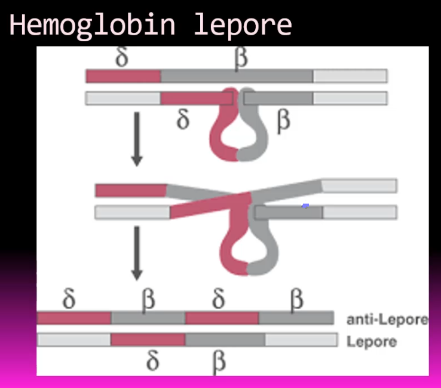

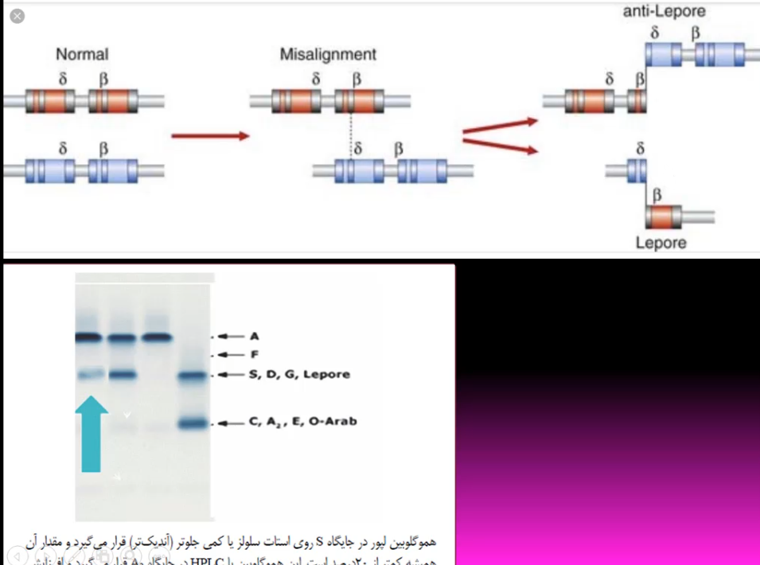

تمایز تالاسمی ها از فقر آهن بسیار مهم و حیاتی است؛ به جدول زیر توجه کنید:

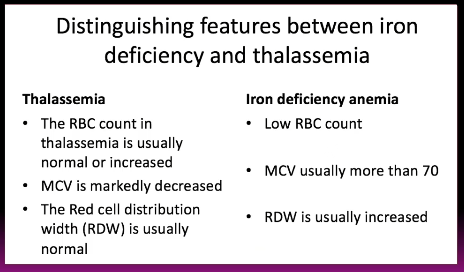

همچنین گفته شد در این وضعیت باید از فرمول ها و شاخص های عمومی غربالگری تالاسمی استفاده کرد که در تصاویر زیر مشاهده می‌کنید:

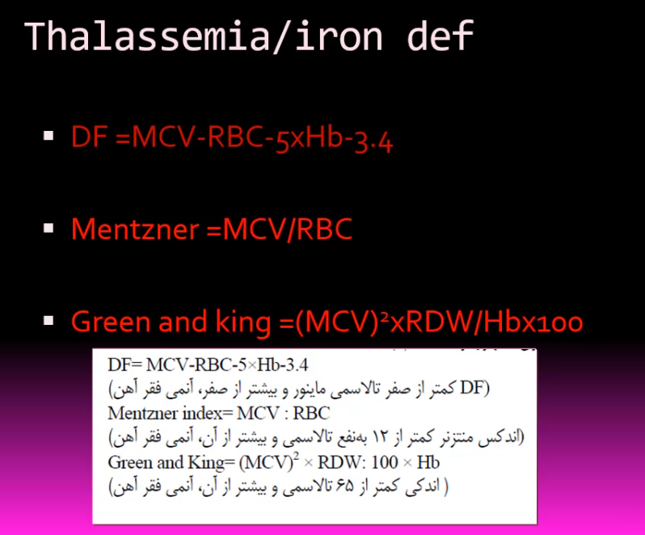

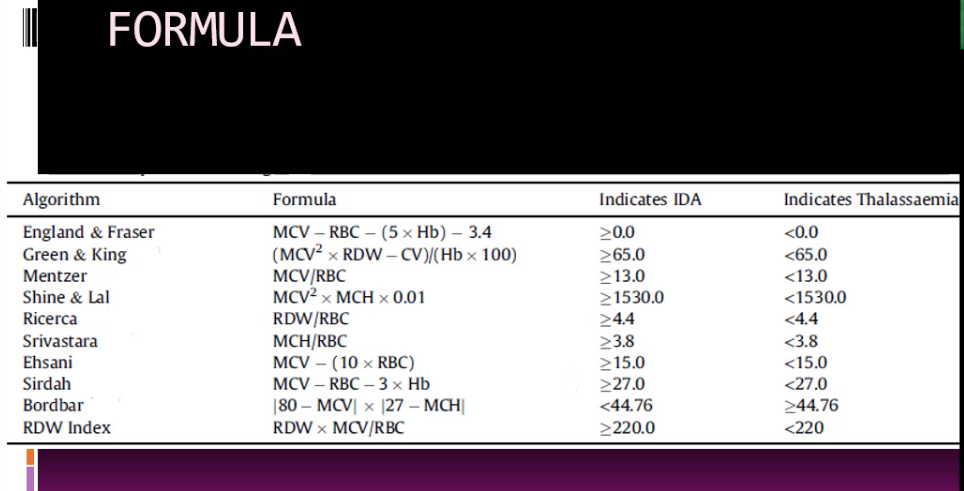

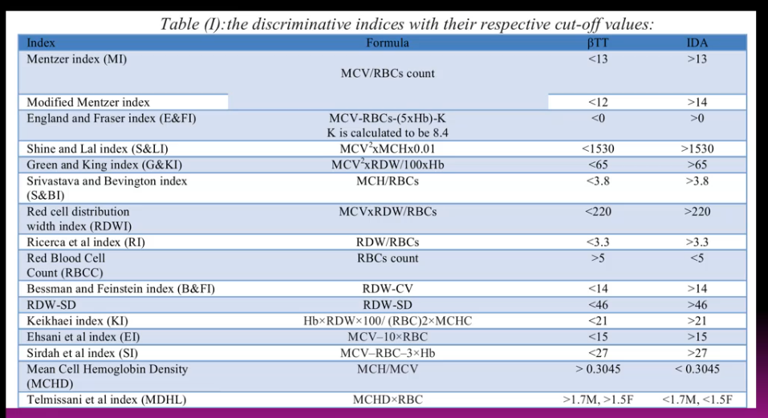

### ژن‌ها و ژنوتیپ‌های آلفا تالاسمی

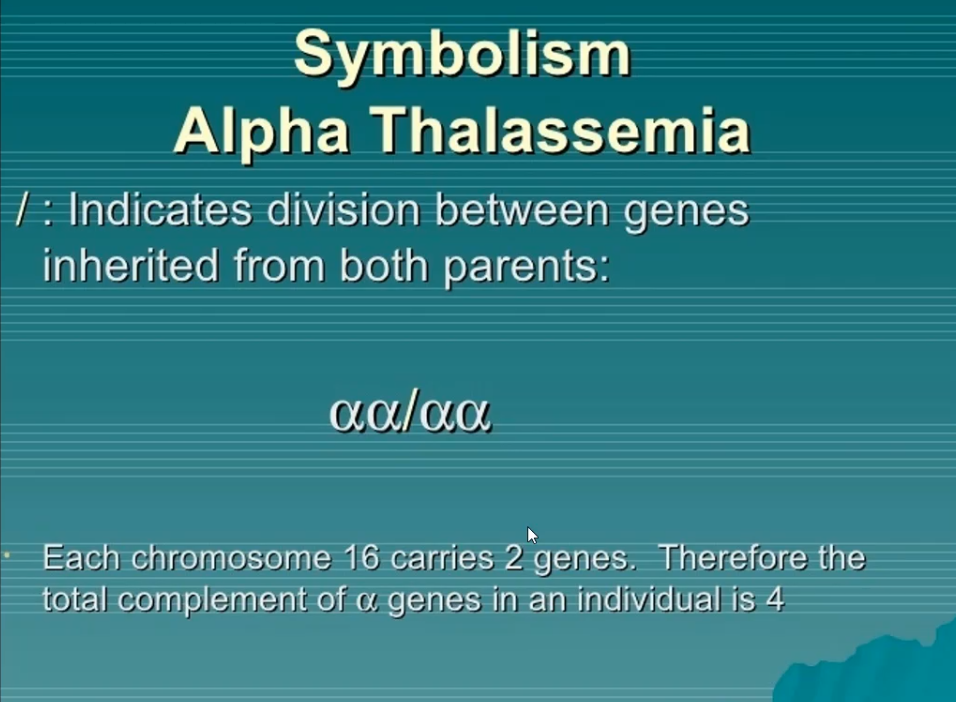

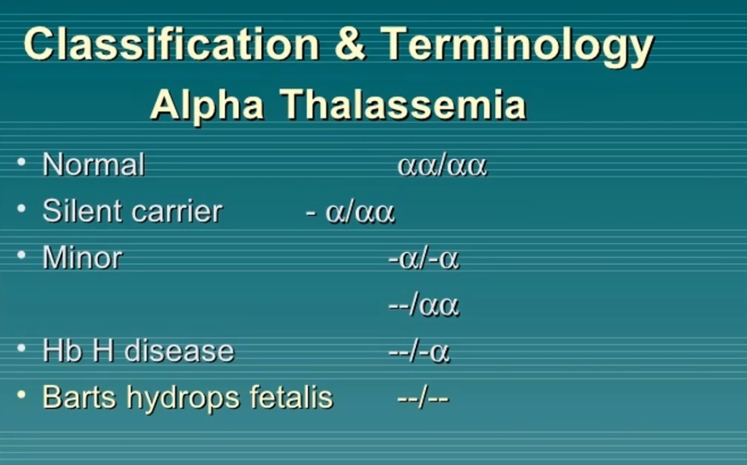

به‌طور معمول **چهار ژن آلفا** داریم: دو آلفا از پدر و دو آلفا از مادر به ارث می‌بریم. همچنین دو بتا داریم. **ژنوتیپ طبیعی** آلفا **αα/αα** است. ژن آلفا روی **کروموزوم ۱۶** قرار دارد. وجود چهار آلفا و دو بتا تعادل هموگلوبین را برقرار می‌کند و حالت طبیعی محسوب می‌شود. در جدول زیر انواع فنوتایپ و ژنوتایپ در حالت های مختلف تالاسمی آلفا آمده که در قسمت های بعدی هرکدام توضیح داده خواهند شد:

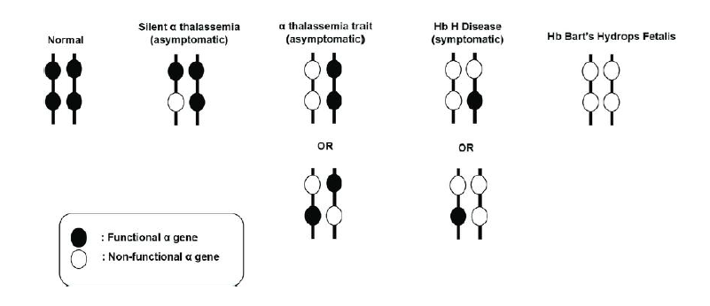

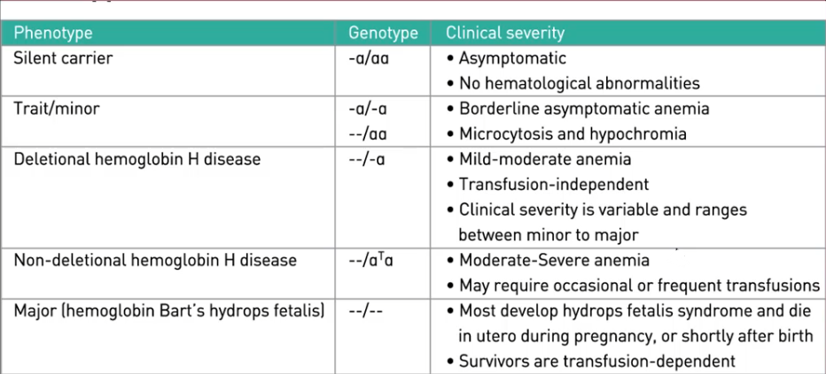

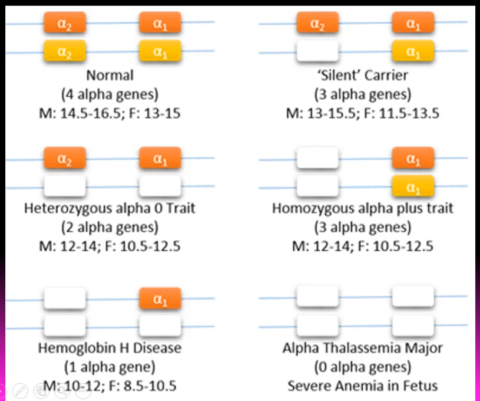

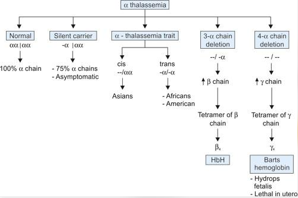

#### حامل خاموش (Silent Carrier)

در حالت حامل خاموش (Silent Carrier)، یک آلفا حذف شده و ژنوتیپ **-α/αα** است؛ بنابراین فرد **سه آلفا** دارد. حامل خاموش علامت هماتولوژیک ندارد، با اینکه یک آلفا را ندارد. آزمایش خون و هموگلوبین ممکن است طبیعی باشند و حتی ممکن است حامل‌بودن فرد با آزمایش هم تشخیص داده نشود.

> [BOX:DEFINITION]
> **حامل خاموش (Silent Carrier)**
> حالتی که یک آلفا حذف شده و ژنوتیپ **-α/αα** است؛ فرد سه آلفا دارد و علامت هماتولوژیک ندارد.

#### تالاسمی مینور آلفا (Trait/Minor)

اگر دو آلفا وجود نداشته باشند، ژنوتیپ می‌تواند یکی از این دو حالت باشد:

- **-α/-α**: هرکدام از والدین یک آلفا نداده‌اند.
- **--/αα**: یکی از والدین دو آلفای کنار هم را نداده است.

هر دو حالت **تالاسمی مینور آلفا (Alpha Thalassemia Minor)** نام دارند. تالاسمی مینور آلفا دو نوع دارد:

- **حذف ترانس (Trans Deletion)** با ژنوتیپ **-α-/α**
- **حذف سیس (Cis Deletion)** با ژنوتیپ **--/αα**

در **حذف سیس**، دو آلفای کنار هم روی یک کروموزوم حذف شده‌اند؛ به این حالت **هاپلوتیپ آلفا صفر (α0 haplotype)** هم می‌گویند. یعنی لنگهٔ کروموزومی‌ای که یکی از والدین داده است، دو آلفای کنار هم را ندارد. اهمیت حذف سیس در مشاورهٔ ژنتیکی می‌تواند بسیار زیاد باشد.

> [BOX:DEFINITION]
> **حذف سیس (Cis Deletion) / هاپلوتیپ آلفا صفر (α0 haplotype)**
> دو آلفای کنار هم روی یک کروموزوم حذف شده‌اند؛ لنگهٔ کروموزومی‌ای که یکی از والدین داده است، دو آلفای کنار هم را ندارد.

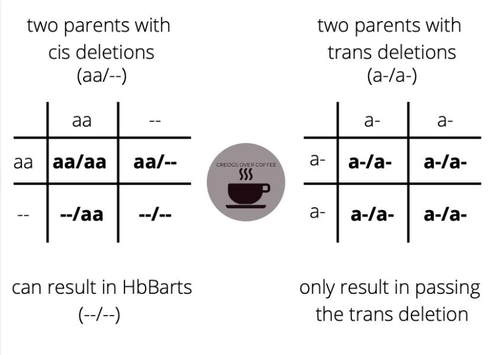

> [BOX:IMPORTANT]
> اهمیت حذف سیس در مشاورهٔ ژنتیکی می‌تواند بسیار زیاد باشد.

مانند بتا تالاسمی مینور، فرد مبتلا به مینور آلفا **میکروسیتیک و هایپوکروم** می‌شود و **RBC count او از ۵٫۵ میلیون بالاتر** می‌رود. **مورفولوژی گلبول قرمز در مینور آلفا مانند بتا تالاسمی مینور است، با این تفاوت که Hb A2 زیر ۲٫۵ درصد قرار می‌گیرد**. Hb A2 برابر **α2δ2** است و وقتی آلفا کم باشد، Hb A2 هم پایین می‌آید. بنابراین، در فرد میکروسیتیک و هایپوکروم با Hb A2 زیر ۲٫۵ درصد، دو احتمال مطرح است: **فقر آهن یا تالاسمی مینور آلفا**.

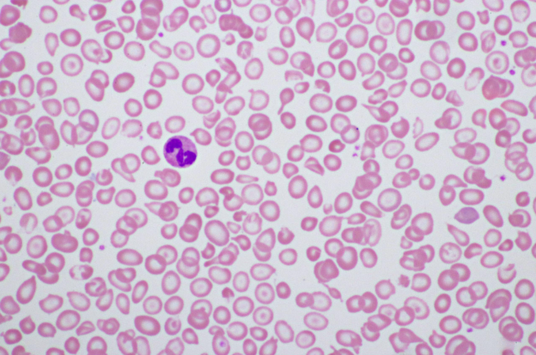

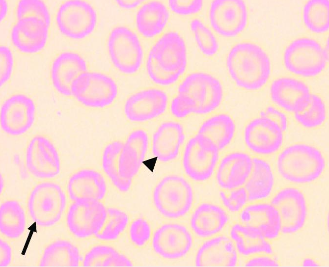

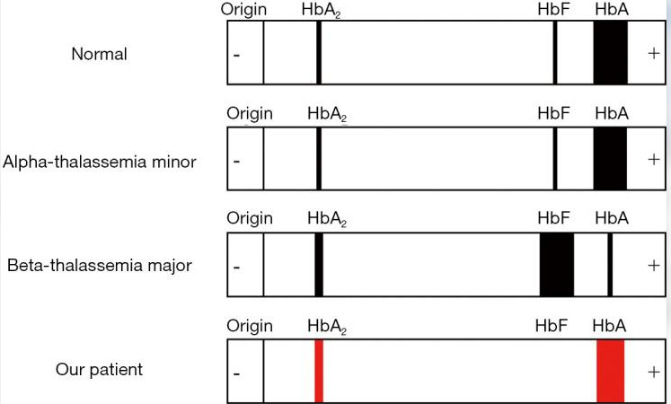

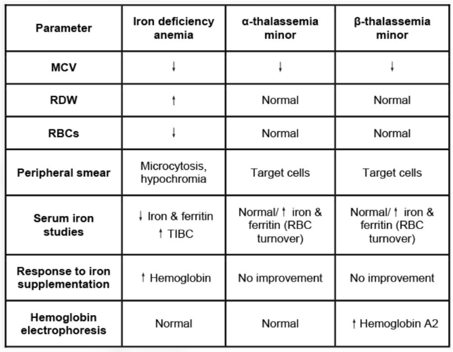

#### بیماری هموگلوبین H  (Hemoglobin H Disease; Hb H)

اگر فقط یک آلفا وجود داشته باشد، ژنوتیپ **--/-α** است؛ یعنی یکی از والدین دو آلفا و والد دیگر یک آلفا نداده‌اند. این حالت بیماری هموگلوبین H (Hemoglobin H Disease; Hb H) نام دارد و نوعی تالاسمی آلفاست.

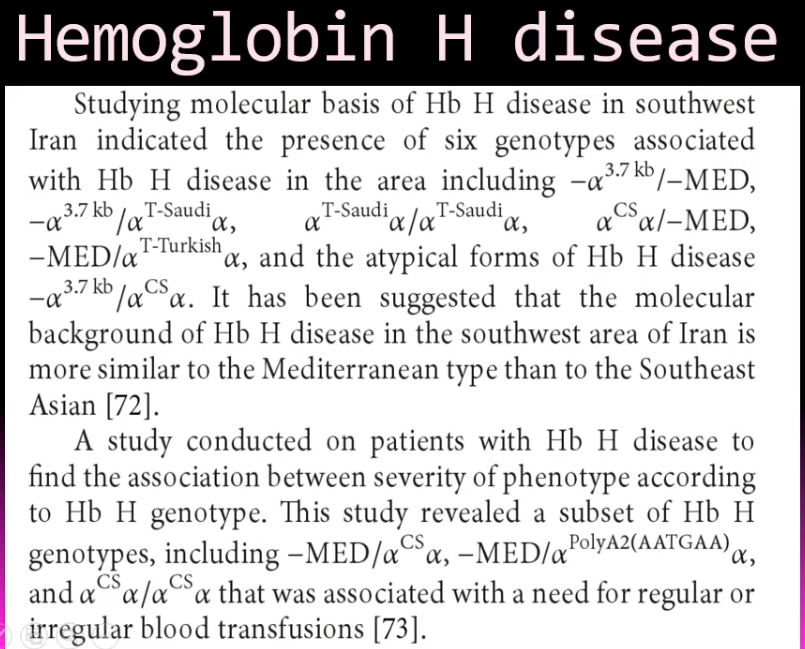

> [BOX:DEFINITION]
> **بیماری هموگلوبین H (Hemoglobin H Disease; Hb H)**
> حالتی از تالاسمی آلفا با ژنوتیپ **--/-α** که در آن فقط یک آلفا وجود دارد.

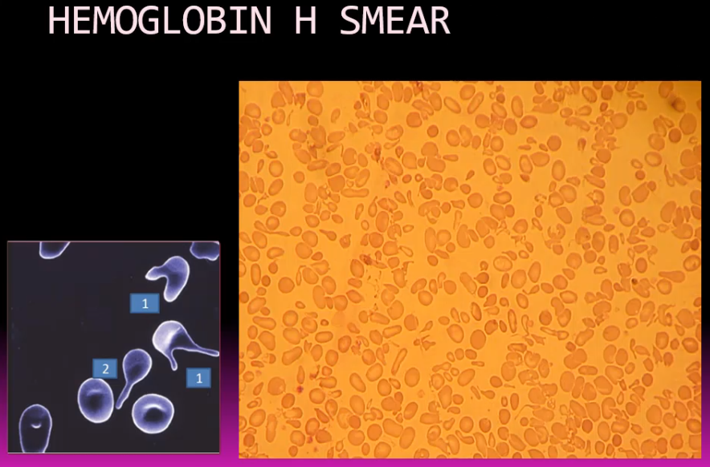

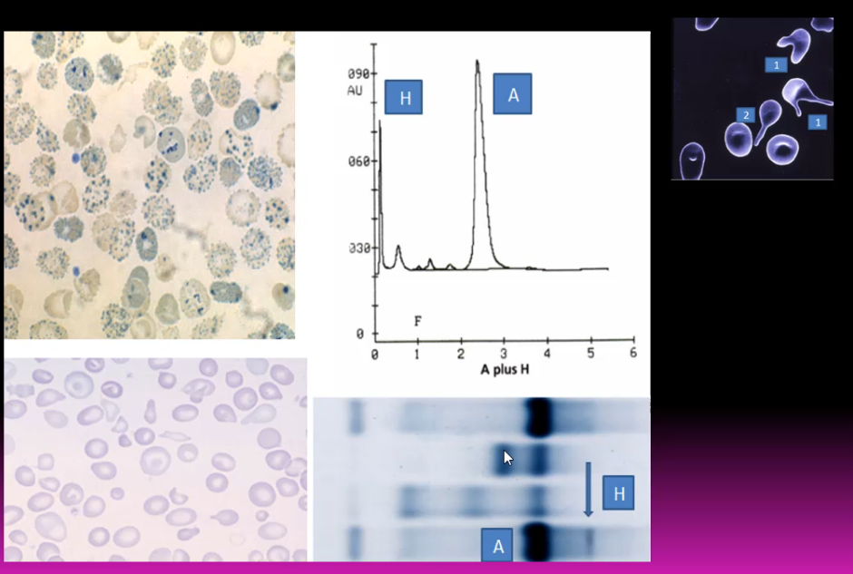

#### هیدروپس فتالیس و هموگلوبین بارت (Hb Bart & Hydrops Fetalis)

ممکن است هیچ آلفایی وجود نداشته باشد: ژنوتیپ **--/--**؛ یعنی نه مادر و نه پدر آلفایی نداده‌اند. این حالت می‌تواند زمانی ایجاد شود که هر دو والد زنده باشند و هر دو حذف سیس آلفا، یعنی **--/αα**، داشته باشند(هردو مینور آلفا بوده اند). خود آن‌ها مینور هستند و مشکلی ندارند؛ اما اگر هر دو کروموزوم دارای حذف سیس را به فرزند بدهند، فرزند ژنوتیپ **--/--** خواهد داشت.

این ژنوتیپ با زندگی خارج‌رحمی سازگار نیست و نوزاد مرده به دنیا می‌آید یا ساعاتی پس از تولد می‌میرد. به این حالت هیدروپس فتالیس (Hydrops Fetalis) با هموگلوبین بارت (Hb Bart) می‌گویند؛ نوزاد مرده و متورم به دنیا می‌آید و Hb Bart دارد.

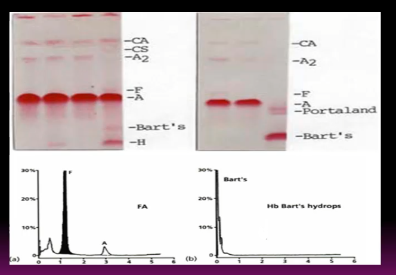

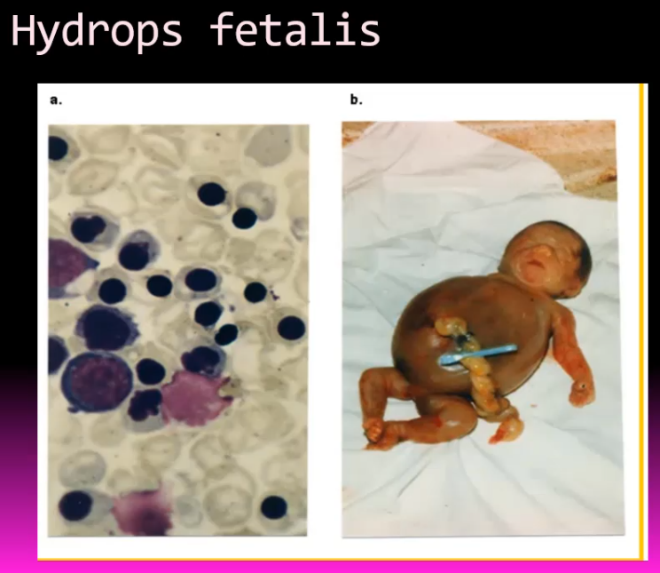

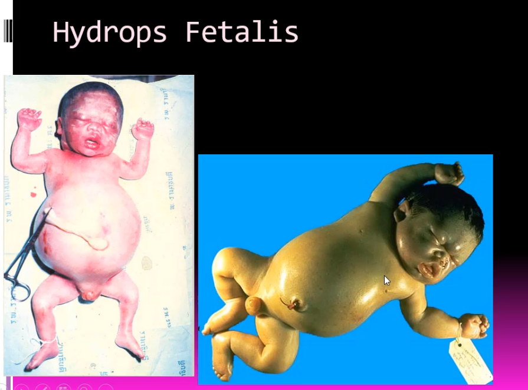

> [BOX:DEFINITION]
> **هیدروپس فتالیس (Hydrops Fetalis) با هموگلوبین بارت (Hb Bart)**
> حالتی با ژنوتیپ **--/--** که با زندگی خارج‌رحمی سازگار نیست؛ نوزاد مرده و متورم به دنیا می‌آید یا ساعاتی پس از تولد می‌میرد و Hb Bart دارد.

### حذف‌های آلفا و مشاورهٔ ژنتیکی

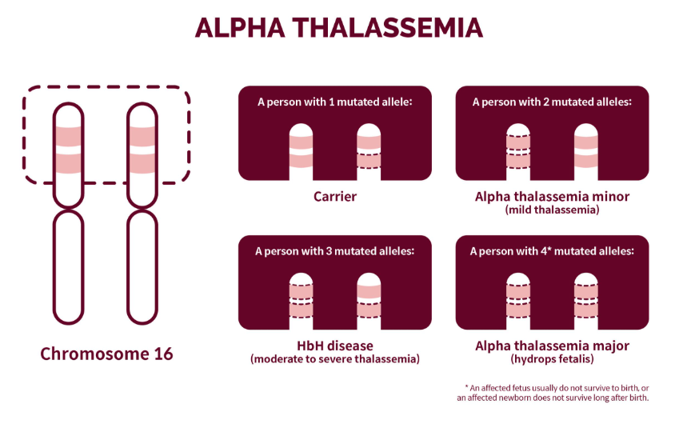

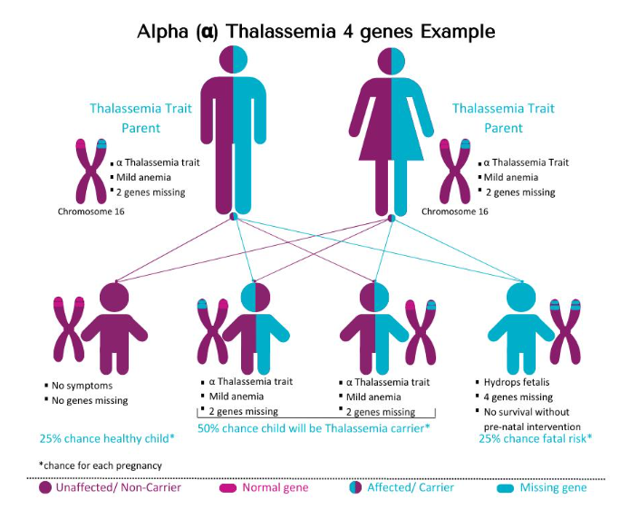

در تالاسمی‌های آلفا حذف ژنی داریم؛ یعنی ژن حذف می‌شود. این با توضیح بتا تالاسمی مینور تفاوت دارد که در آن حذف نقطه‌ای (Point Mutation) مطرح شد: یک نوکلئوتید تغییر کرده بود و به آن موتاسیون (جهش) نقطه‌ای می‌گفتند.

یک خطر مهم در مشاورهٔ ژنتیکی، ازدواج فردی با حذف سیس آلفا با حامل خاموش است. حامل خاموش ممکن است شناسایی نشده باشد و یک آلفا نداشته باشد. اگر با فرد دارای حذف سیس فرزند داشته باشد، فرزند ممکن است ژنوتیپ **--/-α** داشته باشد و دچار بیماری هموگلوبین H شود.

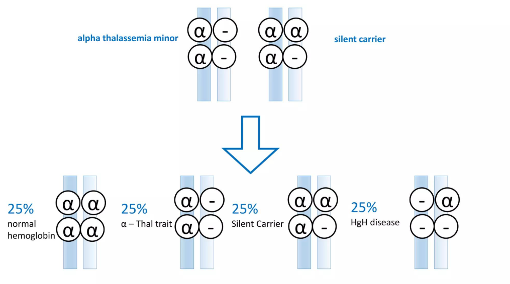

> [BOX:IMPORTANT]
> یک خطر مهم در مشاورهٔ ژنتیکی، ازدواج فردی با حذف سیس آلفا با حامل خاموش است؛ فرزند ممکن است ژنوتیپ **--/-α** داشته باشد و دچار بیماری هموگلوبین H شود.

#### حذف‌های شایع

در کروموزوم ۱۶ دو ژن آلفا و یک ژن زتا (ζ) وجود دارد. زتا در دوران رویانی فعال است. در شکلِ یک هاپلوتیپ از کروموزوم ۱۶، نواحی مشکی بخش‌هایی را نشان می‌دهند که ممکن است حذف شده باشند.

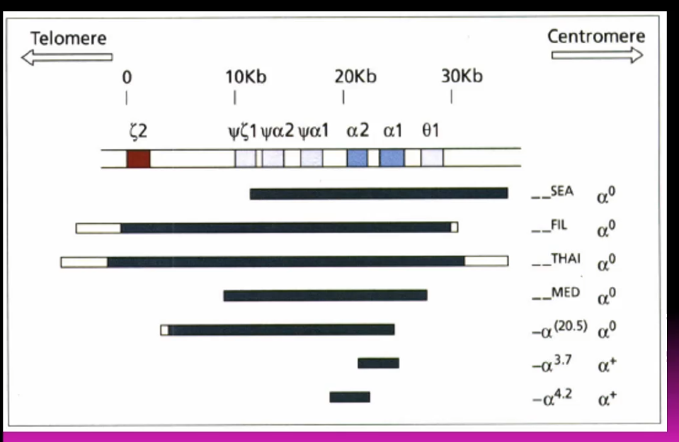

از حذف‌های شایع در ایران، حذف **SEA (Southeast Asian Deletion)** است. در حذف SEA، هر دو ژن آلفا ۱ و آلفا ۲ حذف شده‌اند؛ بنابراین، دو آلفا به‌صورت سیس حذف شده‌اند. اگر گفته شود لنگهٔ کروموزوم ۱۶ که پدر داده حذف SEA دارد، یعنی دو آلفای کنار هم روی آن وجود ندارند.

حذف‌های دیگری نیز مطرح شدند:

- **FIL (Philippines Deletion)**: در این حذف، ناحیهٔ سیاهِ نشان‌داده‌شده، شامل آلفاها و زتا، حذف شده است.
- **THAI (Thailand Deletion)**: در این حذف نیز آلفاها و زتا حذف شده‌اند.
- **MED (Mediterranean Deletion)**: در این حذف آلفا ۱ و آلفا ۲ حذف شده‌اند.

این نام‌ها به محل‌هایی اشاره دارند که حذف برای نخستین‌بار در آنجا شناسایی شده است.

در حذف **۳٫۷ (-α^3.7)**، ۳٫۷ کیلوباز (3.7 kb) حذف می‌شود. بخشی از آلفا ۱ و بخشی از آلفا ۲ حذف می‌شوند و قسمت‌های باقی‌مانده به هم می‌پیوندند؛ در نتیجه، دو ژن آلفا درهم ادغام می‌شوند و ژن ادغام‌شده کار یک ژن آلفا را انجام می‌دهد. در حذف **۴٫۲ (-α^4.2)**، آلفا ۲ حذف شده است. این گونه از حذف هارا به عنوان **تالاسمی های آلفا پلاس (a+ Thalassemia)** می‌شناسیم یعنی ژن های باقی مانده از حذف آلفا ادغام شده و تا حدودی جبران می‌کنند؛ اما حذف های قبلی که هردو ژن آلفا به کل حذف می‌شدند را **تالاسمی های آلف صفر (a0 Thalassemia)** می‌نامند؛ زیرا در این وضعیت هیچ ژن آلفایی وجود ندارد.

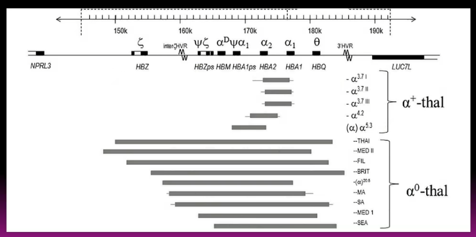

#### پیامدهای ژنوتیپ‌های والدین برای فرزند

اگر یک نفر ژنوتیپ **--/SEA ) αα)** و نفر دیگر **--/MED) αα)** داشته باشد، هر دو مینور آلفا هستند و هرکدام دو آلفا ندارند. بدترین حالت برای فرزند **--/--** است. در این حالت زتا وجود دارد؛ بنابراین هموگلوبین‌های رویانی ساخته می‌شوند. فرزند ممکن است تا ماه هفتم یا هشتم بارداری زنده بماند، اما هنگام تولد یا پیش از زایمان می‌میرد. وقتی آزمایشگاه این دو وضعیت را گزارش می‌کند، در مشاورهٔ پزشکی این خطر توضیح داده می‌شود.

> [BOX:EXAMPLE]
> یک نفر با ژنوتیپ **--SEA/αα** و نفر دیگر با ژنوتیپ **--MED/αα** هر دو مینور آلفا هستند. بدترین حالت برای فرزند **--/--** است؛ در این حالت زتا وجود دارد و هموگلوبین‌های رویانی ساخته می‌شوند. فرزند ممکن است تا ماه هفتم یا هشتم بارداری زنده بماند، اما هنگام تولد یا پیش از زایمان می‌میرد.

اگر یک نفر **--FIL/αα** و نفر دیگر **--THAI/αα** داشته باشد، در بدترین حالت فرزند آلفا و زتا ندارد. چنین فرزندی ممکن است در یکی‌دو ماه اول زندگی داخل رحم بمیرد و این وضعیت برای مادر هم خطرناک است. در مشاورهٔ ژنتیکی تالاسمی، ممکن است فرزند سالم با ژنوتیپ **αα/αα** یا مینور به دنیا بیاید، اما بدترین حالت نیز در نظر گرفته می‌شود.

> [BOX:EXAMPLE]
> اگر یک نفر **--FIL/αα** و نفر دیگر **--THAI/αα** داشته باشد، در بدترین حالت فرزند آلفا و زتا ندارد؛ ممکن است در یکی‌دو ماه اول زندگی داخل رحم بمیرد و این وضعیت برای مادر هم خطرناک است.

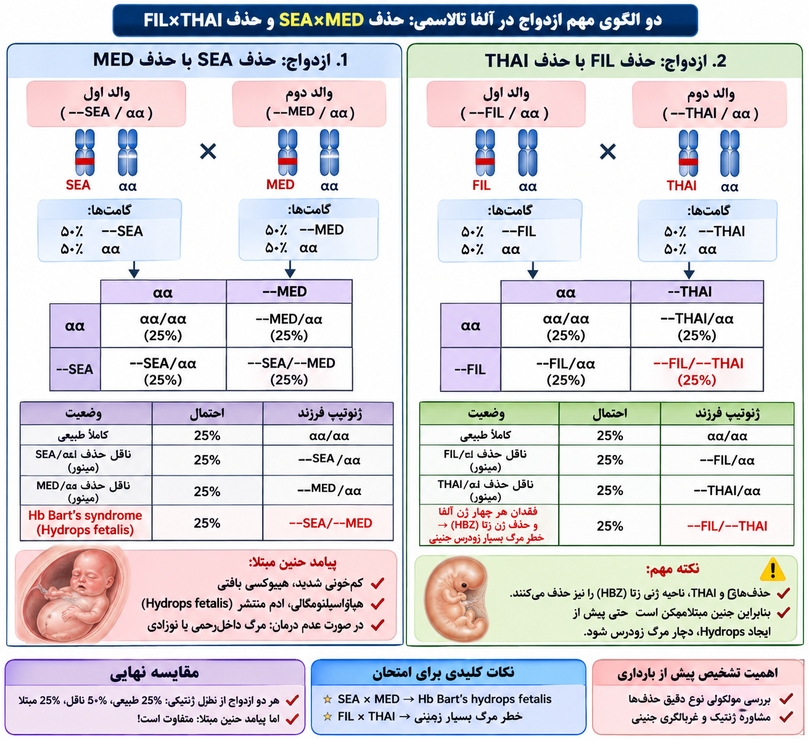

در توضیح یک حالت دیگر گفته شد که زمانی کراسینگ‌اور رخ داده و آلفا ۱ و آلفا ۲ به هم چسبیده‌اند؛ همچنین گفته شد که وقتی آلفا ۲ و آلفا به هم می‌چسبند، مشکلی ایجاد نمی‌شود.

### Hb Bart و Hb H

هموگلوبین اصلی جنین Hb F با فرمول **α2γ2** است. پس از تولد، از حدود یک‌سالگی به بعد، هموگلوبین اصلی Hb A با فرمول **α2β2** است. در دوران جنینی Hb F هموگلوبین اصلی است و پس از تولد Hb A هموگلوبین اصلی می‌شود.

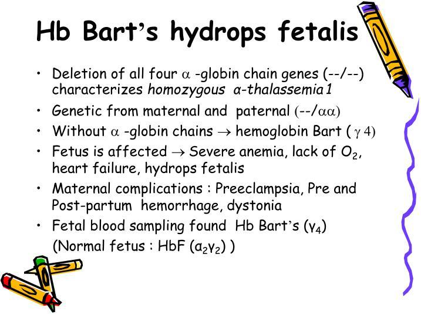

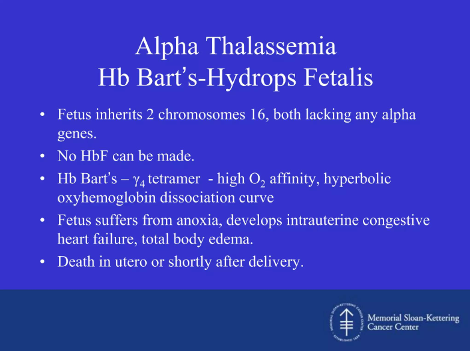

وقتی آلفا محدود باشد، زنجیره‌های اضافی گاما به هم می‌چسبند و گاما4 (**γ4)** می‌سازند؛ این هموگلوبین بارت (Hb Bart) است. در توضیح درس، درصد Hb Bart در خون نوزاد با تعداد آلفاهای ازدست‌رفته مرتبط دانسته شد:

- فقدان یک آلفا: ۱ تا ۳ درصد
- فقدان دو آلفا: ۳ تا ۸ درصد
- فقدان سه آلفا: «۲۰، ۲۵ تا ۴۰ درصد»
- فقدان چهار آلفا: ۸۰ تا ۹۰ درصد

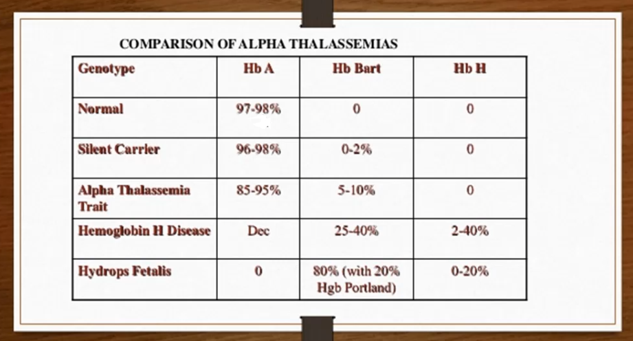

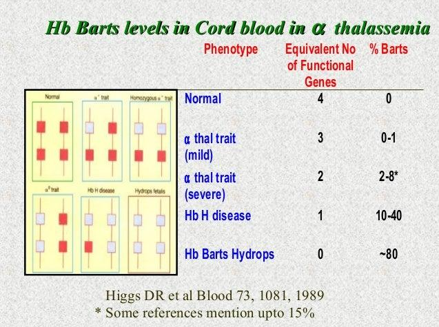

در توضیح درس، برای نوزاد نرمال ۶۰ تا ۸۵ درصد Hb F و ۱۵ تا ۴۰ درصد Hb A ذکر شد. نوزاد سالم نباید Hb Bart داشته باشد. وجود Hb Bart نشان می‌دهد آلفا محدود بوده است و مقدار آن نشان‌دهندهٔ میزان محدودیت آلفاست. Hb Bart، یعنی **γ4**، نمی‌تواند اکسیژن منتقل کند. گفته شد هموگلوبین‌هایی که از زنجیره‌های یکسان ساخته شده‌اند، مثل Hb Bart، کارایی ندارند و به همین دلیل، در صورت بروز مشکلات آلفا، جنین ممکن است بمیرد.

پس از تولد، وقتی آلفا کم باشد، زنجیره‌های بتا چهارتایی به هم می‌چسبند و Hb H، یعنی **β4**، می‌سازند. **بنابراین، در سندرم‌های تالاسمی آلفا، در دوران جنینی و بدو تولد Hb Bart و پس از تولد Hb H مطرح است. Hb H و Hb Bart نمی‌توانند اکسیژن‌رسانی کنند.**

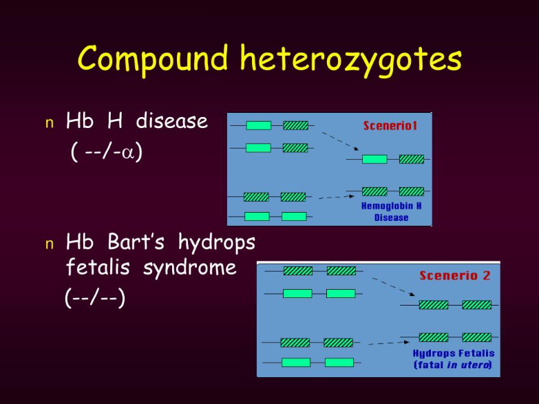

اگر زتا وجود نداشته باشد، هموگلوبین‌های رویانی تشکیل نمی‌شوند و جنین ممکن است در یکی‌دو ماهگی بمیرد. به همین دلیل، از نوزادان متولدشده الکتروفورز خون سرانگشت هم انجام می‌دهند تا مشخص شود Hb Bart دارند یا نه.

#### Hb Bart در حامل خاموش

حامل خاموش یک آلفا ندارد و در بدو تولد ممکن است ۱ تا ۳ درصد Hb Bart داشته باشد، اما Hb Bart پس از تولد محو می‌شود. پس از تولد، با سوییچ γ به β، دیگر گامایی نیست که Hb Bart بسازد. اگر مورد در روز اول تشخیص داده شود، می‌توان آن را از موارد دیگر تشخیص داد؛ چون پس از سوییچ گاما به بتا، Hb Bart دیگر پیدا نمی‌شود.

#### Hb H و آزمایش توپ گلف

بیشترین مقدار Hb H در حالتی دیده می‌شود که سه آلفا وجود نداشته باشد؛ این حالت بیماری هموگلوبین H است. در غیاب سه آلفا، بتاها چهارتایی به هم می‌چسبند و Hb H می‌سازند.

Hb H در رنگ‌آمیزی ویتال (Vital Staining)، یعنی رنگ‌آمیزی رتیکولوسیت، رسوب می‌کند و به شکل توپ گلف داخل گلبول قرمز دیده می‌شود. به این بررسی آزمایش توپ گلف، **H-body test**، **Golf Ball Test** یا **H Inclusion Test** هم می‌گویند. در رنگ‌آمیزی رتیکولوسیت به‌دنبال توپ‌های گلف می‌گردیم؛ این رسوب‌ها از بهترین یافته‌ها برای شناسایی Hb H هستند.

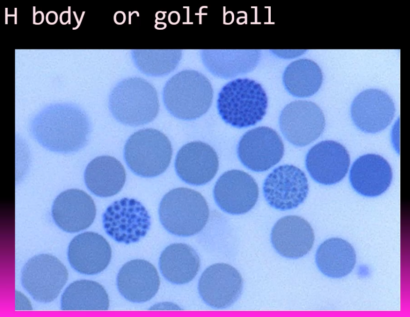

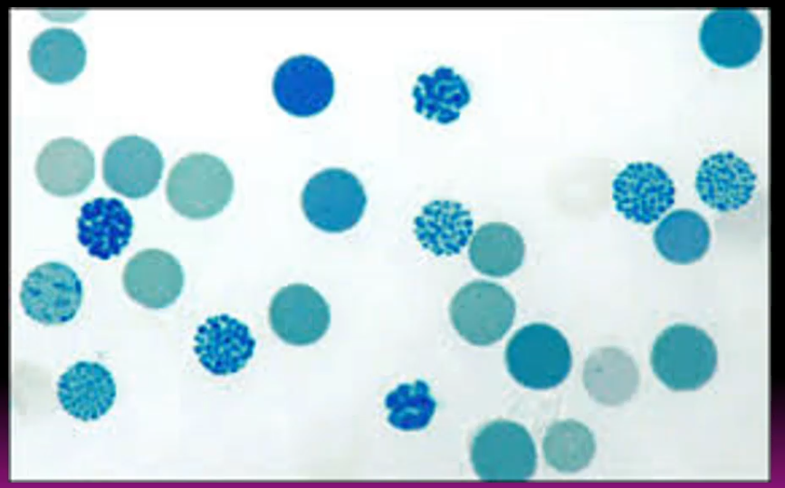

> [BOX:DEFINITION]
> **آزمایش توپ گلف (H-body test / Golf Ball Test / H Inclusion Test)**
> بررسی رنگ‌آمیزی رتیکولوسیت برای یافتن رسوب Hb H که به شکل توپ گلف داخل گلبول قرمز دیده می‌شود.

بیمار Hb H میکروسیتیک و هایپوکروم است و در رنگ‌آمیزی رتیکولوسیت رسوب Hb H دارد. در گزارش به پزشک گفته می‌شود که بیمار سه آلفا ندارد و به‌علت نبود آلفا، زنجیره‌های بتا به هم چسبیده و Hb H ساخته‌اند.

Hb H در الکتروفورز هموگلوبین نیز مشخص می‌شود و در جایگاه مخصوصی قرار می‌گیرد. الکتروفورز انواع هموگلوبین‌ها را از هم جدا می‌کند؛ برای مثال، Lepore، Hb C و Hb A در جایگاه‌های جداگانه قرار می‌گیرند.

در خون بیماری که Hb H دارد، ممکن است گلبول‌های دم‌دار دیده شوند که شبیه کلهٔ گربه‌اند و دو شاخ دارند؛ در آزمایشگاه به آن‌ها **گلبول‌های کله‌گربه‌ای** گفته می‌شود. با مشاهدهٔ گلبول‌های دم‌دار، رنگ‌آمیزی رتیکولوسیت انجام می‌دهیم. **در رنگ رایت رسوب Hb H یا توپ گلف مشخص نیست، اما دیدن گلبول‌های کله‌گربه‌ای توجه را به این موضوع جلب می‌کند**. در گزارش نباید نوشت «کله‌های گربه در خون بیمار مشاهده شد :) »؛ یا: «اشکال درهم‌برهم همراه با گلبول‌های کله‌گربه‌ای در خون بیمار یافت شد». **{طنز گل افشان؛ خخخخخخخ، هااااا هااااااا هههااااا، هههههههههههههههه، پاااااارررره شدم از خنده :) }**

### تشخیص تالاسمی آلفا

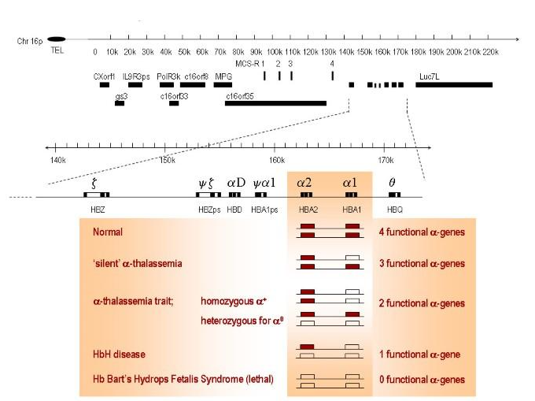

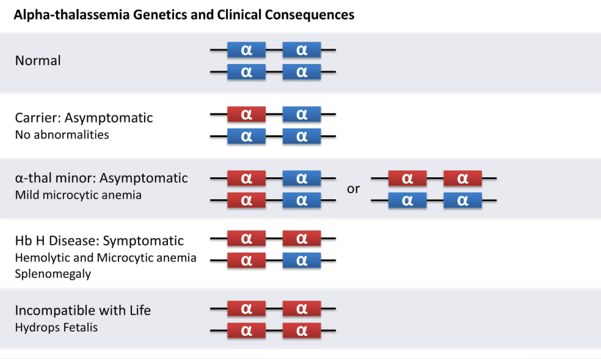

برای تشخیص نوع تالاسمی، همان‌طور که دربارهٔ بتا گفته شد، الکتروفورز انجام می‌دهیم و هموگلوبین A2 را اندازه‌گیری می‌کنیم. نیوبورن (Newborn) یعنی نوزاد. چهار حالت تالاسمی آلفا را برای تشخیص در نظر می‌گیریم:

1. حامل خاموش
2. مینور آلفا
3. هموگلوبین H (Hb H)
4. هیدروپس فتالیس (Hydrops Fetalis)

در هیدروپس فتالیس، نوزاد مرده به دنیا آمده و چهار آلفا ندارد؛ اگر تشخیص اشتباه شده باشد، می‌توان خون نوزاد را هم بررسی کرد.

گاهی نوزاد مرده و متورم است و چون علت‌های مختلفی می‌توانند چنین وضعیتی ایجاد کنند، خون او را برای مشخص‌شدن علت سقط به آزمایشگاه می‌فرستند؛ الکتروفورز می‌تواند به تشخیص کمک کند.

در نمونه‌ای از نوزاد، خون را از پاشنهٔ پا گرفته بودند و Hb Bart برابر ۳٫۷ درصد بود. وجود ۳٫۷ درصد Hb Bart در بدو تولد به معنی نداشتن دو آلفا در توضیح این مورد بود. روش‌های مختلف الکتروفورز وجود دارند؛ اگر آزمایشگاه نتواند Hb Bart را از روی نمونه تشخیص دهد، الکتروفورز انجام می‌دهد.

> [BOX:EXAMPLE]
> در نمونه‌ای از نوزاد که خون آن را از پاشنهٔ پا گرفته بودند، Hb Bart برابر ۳٫۷ درصد بود. در توضیح این مورد، وجود ۳٫۷ درصد Hb Bart در بدو تولد به معنی نداشتن دو آلفا دانسته شد.

به نوزادان متولدشده الکتروفورز خون سرانگشت هم انجام می‌دهند تا مشخص شود Hb Bart دارند یا نه. در دوران نوزادی باید به‌دنبال Hb Bart بود و در بزرگسالی به‌دنبال Hb H.

### ATR-X و بیان ژن آلفا

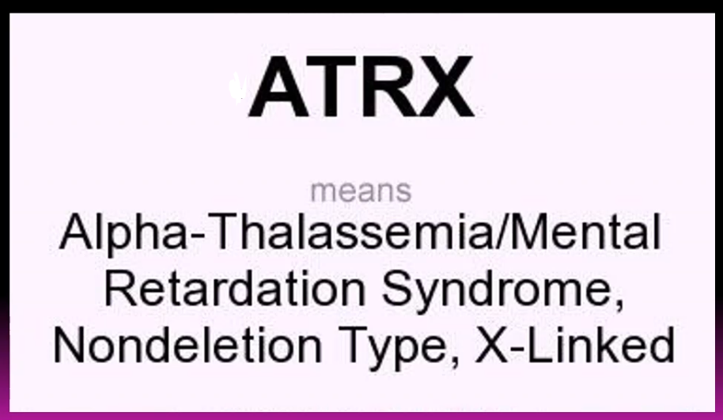

سندرمی به نام **ATR-X** وجود دارد: **Alpha Thalassemia Mental Retardation Syndrome**، یعنی **تالاسمی آلفا همراه با عقب‌افتادگی رشد ذهنی**. گفته شد بعضی افراد مبتلا به تالاسمی مینور آلفا ممکن است عقب‌افتادگی ذهنی هم داشته باشند؛ این موضوع در تقابل با این گفته مطرح شد که افراد مبتلا به مینور بتا باهوش‌اند.

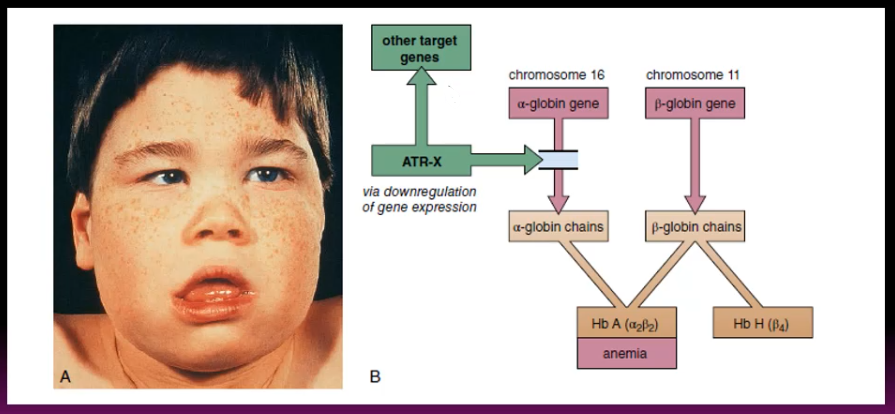

اگرچه فرد ممکن است چهار آلفا داشته باشد، بیان آلفا تحت تأثیر ژنی روی **کروموزوم X** به نام **ATRX** است. ا**ین ژن به ژن آلفا پیام می‌دهد تا بیان شود**. اگر ATRX حذف شده یا دچار موتاسیون شده باشد، نمی‌تواند سیگنال لازم را به ژن آلفا بدهد؛ در نتیجه، ژن‌های آلفا وجود دارند، اما بیان نمی‌شوند. به این حالت ATRX گفته شد و ظاهر کودک نیز ممکن است تغییر کند؛ این تغییرات را و**یژگی‌های دیسمورفیک (Dysmorphic Features)** می‌نامند.

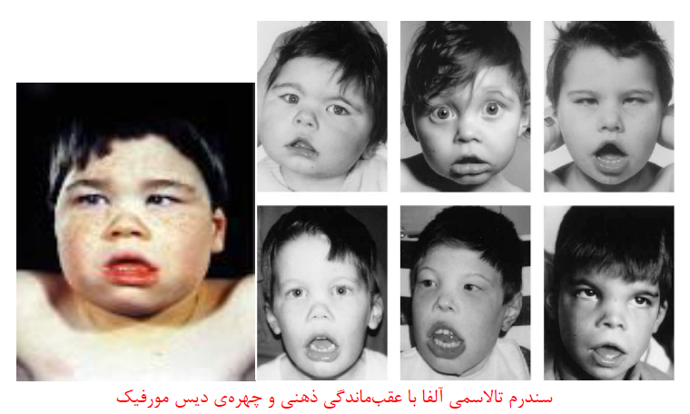

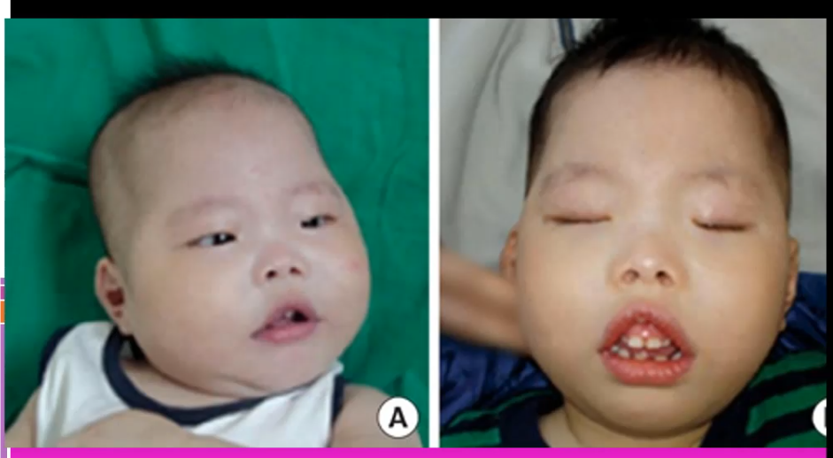

وقتی آلفا به‌خوبی بیان نشود، فرد ممکن است مینور آلفا یا Hb H داشته باشد. اگر آزمایش‌ها نشان دهند کودک تالاسمی آلفا دارد، اما هر چهار ژن آلفا وجود داشته باشند، می‌توان به مشکل ATRX مشکوک شد. در یک مورد مبتلا به ATRX، Hb H هم مثبت بود، درحالی‌که هر چهار آلفا وجود داشتند؛ ATRX موتاسیون پیدا کرده بود و با وجود ژن‌های آلفا، سیگنال لازم برای بیان آن‌ها وجود نداشت.

> [BOX:EXAMPLE]
> در یک مورد مبتلا به ATRX، Hb H هم مثبت بود، درحالی‌که هر چهار آلفا وجود داشتند؛ ATRX موتاسیون پیدا کرده بود و با وجود ژن‌های آلفا، سیگنال لازم برای بیان آن‌ها وجود نداشت.

### c-Kit Ligand و Lepore

Lepore که پیش‌تر درباره‌اش صحبت شد، می‌تواند تالاسمی دلتا-بتا باشد.

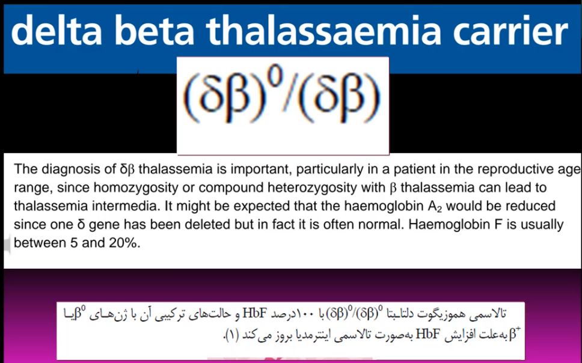

دربارهٔ **c-Kit Ligand** گفته شد که ligand چیزی است که به c-Kit می‌چسبد؛ هر receptor یک ligand دارد. برای مثال، **Steel Factor** به c-Kit سلول مادر می‌چسبد و باعث زنده‌ماندن سلول مادر می‌شود.

> [BOX:DEFINITION]
> **ligand**
> چیزی که به receptor می‌چسبد؛ دربارهٔ c-Kit گفته شد هر receptor یک ligand دارد.

> [BOX:EXAMPLE]
> **Steel Factor** به c-Kit سلول مادر می‌چسبد و باعث زنده‌ماندن سلول مادر می‌شود.

> [BOX:REVIEW]
> **اصطلاح ligand برای NCOA4**
> در توضیح درس، NCOA4 به‌عنوان ligand فریتین معرفی شده است؛ این نسبتِ اصطلاحی در منبع نیازمند بررسی است.
> **وضعیت:** نیازمند بررسی

### هموگلوبین کنستانت اسپرینگ (Hemoglobin Constant Spring; Hb CS)

نوع دیگری از هموگلوبین، هموگلوبین کنستانت اسپرینگ (Hemoglobin Constant Spring; Hb CS) است. Constant Spring به معنی «همیشه بهار» است و نخستین‌بار آن را در خانمی به نام کنستانت اسپرینگ دیده بودند. این نوع هموگلوبین در ایران هم وجود دارد و ممکن است در درمانگاه چند مورد، حدود پنج یا شش مورد، دیده شود.

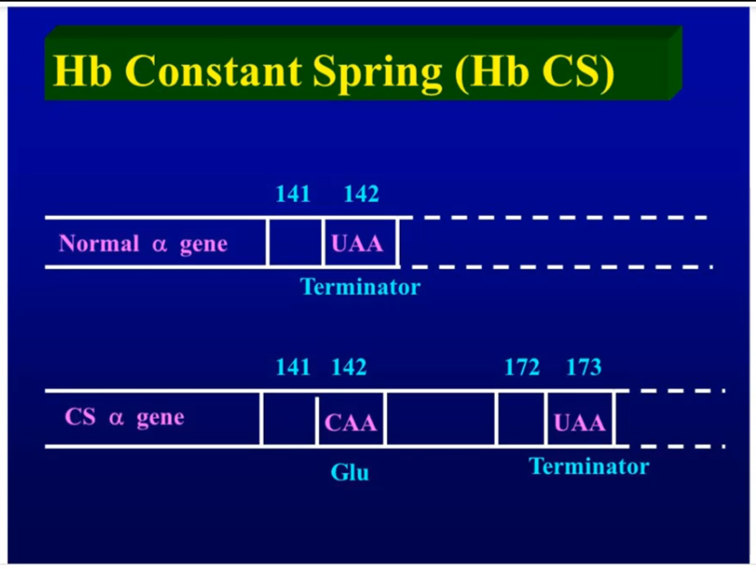

زنجیرهٔ آلفا ۱۴۱ آمینواسید دارد. پس از ساخته‌شدن ۱۴۱ آمینواسید، زنجیره به کد استاپ (Stop Codon) می‌رسد. اگر کد استاپ موتاسیون(جهش) پیدا کند و دیگر کد استاپ نباشد، زنجیره تا استاپ بعدی ادامه پیدا می‌کند. در این حالت ۳۱ آمینواسید به زنجیرهٔ آلفا اضافه می‌شود و طول زنجیره از ۱۴۱ به ۱۷۲ آمینواسید می‌رسد. زنجیره سنگین‌تر و حجیم‌تر می‌شود و هموگلوبین **α2β2** را هم مختل می‌کند.

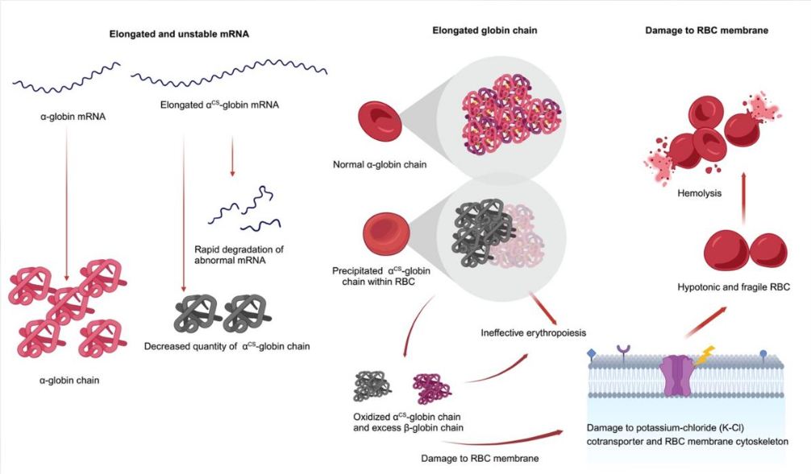

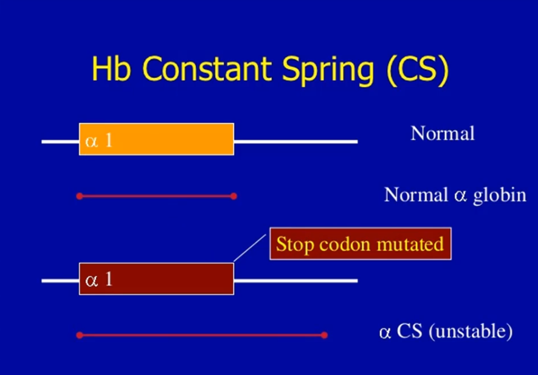

**هموگلوبین کنستانت اسپرینگ (Hb CS)** به‌شکل **α2^CSβ2** بیان شد؛ یعنی آلفای CS، آلفای طویل‌شده است. در شکل، حالت نرمال و محل کد استاپ نشان داده شده است. کد استاپ سه کد دارد و هرکدام از کد اول، دوم یا سوم ممکن است جهش پیدا کند.

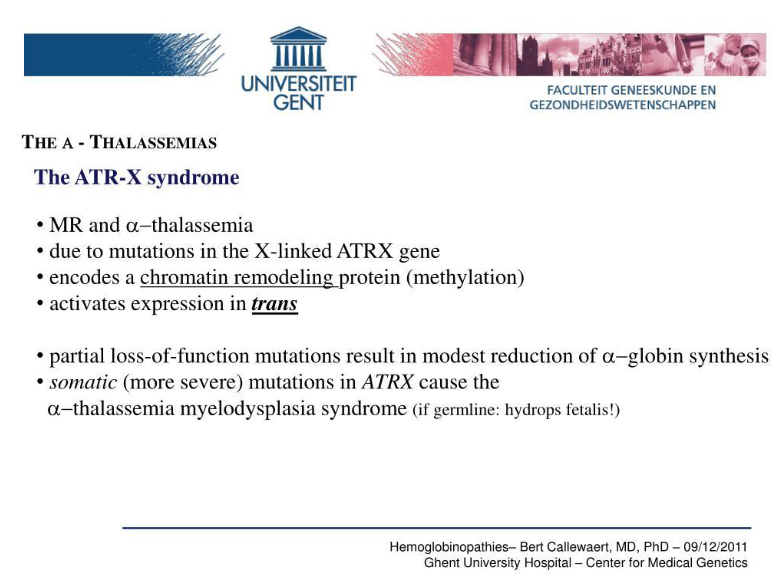

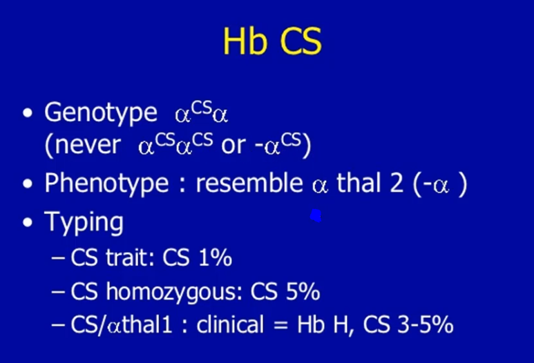

اگر دو آلفا حذف شده باشند، فرد می‌تواند زندگی عادی داشته باشد؛ اما اگر فرد دو آلفای کنستانت اسپرینگ به ارث ببرد، به خون نیاز پیدا می‌کند و طحالش بزرگ می‌شود. در مثالی که مطرح شد، پدر یک آلفای کنستانت اسپرینگ و یک آلفای سالم، و مادر نیز یک آلفای کنستانت اسپرینگ و یک آلفای سالم می‌دهند؛ در نتیجه، فرد دو آلفای کنستانت اسپرینگ خواهد داشت.

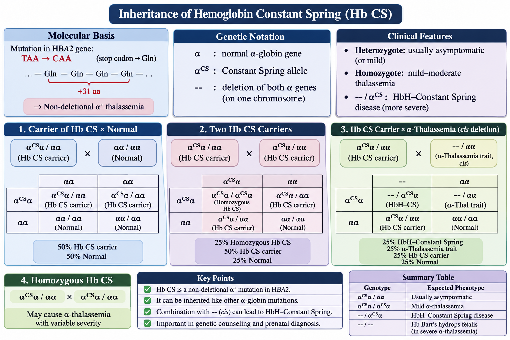

> [BOX:EXAMPLE]
> پدر یک آلفای کنستانت اسپرینگ و یک آلفای سالم، و مادر نیز یک آلفای کنستانت اسپرینگ و یک آلفای سالم می‌دهند؛ در نتیجه فرد دو آلفای کنستانت اسپرینگ خواهد داشت.

در این توضیح، آلفاهای جهشی خیلی بدتر از آلفاهای حذفی دانسته شدند و Hb CS نمونه‌ای بارز از آلفاهای جهشی معرفی شد. داشتن یک ژن کنستانت اسپرینگ به‌تنهایی مشکلی ایجاد نمی‌کند، اما اگر دو فرد که هرکدام یک کنستانت اسپرینگ دارند ازدواج کنند، فرزند ممکن است هموزیگوت کنستانت اسپرینگ شود، کم‌خونی بگیرد و طحالش بزرگ شود.

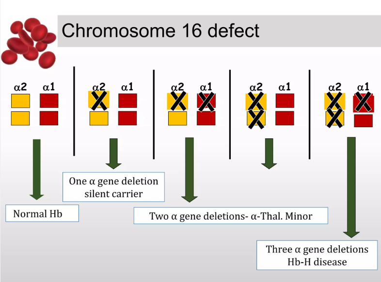

### الکتروفورز هموگلوبین

برای شناسایی انواع هموگلوبین می‌توان از الکتروفورز استفاده کرد.

#### استات سلولز در pH قلیایی

روش قدیمی و پایه، استات سلولز در pH قلیایی (Cellulose Acetate at Alkaline pH)، یعنی الکتروفورز هموگلوبین روی استات سلولز، است. دستگاه می‌تواند ۳۰۰ ولت اعمال کند. یک نوار کاغذی از جنس استات سلولز روی صفحهٔ دستگاه قرار می‌گیرد؛ خون را همولیز می‌کنند، یک قطره از آن روی نوار می‌گذارند و نوار را به جریان برق وصل می‌کنند. این روش دارای power supply و pH قلیایی است.

چون هموگلوبین‌ها شارژهای متفاوتی دارند، حرکت می‌کنند و هرکدام در جای خاصی قرار می‌گیرند. هموگلوبین‌های **A2، C، E، Lepore، S، F، A، J، N، H و Bart** را می‌توان در جایگاه‌های متفاوت تشخیص داد.

#### الکتروفورز ناحیه‌ای موئینه

روش دیگر، الکتروفورز ناحیه‌ای موئینه (Capillary Zone Electrophoresis) است که در توضیح درس گفته شد ۱۰٬۰۰۰ ولت به خون می‌دهد و الکتروفورز انجام می‌دهد؛ هر هموگلوبین در جایگاه مخصوص خود قرار می‌گیرد. در این روش ناحیه‌ها با شماره‌هایی مانند ۹۸، ۱۰۰ و ۱۲۰ و نیز **Zone 1، Zone 2، Zone 3** و غیره مشخص می‌شوند؛ برای مثال، Hb Bart در **Zone 12** قرار می‌گیرد.

### یافتهٔ تصویربرداری در کم‌خونی شدید

در تصویر رادیولوژی ممکن است حالت مو‌مانند جمجمه دیده شود که به آن «جمجمهٔ مودار» یا **Hair-on-end** می‌گویند؛ منظور این نیست که مو در عکس دیده می‌شود. در کم‌خونی شدید، دالان‌هایی در استخوان جمجمه ایجاد می‌شوند تا بافت خون‌ساز و سلول‌های مادر به آنجا بروند و خون بسازند. این دالان‌ها در استخوان دیده می‌شوند و در **آنمی داسی‌شکل و بتا تالاسمی ماژور** هم وجود دارند. به این یافته **Hair-on-end skull** گفته می‌شود. این‌ها از هموگلوبینوپاتی‌هایی هستند که قرار است جلسات آینده توضیح داده شود.

> [BOX:DEFINITION]
> **Hair-on-end skull**
> نمای مو‌مانند جمجمه در تصویر رادیولوژی؛ در کم‌خونی شدید، دالان‌هایی در استخوان جمجمه ایجاد می‌شوند تا بافت خون‌ساز و سلول‌های مادر به آنجا بروند و خون بسازند.

### آسپیراسیون و بیوپسی مغز استخوان

در آسپیراسیون مغز استخوان (Bone Marrow Aspiration)، نمونه را از ایلیاک کرست (Iliac Crest)، یعنی استخوان لگن و قسمت فوقانی ایلیاک کرست، می‌گیرند. نام سوزن **Jamshidi Needle** است.

ابتدا با بی‌حسی، پوست را بی‌حس می‌کنند؛ سپس با حرکت دورانی استخوان را سوراخ می‌کنند و وارد آن می‌شوند. خون بیرون‌آمده از مغز استخوان همراه با خود مغز استخوان است. فوراً از محتویات مغز استخوان لام می‌کشند، اسلاید تهیه و آن را رنگ‌آمیزی می‌کنند و سریع کار را انجام می‌دهند. یک نمونه را به آزمایشگاه هماتولوژی و نمونه‌ای دیگر را برای آزمایشگاه فلوسایتومتری (Flow Cytometry) و بررسی مارکرهای سلولی می‌فرستند.

در بیوپسی ترفین (Trephine Biopsy)، خود بافت مغز استخوان وارد سوزن می‌شود؛ آن را بیرون می‌آورند و برای برش بافت در فرمالین قرار می‌دهند. سپس از همین بافت مغز استخوان برش تهیه می‌کنند.

## ۳. جداول مرور سریع

| وضعیت | ژنوتیپ | ویژگی‌های ذکرشده |
|---|---|---|
| طبیعی آلفا | **αα/αα** | چهار آلفا؛ حالت طبیعی |
| حامل خاموش | **-α/αα** | سه آلفا؛ علامت هماتولوژیک ندارد |
| تالاسمی مینور آلفا، حذف ترانس | **-α/-α** | هرکدام از والدین یک آلفا نداده‌اند |
| تالاسمی مینور آلفا، حذف سیس | **--/αα** | یکی از والدین دو آلفای کنار هم را نداده است |
| بیماری هموگلوبین H | **--/-α** | فقط یک آلفا وجود دارد |
| هیدروپس فتالیس | **--/--** | هیچ آلفایی وجود ندارد |

| یافتهٔ آزمایشگاهی | تالاسمی مینور آلفا | بتا تالاسمی مینور |
|---|---|---|
| MCV و MCH / ظاهر گلبول قرمز | میکروسیتیک و هایپوکروم؛ مورفولوژی مانند بتا تالاسمی مینور | میکروسیتیک و هایپوکروم |
| RBC count | بالاتر از ۵٫۵ میلیون | در این بخش عددی ذکر نشده است |
| Hb A2 | زیر ۲٫۵ درصد | در این بخش عددی ذکر نشده است |

| نوع حذف | ناحیه یا ژن‌های حذف‌شده / تغییر رخ‌داده |
|---|---|
| **SEA (Southeast Asian Deletion)** | هر دو ژن آلفا ۱ و آلفا ۲ حذف شده‌اند؛ دو آلفا به‌صورت سیس حذف شده‌اند. از حذف‌های شایع در ایران است. |
| **FIL (Philippines Deletion)** | ناحیهٔ نشان‌داده‌شده شامل آلفاها و زتا حذف شده است. |
| **THAI (Thailand Deletion)** | آلفاها و زتا حذف شده‌اند. |
| **MED (Mediterranean Deletion)** | آلفا ۱ و آلفا ۲ حذف شده‌اند. |
| **۳٫۷ (-α^3.7)** | ۳٫۷ کیلوباز حذف می‌شود؛ بخشی از آلفا ۱ و بخشی از آلفا ۲ باقی می‌مانند و به هم می‌پیوندند؛ ژن ادغام‌شده کار یک ژن آلفا را انجام می‌دهد. |
| **۴٫۲ (-α^4.2)** | آلفا ۲ حذف شده است. |

| ژنوتیپ والدین | بدترین حالت برای فرزند | پیامدهای ذکرشده |
|---|---|---|
| **--SEA/αα** و **--MED/αα** | **--/--**؛ زتا وجود دارد | هموگلوبین‌های رویانی ساخته می‌شوند؛ فرزند ممکن است تا ماه هفتم یا هشتم بارداری زنده بماند، اما هنگام تولد یا پیش از زایمان می‌میرد. |
| **--FIL/αα** و **--THAI/αα** | فرزند آلفا و زتا ندارد | ممکن است در یکی‌دو ماه اول زندگی داخل رحم بمیرد؛ این وضعیت برای مادر هم خطرناک است. |

| هموگلوبین | زنجیره‌ها | زمان یا وضعیت ذکرشده |
|---|---|---|
| Hb F | **α2γ2** | هموگلوبین اصلی جنین؛ برای نوزاد نرمال ۶۰ تا ۸۵ درصد ذکر شد. |
| Hb A | **α2β2** | از حدود یک‌سالگی به بعد هموگلوبین اصلی؛ برای نوزاد نرمال ۱۵ تا ۴۰ درصد ذکر شد. |
| Hb Bart | **γ4** | در محدودیت آلفا، زنجیره‌های اضافی گاما به هم می‌چسبند؛ در دوران جنینی و بدو تولد مطرح است و نمی‌تواند اکسیژن منتقل کند. |
| Hb H | **β4** | پس از تولد، در کمبود آلفا زنجیره‌های بتای چهارتایی به هم می‌چسبند؛ نمی‌تواند اکسیژن‌رسانی کند. |

| تعداد آلفاهای ازدست‌رفته | درصد Hb Bart ذکرشده |
|---|---|
| یک آلفا | ۱ تا ۳ درصد |
| دو آلفا | ۳ تا ۸ درصد |
| سه آلفا | «۲۰، ۲۵ تا ۴۰ درصد» |
| چهار آلفا | ۸۰ تا ۹۰ درصد |

| ویژگی | استات سلولز در pH قلیایی | الکتروفورز ناحیه‌ای موئینه |
|---|---|---|
| نام روش | Cellulose Acetate at Alkaline pH | Capillary Zone Electrophoresis |
| توضیح دستگاه / روش | دستگاه می‌تواند ۳۰۰ ولت اعمال کند؛ نوار استات سلولز، نمونهٔ خون همولیزشده و power supply به کار می‌روند. | در توضیح درس گفته شد ۱۰٬۰۰۰ ولت به خون می‌دهد و الکتروفورز انجام می‌دهد. |
| نحوهٔ گزارش جایگاه | هموگلوبین‌ها در جایگاه‌های متفاوت قرار می‌گیرند. | ناحیه‌ها با شماره‌هایی مانند ۹۸، ۱۰۰ و ۱۲۰ و نیز Zone 1، Zone 2، Zone 3 و غیره مشخص می‌شوند. |
| مثال ذکرشده | A2، C، E، Lepore، S، F، A، J، N، H و Bart در جایگاه‌های متفاوت تشخیص داده می‌شوند. | Hb Bart در Zone 12 قرار می‌گیرد. |

| ویژگی | آسپیراسیون مغز استخوان (Bone Marrow Aspiration) | بیوپسی ترفین (Trephine Biopsy) |
|---|---|---|
| نمونه | خون بیرون‌آمده از مغز استخوان همراه با خود مغز استخوان | خود بافت مغز استخوان که وارد سوزن می‌شود |
| محل و ابزار ذکرشده | ایلیاک کرست (Iliac Crest)، با سوزن **Jamshidi Needle** | بافت وارد سوزن می‌شود و بیرون آورده می‌شود |
| آماده‌سازی و بررسی | فوراً لام می‌کشند، اسلاید تهیه و رنگ‌آمیزی می‌کنند؛ نمونه‌هایی به آزمایشگاه هماتولوژی و فلوسایتومتری فرستاده می‌شود. | بافت را برای برش در فرمالین قرار می‌دهند و از آن برش تهیه می‌کنند. |

## ۴. اصطلاحات و تعاریف

> [BOX:DEFINITION]
> **Mentzer Index**
> Mentzer Index = MCV / RBC count

> [BOX:DEFINITION]
> **حامل خاموش (Silent Carrier)**
> حالتی که یک آلفا حذف شده و ژنوتیپ **-α/αα** است؛ فرد سه آلفا دارد و علامت هماتولوژیک ندارد.

> [BOX:DEFINITION]
> **حذف سیس (Cis Deletion) / هاپلوتیپ آلفا صفر (α0 haplotype)**
> دو آلفای کنار هم روی یک کروموزوم حذف شده‌اند؛ لنگهٔ کروموزومی‌ای که یکی از والدین داده است، دو آلفای کنار هم را ندارد.

> [BOX:DEFINITION]
> **بیماری هموگلوبین H (Hemoglobin H Disease; Hb H)**
> حالتی از تالاسمی آلفا با ژنوتیپ **--/-α** که در آن فقط یک آلفا وجود دارد.

> [BOX:DEFINITION]
> **هیدروپس فتالیس (Hydrops Fetalis) با هموگلوبین بارت (Hb Bart)**
> حالتی با ژنوتیپ **--/--** که با زندگی خارج‌رحمی سازگار نیست؛ نوزاد مرده و متورم به دنیا می‌آید یا ساعاتی پس از تولد می‌میرد و Hb Bart دارد.

> [BOX:DEFINITION]
> **آزمایش توپ گلف (H-body test / Golf Ball Test / H Inclusion Test)**
> بررسی رنگ‌آمیزی رتیکولوسیت برای یافتن رسوب Hb H که به شکل توپ گلف داخل گلبول قرمز دیده می‌شود.

> [BOX:DEFINITION]
> **ligand**
> چیزی که به receptor می‌چسبد؛ دربارهٔ c-Kit گفته شد هر receptor یک ligand دارد.

> [BOX:DEFINITION]
> **Hair-on-end skull**
> نمای مو‌مانند جمجمه در تصویر رادیولوژی؛ در کم‌خونی شدید، دالان‌هایی در استخوان جمجمه ایجاد می‌شوند تا بافت خون‌ساز و سلول‌های مادر به آنجا بروند و خون بسازند.

## ۵. خود‌ارزیابی

### سوالات تشریحی

> [QUESTION:ESSAY:1]
> ژنوتیپ‌های حذف ترانس و حذف سیس در تالاسمی مینور آلفا را بیان کنید و توضیح دهید تفاوت آن‌ها در آرایش ژن‌های حذف‌شده چیست.
> [ANSWER]
> حذف ترانس ژنوتیپ **-α/-α** دارد و هرکدام از والدین یک آلفا نداده‌اند. حذف سیس ژنوتیپ **--/αα** دارد و دو آلفای کنار هم روی یک کروموزوم حذف شده‌اند.

> [QUESTION:ESSAY:2]
> در کمبود آلفا، Hb Bart و Hb H از چه زنجیره‌هایی ساخته می‌شوند و در چه دوره‌هایی مطرح‌اند؟
> [ANSWER]
> Hb Bart از زنجیره‌های گامای چهارتایی (**γ4**) ساخته می‌شود و در دوران جنینی و بدو تولد مطرح است. پس از تولد، زنجیره‌های بتای چهارتایی (**β4**) به هم می‌چسبند و Hb H می‌سازند.

> [QUESTION:ESSAY:3]
> توضیح دهید در حذف **۳٫۷ (-α^3.7)** چه تغییری در بخش‌های آلفا رخ می‌دهد و ژن ادغام‌شده چه کاری انجام می‌دهد.
> [ANSWER]
> ۳٫۷ کیلوباز حذف می‌شود؛ بخشی از آلفا ۱ و بخشی از آلفا ۲ باقی می‌مانند و به هم می‌پیوندند. در نتیجه، دو ژن آلفا درهم ادغام می‌شوند و ژن ادغام‌شده کار یک ژن آلفا را انجام می‌دهد.

> [QUESTION:ESSAY:4]
> در یک بیمار مبتلا به Hb H، آزمایش توپ گلف چه چیزی را بررسی می‌کند و رسوب Hb H در چه شکلی دیده می‌شود؟
> [ANSWER]
> در رنگ‌آمیزی ویتال، یعنی رنگ‌آمیزی رتیکولوسیت، به‌دنبال رسوب Hb H می‌گردند. رسوب به شکل توپ گلف داخل گلبول قرمز دیده می‌شود؛ این بررسی H-body test، Golf Ball Test یا H Inclusion Test هم نام دارد.

> [QUESTION:ESSAY:5]
> تفاوت نمونهٔ به‌دست‌آمده در آسپیراسیون مغز استخوان و بیوپسی ترفین را شرح دهید.
> [ANSWER]
> در آسپیراسیون، خون بیرون‌آمده از مغز استخوان همراه با خود مغز استخوان نمونه‌گیری می‌شود و فوراً از محتویات آن لام تهیه و رنگ‌آمیزی می‌کنند. در بیوپسی ترفین، خود بافت مغز استخوان وارد سوزن می‌شود؛ آن را بیرون می‌آورند، در فرمالین قرار می‌دهند و از آن برش تهیه می‌کنند.

### سوالات تستی

> [QUESTION:MCQ:1]
> کدام ژنوتیپ مربوط به حذف سیس در تالاسمی مینور آلفا است؟
> [OPTION:A] **-α/-α**
> [OPTION:B] **--/αα**
> [OPTION:C] **--/-α**
> [OPTION:D] **--/--**
> [ANSWER]
> [CORRECT:B]
> حذف سیس ژنوتیپ **--/αα** دارد.

> [QUESTION:MCQ:2]
> در توضیح درس، ژن آلفا روی کدام کروموزوم قرار دارد؟
> [OPTION:A] کروموزوم ۱۶
> [OPTION:B] کروموزوم X
> [OPTION:C] کروموزوم ۳٫۷
> [OPTION:D] کروموزوم ۴٫۲
> [ANSWER]
> [CORRECT:A]
> ژن آلفا روی کروموزوم ۱۶ قرار دارد؛ ژن ATRX روی کروموزوم X ذکر شد.

> [QUESTION:MCQ:3]
> Hb A2 با کدام فرمول بیان شده است؟
> [OPTION:A] **α2γ2**
> [OPTION:B] **α2δ2**
> [OPTION:C] **α2β2**
> [OPTION:D] **β4**
> [ANSWER]
> [CORRECT:B]
> Hb A2 برابر **α2δ2** است.

> [QUESTION:MCQ:4]
> در نبود آلفای کافی، Hb Bart از کدام زنجیره‌ها ساخته می‌شود؟
> [OPTION:A] زنجیره‌های گامای چهارتایی
> [OPTION:B] زنجیره‌های بتای چهارتایی
> [OPTION:C] دو زنجیرهٔ آلفا و دو زنجیرهٔ بتا
> [OPTION:D] دو زنجیرهٔ آلفا و دو زنجیرهٔ دلتا
> [ANSWER]
> [CORRECT:A]
> زنجیره‌های اضافی گاما به هم می‌چسبند و **γ4** یا Hb Bart را می‌سازند.

> [QUESTION:MCQ:5]
> پس از تولد، در کمبود آلفا کدام هموگلوبین از زنجیره‌های بتای چهارتایی ساخته می‌شود؟
> [OPTION:A] Hb F
> [OPTION:B] Hb A
> [OPTION:C] Hb H
> [OPTION:D] Hb Bart
> [ANSWER]
> [CORRECT:C]
> پس از تولد زنجیره‌های بتا به هم می‌چسبند و **β4** یا Hb H می‌سازند.

> [QUESTION:MCQ:6]
> در حذف **۴٫۲ (-α^4.2)** کدام بخش حذف شده است؟
> [OPTION:A] آلفا ۱
> [OPTION:B] آلفا ۲
> [OPTION:C] آلفا ۱ و آلفا ۲، همراه با زتا
> [OPTION:D] بخشی از آلفا ۱ و بخشی از آلفا ۲ که به هم می‌پیوندند
> [ANSWER]
> [CORRECT:B]
> در حذف **۴٫۲ (-α^4.2)**، آلفا ۲ حذف شده است.

> [QUESTION:MCQ:7]
> Hb H در رنگ‌آمیزی رتیکولوسیت چگونه دیده می‌شود؟
> [OPTION:A] به‌صورت توپ گلف داخل گلبول قرمز
> [OPTION:B] به‌صورت Hb Bart در Zone 12
> [OPTION:C] به‌صورت گلبول‌های کله‌گربه‌ای فقط در رنگ رایت
> [OPTION:D] به‌صورت زنجیره‌های گامای آزاد
> [ANSWER]
> [CORRECT:A]
> رسوب Hb H در رنگ‌آمیزی رتیکولوسیت به شکل توپ گلف داخل گلبول قرمز دیده می‌شود.

> [QUESTION:MCQ:8]
> در صورت وجود هر چهار ژن آلفا در کودکی که آزمایش‌هایش تالاسمی آلفا را نشان می‌دهند، کدام مشکل می‌تواند مطرح باشد؟
> [OPTION:A] حذف MED
> [OPTION:B] مشکل ATRX
> [OPTION:C] حذف SEA
> [OPTION:D] حذف آلفا ۲ به‌تنهایی
> [ANSWER]
> [CORRECT:B]
> اگر تالاسمی آلفا مطرح باشد اما هر چهار ژن آلفا وجود داشته باشند، می‌توان به مشکل ATRX مشکوک شد.

> [QUESTION:MCQ:9]
> در بیوپسی ترفین، نمونهٔ مغز استخوان چگونه آماده می‌شود؟
> [OPTION:A] به‌صورت خون همولیزشده روی نوار استات سلولز گذاشته می‌شود.
> [OPTION:B] بافت را در فرمالین قرار می‌دهند و از آن برش تهیه می‌کنند.
> [OPTION:C] نمونه فقط برای بررسی مارکرهای سلولی فرستاده می‌شود.
> [OPTION:D] آن را با رنگ‌آمیزی رتیکولوسیت برای توپ گلف بررسی می‌کنند.
> [ANSWER]
> [CORRECT:B]
> در بیوپسی ترفین، بافت مغز استخوان را در فرمالین قرار می‌دهند و از آن برش تهیه می‌کنند.

> [QUESTION:MCQ:10]
> در حذف SEA، کدام توصیف با مطالب درس مطابقت دارد؟
> [OPTION:A] فقط آلفا ۲ حذف شده است.
> [OPTION:B] هر دو ژن آلفا ۱ و آلفا ۲ حذف شده‌اند و حذف به‌صورت سیس است.
> [OPTION:C] آلفاها باقی می‌مانند، اما ATRX بیان نمی‌شود.
> [OPTION:D] بخشی از آلفا ۱ و آلفا ۲ به هم می‌پیوندند و یک ژن آلفا می‌سازند.
> [ANSWER]
> [CORRECT:B]
> در حذف SEA، هر دو ژن آلفا ۱ و آلفا ۲ حذف شده‌اند؛ بنابراین دو آلفا به‌صورت سیس حذف شده‌اند.

## ۷. ادیتور و منابع استفاده‌شده

**ادیتور:** نیما قاسمی (ن.ق.شب‌زنده‌دار)

**منابع استفاده‌شده:**

- صوت درس
- <h1>References – Alpha-Thalassemia</h1><h3>۱. کتاب‌های مرجع کلاسیک هماتولوژی</h3><ol start="1"><li>
Hoffbrand, A. V., &amp; Moss, P. A. H. <em>Hoffbrand's Essential Haematology</em>. 7th ed. Wiley-Blackwell, 2016.
</li><li>
Keohane, E. M., Otto, C. N., &amp; Walenga, J. M. <em>Rodak's Hematology: Clinical Principles and Applications</em>. 6th ed. Elsevier, 2020.
</li><li>
Bain, B. J., Bates, I., &amp; Laffan, M. A. <em>Dacie and Lewis Practical Haematology</em>. 12th ed. Elsevier, 2017.
</li><li>
<em>Wintrobe's Clinical Hematology</em>. 15th ed. Wolters Kluwer, 2023.
</li></ol><h3>۲. منابع تخصصی و مقالات علمی</h3><ol start="5"><li>
Tamary, H., Greenberg-Kushnir, N., &amp; Dgany, O. (2026). <strong>Alpha-Thalassemia.</strong> GeneReviews. <a href="https://www.ncbi.nlm.nih.gov/sites/books/NBK1435/?utm_source=chatgpt.com">GeneReviews – Full Text</a>
</li><li>
Amid, A., Lal, A., Coates, T. D., &amp; Fucharoen, S. (Eds.). (2023). <strong>Guidelines for the Management of α-Thalassaemia.</strong> Thalassaemia International Federation. <a href="https://www.ncbi.nlm.nih.gov/books/NBK602223/?utm_source=chatgpt.com">TIF Guidelines – Full Text</a>
</li><li>
Piel, F. B., &amp; Weatherall, D. J. (2014). <strong>The α-Thalassemias.</strong> <em>New England Journal of Medicine</em>, 371, 1908–1916. <a href="https://pubmed.ncbi.nlm.nih.gov/25390741/?utm_source=chatgpt.com">PubMed – Article</a>
</li><li>
Kwaifa, I. K., Lai, M. I., &amp; Md Noor, S. (2020). <strong>Non-deletional alpha thalassaemia: a review.</strong> <em>Orphanet Journal of Rare Diseases</em>, 15, 166. <a href="https://link.springer.com/article/10.1186/s13023-020-01429-1?utm_source=chatgpt.com">Full Text – Springer Nature</a>
</li><li>
Fischel-Ghodsian, N., et al. (1988). <strong>Characterization of two deletions that remove the entire human zeta-alpha globin gene complex (--THAI and --FIL).</strong> <em>British Journal of Haematology</em>, 70(2), 233–238. <a href="https://pubmed.ncbi.nlm.nih.gov/3191033/?utm_source=chatgpt.com">PubMed – Article</a>
</li><li>
Motiani, A., Zubair, M., &amp; Sonagra, A. D. (2024). <strong>Laboratory Evaluation of Alpha Thalassemia.</strong> StatPearls. <a href="https://www.ncbi.nlm.nih.gov/books/NBK587402/?utm_source=chatgpt.com">NCBI Bookshelf – Full Text</a>
</li></ol><h3>۳. منابع تشخیص آزمایشگاهی و تصاویر آموزشی</h3><ol start="11"><li>
Agios Pharmaceuticals. (2023). <strong>Alpha Thalassemia – Fast Facts for Patients.</strong> <a href="https://www.agios.com/wp-content/uploads/2023/02/THA-ALL-0050-Alpha-Thalassemia-Fast-Facts-Patient-Booklet_MA.pdf?utm_source=chatgpt.com">PDF – Alpha Thalassemia Fast Facts</a>
</li><li>
University of Utah. (2018). <strong>Hemoglobinopathies and Thalassemias in Pregnancy.</strong> Educational Presentation. <a href="https://physicians.utah.edu/sites/g/files/zrelqx276/files/media/documents/2021/2018.5.04-hemaglobinopathies--thalassemias-in-pregnancy.pdf?utm_source=chatgpt.com">University of Utah – PDF Presentation</a>
</li><li>
Thalassaemia International Federation. (2023). <strong>Guidelines for the Management of α-Thalassaemia.</strong> <a href="https://www.ncbi.nlm.nih.gov/books/NBK602223/toc/?report=printable&amp;utm_source=chatgpt.com">TIF – Educational and Clinical Reference</a>
</li></ol><h3>۴. منابع فارسی</h3><ol start="14"><li>
گل‌افشان، حبیب‌الله. <bdi>(۱۳۸۷). </bdi><strong>پاسخ به پرسش‌های آزمایشگاهی تالاسمی و اختلالات هموگلوبین.</strong> انتشارات نوید.
</li><li>
گل‌افشان، حبیب‌الله. <strong>روش‌های آزمایشگاهی در هماتولوژی.</strong>
</li><li>
گل‌افشان، حبیب‌الله. <strong>جزوات و اسلایدهای آموزشی درس هماتولوژی.</strong> دانشکده پیراپزشکی، دانشگاه علوم پزشکی شیراز.
</li></ol>
<h3> </h3>

## ۸. گزارش تکمیل بودن محتوا

- ✓ پوشش محتوای اسلایدهای ارائه‌شده: مطالب موجود در محتوای ورودی پوشش داده شد؛ نام فایل اسلاید ارائه نشده است.
- ✓ پوشش صوت درس: نکات آموزشی و توضیحات موجود در محتوای ورودی حفظ شد.