# ارگان‌های لنفاوی محیطی (ثانویه)

**درس:** ایمونولوژی
**مبحث:** ایمونولوژی - ارگان های لنفاوی ثانویه - جلسه چهارم
**استاد:** Tahereh Kalantari، PhD in Immunology
**تاریخ تولید جزوه:** 2026-10-25T20:32:17

## ۱. مقدمه و کلیات

در جلسهٔ قبل، ارگان‌های لنفاوی اولیه یا مرکزی، یعنی تیموس و bone marrow، بررسی شدند. این جلسه به ارگان‌های لنفاوی ثانویه می‌پردازد: غدد لنفاوی (lymph nodes)، طحال (spleen) و بافت لنفاوی وابسته به مخاط (mucosa-associated lymphoid tissue; MALT). ابتدا دستگاه لنفاوی و مسیر حرکت مایع، سپس غدهٔ لنفاوی، طحال و در پایان MALT بررسی می‌شوند.

## ۲. متن اصلی جزوه

### ارگان‌های لنفاوی اولیه و ثانویه

سلول‌های B و T در ارگان‌های لنفاوی اولیه مراحل بلوغ (maturation) را می‌گذرانند. بلوغ نهایی B cell در طحال صورت می‌گیرد. T cell به‌صورت نارس وارد تیموس می‌شود، مراحل تکامل خود را در آن طی می‌کند و به‌صورت T cell بالغ از آن خارج می‌شود تا به ارگان‌های ثانویه برود.

ارگان‌های لنفاوی اولیه معمولاً محل تولید و بلوغ سلول‌ها هستند؛ در مقابل، ارگان‌های ثانویه محل برخورد سلول‌ها با آنتی‌ژن‌اند و سلول‌ها در آنجا منتظر آنتی‌ژن می‌مانند. ارگان‌های لنفاوی ثانویهٔ مهمی که در این درس بررسی می‌شوند عبارت‌اند از:

- غدد لنفاوی (lymph nodes)
- طحال (spleen)
- بافت لنفاوی وابسته به مخاط (mucosa-associated lymphoid tissue; MALT)

MALT به سیستم لنفاوی وابسته به مخاط اشاره دارد. در بحث سدهای بدن، سطوح مخاطی و پوست نیز مطرح می‌شوند.

### دستگاه لنفاوی و مسیر حرکت مایع

#### ساختار کلی دستگاه لنفاوی

دستگاه لنفاوی بدن از عروق لنفاوی و غدد لنفاوی تشکیل شده است. در نمای بدن، علاوه بر عروق خونی، عروق لنفاوی و گره‌های لنفاویِ واقع در مسیر آن‌ها دیده می‌شوند. ساختارهای مشخص‌شده در شکل عبارت‌اند از:

- cervical nodes
- thoracic و intercostal vessels
- axillary nodes
- para-aortic nodes
- cisterna chyli
- عروق برخاسته از روده‌ها
- inguinal nodes
- مسیر تخلیه از یک infection site به غدد لنفاوی

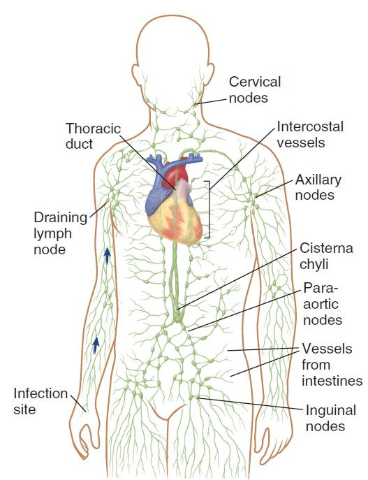
*تصویر 2*

#### تشکیل مایع میان‌بافتی و بازگشت آن به خون

قلب خون را به شریان‌ها می‌فرستد. خون از قلب وارد شریان‌های بزرگ می‌شود و فشار در شریان‌ها بالاست. شریان‌ها به شاخه‌های باریک‌تر تقسیم می‌شوند و سپس به شریانچه‌ها (arterioles) و در نهایت به مویرگ‌ها (capillaries) می‌رسند. مویرگ‌ها کوچک‌ترین عروق در گردش خون‌اند و دیوارهٔ هر مویرگ فقط از یک لایه سلول اندوتلیالی تشکیل شده است.

در مویرگ‌ها، به‌علت فشار هیدروستاتیکی، مقداری از آب خون از عروق خارج و وارد بافت‌ها و فضای بین سلول‌ها می‌شود. این فضا، فضای میان‌بافتی (interstitial space) است و محل تبادل مواد با سلول‌هاست. مایعی که در آن قرار دارد، مایع میان‌بافتی (interstitial fluid) نامیده می‌شود.

> [BOX:DEFINITION]
> **فضای میان‌بافتی (interstitial space)**
> فضای بین سلول‌ها که محل تبادل مواد با سلول‌هاست.

> [BOX:DEFINITION]
> **مایع میان‌بافتی (interstitial fluid)**
> مایعی که در فضای میان‌بافتی قرار دارد.

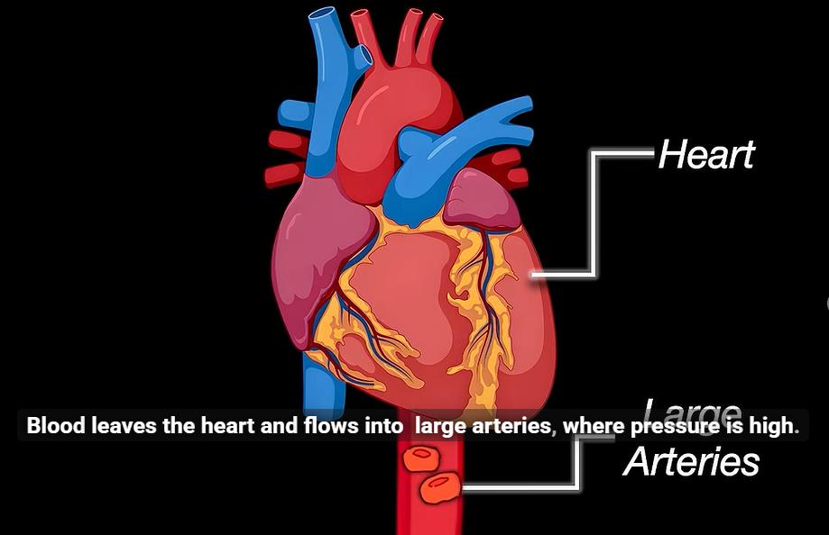
*تصویر 3*

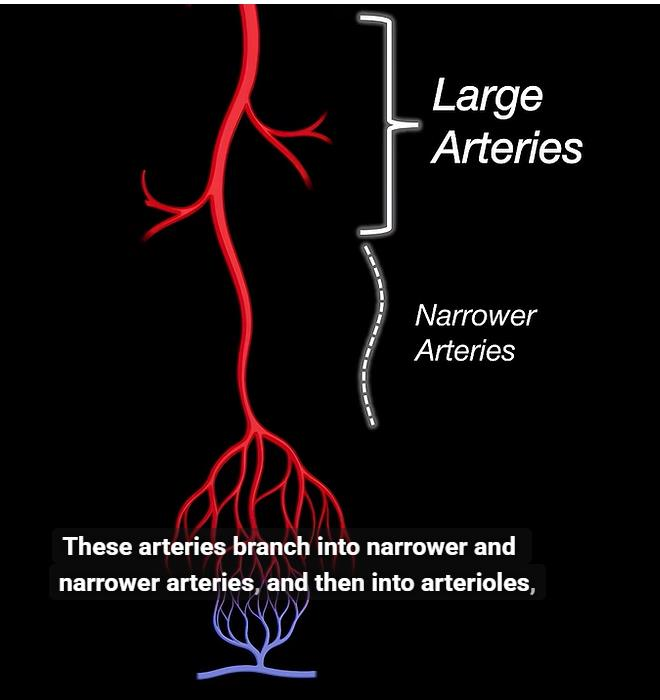
*تصویر 4*

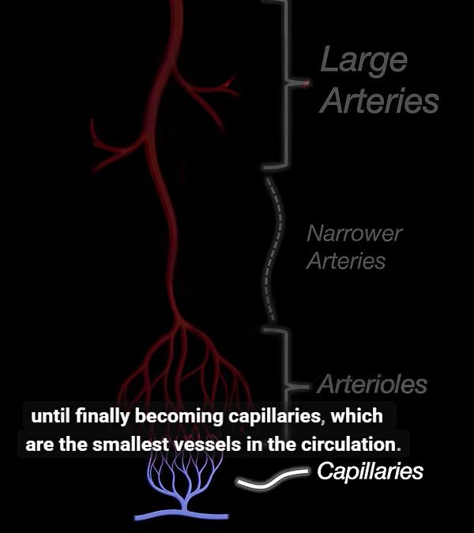
*تصویر 5*

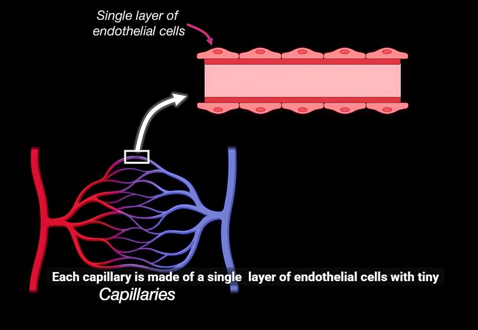
*تصویر 6*

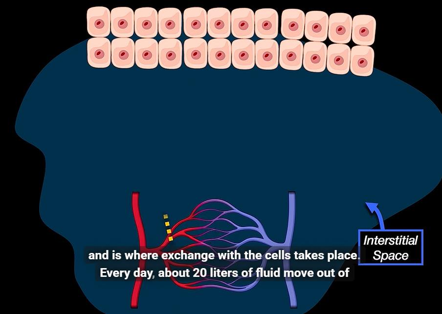
*تصویر 7*

هر روز حدود ۲۰ لیتر مایع از خون وارد فضای میان‌بافتی می‌شود. حدود ۱۷ لیتر آن دوباره به خون بازجذب می‌شود و حدود ۲ تا ۳ لیتر ــ که برآورد معمول آن حدود ۳ لیتر است ــ در بافت‌ها باقی می‌ماند. دستگاه لنفاوی این مایع باقی‌مانده را جمع‌آوری می‌کند و دوباره به جریان خون بازمی‌گرداند.

| جابه‌جایی روزانهٔ مایع | مقدار تقریبی |
|---|---:|
| مایع واردشده از خون به فضای میان‌بافتی | حدود ۲۰ لیتر |
| مایع بازجذب‌شده به خون | حدود ۱۷ لیتر |
| مایع باقی‌مانده در بافت‌ها و جمع‌آوری‌شده به‌وسیلهٔ دستگاه لنفاوی | حدود ۲ تا ۳ لیتر؛ برآورد معمول حدود ۳ لیتر |

فضای میان‌بافتی آن‌قدر بزرگ نیست که گاهی در شکل‌ها به نظر می‌رسد؛ مایع در فضاهای بسیار کوچک میان سلول‌ها قرار می‌گیرد و آن‌ها را پر می‌کند. اگر دستگاه لنفاوی نتواند مایع باقی‌مانده را تخلیه کند، مایع در بافت‌ها جمع می‌شود و edema یا خیز ایجاد می‌کند.

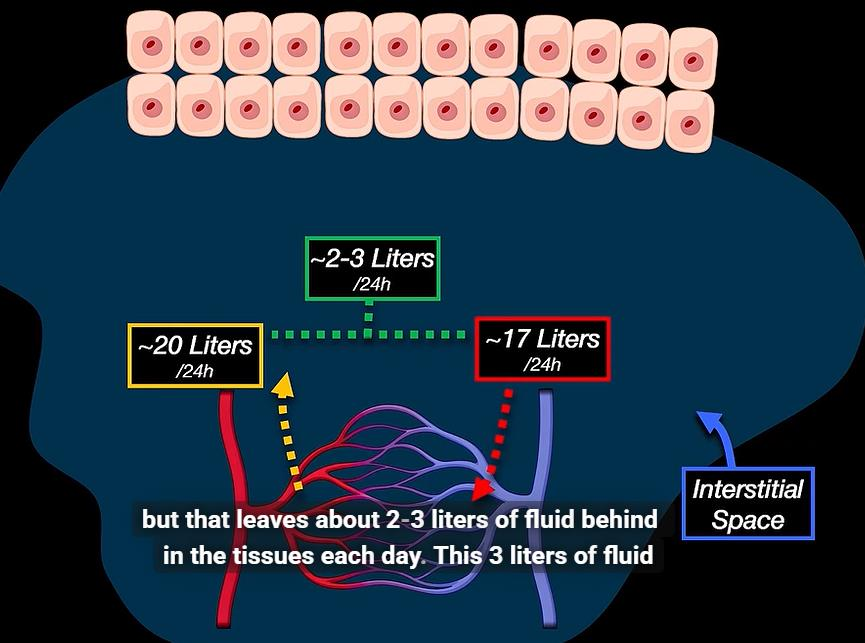
*تصویر 8*

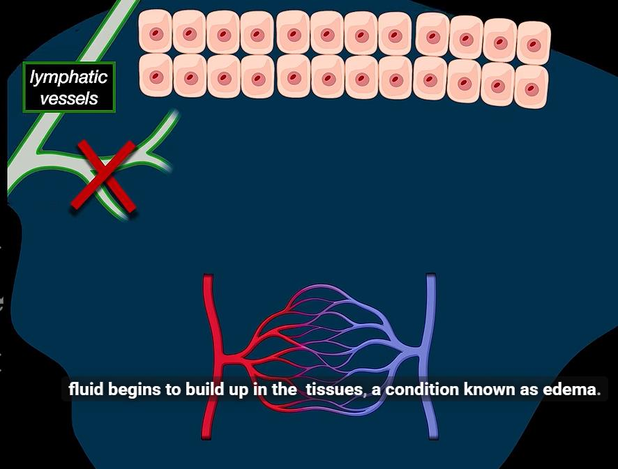
*تصویر 9*

یکی از کارکردهای دستگاه لنفاوی، تخلیهٔ مایع خارج‌سلولی (extracellular fluid drainage) و جلوگیری از تجمع آن در بافت‌هاست. اختلال یا انسداد سیستم لنفاوی ممکن است باعث تورم، برای مثال در پا یا مچ پا، شود. بااین‌حال، ورم مچ پا علت‌های دیگری هم دارد:

- **بیماری‌های قلبی‌عروقی و اختلال در پمپاژ قلب** می‌توانند حتی در صورت سالم‌بودن دستگاه لنفاوی موجب ورم شوند.
- **بیماری کلیه** نیز می‌تواند به edema و خیز، به‌ویژه در پاها، بینجامد.
- در بعضی موارد، با فشار دادن انگشت بر پا فرورفتگی باقی می‌ماند. این می‌تواند یکی از نشانه‌های edema باشد و علت آن باید پیگیری شود.
- **چاقی** نیز از علت‌های دیگر است.

#### لنف و مویرگ‌های لنفاوی

مایع موجود در فضای میان‌بافتی، interstitial fluid است؛ پس از ورود آن به عروق لنفاوی، lymph یا مایع لنفاوی نامیده می‌شود. مویرگ‌های لنفاوی (lymphatic capillaries) کوچک‌ترین عروق لنفاوی‌اند. دیوارهٔ آن‌ها بسیار شل و نفوذپذیر است؛ اصطلاح به‌کاررفته برای این ویژگی loose است. این ساختار ورود مایع میان‌بافتی به مویرگ را ممکن می‌کند. ورود مایع یک‌طرفه است: پس از ورود، مسیر بسته می‌شود و مایع به فضای میان‌بافتی بازنمی‌گردد.

> [BOX:DEFINITION]
> **لنف (lymph)**
> مایع میان‌بافتی پس از ورود به عروق لنفاوی، lymph یا مایع لنفاوی نامیده می‌شود.

ترکیب lymph و interstitial fluid بسیار شبیه است. لنف عمدتاً از آب، یون‌های محلول و مقدار کمی پروتئین تشکیل می‌شود. پروتئین‌ها از خون می‌آیند و در توصیف اسلاید از plasma proteins نیز نام برده شده است. در دستگاه گوارش، برای مثال در رودهٔ کوچک، چربی نیز ممکن است وارد دستگاه لنفاوی شود. بنابراین، دیدن چربی در سیستم لنفاوی، به‌ویژه هنگام بررسی رودهٔ کوچک، غیرمنتظره نیست؛ جزئیات این موضوع در اینجا بررسی نمی‌شود.

| ویژگی | Interstitial fluid | Lymph |
|---|---|---|
| محل یا مرحله | در فضای میان‌بافتی قرار دارد | پس از ورود مایع میان‌بافتی به عروق لنفاوی، این نام را می‌گیرد |
| ترکیب | ترکیب آن با lymph بسیار شبیه است | عمدتاً آب، یون‌های محلول و مقدار کمی پروتئین دارد؛ پروتئین‌ها از خون می‌آیند و از plasma proteins نیز نام برده شده است |
| چربی | — | در دستگاه گوارش، برای مثال در رودهٔ کوچک، چربی نیز ممکن است وارد دستگاه لنفاوی شود |

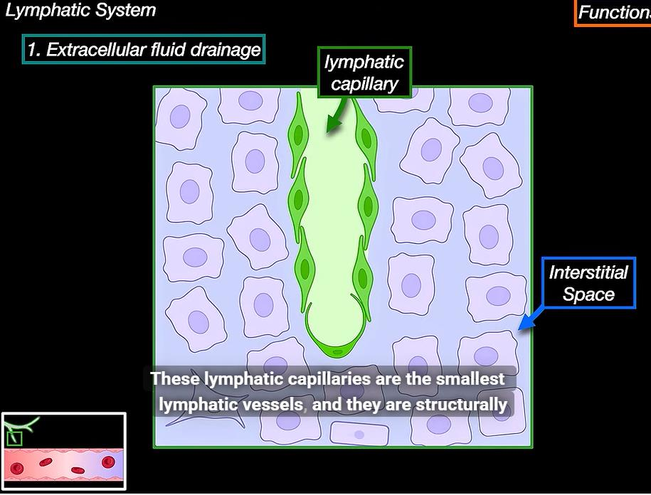
*تصویر 10*

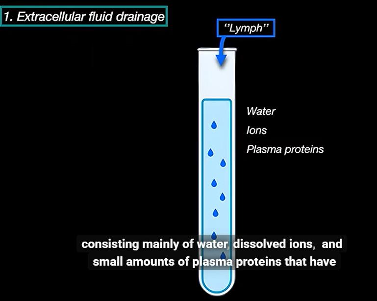
*تصویر 11*

#### کارکردهای دستگاه لنفاوی

کارکردهای دستگاه لنفاوی عبارت‌اند از:

- تخلیهٔ مایع خارج‌سلولی
- انتقال مولکول‌های بزرگ‌تر، از جمله proteins و fats، و نیز مواد دیگری مانند nutrients و مواد زائد
- جمع‌آوری سلول‌های پیر و فرسوده
- پایش ایمنی (immune surveillance)

غدد لنفاوی جمعیت زیادی از سلول‌های ایمنی دارند که بر آنتی‌ژن‌ها و محتویات لنف نظارت می‌کنند. سلول‌های پیر یا آسیب‌دیده و عوامل میکروبی نیز در این مسیر جمع‌آوری و بررسی می‌شوند.

| کارکرد دستگاه لنفاوی | محتوای مطرح‌شده |
|---|---|
| تخلیهٔ مایع خارج‌سلولی | جمع‌آوری مایع باقی‌مانده در بافت‌ها و بازگرداندن آن به جریان خون |
| انتقال مواد | انتقال مولکول‌های بزرگ‌تر، از جمله proteins و fats، و نیز nutrients و مواد زائد |
| جمع‌آوری سلول‌ها | جمع‌آوری سلول‌های پیر و فرسوده؛ سلول‌های پیر یا آسیب‌دیده نیز در مسیر جمع‌آوری و بررسی می‌شوند |
| پایش ایمنی | نظارت بر آنتی‌ژن‌ها و محتویات لنف به‌وسیلهٔ سلول‌های ایمنی غدد لنفاوی؛ عوامل میکروبی نیز در این مسیر بررسی می‌شوند |

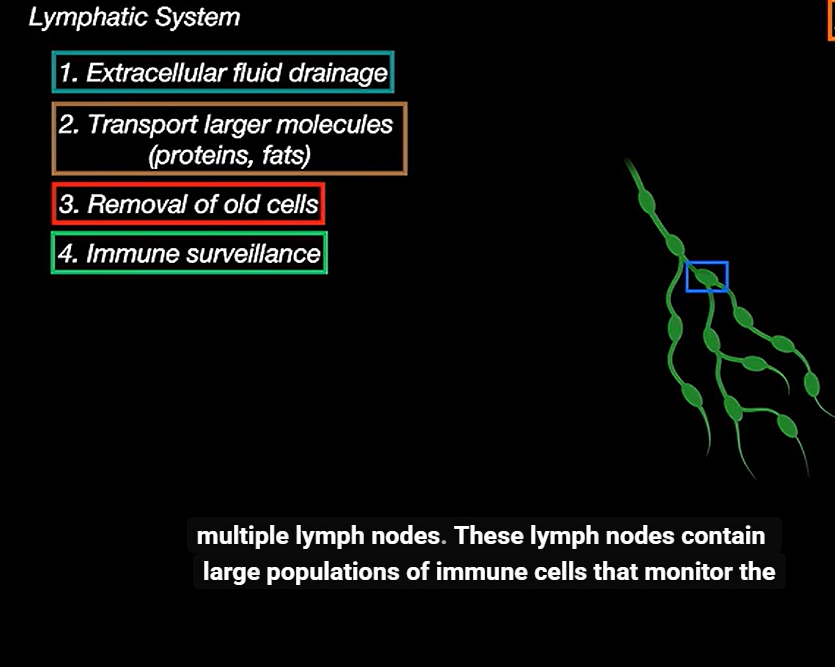
*تصویر 12*

#### مسیر عروق لنفاوی و تخلیهٔ لنف به خون

مسیر عروق لنفاوی به‌ترتیب شامل موارد زیر است:

1. lymphatic capillaries
2. lymphatic vessels
3. lymphatic trunks
4. lymphatic ducts

مویرگ‌ها مایع میان‌بافتی را دریافت می‌کنند و به عروق لنفاوی می‌پیوندند. عروق لنفاوی در مسیر خود از غدد لنفاوی می‌گذرند. سپس چند عروق به هم می‌پیوندند و lymphatic trunks را می‌سازند و در ادامه lymphatic ducts شکل می‌گیرند.

| ترتیب | بخش مسیر لنفاوی | توضیح |
|---:|---|---|
| ۱ | lymphatic capillaries | مایع میان‌بافتی را دریافت می‌کنند |
| ۲ | lymphatic vessels | در مسیر خود از غدد لنفاوی می‌گذرند |
| ۳ | lymphatic trunks | با پیوستن چند عروق لنفاوی شکل می‌گیرند |
| ۴ | lymphatic ducts | در ادامهٔ مسیر شکل می‌گیرند و لنف را به خون تخلیه می‌کنند |

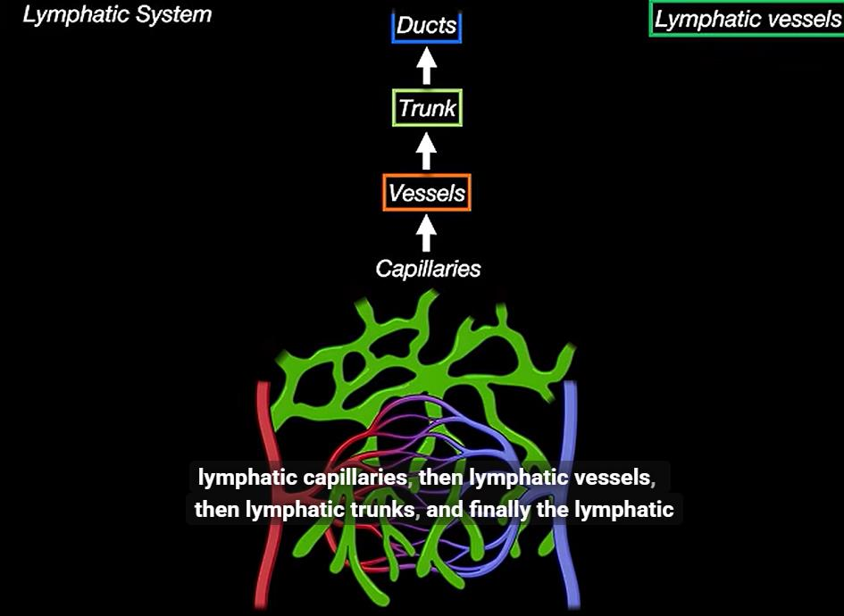
*تصویر 13*

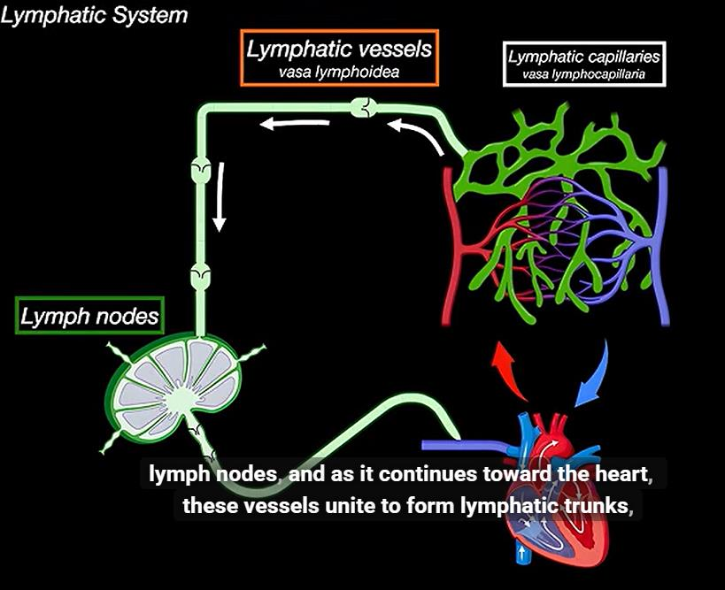
*تصویر 14*

دو مجرای لنفاوی مهم بدن thoracic duct یا مجرای سینه‌ای و right lymphatic duct هستند:

- تقریباً همهٔ بخش‌های پایین‌تنه به thoracic duct تخلیه می‌شوند. سمت چپ سر و گردن، بازوی چپ و نیمهٔ چپ قفسهٔ سینه نیز به آن می‌ریزند. در مجموع، حدود سه‌چهارم دستگاه لنفاوی بدن وارد thoracic duct می‌شود.
- right lymphatic duct کوچک‌تر است و لنف بخش‌هایی از سمت راست بالاتنه، یعنی بازوی راست، سمت راست قفسهٔ سینه و سمت راست سر و گردن، را دریافت می‌کند.
- بخش‌های پایین‌تنه، چه سمت راست و چه سمت چپ، به thoracic duct می‌ریزند، نه به right lymphatic duct.

| مجرا | ناحیه‌هایی که لنف آن‌ها را دریافت می‌کند | نکته |
|---|---|---|
| thoracic duct | تقریباً همهٔ بخش‌های پایین‌تنه؛ سمت چپ سر و گردن؛ بازوی چپ؛ نیمهٔ چپ قفسهٔ سینه | حدود سه‌چهارم دستگاه لنفاوی بدن به آن وارد می‌شود |
| right lymphatic duct | بازوی راست؛ سمت راست قفسهٔ سینه؛ سمت راست سر و گردن | کوچک‌تر است؛ لنف پایین‌تنه، در هر دو سمت، به آن نمی‌ریزد |

در نهایت، هر دو مجرا به رگ‌های بزرگ این ناحیه، از جمله subclavian vein، می‌رسند. subclavian vein همان ورید زیرترقوه‌ای یا تحت‌ترقوه‌ای است. لنف در آنجا وارد خون می‌شود؛ در نتیجه، مایع باقی‌مانده در فضای میان‌بافتی از طریق دستگاه لنفاوی به جریان خون بازمی‌گردد.

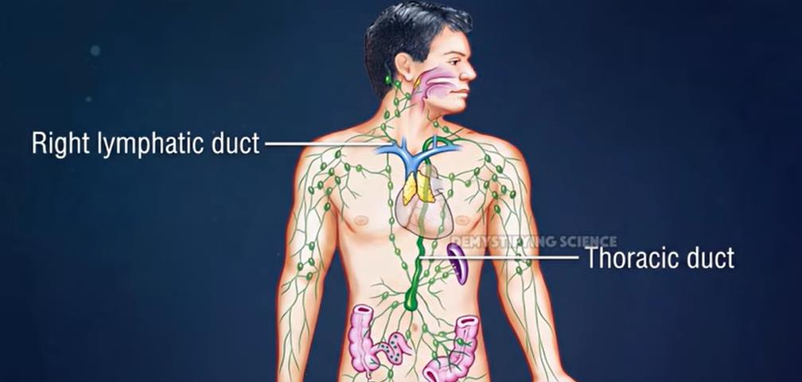
*تصویر 15*

### غدهٔ لنفاوی

#### ویژگی‌ها و ساختمان کلی

غدهٔ لنفاوی یکی از ارگان‌های لنفاوی ثانویه است. یکی از رویدادهای مهم در آن، برخورد سلول‌های ایمنی با آنتی‌ژن‌هاست. غده معمولاً کوچک و بیضی‌شکل است و اندازهٔ آن حدود ۱ تا ۲۵ میلی‌متر است؛ غدد لنفاوی همگی هم‌اندازه نیستند. تعداد کل غدد لنفاوی بدن حدود ۶۰۰ عدد است.

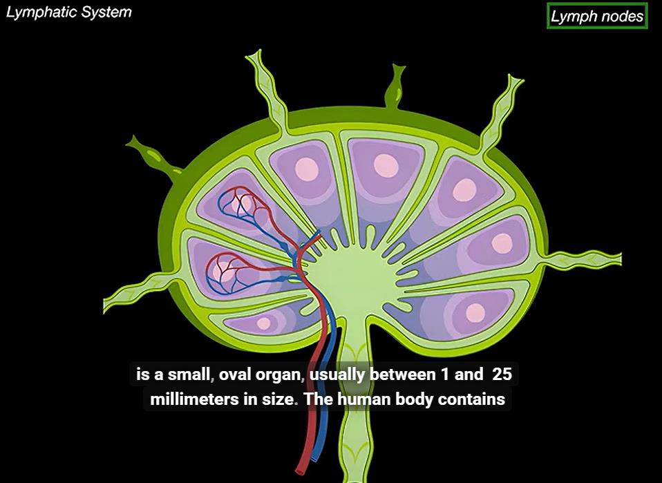
*تصویر 16*

*تصویر 17*

غدهٔ لنفاوی کپسولی از بافت همبند متراکم و فیبروزی دارد که اندام را احاطه می‌کند؛ تیموس نیز کپسول دارد. از کپسول، تیغه‌هایی به نام trabeculae به درون اندام امتداد می‌یابند و بخش‌هایی از آن را تقسیم می‌کنند. عروق خونی، عروق لنفاوی و اعصاب از نواحی trabeculae عبور می‌کنند.

زیر کپسول، فضایی به نام subcapsular sinus یا marginal sinus قرار دارد؛ این فضا در تیموس وجود ندارد. از فضای زیر کپسول به بعد از سطح به عمق، بخش‌های غده عبارت‌اند از:

1. cortex
2. paracortex، در عمق‌تر و میان cortex و medulla
3. medulla

در شکل، اجزایی مانند capsule، trabeculae، paracortex و medulla مشخص شده‌اند.

| ساختار غدهٔ لنفاوی | جایگاه یا توصیف |
|---|---|
| کپسول | بافت همبند متراکم و فیبروزی که اندام را احاطه می‌کند |
| trabeculae | تیغه‌هایی که از کپسول به درون اندام امتداد می‌یابند و بخش‌هایی از آن را تقسیم می‌کنند؛ عروق خونی، عروق لنفاوی و اعصاب از نواحی آن‌ها عبور می‌کنند |
| subcapsular sinus یا marginal sinus | فضای زیر کپسول؛ این فضا در تیموس وجود ندارد |
| cortex | بخش سطحی‌تر غده |
| paracortex | میان cortex و medulla و در عمق‌تر از cortex |
| medulla | بخش عمقی‌تر غده |

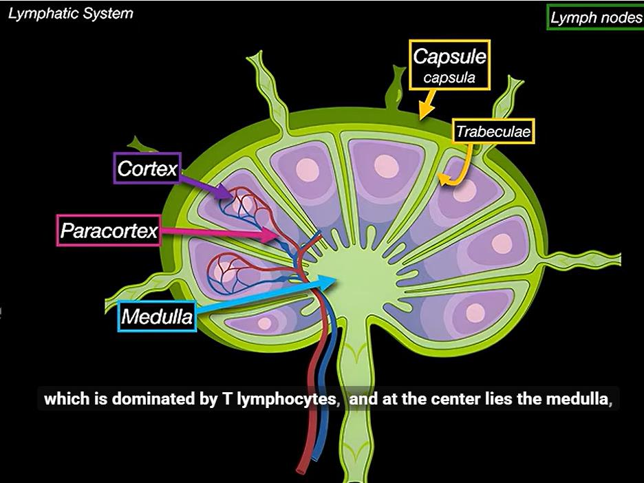
*تصویر 18*

#### ورود و خروج لنف و مسیر آن در غده

عروق لنفاوی‌ای که لنف را به غده وارد می‌کنند afferent lymphatic vessels یا عروق آوران‌اند؛ afferent با مفهوم ورود ارتباط دارد. عروق خارج‌شونده efferent lymphatic vessels یا عروق وابران نام دارند؛ برای به‌خاطر سپردن efferent می‌توان آن را با exit به یاد آورد. چند عروق آوران ممکن است وارد غده شوند و معمولاً یک یا دو عروق وابران از آن خارج می‌شوند.

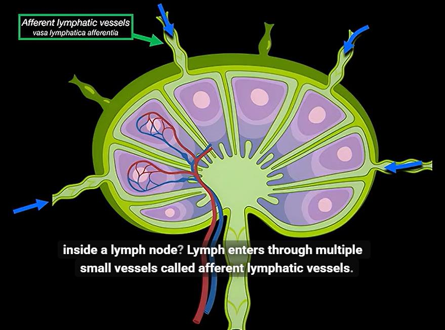
*تصویر 19*

لنف از عروق آوران وارد غده می‌شود و ابتدا به فضایی درست زیر کپسول، یعنی subcapsular یا marginal sinus، می‌رسد. سپس از مسیرهای سینوسی داخل غده، از جمله internodular sinuses و medullary sinuses، عبور می‌کند و سرانجام از عروق وابران خارج می‌شود. این فضاهای سینوسی با مسیرهای درون غده و trabeculae مرتبط‌اند.

| مسیر لنف در غدهٔ لنفاوی | ترتیب یا ویژگی |
|---|---|
| ورود | از راه afferent lymphatic vessels؛ چند عروق آوران ممکن است وارد شوند |
| گام نخست در غده | ورود به subcapsular یا marginal sinus، درست زیر کپسول |
| عبور درون غده | گذر از مسیرهای سینوسی، از جمله internodular sinuses و medullary sinuses؛ این فضاها با مسیرهای درون غده و trabeculae مرتبط‌اند |
| خروج | از راه efferent lymphatic vessels؛ معمولاً یک یا دو عروق وابران خارج می‌شوند |

لنف آهسته از غده می‌گذرد تا با سلول‌های آن برخورد کند. اگر آنتی‌ژن، سلول پیر یا سلول آسیب‌دیده‌ای وجود داشته باشد، فیلتر و تخریب می‌شود. غدهٔ لنفاوی می‌تواند سلول‌های ناقص یا آسیب‌دیده و عوامل میکروبی مانند باکتری‌ها را به دام بیندازد و از بین ببرد.

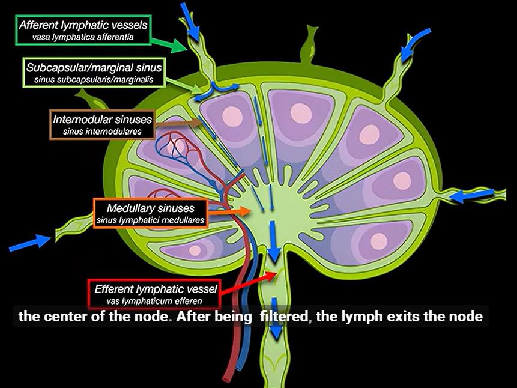
*تصویر 20*

*تصویر 21*

#### سلول‌های ایمنی و فیلترکردن لنف

سه گروه اصلی سلول‌های ایمنی غدهٔ لنفاوی عبارت‌اند از:

- macrophages
- dendritic cells
- lymphocytes، شامل B cellها و T cellها

در شکل، macrophages، dendritic cells و lymphocytes در ارتباط با سینوس‌های غده نشان داده شده‌اند.

| گروه سلولی در غدهٔ لنفاوی | نکتهٔ مطرح‌شده |
|---|---|
| macrophages | در subcapsular sinus فراوان‌اند و در medulla نیز حضور دارند؛ عوامل میکروبی یا سلول‌های آسیب‌دیده را به دام می‌اندازند، می‌بلعند و تخریب می‌کنند |
| dendritic cells | می‌توانند آنتی‌ژن را در بافت‌های محیطی برداشت و تجزیه کنند و آن را به T cellها ارائه دهند |
| lymphocytes | شامل B cellها و T cellها هستند؛ B cellها نیز در گروه سلول‌های ارائه‌کنندهٔ آنتی‌ژن قرار می‌گیرند |

*تصویر 22*

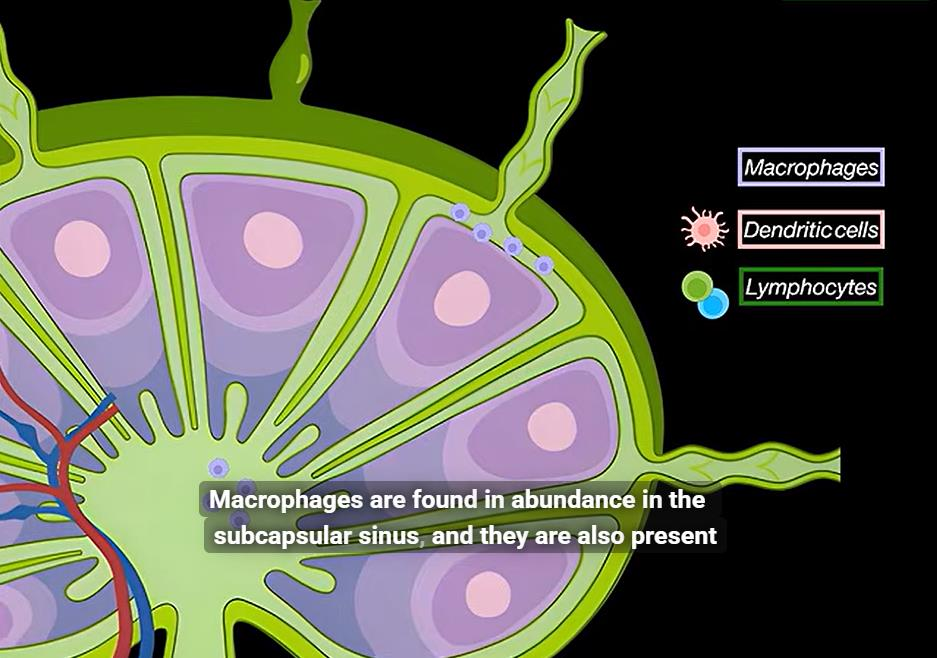
*تصویر 23*

Macrophages در ناحیهٔ subcapsular sinus فراوان‌اند و در medulla نیز حضور دارند. آن‌ها از قبل در غده وجود دارند و هنگام عبور لنف ممکن است با عوامل میکروبی روبه‌رو شوند. در subcapsular sinus و medulla، ماکروفاژها تقریباً مانند فیلتر عمل می‌کنند: عوامل میکروبی یا سلول‌های آسیب‌دیده را به دام می‌اندازند، می‌بلعند (engulf) و تخریب می‌کنند. ماکروفاژها توانایی phagocytosis دارند و مانند neutrophils بیگانه‌خواری می‌کنند.

ماکروفاژها و dendritic cells از professional antigen-presenting cells یا professional APCs هستند؛ B cellها نیز در گروه سلول‌های ارائه‌کنندهٔ آنتی‌ژن قرار می‌گیرند. ماکروفاژ می‌تواند آنتی‌ژن را بگیرد و تجزیه کند، سپس آن را از طریق MHC class I یا MHC class II روی سطح خود به سلول‌های مربوطه ارائه دهد.

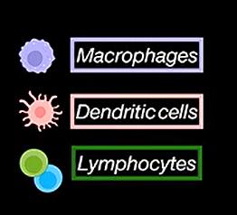
*تصویر 24*

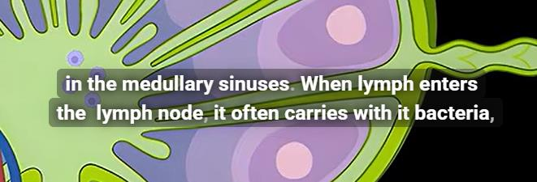
*تصویر 25*

*تصویر 26*

Dendritic cells نیز می‌توانند APC باشند. آن‌ها ممکن است در بافت‌های محیطی با آنتی‌ژن یا عامل بیماری‌زا برخورد کرده، آن را برداشته و تجزیه کرده باشند و از طریق MHC class I و MHC class II روی سطح خود ارائه دهند. سلول‌های دندریتیک می‌توانند پیش از ورود به عروق لنفاوی، Pathogens را در بافت‌های محیطی شناسایی و برداشت کنند و سپس از طریق عروق لنفاوی به غده برسند. پس از ورود به غده، به paracortex مهاجرت می‌کنند؛ ناحیه‌ای که T cellها در آن حضور دارند.

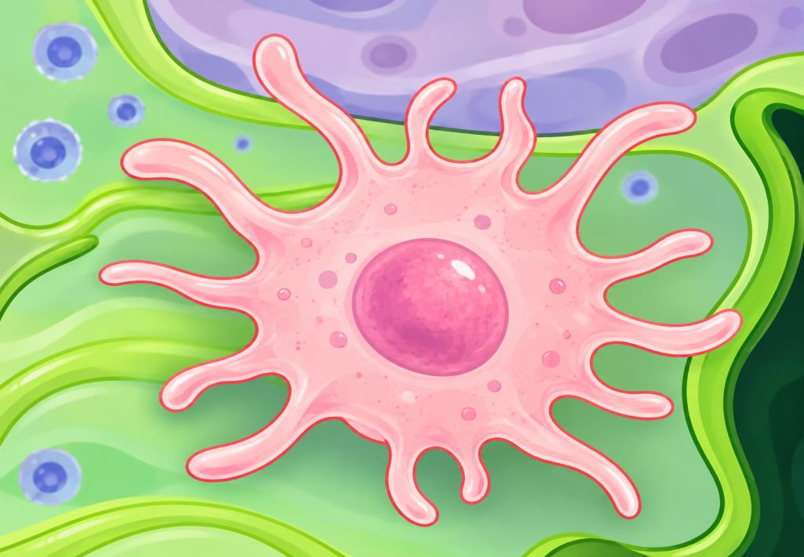
*تصویر 27*

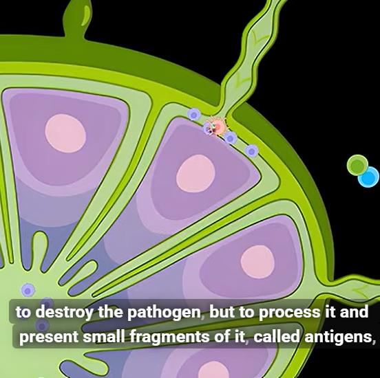
*تصویر 28*

در paracortex، dendritic cell قطعات آنتی‌ژنی پردازش‌شده را در اتصال با مولکول‌های MHC روی سطح خود به Naïve T Cells ارائه می‌دهد. گیرندهٔ سطحی T cell با MHC و آنتی‌ژن ارائه‌شده برخورد می‌کند و T cell فعال می‌شود؛ در نتیجه، پاسخ ایمنی اکتسابی یا اختصاصی (Adaptive Immunity) آغاز می‌شود. T cell فعال‌شده می‌تواند به T helper یا T cytotoxic تبدیل شود. جزئیات فعال‌شدن سلول‌ها در بحث دیگری کامل‌تر بررسی می‌شود.

هدایت dendritic cell به paracortex به chemokines مربوط است؛ برای توضیح این جهت‌یابی باید chemokines را در نظر گرفت.

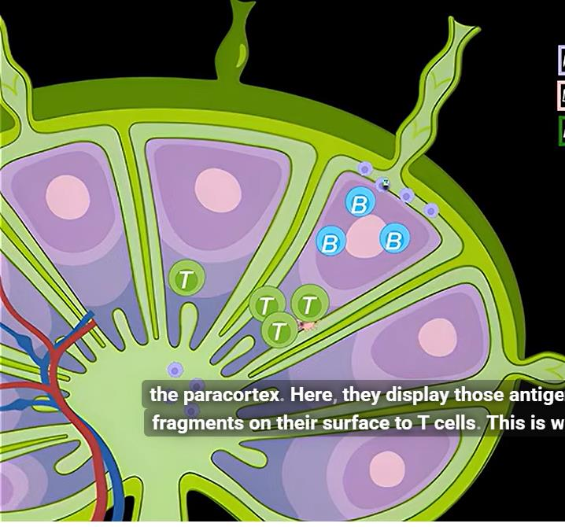
*تصویر 29*

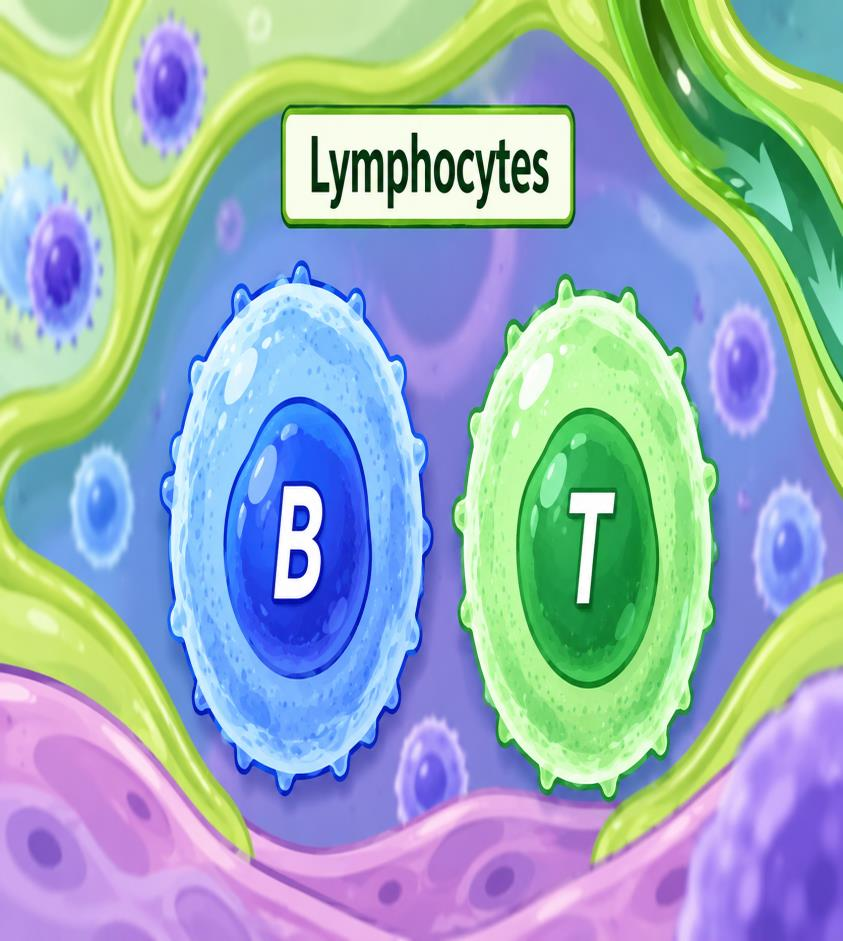
*تصویر 30*

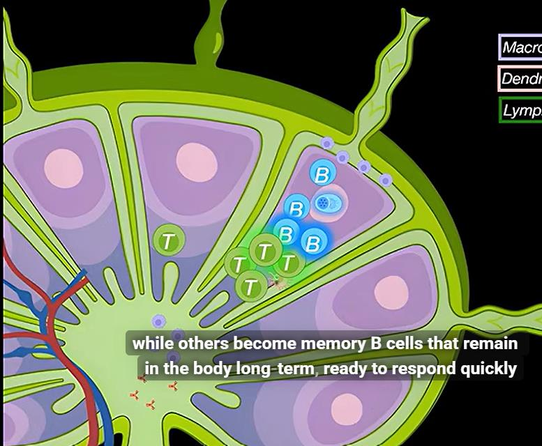
*تصویر 31*

#### نواحی B cell و T cell و ورود لنفوسیت‌ها

در غدهٔ لنفاوی، cortex را B cell zone نیز می‌گویند، چون بیشتر B cellها در آن قرار دارند. آن‌ها عمدتاً در ساختارهایی به نام lymphatic nodules یا lymphatic follicles جای می‌گیرند. Paracortex، T cell zone است و بیشتر T cellها در این ناحیه، در عمق قشر، قرار دارند. این دو ناحیه از هم جدا هستند: B cellها در cortex و T cellها در paracortex مستقر می‌شوند. عوامل مربوط به chemokines در هدایت B cellها به cortex و T cellها به paracortex نقش دارند.

در paracortex عروق خونی تخصص‌یافته‌ای قرار دارند که دیوارهٔ اندوتلیالی آن‌ها از سلول‌های بلند تشکیل شده است؛ به همین دلیل high endothelial venules یا HEVs نام دارند. HEVها مسیری برای ورود لنفوسیت‌های Naïve از خون به بافت غدهٔ لنفاوی فراهم می‌کنند. هم Naïve B cellها و هم Naïve T cellها از آن‌ها وارد غده می‌شوند. Naïve به معنی دست‌نخورده است: سلولی که هنوز با آنتی‌ژن برخورد نکرده است.

> [BOX:DEFINITION]
> **Naïve**
> دست‌نخورده؛ سلولی که هنوز با آنتی‌ژن برخورد نکرده است.

پس از ورود، T cellها در paracortex مستقر می‌شوند و B cellها به cortex می‌روند. Dendritic cellها معمولاً از عروق آوران وارد می‌شوند، اما ممکن است از HEVها نیز وارد شوند. Macrophages از قبل در غده حضور دارند.

| سلول یا ساختار | مسیر ورود یا جایگاه در غدهٔ لنفاوی |
|---|---|
| Naïve B cellها و Naïve T cellها | از خون و از راه HEVها وارد غده می‌شوند |
| T cellها | پس از ورود در paracortex، یعنی T cell zone، مستقر می‌شوند |
| B cellها | پس از ورود به cortex، یعنی B cell zone، می‌روند |
| Dendritic cellها | معمولاً از عروق آوران وارد می‌شوند؛ ممکن است از HEVها نیز وارد شوند؛ پس از ورود به غده به paracortex مهاجرت می‌کنند |
| Macrophages | از قبل در غده حضور دارند |

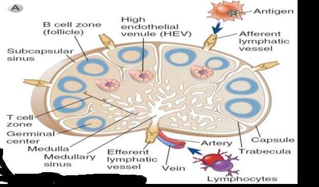
*تصویر 32*

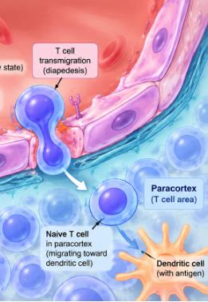
*تصویر 33*

#### فولیکول‌های اولیه و ثانویه

در cortex، فولیکول B cellها می‌تواند primary یا secondary باشد:

- **Primary lymphoid follicle یا primary follicle:** فولیکولی است که B cellهای آن هنوز با آنتی‌ژن برخورد نکرده‌اند و مرکز روشن germinal center ندارد.
- **Secondary follicle:** پس از برخورد B cellها با آنتی‌ژن، germinal center تشکیل می‌شود. به‌دلیل تکثیر زیاد در این ناحیه، مرکز فولیکول در رنگ‌آمیزی روشن‌تر به نظر می‌رسد. بنابراین، وجود germinal center روشن در secondary follicle نشان می‌دهد که B cellها با آنتی‌ژن برخورد کرده‌اند.

| ویژگی | Primary lymphoid follicle یا primary follicle | Secondary follicle |
|---|---|---|
| برخورد B cellها با آنتی‌ژن | هنوز رخ نداده است | رخ داده است |
| Germinal center | مرکز روشن germinal center ندارد | germinal center تشکیل می‌شود |
| ظاهر در رنگ‌آمیزی | فاقد مرکز روشن germinal center | مرکز به‌دلیل تکثیر زیاد روشن‌تر به نظر می‌رسد |

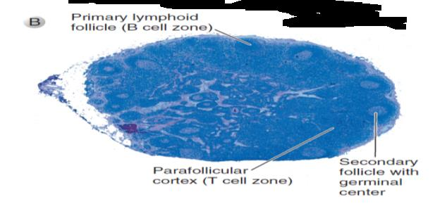
*تصویر 34*

غدهٔ لنفاوی افزون بر تخلیهٔ مایع میان‌بافتی، در جمع‌آوری سلول‌های پیر و آسیب‌دیده و پایش ایمنی نقش دارد. غدهٔ لنفاوی آنتی‌ژن‌هایی را که از راه لنف می‌آیند بررسی و فیلتر می‌کند. منبع آنتی‌ژن‌هایی که غدهٔ لنفاوی و طحال بررسی می‌کنند متفاوت است.

### طحال

#### ویژگی‌ها و کارکرد

طحال بزرگ‌ترین ارگان لنفاوی ثانویه است و کار اصلی آن فیلترکردن خون است. طحال در بخش بالایی و چپ بدن، زیر معده و دیافراگم قرار دارد و وزن آن حدود ۱۵۰ گرم است.

افزون بر غدهٔ لنفاوی، طحال نیز در جمع‌آوری سلول‌های پیر یا آسیب‌دیده و آغاز پاسخ‌های ایمنی نقش دارد؛ اما آنتی‌ژن‌ها و سلول‌هایی را بررسی می‌کند که از راه خون می‌آیند. آنتی‌ژن‌های منتقل‌شده با لنف در غدهٔ لنفاوی و آنتی‌ژن‌های منتقل‌شده با خون در طحال بررسی می‌شوند.

ارگان‌های لنفاوی ثانویهٔ دیگری نیز وجود دارند، از جمله tonsils یا لوزه‌ها و appendix؛ اما در کتاب‌های ایمونولوژی معمولاً سه مورد غدد لنفاوی، طحال و MALT بیشتر مورد توجه‌اند.

| ویژگی | غدهٔ لنفاوی | طحال |
|---|---|---|
| آنتی‌ژن‌هایی که بررسی می‌شوند | آنتی‌ژن‌هایی که از راه لنف می‌آیند | آنتی‌ژن‌هایی که از راه خون می‌آیند |
| کارکردهای مطرح‌شده | فیلترکردن آنتی‌ژن‌های لنف، تخلیهٔ مایع میان‌بافتی، جمع‌آوری سلول‌های پیر و آسیب‌دیده و پایش ایمنی | فیلترکردن خون، جمع‌آوری سلول‌های پیر یا آسیب‌دیده و آغاز پاسخ‌های ایمنی |

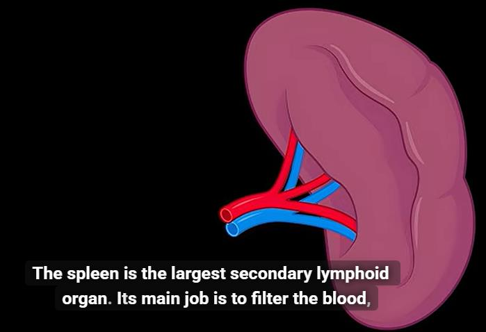
*تصویر 35*

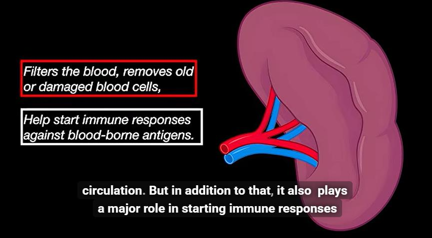
*تصویر 36*

#### کپسول و بخش‌های white pulp و red pulp

طحال دو بخش اصلی دارد:

- **White pulp:** غنی از lymphocytes و دیگر سلول‌های ایمنی است و در پاسخ ایمنی نقش دارد.
- **Red pulp:** با گلبول‌های قرمز مرتبط است و محل تجمع خون، erythrocytes یا RBCs و macrophages است. این بخش شامل sinusoids پر از خون است. Macrophages این ناحیه در ازبین‌بردن سلول‌های پیر و فرسوده نقش مهمی دارند.

طحال کپسولی به نام tunica fibrosa دارد و امتدادهای کپسول به درون بافت، splenic trabeculae هستند. عروق خونی، اعصاب و عروق لنفاوی از مسیر trabeculae عبور می‌کنند و از آنجا منشعب می‌شوند.

| بخش یا ساختار طحال | ویژگی‌ها و نقش مطرح‌شده |
|---|---|
| White pulp | غنی از lymphocytes و دیگر سلول‌های ایمنی است و در پاسخ ایمنی نقش دارد |
| Red pulp | با گلبول‌های قرمز مرتبط است؛ محل تجمع خون، erythrocytes یا RBCs و macrophages است؛ sinusoids پر از خون دارد؛ macrophages آن در ازبین‌بردن سلول‌های پیر و فرسوده نقش مهمی دارند |
| tunica fibrosa | کپسول طحال |
| splenic trabeculae | امتدادهای کپسول به درون بافت؛ عروق خونی، اعصاب و عروق لنفاوی از مسیر آن‌ها عبور می‌کنند و از آنجا منشعب می‌شوند |

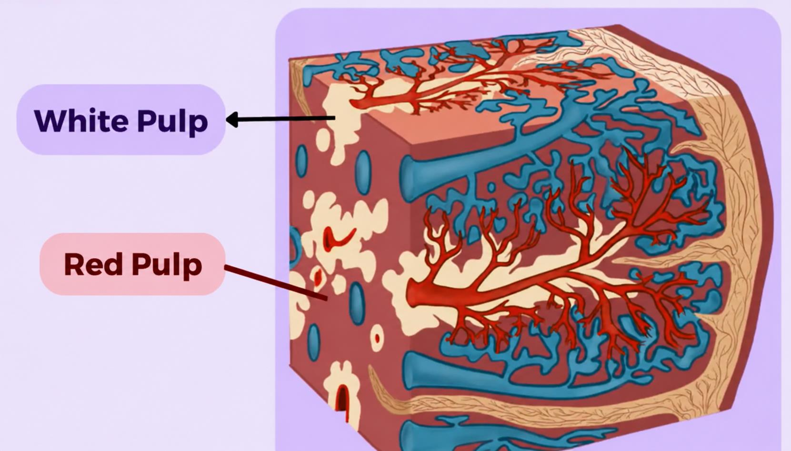
*تصویر 37*

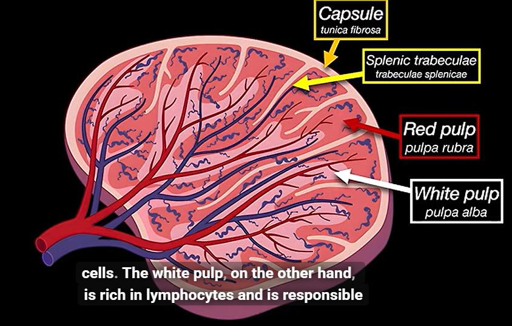
*تصویر 38*

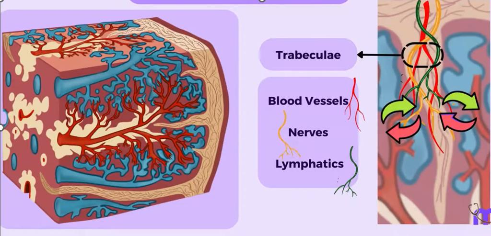
*تصویر 39*

#### نواحی سلولی در white pulp

در white pulp، شریان طحالی شاخه‌شاخه می‌شود و یکی از شاخه‌ها شریانچه است. شریانچه‌ای که در مرکز قرار دارد central arteriole نامیده می‌شود و lymphocytes در اطراف آن جای می‌گیرند.

طحال، مانند غدهٔ لنفاوی، نواحی جداگانه‌ای برای T cellها و B cellها دارد:

- **T cell zone:** T cellها اطراف central arteriole را می‌پوشانند و ناحیه‌ای به نام periarteriolar lymphoid sheath یا PALS می‌سازند. PALS همان T cell zone طحال است. این ناحیه را نباید با T cell zone در paracortex غدهٔ لنفاوی اشتباه گرفت: در طحال، T cell zone به‌صورت غلافی اطراف central arteriole قرار دارد و PALS نامیده می‌شود.
- **B cell zone:** میان T cell zone و marginal zone قرار دارد و معمولاً lymphoid follicle یا lymphoid follicular zone نامیده می‌شود.
- **Marginal zone:** در ناحیهٔ حاشیه‌ای B cellها و macrophages قرار دارند.

| ناحیه در white pulp طحال | جایگاه یا ترکیب | نام یا نکتهٔ مرتبط |
|---|---|---|
| T cell zone | T cellها اطراف central arteriole را می‌پوشانند | periarteriolar lymphoid sheath یا PALS |
| B cell zone | میان T cell zone و marginal zone | lymphoid follicle یا lymphoid follicular zone |
| Marginal zone | در ناحیهٔ حاشیه‌ای | B cellها و macrophages در آن قرار دارند |

B cellهای marginal zone از نظر نوع با B cellهای معمولی تفاوت دارند. بیشتر B cellهای معمول بدن، حدود ۹۵ درصد، از نوع B-2 هستند؛ اما B cellهای marginal zone از نوع B-1 هستند. این پرسش مطرح است که آیا B-1 cellهای marginal zone به‌علت تفاوت نوعشان نقش متفاوتی دارند و برای گرفتن برخی عوامل میکروبی خاص در این ناحیه قرار گرفته‌اند؛ عواملی که B cellهای معمولیِ ناحیهٔ فولیکولی ممکن است به همان خوبی با آن‌ها مقابله نکنند. این نکته در پرسش‌های کنکور مورد تأکید بوده است.

> [BOX:IMPORTANT]
> این نکته در پرسش‌های کنکور مورد تأکید بوده است: بیشتر B cellهای معمول بدن، حدود ۹۵ درصد، از نوع B-2 هستند؛ اما B cellهای marginal zone از نوع B-1 هستند. این پرسش مطرح است که آیا B-1 cellهای marginal zone نقش متفاوتی دارند و برای گرفتن برخی عوامل میکروبی خاص در این ناحیه قرار گرفته‌اند؛ عواملی که B cellهای معمولیِ ناحیهٔ فولیکولی ممکن است به همان خوبی با آن‌ها مقابله نکنند.

در نمای طحال، اجزای زیر مشخص شده‌اند:

- follicular arteriole
- central arteriole
- trabecular artery
- marginal sinus
- marginal zone
- T cell zone یا PALS
- B cell zone یا follicle

سلول‌های آبی‌رنگ اطراف central arteriole، T cell zone و همان PALS هستند؛ ناحیهٔ فولیکولی B cell zone را می‌سازد و marginal zone بیرون این نواحی قرار دارد. Germinal center در تصویر دیگری از lymphoid follicle نشان داده شده است. تشخیص germinal center در تصویرهایی که مرکز روشن آن واضح نیست دشوار است؛ از چنین تصویری سؤال تشخیصی مطرح نمی‌شود، مگر آنکه مرکز روشن به‌وضوح دیده شود.

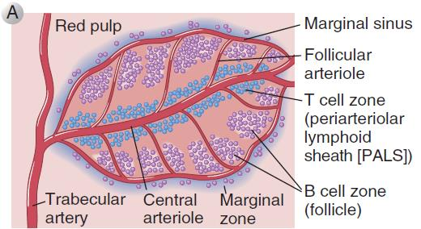
*تصویر 40*

اگر سوال موقعیت مکانی B cell zone را از ما خواستند، میگوییم بین T cell zone و Marginal zone قرار گرفته است.

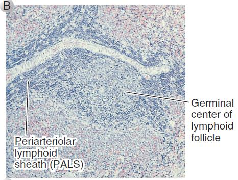
*تصویر 41*

### بافت لنفاوی وابسته به مخاط (MALT)

#### تعریف و محل‌ها

MALT مخفف mucosa-associated lymphoid tissue است. آنتی‌ژن‌هایی که از راه مخاط وارد می‌شوند، در سیستم مرتبط با سطوح مخاطی بررسی می‌شوند. در مقایسه، آنتی‌ژن‌های واردشده از راه لنف در غدهٔ لنفاوی و آنتی‌ژن‌های واردشده از راه خون در طحال پایش می‌شوند.

> [BOX:DEFINITION]
> **MALT (mucosa-associated lymphoid tissue)**
> مجموعه‌ای از بافت لنفاوی وابسته به مخاط؛ آنتی‌ژن‌هایی که از راه مخاط وارد می‌شوند در سیستم مرتبط با سطوح مخاطی بررسی می‌شوند.

| مسیر ورود آنتی‌ژن | محل بررسی یا پایش |
|---|---|
| مخاط | سیستم مرتبط با سطوح مخاطی، از جمله MALT |
| لنف | غدهٔ لنفاوی |
| خون | طحال |

MALT مجموعه‌ای گسترده از ساختارها و سلول‌های ایمنی مرتبط با سطوح مخاطی بدن است و مخاط bronchi، دستگاه گوارش، intestine و دستگاه ادراری‌ـ‌تناسلی را دربرمی‌گیرد. سلول‌های ایمنی innate و adaptive در پاسخ به آنتی‌ژن‌هایی که این سطوح دریافت می‌کنند نقش دارند. از اجزای MALT، ساختارهای لنفوئیدی بدون کپسول (non-encapsulated lymphoid structures) هستند.

| ویژگی MALT | محتوای مطرح‌شده |
|---|---|
| گستره | ساختارها و سلول‌های ایمنی مرتبط با سطوح مخاطی بدن |
| محل‌های ذکرشده | مخاط bronchi، دستگاه گوارش، intestine و دستگاه ادراری‌ـ‌تناسلی |
| سلول‌های دخیل | سلول‌های ایمنی innate و adaptive |
| یکی از اجزا | ساختارهای لنفوئیدی بدون کپسول (non-encapsulated lymphoid structures) |

پوست نیز در ارتباط با سدهای بدن و سیستم‌های ایمنی آن مطرح است. اسلاید، پوست و مخاط دستگاه گوارش و برونش را از سدهای اپیتلیالی اصلی دارای سیستم‌های اختصاصی گره‌های لنفاوی و سلول‌های ایمنی پراکنده برمی‌شمارد. این اجزا هماهنگ عمل می‌کنند تا در برابر عوامل بیماری‌زایی که از این سدها وارد می‌شوند، پاسخ ایمنی تخصصی ایجاد کنند.

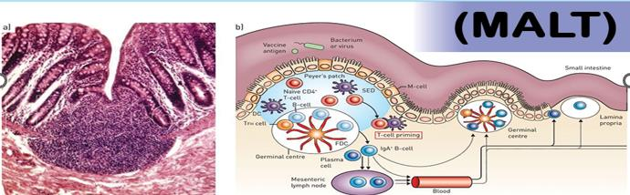
*تصویر 42*

## ۳. جداول مرور سریع

| گروه ارگان‌های لنفاوی | نقش کلی یا ویژگی | نمونه‌ها |
|---|---|---|
| ارگان‌های لنفاوی اولیه یا مرکزی | معمولاً محل تولید و بلوغ سلول‌ها | تیموس و bone marrow |
| ارگان‌های لنفاوی ثانویه | محل برخورد سلول‌ها با آنتی‌ژن | غدد لنفاوی، طحال و MALT |

| جابه‌جایی روزانهٔ مایع | مقدار تقریبی |
|---|---:|
| مایع واردشده از خون به فضای میان‌بافتی | حدود ۲۰ لیتر |
| مایع بازجذب‌شده به خون | حدود ۱۷ لیتر |
| مایع باقی‌مانده و جمع‌آوری‌شده به‌وسیلهٔ دستگاه لنفاوی | حدود ۲ تا ۳ لیتر؛ معمولاً حدود ۳ لیتر |

| ویژگی | Interstitial fluid | Lymph |
|---|---|---|
| محل یا مرحله | در فضای میان‌بافتی | پس از ورود مایع میان‌بافتی به عروق لنفاوی |
| ترکیب | ترکیب آن با lymph بسیار شبیه است | عمدتاً آب، یون‌های محلول و مقدار کمی پروتئین؛ پروتئین‌ها از خون می‌آیند و از plasma proteins نیز نام برده شده است |
| چربی | — | در دستگاه گوارش، برای مثال رودهٔ کوچک، ممکن است چربی وارد دستگاه لنفاوی شود |

| کارکرد دستگاه لنفاوی | محتوای مطرح‌شده |
|---|---|
| تخلیهٔ مایع خارج‌سلولی | جمع‌آوری مایع باقی‌مانده در بافت‌ها و بازگرداندن آن به جریان خون |
| انتقال مواد | انتقال مولکول‌های بزرگ‌تر، از جمله proteins و fats، و نیز nutrients و مواد زائد |
| جمع‌آوری سلول‌ها | جمع‌آوری سلول‌های پیر و فرسوده؛ سلول‌های پیر یا آسیب‌دیده نیز در مسیر جمع‌آوری و بررسی می‌شوند |
| پایش ایمنی | نظارت بر آنتی‌ژن‌ها و محتویات لنف به‌وسیلهٔ سلول‌های ایمنی غدد لنفاوی؛ عوامل میکروبی نیز در این مسیر بررسی می‌شوند |

| ترتیب | بخش مسیر لنفاوی | توضیح |
|---:|---|---|
| ۱ | lymphatic capillaries | دریافت مایع میان‌بافتی |
| ۲ | lymphatic vessels | عبور از غدد لنفاوی در مسیر |
| ۳ | lymphatic trunks | با پیوستن چند عروق لنفاوی شکل می‌گیرند |
| ۴ | lymphatic ducts | در ادامهٔ مسیر شکل می‌گیرند و لنف را به خون تخلیه می‌کنند |

| مجرا | ناحیه‌هایی که لنف آن‌ها را دریافت می‌کند | نکته |
|---|---|---|
| thoracic duct | تقریباً همهٔ بخش‌های پایین‌تنه؛ سمت چپ سر و گردن؛ بازوی چپ؛ نیمهٔ چپ قفسهٔ سینه | حدود سه‌چهارم دستگاه لنفاوی بدن به آن وارد می‌شود |
| right lymphatic duct | بازوی راست؛ سمت راست قفسهٔ سینه؛ سمت راست سر و گردن | کوچک‌تر است؛ لنف پایین‌تنه، در هر دو سمت، به آن نمی‌ریزد |

| ساختار غدهٔ لنفاوی | جایگاه یا توصیف |
|---|---|
| کپسول | بافت همبند متراکم و فیبروزی که اندام را احاطه می‌کند |
| trabeculae | تیغه‌هایی که از کپسول به درون اندام امتداد می‌یابند و بخش‌هایی از آن را تقسیم می‌کنند؛ عروق خونی، عروق لنفاوی و اعصاب از نواحی آن‌ها عبور می‌کنند |
| subcapsular sinus یا marginal sinus | فضای زیر کپسول؛ در تیموس وجود ندارد |
| cortex | بخش سطحی‌تر غده |
| paracortex | میان cortex و medulla و در عمق‌تر از cortex |
| medulla | بخش عمقی‌تر غده |

| مسیر لنف در غدهٔ لنفاوی | ترتیب یا ویژگی |
|---|---|
| ورود | از راه afferent lymphatic vessels؛ چند عروق آوران ممکن است وارد شوند |
| گام نخست | subcapsular یا marginal sinus، درست زیر کپسول |
| عبور درون غده | مسیرهای سینوسی، از جمله internodular sinuses و medullary sinuses؛ مرتبط با مسیرهای درون غده و trabeculae |
| خروج | از راه efferent lymphatic vessels؛ معمولاً یک یا دو عروق وابران خارج می‌شوند |

| گروه سلولی در غدهٔ لنفاوی | نکتهٔ مطرح‌شده |
|---|---|
| macrophages | در subcapsular sinus فراوان‌اند و در medulla نیز حضور دارند؛ عوامل میکروبی یا سلول‌های آسیب‌دیده را به دام می‌اندازند، می‌بلعند و تخریب می‌کنند |
| dendritic cells | می‌توانند آنتی‌ژن را در بافت‌های محیطی برداشت و تجزیه کنند و آن را به T cellها ارائه دهند |
| lymphocytes | شامل B cellها و T cellها هستند؛ B cellها نیز در گروه سلول‌های ارائه‌کنندهٔ آنتی‌ژن قرار می‌گیرند |

| سلول یا ساختار | مسیر ورود یا جایگاه در غدهٔ لنفاوی |
|---|---|
| Naïve B cellها و Naïve T cellها | از خون و از راه HEVها وارد غده می‌شوند |
| T cellها | پس از ورود در paracortex، یعنی T cell zone، مستقر می‌شوند |
| B cellها | پس از ورود به cortex، یعنی B cell zone، می‌روند |
| Dendritic cellها | معمولاً از عروق آوران وارد می‌شوند؛ ممکن است از HEVها نیز وارد شوند؛ سپس به paracortex مهاجرت می‌کنند |
| Macrophages | از قبل در غده حضور دارند |

| ویژگی | Primary lymphoid follicle یا primary follicle | Secondary follicle |
|---|---|---|
| برخورد B cellها با آنتی‌ژن | هنوز رخ نداده است | رخ داده است |
| Germinal center | مرکز روشن germinal center ندارد | germinal center تشکیل می‌شود |
| ظاهر در رنگ‌آمیزی | فاقد مرکز روشن germinal center | مرکز به‌دلیل تکثیر زیاد روشن‌تر به نظر می‌رسد |

| ویژگی | غدهٔ لنفاوی | طحال |
|---|---|---|
| آنتی‌ژن‌هایی که بررسی می‌شوند | آنتی‌ژن‌هایی که از راه لنف می‌آیند | آنتی‌ژن‌هایی که از راه خون می‌آیند |
| کارکردهای مطرح‌شده | فیلترکردن آنتی‌ژن‌های لنف، تخلیهٔ مایع میان‌بافتی، جمع‌آوری سلول‌های پیر و آسیب‌دیده و پایش ایمنی | فیلترکردن خون، جمع‌آوری سلول‌های پیر یا آسیب‌دیده و آغاز پاسخ‌های ایمنی |

| بخش یا ساختار طحال | ویژگی‌ها و نقش مطرح‌شده |
|---|---|
| White pulp | غنی از lymphocytes و دیگر سلول‌های ایمنی است و در پاسخ ایمنی نقش دارد |
| Red pulp | با گلبول‌های قرمز مرتبط است؛ محل تجمع خون، erythrocytes یا RBCs و macrophages است؛ sinusoids پر از خون دارد؛ macrophages آن در ازبین‌بردن سلول‌های پیر و فرسوده نقش مهمی دارند |
| tunica fibrosa | کپسول طحال |
| splenic trabeculae | امتدادهای کپسول به درون بافت؛ عروق خونی، اعصاب و عروق لنفاوی از مسیر آن‌ها عبور می‌کنند و از آنجا منشعب می‌شوند |

| ناحیه در white pulp طحال | جایگاه یا ترکیب | نام یا نکتهٔ مرتبط |
|---|---|---|
| T cell zone | T cellها اطراف central arteriole را می‌پوشانند | periarteriolar lymphoid sheath یا PALS |
| B cell zone | میان T cell zone و marginal zone | lymphoid follicle یا lymphoid follicular zone |
| Marginal zone | در ناحیهٔ حاشیه‌ای | B cellها و macrophages در آن قرار دارند |

| مسیر ورود آنتی‌ژن | محل بررسی یا پایش |
|---|---|
| مخاط | سیستم مرتبط با سطوح مخاطی، از جمله MALT |
| لنف | غدهٔ لنفاوی |
| خون | طحال |

| ویژگی MALT | محتوای مطرح‌شده |
|---|---|
| گستره | ساختارها و سلول‌های ایمنی مرتبط با سطوح مخاطی بدن |
| محل‌های ذکرشده | مخاط bronchi، دستگاه گوارش، intestine و دستگاه ادراری‌ـ‌تناسلی |
| سلول‌های دخیل | سلول‌های ایمنی innate و adaptive |
| یکی از اجزا | ساختارهای لنفوئیدی بدون کپسول (non-encapsulated lymphoid structures) |

## ۴. اصطلاحات و تعاریف

> [BOX:DEFINITION]
> **فضای میان‌بافتی (interstitial space)**
> فضای بین سلول‌ها که محل تبادل مواد با سلول‌هاست.

> [BOX:DEFINITION]
> **مایع میان‌بافتی (interstitial fluid)**
> مایعی که در فضای میان‌بافتی قرار دارد.

> [BOX:DEFINITION]
> **لنف (lymph)**
> مایع میان‌بافتی پس از ورود به عروق لنفاوی، lymph یا مایع لنفاوی نامیده می‌شود.

> [BOX:DEFINITION]
> **Naïve**
> دست‌نخورده؛ سلولی که هنوز با آنتی‌ژن برخورد نکرده است.

> [BOX:DEFINITION]
> **MALT (mucosa-associated lymphoid tissue)**
> مجموعه‌ای از بافت لنفاوی وابسته به مخاط؛ آنتی‌ژن‌هایی که از راه مخاط وارد می‌شوند در سیستم مرتبط با سطوح مخاطی بررسی می‌شوند.

## ۵. خود‌ارزیابی

### سوالات تشریحی

> [QUESTION:ESSAY:1]
> تفاوت کلی ارگان‌های لنفاوی اولیه و ثانویه چیست و نمونه‌های اصلی ارگان‌های لنفاوی ثانویهٔ مطرح‌شده در درس کدام‌اند؟
> [ANSWER]
> ارگان‌های لنفاوی اولیه معمولاً محل تولید و بلوغ سلول‌ها هستند؛ ارگان‌های لنفاوی ثانویه محل برخورد سلول‌ها با آنتی‌ژن‌اند. نمونه‌های اصلی مطرح‌شده غدد لنفاوی، طحال و MALT هستند.

> [QUESTION:ESSAY:2]
> مسیر تشکیل مایع میان‌بافتی، جمع‌آوری آن به‌وسیلهٔ دستگاه لنفاوی و بازگشت آن به خون را شرح دهید و مقادیر تقریبی روزانه را ذکر کنید.
> [ANSWER]
> در مویرگ‌ها، به‌علت فشار هیدروستاتیکی مقداری از آب خون وارد فضای میان‌بافتی می‌شود. هر روز حدود ۲۰ لیتر مایع وارد این فضا می‌شود؛ حدود ۱۷ لیتر دوباره به خون بازجذب می‌شود و حدود ۲ تا ۳ لیتر، که برآورد معمول آن حدود ۳ لیتر است، باقی می‌ماند. دستگاه لنفاوی این مایع باقی‌مانده را جمع‌آوری می‌کند و از راه مجاری لنفاوی به خون بازمی‌گرداند.

> [QUESTION:ESSAY:3]
> مسیر لنف در غدهٔ لنفاوی را از ورود تا خروج توضیح دهید و دو نوع اصلی عروق ورودی و خروجی را نام ببرید.
> [ANSWER]
> لنف از afferent lymphatic vessels یا عروق آوران وارد غده می‌شود و ابتدا به subcapsular یا marginal sinus می‌رسد. سپس از مسیرهای سینوسی داخل غده، از جمله internodular sinuses و medullary sinuses، عبور می‌کند و از efferent lymphatic vessels یا عروق وابران خارج می‌شود. معمولاً چند عروق آوران وارد غده می‌شوند و یک یا دو عروق وابران از آن خارج می‌شوند.

> [QUESTION:ESSAY:4]
> جایگاه B cellها و T cellها در غدهٔ لنفاوی را شرح دهید و نقش HEVها را در ورود لنفوسیت‌ها بیان کنید.
> [ANSWER]
> بیشتر B cellها در cortex یا B cell zone و عمدتاً در lymphatic nodules یا lymphatic follicles قرار دارند. بیشتر T cellها در paracortex یا T cell zone مستقر می‌شوند. HEVها در paracortex عروق خونی تخصص‌یافته‌ای هستند که مسیر ورود Naïve B cellها و Naïve T cellها را از خون به غده فراهم می‌کنند.

> [QUESTION:ESSAY:5]
> white pulp و red pulp طحال را با توجه به سلول‌ها یا محتوا و نقش‌های مطرح‌شده مقایسه کنید.
> [ANSWER]
> White pulp غنی از lymphocytes و دیگر سلول‌های ایمنی است و در پاسخ ایمنی نقش دارد. Red pulp با گلبول‌های قرمز مرتبط است و محل تجمع خون، erythrocytes یا RBCs و macrophages است؛ sinusoids آن پر از خون‌اند و macrophages این ناحیه در ازبین‌بردن سلول‌های پیر و فرسوده نقش مهمی دارند.

### سوالات تستی

> [QUESTION:MCQ:1]
> کدام گزینه تفاوت کلی ارگان‌های لنفاوی اولیه و ثانویه را درست بیان می‌کند؟
> [OPTION:A] ارگان‌های اولیه محل برخورد با آنتی‌ژن‌اند و ارگان‌های ثانویه محل تولید سلول‌ها هستند.
> [OPTION:B] ارگان‌های اولیه معمولاً محل تولید و بلوغ سلول‌ها هستند و ارگان‌های ثانویه محل برخورد آن‌ها با آنتی‌ژن‌اند.
> [OPTION:C] هر دو گروه فقط محل بلوغ نهایی B cell هستند.
> [OPTION:D] هر دو گروه فقط لنف را به خون تخلیه می‌کنند.
> [ANSWER]
> [CORRECT:B]
> ارگان‌های اولیه معمولاً محل تولید و بلوغ‌اند و ارگان‌های ثانویه محل برخورد سلول‌ها با آنتی‌ژن.

> [QUESTION:MCQ:2]
> پس از ورود مایع میان‌بافتی به عروق لنفاوی، به آن چه گفته می‌شود؟
> [OPTION:A] plasma
> [OPTION:B] interstitial space
> [OPTION:C] lymph
> [OPTION:D] blood
> [ANSWER]
> [CORRECT:C]
> مایع میان‌بافتی پس از ورود به عروق لنفاوی lymph نامیده می‌شود.

> [QUESTION:MCQ:3]
> کدام ترتیب، مسیر کلی عروق لنفاوی را درست نشان می‌دهد؟
> [OPTION:A] lymphatic ducts ← lymphatic trunks ← lymphatic vessels ← lymphatic capillaries
> [OPTION:B] lymphatic capillaries ← lymphatic vessels ← lymphatic trunks ← lymphatic ducts
> [OPTION:C] lymphatic vessels ← lymphatic capillaries ← lymphatic ducts ← lymphatic trunks
> [OPTION:D] lymphatic trunks ← lymphatic ducts ← lymphatic capillaries ← lymphatic vessels
> [ANSWER]
> [CORRECT:B]
> ترتیب مسیر از lymphatic capillaries به lymphatic vessels، سپس lymphatic trunks و در ادامه lymphatic ducts است.

> [QUESTION:MCQ:4]
> کدام ناحیه به right lymphatic duct تخلیه می‌شود؟
> [OPTION:A] همهٔ بخش‌های پایین‌تنه
> [OPTION:B] سمت چپ سر و گردن و بازوی چپ
> [OPTION:C] بازوی راست، سمت راست قفسهٔ سینه و سمت راست سر و گردن
> [OPTION:D] بخش‌های پایین‌تنهٔ سمت راست، اما نه سمت چپ
> [ANSWER]
> [CORRECT:C]
> right lymphatic duct لنف بخش‌هایی از سمت راست بالاتنه، یعنی بازوی راست، سمت راست قفسهٔ سینه و سمت راست سر و گردن، را دریافت می‌کند.

> [QUESTION:MCQ:5]
> لنف پس از ورود به غدهٔ لنفاوی ابتدا به کدام فضا می‌رسد؟
> [OPTION:A] medullary sinus
> [OPTION:B] subcapsular یا marginal sinus
> [OPTION:C] cortex
> [OPTION:D] germinal center
> [ANSWER]
> [CORRECT:B]
> لنف از عروق آوران وارد می‌شود و ابتدا به subcapsular یا marginal sinus، درست زیر کپسول، می‌رسد.

> [QUESTION:MCQ:6]
> کدام سلول‌ها معمولاً از عروق آوران وارد غدهٔ لنفاوی می‌شوند، اما ممکن است از HEVها نیز وارد شوند؟
> [OPTION:A] Macrophages
> [OPTION:B] Dendritic cellها
> [OPTION:C] erythrocytes
> [OPTION:D] سلول‌های red pulp
> [ANSWER]
> [CORRECT:B]
> Dendritic cellها معمولاً از عروق آوران وارد می‌شوند، اما ممکن است از HEVها نیز وارد شوند.

> [QUESTION:MCQ:7]
> T cell zone طحال چه نام دارد؟
> [OPTION:A] marginal sinus
> [OPTION:B] red pulp
> [OPTION:C] periarteriolar lymphoid sheath یا PALS
> [OPTION:D] subcapsular sinus
> [ANSWER]
> [CORRECT:C]
> T cellها اطراف central arteriole را می‌پوشانند و periarteriolar lymphoid sheath یا PALS را می‌سازند.

> [QUESTION:MCQ:8]
> کدام ویژگی با primary lymphoid follicle سازگار است؟
> [OPTION:A] B cellهای آن با آنتی‌ژن برخورد کرده‌اند و germinal center روشن دارد.
> [OPTION:B] B cellهای آن هنوز با آنتی‌ژن برخورد نکرده‌اند و مرکز روشن germinal center ندارد.
> [OPTION:C] فقط T cellها در آن حضور دارند.
> [OPTION:D] در medulla غدهٔ لنفاوی قرار دارد.
> [ANSWER]
> [CORRECT:B]
> در primary follicle، B cellها هنوز با آنتی‌ژن برخورد نکرده‌اند و مرکز روشن germinal center وجود ندارد.

> [QUESTION:MCQ:9]
> کدام عبارت دربارهٔ red pulp طحال درست است؟
> [OPTION:A] غنی از lymphocytes است و در پاسخ ایمنی نقش دارد.
> [OPTION:B] محل تجمع خون، erythrocytes یا RBCs و macrophages است.
> [OPTION:C] همان T cell zone اطراف central arteriole است.
> [OPTION:D] آنتی‌ژن‌های واردشده از راه مخاط را بررسی می‌کند.
> [ANSWER]
> [CORRECT:B]
> Red pulp محل تجمع خون، erythrocytes یا RBCs و macrophages است و sinusoids پر از خون دارد.

> [QUESTION:MCQ:10]
> آنتی‌ژن‌هایی که از راه خون می‌آیند، در کدام ارگان بررسی می‌شوند؟
> [OPTION:A] غدهٔ لنفاوی
> [OPTION:B] طحال
> [OPTION:C] MALT
> [OPTION:D] تیموس
> [ANSWER]
> [CORRECT:B]
> طحال آنتی‌ژن‌ها و سلول‌هایی را بررسی می‌کند که از راه خون می‌آیند.

## ۶. موارد نیازمند بررسی

## ۷. ادیتور و منابع استفاده‌شده

**ادیتور:** آوین باقرزاده

**منابع استفاده‌شده:**

- صوت درس
- جزوه استاد

## ۸. گزارش تکمیل بودن محتوا

**برآورد تقریبی تکمیل محتوا:** حدود ۱۰۰٪ بر پایهٔ محتوای ارائه‌شده در اسلایدها و صوت.

- ✓ پوشش اسلایدها: محتوای آموزشی و تصاویر ارجاع‌شده در متن پوشش داده شده‌اند؛ نام فایل اسلاید در دسترس نبود.
- ✓ پوشش صوت درس: نکته‌ها، توضیحات و مثال‌های آموزشی ارائه‌شده در محتوای صوتی حفظ شده‌اند.
- ✓ موارد نیازمند بررسی: مورد حل‌نشده‌ای در محتوای ارائه‌شده مشخص نشده است.
