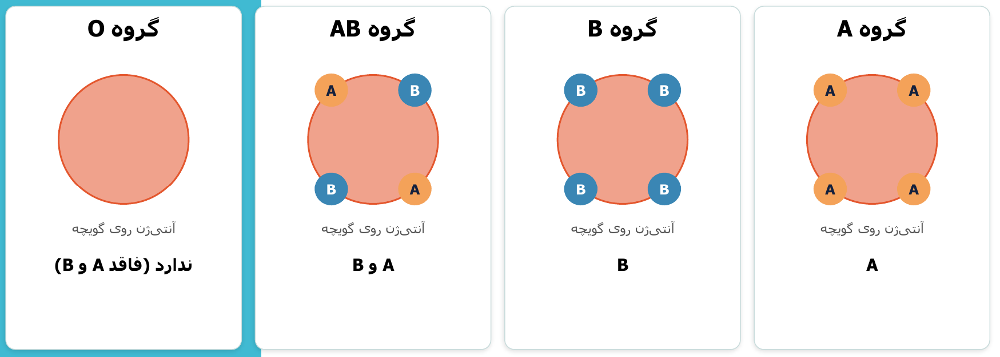
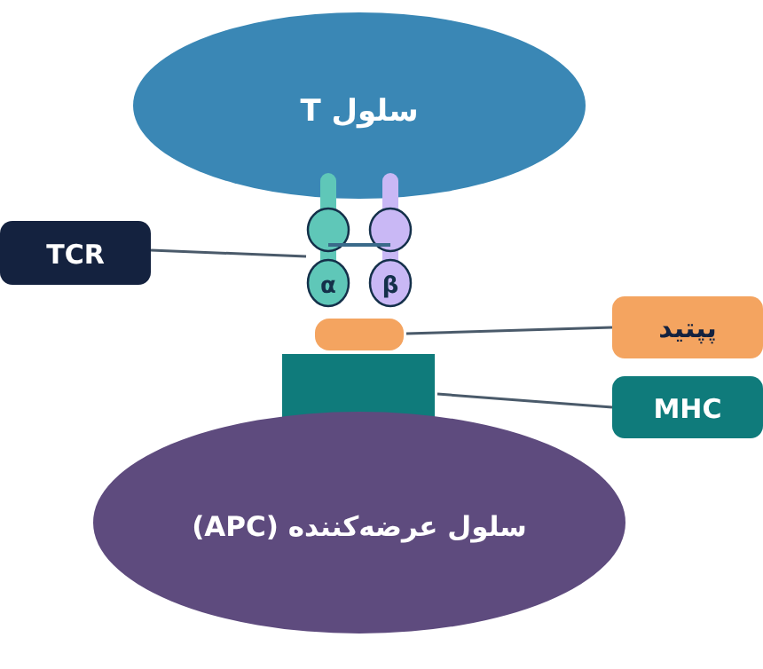
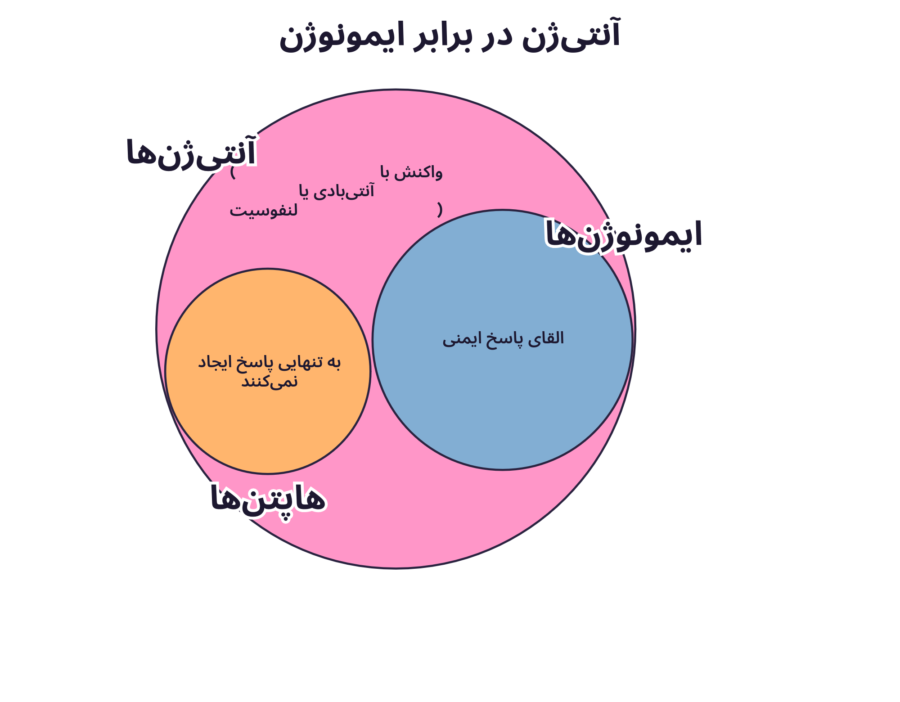
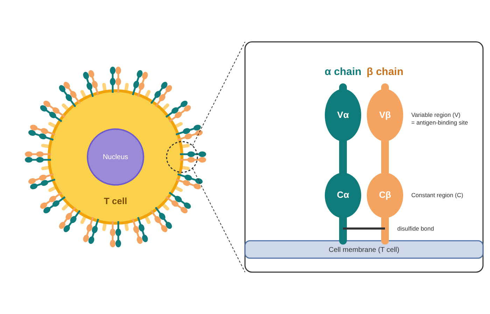
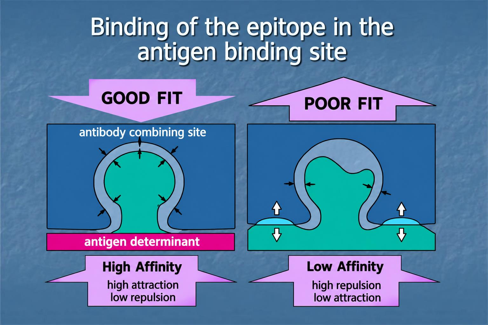
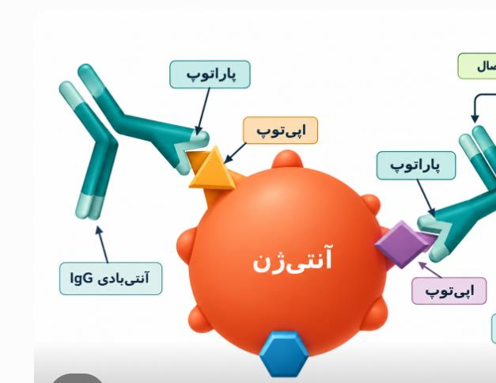
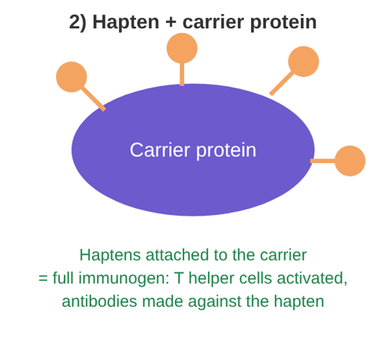
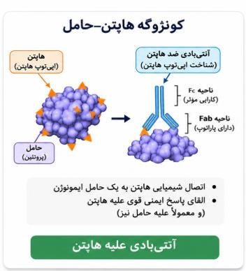
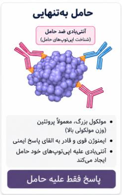
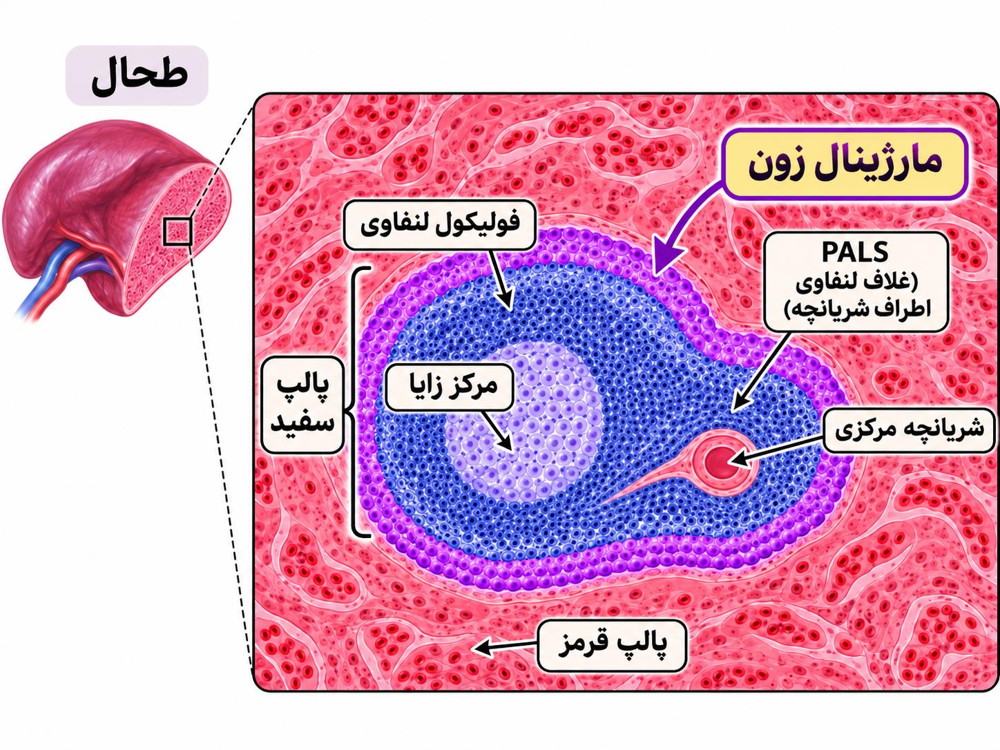

# آنتی‌ژن‌ها (Antigens)

**درس:** ایمنولوژی ۱، کارشناسی علوم آزمایشگاهی
**مبحث:** ایمونولوژی - آنتی‌ژن‌ها و عوامل مؤثر بر پاسخ ایمنی - جلسه پنجم
**استاد:** Tahereh Kalantari، PhD in Immunology
**تاریخ تولید جزوه:** 2026-11-02T16:54:40

## ۱. مقدمه و کلیات

اندام‌های لنفاوی اولیه محل بلوغ لنفوسیت‌ها و اندام‌های لنفاوی ثانویه محل فعال‌شدن سلول‌های ایمنی‌اند. سیستم ایمنی با موادی مانند باکتری، ویروس، گرده (آلرژن) و سلول توموری مواجه می‌شود. پرسش محوری این جلسه این است که سیستم ایمنی دقیقاً چه چیزی را می‌بیند و به آن پاسخ می‌دهد. جلسه به تعریف و انواع آنتی‌ژن، ایمونوژن، هاپتن، اپی‌توپ و پاراتوپ، عوامل مؤثر بر ایمونوژنیسیته، ارائه آنتی‌ژن، انواع پاسخ ایمنی و ارتباط این مفاهیم با آگلوتیناسیون و گروه‌بندی خون می‌پردازد.

## ۲. متن اصلی جزوه

### مرور جلسه قبل و پرسش آغازین

در آزمایشگاه، بسیاری از موادی که اندازه‌گیری می‌شوند، در اصل **آنتی‌ژن** یا **آنتی‌بادی‌**اند. برای مثال، در تعیین گروه خونی با آنتی‌ژن‌های گروه خونی سروکار داریم و در تست رایت، آنتی‌بادی علیه میکروب بروسلا سنجیده می‌شود.

> [BOX:IMPORTANT]
> تقریباً در هر تست ایمونولوژی، آنتی‌ژن یا آنتی‌بادی اندازه‌گیری می‌شود.

### سیستم گروه خونی ABO

| گروه خونی | آنتی‌ژن روی گویچه قرمز |
|---|---|
| A | A |
| B | B |
| AB | A و B |
| O | فاقد A و B |

### آنتی‌ژن‌ها بر اساس منشأ

**آنتی‌ژن برون‌زاد (Exogenous)** از خارج سلول یا بدن می‌آید؛ **باکتری‌ها** و **سموم** نمونه‌های آن‌اند. این مواد ممکن است با فاگوسیتوز وارد سلول‌های عرضه‌کننده آنتی‌ژن (APC) شوند، تجزیه شوند و از طریق MHC روی سطح سلول به سلول T عرضه شوند. معمولاً پپتیدهای آنتی‌ژن برون‌زاد روی MHC class II به سلول T کمکی (CD4+) عرضه می‌شوند.

**آنتی‌ژن درون‌زاد (Endogenous)** در سیتوزول سلول ساخته می‌شود؛ **پروتئین‌های ویروسی** و **آنتی‌ژن‌های سلول‌های توموری** نمونه‌های آن‌اند. آنتی‌ژن‌های درون‌زاد از طریق MHC class I به سلول T سایتوتوکسیک (CD8+) عرضه می‌شوند، نه از طریق MHC class II.

در عفونت ویروسی، ویروس از سلول‌های بدن برای تکثیر خود استفاده می‌کند؛ بنابراین آنتی‌ژن‌های ویروسی درون‌زادند. آنتی‌ژن‌های سلول‌های توموری نیز درون‌زاد محسوب می‌شوند: این سلول‌ها منشأ بدنی دارند، اما تغییر ماهیت داده‌اند.

در برخورد با عامل خارجی مانند باکتری، سلول‌های عرضه‌کننده آنتی‌ژن، از جمله ماکروفاژها، سلول‌های دندریتیک و سلول‌های B، عامل را می‌گیرند و وارد سلول می‌کنند. آنتی‌ژن در APC تجزیه می‌شود و از طریق MHC به سطح سلول می‌آید تا به سلول T عرضه شود.

### عرضه آنتی‌ژن به سلول T

سلول T آنتی‌ژن را از طریق APC دریافت می‌کند. APCهای حرفه‌ای شامل **سلول‌های دندریتیک، ماکروفاژها و سلول‌های B** هستند.

TCR (گیرنده سلول T) آنتی‌ژن آزاد را نمی‌بیند؛ فقط قطعه پپتیدیِ عرضه‌شده روی MHC را شناسایی می‌کند. بنابراین اپی‌توپ سلول T به‌صورت «**پپتید + MHC**» در نظر گرفته می‌شود.

| مولکول عرضه‌کننده | سلول T دریافت‌کننده |
|---|---|
| پپتید روی MHC class I | سلول T سایتوتوکسیک (CD8+) |
| پپتید روی MHC class II | سلول T کمکی (CD4+) |

سلول دندریتیک پپتید آنتی‌ژنی را در شکاف MHC خود به سلول T عرضه می‌کند

### آنتی‌ژن خودی و تحمل ایمنی

> [BOX:DEFINITION]
> **آنتی‌ژن خودی (Autoantigen)**
> مولکولی طبیعی در بدن است که در حالت سالم، نسبت به آن تحمل ایمنی وجود دارد.

اگر بدن درست کار کند، سیستم ایمنی نباید علیه آنتی‌ژن خودی واکنش نشان دهد. واکنش علیه آن به معنی شکستن تحمل ایمنی (Tolerance) است و می‌تواند به بیماری خودایمنی بینجامد.

عوامل ژنتیکی، از جمله MHC، در استعداد ابتلا به بیماری خودایمنی نقش دارند؛ در انسان به MHC، اصطلاح HLA (Human Leukocyte Antigen) نیز گفته می‌شود. عوامل محیطی نیز مطرح‌اند.

> [BOX:EXAMPLE]
> در تاریخچه برخی افراد مبتلا به بیماری خودایمنی، پیش از بروز بیماری رویدادهایی مانند افسردگی، از دست‌دادن یکی از نزدیکان یا استرس شدید دیده می‌شود. فرد دارای استعداد ژنتیکی ممکن است تا زمان آشکارشدن بیماری با محیط کنار آمده باشد و عوامل محیطی یا تنش‌زا در بروز بیماری دخیل باشند.

استرس کم ممکن است فعالیت را افزایش دهد، اما استرس شدید و مهارنشده می‌تواند اثر نامطلوبی بر سیستم ایمنی داشته باشد. سلول‌ها با ارسال سیگنال‌هایی، از جمله سیگنال‌های مرتبط با تولید سایتوکاین‌ها، بر یکدیگر اثر می‌گذارند و ممکن است سلول‌هایی را که به‌واسطه Tolerance خاموش بوده‌اند، فعال کنند.

> [BOX:IMPORTANT]
> بیماری‌های خودایمنی می‌توانند چندعاملی باشند و ژنتیک و محیط هر دو در آن‌ها نقش داشته باشند.

### تعریف‌های پایه: آنتی‌ژن و ایمونوژن

> [BOX:DEFINITION]
> **آنتی‌ژن (Antigen)**
> مولکولی است که به‌طور اختصاصی توسط آنتی‌بادی، گیرنده سلول بی (BCR) یا گیرنده سلول T (TCR، همراه با MHC) شناسایی می‌شود.

از نظر ماهیت شیمیایی، آنتی‌ژن‌ها می‌توانند پروتئین، پلی‌ساکارید، لیپید، اسید نوکلئیک یا حتی مولکول‌های کوچک شیمیایی باشند؛ مولکول‌های کوچک ممکن است پس از اتصال به حامل در این بحث قرار بگیرند. اختصاصیت و حافظه ایمنی اکتسابی بر پایه شناسایی آنتی‌ژن‌ها شکل می‌گیرد.

لنفوسیت‌های مورد بحث در ایمنی اختصاصی، سلول‌های B و T هستند. گیرنده لنفوسیت B، یعنی B-cell receptor، شبیه آنتی‌بادی است. TCR هترودایمری متشکل از دو زنجیره آلفا و بتا است و مجموعه پپتید و MHC را می‌شناسد. بنابراین آنتی‌ژن می‌تواند توسط آنتی‌بادی ترشح‌شده، آنتی‌بادی روی سطح سلول بی (BCR) یا TCR شناسایی شود؛ شناسایی توسط TCR به‌صورت پپتیدِ قرارگرفته در شکاف MHC انجام می‌شود.

در تعریف آنتی‌ژن باید شناسایی و اتصال را از فعال‌شدن و ایجاد پاسخ ایمنی جدا کرد:

1. مرحله نخست، اتصال از طریق آنتی‌بادی، BCR یا TCR است.
2. مرحله بعد ممکن است شامل فعال‌شدن سلول‌ها و ایجاد پاسخ ایمنی باشد.

اتصال به‌تنهایی همیشه به فعال‌شدن سلول و ایجاد پاسخ منجر نمی‌شود.

> [BOX:DEFINITION]
> **ایمونوژن (Immunogen)**
> مولکولی است که می‌تواند پاسخ ایمنی هومورال یا سلولی را القا کند.

آنتی‌ژن با محصولات پاسخ ایمنی، یعنی آنتی‌بادی یا لنفوسیت، واکنش می‌دهد، حتی اگر خودش نتواند پاسخ را القا کند. بنابراین هر ایمونوژنی آنتی‌ژن است، اما هر آنتی‌ژنی ایمونوژن نیست. هاپتن‌ها آنتی‌ژن‌های غیرایمونوژن‌اند.

> [BOX:IMPORTANT]
> تمایز آنتی‌ژن و ایمونوژن از سؤال‌های امتحانی مهم است.

| مفهوم | توانایی القای پاسخ ایمنی |
| --- | --- |
| آنتی‌ژن | ممکن است پاسخ را القا بکند یا نکند |
| ایمونوژن | پاسخ ایمنی هومورال یا سلولی را القا می‌کند |
| هاپتن | به‌تنهایی پاسخ ایمنی ایجاد نمی‌کند |

### اپی‌توپ و پاراتوپ

> [BOX:DEFINITION]
> **اپی‌توپ (Epitope)**
> یا دترمینان آنتی‌ژنی، بخش کوچکی از آنتی‌ژن است که مستقیماً توسط آنتی‌بادی، BCR یا TCR شناسایی می‌شود.

> [BOX:DEFINITION]
> **پاراتوپ (Paratope)**
> ناحیه اتصال روی آنتی‌بادی یا گیرنده است که از نظر شکل و بار مکمل اپی‌توپ است و به آن متصل می‌شود.

اپی‌توپ بخشی از آنتی‌ژن و پاراتوپ جایگاه اتصال مکمل آن است. از نظر آزمایشگاهی، آنتی‌بادی مونوکلونال علیه یک اپی‌توپ و آنتی‌بادی پلی‌کلونال علیه چند اپی‌توپ یک آنتی‌ژن ساخته می‌شود.

جایگاه اتصال آنتی‌ژن در TCR در ناحیه متغیر قرار دارد. اسلایدهای مربوط به TCR اجزای زیر را نشان می‌دهند:

- زنجیره α و زنجیره β
- ناحیه متغیر (Variable region, V)، محل اتصال آنتی‌ژن
- ناحیه ثابت (Constant region, C)
- پیوند دی‌سولفیدی
- غشای سلول T
- هسته

*تصویر 128*

*تصویر 129*

*تصویر 130*

### اپی‌توپ سلول B و سلول T

اپی‌توپ سلول T با اپی‌توپ سلول B تفاوت دارد:

| ویژگی | اپی‌توپ سلول T | اپی‌توپ سلول B |
|---|---|---|
| شکل شناسایی | مجموعه پپتید و MHC | ساختار آنتی‌ژن |
| ویژگی پپتید | معمولاً کوچک و خطی؛ حدود ۱۰ و حداکثر ۲۰ اسیدآمینه، عرضه‌شده در شکاف MHC | می‌تواند خطی یا فضایی باشد |

### هاپتن و حامل

> [BOX:DEFINITION]
> **هاپتن (Hapten)**
> مولکول کوچکی است که می‌تواند به آنتی‌بادی یا گیرنده متصل شود؛ بنابراین آنتی‌ژن است. اما به‌تنهایی نمی‌تواند پاسخ ایمنی ایجاد کند و ایمونوژن نیست.

هاپتن معمولاً مولکولی با وزن مولکولی کمتر از حدود ۱۰۰۰ (یک کیلو) دالتون است.

نمونه‌های هاپتن عبارت‌اند از:

- پنی‌سیلین، سولفونامیدها و بعضی آنتی‌بیوتیک‌ها و داروهای دیگر
- اوروشیول (urushiol) موجود در Poison ivy
- مواد نیکل موجود در زیورآلات
- بعضی مواد رنگ مو و لوازم آرایشی
- PPD، از عوامل شایع حساسیت تماسی

اوروشیول با پروتئین‌های بدن ترکیب می‌شود و درماتیت تماسی ایجاد می‌کند. اسلاید همچنین small synthetic peptides را مطرح می‌کند: این پپتیدها معمولاً از چند آمینواسید تا حدود ۳۰ آمینواسید تشکیل شده‌اند و وزن مولکولی پایینی دارند و چنین پپتیدهایی معمولاً پاسخ ایمنی ایجاد نمی‌کنند.

پنی‌سیلین و بسیاری از داروها در حالت عادی هاپتن‌اند. داروها معمولاً به‌گونه‌ای طراحی می‌شوند که بر عامل میکروبی یا هدف دارویی اثر کنند، نه اینکه خودشان پاسخ ایمنی بدن را برانگیزند؛ بااین‌حال، گاهی سیستم ایمنی علیه آن‌ها واکنش نشان می‌دهد. در بعضی افراد، تزریق پنی‌سیلین ممکن است واکنش آلرژیک شدید ایجاد کند. بعضی آنتی‌بیوتیک‌ها نیز می‌توانند هاپتن باشند.

هاپتن به‌تنهایی می‌تواند به آنتی‌بادی اختصاصیِ از قبل موجود متصل شود، اما این اتصال به این معنا نیست که هاپتن به‌تنهایی پاسخ ایمنی ایجاد می‌کند. اگر هاپتن به پروتئین حامل (Carrier) متصل شود، مجموعه هاپتن ـ حامل می‌تواند ایمونوژن کامل باشد. اتصال هاپتن به حامل شیمیایی و کووالانسی است. اتصال به پروتئین‌های بدن، از جمله آلبومین، اندازه مجموعه را افزایش می‌دهد و اپی‌توپ‌های بیشتری در اختیار سیستم ایمنی قرار می‌دهد. هاپتن کوچک به‌تنهایی سیگنال کافی برای فعال‌سازی ایجاد نمی‌کند؛ اتصال چند گیرنده به ساختار بزرگ‌تر می‌تواند پاسخ را تقویت کند.

وقتی هاپتن به حامل ایمونوژن متصل شود، پاسخ ایمنی علیه هاپتن و معمولاً علیه حامل نیز ایجاد می‌شود. سلول‌های T helper فعال می‌شوند و آنتی‌بادی علیه هاپتن ساخته می‌شود. حامل به‌تنهایی نیز می‌تواند ایمونوژن باشد و علیه اپی‌توپ‌های خود حامل آنتی‌بادی ایجاد کند؛ اما در کونژوگه، سیستم ایمنی اپی‌توپ هاپتن را نیز می‌شناسد و آنتی‌بادی ضد هاپتن می‌سازد. بنابراین پاسخ فقط علیه حامل نیست.

*تصویر 58*

*تصویر 61*

*تصویر 62*

در مثال پنی‌سیلین، تماس اول باعث می‌شود پنی‌سیلینِ کوچک و به‌تنهایی غیرایمونوژن به پروتئین‌های بدن، به‌ویژه آلبومین خون، متصل شود و کونژوگه پنی‌سیلین ـ پروتئین بسازد. در فرد مستعد، لنفوسیت‌های B و T اختصاصی فعال می‌شوند و پاسخ می‌تواند به سمت تولید IgE برود؛ IgE با آلرژی ارتباط دارد.

### والانس آنتی‌ژن

والانس (Valency) تعداد یا نوع اپی‌توپ‌هایی را توصیف می‌کند که در آنتی‌ژن در دسترس‌اند.

| نوع آنتی‌ژن | ویژگی اپی‌توپ | توضیح و نمونه |
|---|---|---|
| تک‌ظرفیتی | یک اپی‌توپ | هاپتن نمونه‌ای از آنتی‌ژن تک‌ظرفیتی است که یک آنتی‌بادی می‌تواند به آن متصل شود، اما به‌تنهایی شبکه تشکیل نمی‌دهد. |
| چندظرفیتی با اپی‌توپ‌های متفاوت | چند اپی‌توپ متفاوت | پروتئین‌ها می‌توانند چند اپی‌توپ متفاوت داشته باشند و در نتیجه چند نوع آنتی‌بادی (پلی‌کلونال) به آن‌ها متصل شوند. |
| چندظرفیتی با اپی‌توپ‌های تکراری | اپی‌توپی مشابه که بارها تکرار می‌شود | مانند بسیاری از پلی‌ساکاریدها؛ چند BCR می‌توانند به آن متصل شوند. |

تشکیل شبکه (lattice) در آگلوتیناسیون و رسوب به آنتی‌ژن چندظرفیتی نیاز دارد.

### آنتی‌ژن‌های پلیمری و تکرار اپی‌توپ

آنتی‌ژن‌های پلیمری از واحدهای یکسان و تکرارشونده ساخته شده‌اند. نمونه‌ها عبارت‌اند از:

- پلی‌ساکاریدهای کپسولی پنوموکوک و هموفیلوس
- LPS (لیپوپلی‌ساکارید) دیواره باکتری‌های گرم منفی
- فلاژلین، پروتئین تاژک باکتری که از زیرواحدهای تکراری ساخته شده است
- پروتئین‌های پوشش ویروس که روی سطح ذره ویروسی واحدهای یکسان دارند

> [BOX:EXAMPLE]
> نمونه‌های آنتی‌ژن پلیمری عبارت‌اند از پلی‌ساکاریدهای کپسولی پنوموکوک و هموفیلوس، LPS دیواره باکتری‌های گرم منفی، فلاژلین و پروتئین‌های پوشش ویروس.

اپی‌توپ تکراری در آنتی‌ژن پلیمری می‌تواند چندین BCR را هم‌زمان cross-link کند و B-cell را حتی بدون کمک T-cell فعال کند؛ این پاسخ T-independent است. تکرار اپی‌توپ‌های مشابه روی پلی‌ساکاریدها چند BCR را هم‌زمان درگیر می‌کند و سیگنال قوی‌ای به B-cell می‌دهد؛ مانند چند دست که هم‌زمان دست می‌دهند و سیگنال قوی‌تری ایجاد می‌کنند.

در آنتی‌ژن‌هایی که اپی‌توپ‌های متفاوت و معمولاً غیرتکراری دارند، هر اپی‌توپ معمولاً یک بار دیده می‌شود و cross-link ضعیف‌تر است؛ پاسخ اغلب وابسته به T-cell است. پاسخ به پلی‌ساکاریدها عمدتاً IgM، بدون class switching و بدون حافظه ایمنی است؛ پاسخ پروتئینی می‌تواند class switching و ایجاد سلول‌های memory داشته باشد.

| ویژگی | آنتی‌ژن پلیمری با اپی‌توپ‌های تکراری | آنتی‌ژن با اپی‌توپ‌های متفاوت و معمولاً غیرتکراری |
|---|---|---|
| درگیری BCR | چندین BCR به‌طور هم‌زمان cross-link می‌شوند | cross-link ضعیف‌تر است |
| وابستگی معمول پاسخ | می‌تواند T-independent باشد | اغلب وابسته به T-cell است |
| ویژگی‌های پاسخ ذکرشده | پلی‌ساکاریدها: عمدتاً IgM، بدون class switching و بدون حافظه ایمنی | پروتئین‌ها: می‌توانند class switching و سلول‌های memory داشته باشند |

### پاسخ کودکان زیر دو سال به پلی‌ساکاریدها

چرا کودکان زیر دو سال به پلی‌ساکاریدها پاسخ ضعیفی می‌دهند؟ ابتدا بخش‌های طحال را مرور می‌کنیم:

| بخش یا ساختار طحال | توضیح ارائه‌شده |
|---|---|
| پالپ قرمز | با RBCها و ماکروفاژها ارتباط دارد؛ در فیلترکردن خون و جمع‌آوری سلول‌های مرده نقش دارد. |
| پالپ سفید | در سیستم ایمنی نقش دارد و لنفوسیت‌های B و T در آن قرار دارند. |
| PALS | محل قرارگیری لنفوسیت‌های T اطراف شریانچه مرکزی |
| فولیکول‌های لنفاوی | محل لنفوسیت‌های B؛ برخورد با آنتی‌ژن می‌تواند به تشکیل مرکز زایا بینجامد. |
| Marginal zone | ناحیه حاشیه‌ای طحال |

*تصویر 92*

در Marginal zone طحال، گروهی از B cellها با B cellهای معمولی تفاوت دارند و B-1 cells نامیده می‌شوند؛ این سلول‌ها با پلی‌ساکاریدها مرتبط‌اند. بسیاری از عوامل میکروبی کپسول پلی‌ساکاریدی دارند. بر اساس این توضیح، B cellهای Marginal zone در کودکان زیر دو سال هنوز بالغ نشده‌اند و پس از دو سالگی بالغ می‌شوند و می‌توانند به آنتی‌ژن‌های پلی‌ساکاریدی پاسخ دهند. بنابراین واکسن پلی‌ساکاریدیِ تنها ممکن است در این گروه سنی پاسخ مناسبی ایجاد نکند.

واکسن کونژوگه در این وضعیت، پلی‌ساکارید را به پروتئین حامل متصل می‌کند و پاسخ مستقل از T را به پاسخ وابسته به T تبدیل می‌کند. کودک می‌تواند به بخش پروتئینی پاسخ دهد، در حالی که پاسخ به پلی‌ساکاریدِ تنها در این سن ضعیف است. اسلاید نمونه واکسن Hib را ذکر می‌کند.Marginal zone طحال به‌عنوان حدود ۹۰ تا ۹۵ درصد علت پاسخ ضعیف زیر دو سال مطرح است اما عوامل دیگری نیز ممکن است اثر داشته باشند.

### عوامل مؤثر بر ایمونوژنیسیته

> [BOX:DEFINITION]
> **ایمونوژنیسیته (Immunogenicity)**
> توانایی یک ماده برای القای پاسخ ایمنی است.

سه دسته عامل در ایمونوژنیسیته مؤثرند:

1. ویژگی‌های آنتی‌ژن
2. عوامل مربوط به میزبان
3. نحوه تماس با آنتی‌ژن

| دسته عامل | عوامل ذکرشده |
|---|---|
| ویژگی‌های آنتی‌ژن | بیگانه‌بودن، اندازه مولکول، ترکیب شیمیایی، پیچیدگی ساختاری و قابلیت پردازش |
| عوامل میزبان | ژنتیک (MHC/HLA)، سن، وضعیت سلامت و تغذیه و داروهای سرکوبگر ایمنی |
| نحوه تماس با آنتی‌ژن | دوز، راه ورود و ادجوانت |

#### بیگانه‌بودن و اندازه مولکول

سیستم ایمنی نسبت به مولکول‌های خودی تحمل دارد. هرچه ماده از نظر تکاملی از میزبان دورتر باشد، معمولاً ایمونوژن‌تر است.

> [BOX:EXAMPLE]
> آلبومین گاوی (BSA) در خرگوش پاسخ ایجاد می‌کند و ایمونوژن مناسبی است، اما در گاو پاسخ ایجاد نمی‌کند، چون برای گاو خودی است.

اندازه مولکول نیز اهمیت دارد. حدود ۱۰۰ کیلو Da اندازه مناسب برای ایمونوژن قوی است؛ مواد کمتر از ۱ کیلو Da به‌صورت هاپتن یا ایمونوژن بسیار ضعیف و بازه حدود ۵ تا ۱۰ kDa پاسخ ضعیف ایجاد می‌کنند. پروتئین‌ها معمولاً مولکول‌های بزرگی‌اند و ایمونوژن‌های خوبی به شمار می‌آیند.

| اندازه تقریبی | توضیح مطرح‌شده |
| --- | --- |
| کمتر از ۱ kDa | هاپتن یا ایمونوژن بسیار ضعیف |
| حدود ۵ تا ۱۰ kDa | پاسخ ضعیف‌ |
| حدود ۱۰۰ kDa و بالاتر | اندازه مناسب برای ایمونوژن قوی؛ پروتئین‌ها معمولاً مولکول‌های بزرگی‌اند و ایمونوژن‌های خوبی به شمار می‌آیند |

#### ترکیب شیمیایی

چهار دسته اصلی ترکیبات بیوشیمیایی عبارت‌اند از پروتئین، پلی‌ساکارید، لیپید و اسید نوکلئیک. در مقایسه ارائه‌شده، ایمونوژنیسیته به‌ترتیب در پروتئین‌ها بیشترین، سپس در پلی‌ساکاریدها، بعد در لیپیدها و در اسیدهای نوکلئیک کمترین است.

| ترکیب | ویژگی‌های ایمونوژنیسیته ذکرشده |
|---|---|
| پروتئین‌ها | بیشترین ایمونوژنیسیته؛ معمولاً پاسخ وابسته به T، حافظه و class switching ایجاد می‌کنند. |
| پلی‌ساکاریدها | پس از پروتئین‌ها؛ مانند کپسول باکتری‌ها، اپی‌توپ‌های تکراری دارند و اغلب مستقل از T عمل می‌کنند و حافظه ضعیف یا فاقد حافظه ایجاد می‌کنند. |
| لیپیدها | ایمونوژن‌های ضعیفی‌اند و معمولاً پس از اتصال به پروتئین حامل ایمونوژن می‌شوند. |
| اسیدهای نوکلئیک | ایمونوژن‌های ضعیفی‌اند، هرچند می‌توانند در خودایمنی، مانند لوپوس، هدف قرار گیرند. |

اسلاید این پرسش گروهی را مطرح می‌کند: چرا پروتئین‌ها نسبت به لیپیدها و پلی‌ساکاریدها ایمونوژن‌های قوی‌تری هستند؟

#### پیچیدگی ساختاری و قابلیت پردازش

هموپلیمرهای آمینواسیدی و ساختارهای ساده ایمونوژن‌های ضعیفی‌اند. تنوع آمینواسیدها و ساختار سه‌بعدی پیچیده‌تر می‌تواند ایمونوژنیسیته را افزایش دهد. برای مثال، پروتئینی که فقط از یک نوع آمینواسید، مانند لیزین، ساخته شده باشد، ایمونوژن قدرتمندی نیست. تنوع اسیدآمینه‌ها، از جمله وجود اسیدآمینه‌های آروماتیکِ دارای حلقه بنزنی، می‌تواند پیچیدگی ساختاری و قدرت ایمونوژنیسیته را افزایش دهد. ساختار متنوع‌تر فرصت شناسایی توسط آنتی‌بادی‌ها و فعال‌سازی T helper را افزایش می‌دهد.

> [BOX:EXAMPLE]
> پروتئینی که فقط از یک نوع آمینواسید، مانند لیزین، ساخته شده باشد، ایمونوژن قدرتمندی نیست. اما پروتئینی حاوی اسیدآمینه آروماتیک تریپتوفان، می‌تواند دارای ساختار سه‌بعدی پیچیده‌تر و در نتیجه ایمونوژن قوی‌تری باشد.

قابلیت پردازش نیز مهم است: پروتئین باید توسط سلول‌های عرضه‌کننده تجزیه شود و پپتیدهای آن روی MHC عرضه شوند. موادی که پردازش و عرضه نمی‌شوند، پاسخ ضعیفی ایجاد می‌کنند و ایمونوژن‌های مناسبی نیستند.

#### عوامل وابسته به میزبان

افراد مختلف به یک آنتی‌ژن پاسخ یکسانی نمی‌دهند. ژنتیک، از جمله HLA/MHC و این‌که چه پپتیدهایی عرضه شوند، در تفاوت پاسخ‌ها نقش دارد. نوزادان و سالمندان معمولاً نسبت به بزرگسالان جوان پاسخ ایمنی ضعیف‌تری دارند. سوءتغذیه، عفونت‌ها و بیماری‌ها نیز می‌توانند پاسخ ایمنی را تضعیف کنند و در تفسیر آزمایش‌های سرولوژی اهمیت دارند. داروهای سرکوبگر ایمنی نیز پاسخ را کاهش می‌دهند.

| عامل میزبان | اثر یا نکته ذکرشده |
|---|---|
| ژنتیک، از جمله HLA/MHC | بر تفاوت پاسخ افراد و پپتیدهایی که عرضه می‌شوند اثر دارد. |
| سن | نوزادان و سالمندان معمولاً نسبت به بزرگسالان جوان پاسخ ایمنی ضعیف‌تری دارند. |
| وضعیت سلامت و تغذیه | سوءتغذیه، عفونت‌ها و بیماری‌ها می‌توانند پاسخ ایمنی را تضعیف کنند و در تفسیر آزمایش‌های سرولوژی اهمیت دارند. |
| داروهای سرکوبگر ایمنی | پاسخ ایمنی را کاهش می‌دهند. |

داروهایی که افراد پس از پیوند بافت مصرف می‌کنند، از داروهای سرکوبگر ایمنی‌اند. سرکوب ایمنی می‌تواند در سال‌های بعد با افزایش احتمال تومور یا سرطان همراه باشد.

#### دوز، راه ورود و ادجوانت

دوز بسیار کم یا بسیار زیاد آنتی‌ژن می‌تواند به پاسخ ضعیف یا تحمل ایمنی منجر شود؛ دوز بهینه بهترین پاسخ را ایجاد می‌کند.

راه ورود نیز اهمیت دارد:

| راه ورود | محل یا بافت مرتبط در نمودار اسلاید |
|---|---|
| تزریق وریدی (IV) | طحال |
| تزریق زیرجلدی یا داخل‌جلدی (SC/ID) | غدد لنفاوی ناحیه‌ای |
| ورود خوراکی یا مخاطی | بافت لنفاوی مخاطی (MALT) |

غذاهای خوراکی آنتی‌ژن دارند، اما معمولاً از راه دستگاه گوارش پاسخ ایمنی علیه آن‌ها ایجاد نمی‌شود، مگر در مواردی مانند حساسیت غذایی. برخی سلول‌های دندریتیک آن ناحیه، از جمله سلول‌های CD103-positive، با جلوگیری از پاسخ ایمنی مرتبط‌اند. اطلاعات درباره سلول‌های دندریتیک ویژه و مارکرهای آن‌ها در حال تحول است.

واکسن‌ها معمولاً از راه وریدی تزریق نمی‌شوند و تزریق IV ممکن است پاسخ ضعیفی ایجاد کند یا پاسخ نزدیک به صفر باشد؛ راه‌های زیرجلدی (Subcutaneous) و داخل‌جلدی (Intradermal) معمولاً پاسخ قوی‌تری ایجاد می‌کنند.

| راه تزریق | توضیح مطرح‌شده |
| --- | --- |
| Intradermal | داخل پوست، میان درم و اپیدرم؛ نیازمند دقت و زاویه مناسب؛ ممکن است پوست تا زمان جذب ماده برجسته بماند. حدود ۵۰ یا ۱۰۰ میکرولیتر با زاویه‌ای مانند ۱۵ درجه انجام می‌شود. |
| Subcutaneous | زیر لایه پوست؛ در مثال تزریق به موش، با بالا کشیدن پوست پشت گردن انجام می‌شود. |
| Intramuscular | راه ورود دیگری است، اما معمولاً ضعیف‌تر از Subcutaneous و Intradermal است. |
| Intraperitoneal | داخل صفاق و در موش؛ در توضیح شفاهی تقریباً در کنار Subcutaneous در نظر گرفته شد. |
| Intravenous | واکسن‌ها معمولاً از این راه تزریق نمی‌شوند؛ تزریق IV ممکن است پاسخ ضعیف یا نزدیک به صفر ایجاد کند. |

> [BOX:DEFINITION]
> **ادجوانت (Adjuvant)**
> ماده‌ای تقویتی است که همراه برخی آنتی‌ژن‌ها به‌کار می‌رود تا پاسخ ایمنی را قوی‌تر کند.

ادجوانت می‌تواند باعث ماندگاری بیشتر آنتی‌ژن و آزادسازی تدریجی آن شود. آنتی‌ژن گاهی در دو یا سه روز اول از بدن دفع می‌شود، درحالی‌که ادجوانت می‌تواند مانند انبار آن را نگه دارد و کم‌کم آزاد کند. ادجوانت لازم نیست با آنتی‌ژن پیوند کووالانسی داشته باشد و نقش آن تقویت پاسخ بدن است.

Alum ادجوانتی بر پایه آلومینیوم است که برای انسان به‌کار می‌رود. ادجوانت‌های دیگری نیز وجود دارند و برخی ادجوانت‌های مورد استفاده در موش می‌توانند برای انسان خطرناک باشند. همچنین گزارش‌هایی درباره لخته پس از برخی واکسن‌ها و وقوع پیامدهای شدید در افراد مستعد وجود دارد.

### اپی‌توپ‌های خطی و فضایی

| ویژگی | اپی‌توپ خطی (Linear) | اپی‌توپ فضایی (Conformational) |
|---|---|---|
| ساختار | از آمینواسیدهای پشت‌سرهم در توالی تشکیل می‌شود. | به تاخوردگی سه‌بعدی وابسته است و ممکن است از نواحی دور از هم در توالی تشکیل شود که در ساختار تاخورده کنار هم قرار می‌گیرند. |
| اثر دناتوره‌شدن | تا حدی پس از دناتوره‌شدن باقی می‌ماند. | با دناتوره‌شدن از بین می‌رود. |
| شناسایی یا نمونه ذکرشده | می‌تواند در Western blot، که پروتئین در آن دناتوره است، شناسایی شود. | بیشتر اپی‌توپ‌های سلول B از این نوع‌اند. |

حرارت یا مواد دناتوره‌کننده می‌توانند اپی‌توپ فضایی را از بین ببرند و نتیجه ELISA یا ایمونوهیستوشیمی را تغییر دهند.

### واکنش متقاطع (Cross-reactivity)

> [BOX:DEFINITION]
> **واکنش متقاطع (Cross-reactivity)**
> زمانی رخ می‌دهد که آنتی‌بادی ساخته‌شده علیه یک آنتی‌ژن به آنتی‌ژن دیگری با اپی‌توپ مشابه نیز متصل شود.

شباهت آنتی‌ژنی گاهی در بیماری‌های خودایمنی مشکل‌ساز می‌شود: آنتی‌بادی ابتدا علیه عامل میکروبی بیگانه ساخته می‌شود و سپس به‌دلیل اپی‌توپ مشابه می‌تواند به بافت میزبان متصل شود. استعداد ژنتیکی، از جمله HLA، و عوامل محیطی می‌توانند در تفاوت ابتلای افراد نقش داشته باشند.

> [BOX:EXAMPLE]
> آنتی‌بادی علیه پروتئین M استرپتوکوک گروه A ممکن است به‌دلیل شباهت با ماهیچه قلب به آن متصل شود و در تب روماتیسمی نقش داشته باشد.

از نظر آزمایشگاهی، واکنش متقاطع می‌تواند مثبت کاذب ایجاد کند و ممکن است آزمون‌های تأییدی لازم باشند.

### آنتی‌ژن‌های ویژه

| نوع آنتی‌ژن | ویژگی یا نمونه ذکرشده |
|---|---|
| آنتی‌ژن توموری | می‌تواند پروتئین جهش‌یافته یا بیش‌بیان‌شده باشد و مبنای نشانگرهای توموری مانند AFP و CEA قرار گیرد. |
| سوپرآنتی‌ژن | بدون پردازش به MHC II و Vβ می‌چسبد و تعداد زیادی سلول T را فعال می‌کند. TSST-1 نمونه‌ای از سوپرآنتی‌ژن است. |
| آلرژن | آنتی‌ژن محیطیِ معمولاً بی‌خطری، مانند گرده، مایت یا دارو است که در افراد مستعد می‌تواند IgE ایجاد کند. |
| زنوآنتی‌ژن | از گونه‌ای دیگر می‌آید و در پیوند زنوگرافت مطرح است. |
| آلوآنتی‌ژن | از تفاوت‌های ژنتیکی میان افراد هم‌گونه ناشی می‌شود. |
| آنتی‌ژن‌های ABO و Rh | روی گویچه‌های قرمز قرار دارند و پایه گروه‌بندی و تطابق خون و واکنش انتقال خون‌اند. |

### آنتی‌ژن‌های وابسته به T و مستقل از T

| ویژگی | آنتی‌ژن‌های وابسته به T (TD) | آنتی‌ژن‌های مستقل از T (TI) |
|---|---|---|
| نوع معمول آنتی‌ژن | عمدتاً پروتئین | LPS، پلی‌ساکاریدها و پلیمرهای دارای اپی‌توپ‌های تکراری |
| پردازش و عرضه | پپتید روی MHC II عرضه می‌شود | کمک سلول T لازم نیست |
| پاسخ | به کمک سلول T نیاز دارد؛ می‌تواند class switching به IgG، IgA و IgE، حافظه قوی و افزایش میل ترکیبی ایجاد کند | معمولاً عمدتاً IgM ایجاد می‌کند و حافظه ضعیف یا فاقد حافظه و افزایش میل ترکیبی محدود یا فاقد آن دارد |
| نمونه‌ها | توکسوئید کزاز و پروتئین‌های ویروسی | پلی‌ساکارید کپسول پنوموکوک و LPS |

واکسن کونژوگه با اتصال پلی‌ساکارید به پروتئین حامل، پاسخ مستقل از T را به پاسخ وابسته به T تبدیل می‌کند؛ نمونه ذکرشده واکسن Hib است.

### پرسش‌های ارزیابی مطرح‌شده در اسلاید

۱. ماده‌ای که با آنتی‌بادی واکنش می‌دهد، اما به‌تنهایی پاسخ ایمنی ایجاد نمی‌کند، چه نام دارد؟ گزینه‌ها: ایمونوژن، هاپتن، ادجوانت، سوپرآنتی‌ژن.

۲. کدام اپی‌توپ‌ها فقط پس از عرضه روی MHC توسط TCR شناسایی می‌شوند؟ پاسخ: اپی‌توپ‌های سلول T. گزینه‌های دیگر در اسلاید شامل قندهای گروه خونی و هاپتن‌های آزادند.

۳. کدام ویژگی مربوط به آنتی‌ژن‌های مستقل از T است؟ پاسخ درستِ مورد نظر اسلاید، اپی‌توپ‌های تکراری مانند پلی‌ساکارید باکتریایی است. گزینه‌های دیگر شامل حافظه قوی و تولید IgG، نیاز به عرضه پپتید روی MHC II و «فقط پروتئین‌ها» هستند.

### جلسه بعد و منابع درسی

جلسه بعد درباره آنتی‌بادی‌هاست: ساختار ایمونوگلوبولین‌ها، کلاس‌های IgM، IgG، IgA، IgE و IgD، عملکردها و آنتی‌بادی‌های پلی‌کلونال و مونوکلونال. موضوع وابسته به T و مستقل از T نیز مطرح خواهد شد.

## ۳. جداول مرور سریع

### گروه خونی ABO

| گروه خونی | آنتی‌ژن روی گویچه قرمز |
|---|---|
| A | A |
| B | B |
| AB | A و B |
| O | فاقد A و B |

### مسیرهای منشأ و عرضه آنتی‌ژن

| ویژگی | آنتی‌ژن برون‌زاد (Exogenous) | آنتی‌ژن درون‌زاد (Endogenous) |
|---|---|---|
| منشأ | خارج سلول یا بدن | ساخته‌شده در سیتوزول سلول |
| نمونه‌ها | باکتری‌ها و سموم | پروتئین‌های ویروسی و آنتی‌ژن‌های سلول‌های توموری |
| مسیر معمول عرضه | MHC class II | MHC class I |
| سلول T مرتبط | T helper (CD4+) | T cytotoxic (CD8+) |

### تمایز آنتی‌ژن، ایمونوژن و هاپتن

| مفهوم | شناسایی یا اتصال | توانایی القای پاسخ ایمنی |
|---|---|---|
| آنتی‌ژن | با آنتی‌بادی یا لنفوسیت واکنش می‌دهد | ممکن است پاسخ را القا نکند |
| ایمونوژن | آنتی‌ژن است | می‌تواند پاسخ ایمنی هومورال یا سلولی را القا کند |
| هاپتن | می‌تواند به آنتی‌بادی یا گیرنده متصل شود | به‌تنهایی پاسخ ایمنی ایجاد نمی‌کند |

### ارائه آنتی‌ژن و اپی‌توپ‌های سلول T و B

| مولکول عرضه‌کننده | سلول T دریافت‌کننده |
|---|---|
| پپتید روی MHC class I | سلول T سایتوتوکسیک (CD8+) |
| پپتید روی MHC class II | سلول T کمکی (CD4+) |

| ویژگی | اپی‌توپ سلول T | اپی‌توپ سلول B |
|---|---|---|
| شکل شناسایی | مجموعه پپتید و MHC | ساختار آنتی‌ژن |
| ویژگی پپتید | معمولاً کوچک و خطی؛ حدود ۱۰ و حداکثر ۲۰ اسیدآمینه، عرضه‌شده در شکاف MHC | می‌تواند خطی یا فضایی باشد |

### والانس آنتی‌ژن

| نوع آنتی‌ژن | ویژگی اپی‌توپ | توضیح و نمونه |
|---|---|---|
| تک‌ظرفیتی | یک اپی‌توپ | هاپتن نمونه‌ای از آنتی‌ژن تک‌ظرفیتی است که یک آنتی‌بادی می‌تواند به آن متصل شود، اما به‌تنهایی شبکه تشکیل نمی‌دهد. |
| چندظرفیتی با اپی‌توپ‌های متفاوت | چند اپی‌توپ متفاوت | پروتئین‌ها می‌توانند چند اپی‌توپ متفاوت داشته باشند و در نتیجه چند نوع آنتی‌بادی (پلی‌کلونال) به آن‌ها متصل شوند. |
| چندظرفیتی با اپی‌توپ‌های تکراری | اپی‌توپی مشابه که بارها تکرار می‌شود | مانند بسیاری از پلی‌ساکاریدها؛ چند BCR می‌توانند به آن متصل شوند. |

### آنتی‌ژن پلیمری و اپی‌توپ‌های متفاوت

| ویژگی | آنتی‌ژن پلیمری با اپی‌توپ‌های تکراری | آنتی‌ژن با اپی‌توپ‌های متفاوت و معمولاً غیرتکراری |
|---|---|---|
| درگیری BCR | چندین BCR به‌طور هم‌زمان cross-link می‌شوند | cross-link ضعیف‌تر است |
| وابستگی معمول پاسخ | می‌تواند T-independent باشد | اغلب وابسته به T-cell است |
| ویژگی‌های پاسخ ذکرشده | پلی‌ساکاریدها: عمدتاً IgM، بدون class switching و بدون حافظه ایمنی | پروتئین‌ها: می‌توانند class switching و سلول‌های memory داشته باشند |

### ساختارهای طحال مطرح‌شده در پاسخ به پلی‌ساکاریدها

| بخش یا ساختار طحال | توضیح ارائه‌شده |
|---|---|
| پالپ قرمز | با RBCها و ماکروفاژها ارتباط دارد؛ در فیلترکردن خون و جمع‌آوری سلول‌های مرده نقش دارد. |
| پالپ سفید | در سیستم ایمنی نقش دارد و لنفوسیت‌های B و T در آن قرار دارند. |
| PALS | محل قرارگیری لنفوسیت‌های T اطراف شریانچه مرکزی |
| فولیکول‌های لنفاوی | محل لنفوسیت‌های B؛ برخورد با آنتی‌ژن می‌تواند به تشکیل مرکز زایا بینجامد. |
| Marginal zone | ناحیه حاشیه‌ای طحال |

### دسته‌های عوامل مؤثر بر ایمونوژنیسیته

| دسته عامل | عوامل ذکرشده |
|---|---|
| ویژگی‌های آنتی‌ژن | بیگانه‌بودن، اندازه مولکول، ترکیب شیمیایی، پیچیدگی ساختاری و قابلیت پردازش |
| عوامل میزبان | ژنتیک (MHC/HLA)، سن، وضعیت سلامت و تغذیه و داروهای سرکوبگر ایمنی |
| نحوه تماس با آنتی‌ژن | دوز، راه ورود و ادجوانت |

### اندازه مولکول و ایمونوژنیسیته

| اندازه تقریبی | توضیح مطرح‌شده |
|---|---|
| کمتر از ۱ kDa | هاپتن یا ایمونوژن بسیار ضعیف؛ در توضیح شفاهی کمتر از حدود ۱۰۰۰ دالتون یا یک کیلو دالتون |
| حدود ۵ تا ۱۰ kDa | پاسخ ضعیف‌تر |
| حدود ۱۰۰ kDa و بالاتر | اندازه مناسب برای ایمونوژن قوی؛ پروتئین‌ها معمولاً مولکول‌های بزرگی‌اند و ایمونوژن‌های خوبی به شمار می‌آیند |

### ترکیب شیمیایی

| ترکیب | ویژگی‌های ایمونوژنیسیته ذکرشده |
|---|---|
| پروتئین‌ها | بیشترین ایمونوژنیسیته؛ معمولاً پاسخ وابسته به T، حافظه و class switching ایجاد می‌کنند. |
| پلی‌ساکاریدها | پس از پروتئین‌ها؛ مانند کپسول باکتری‌ها، اپی‌توپ‌های تکراری دارند و اغلب مستقل از T عمل می‌کنند و حافظه ضعیف یا فاقد حافظه ایجاد می‌کنند. |
| لیپیدها | ایمونوژن‌های ضعیفی‌اند و معمولاً پس از اتصال به پروتئین حامل ایمونوژن می‌شوند. |
| اسیدهای نوکلئیک | ایمونوژن‌های ضعیفی‌اند، هرچند می‌توانند در خودایمنی، مانند لوپوس، هدف قرار گیرند. |

### عوامل میزبان

| عامل میزبان | اثر یا نکته ذکرشده |
|---|---|
| ژنتیک، از جمله HLA/MHC | بر تفاوت پاسخ افراد و پپتیدهایی که عرضه می‌شوند اثر دارد. |
| سن | نوزادان و سالمندان معمولاً نسبت به بزرگسالان جوان پاسخ ایمنی ضعیف‌تری دارند. |
| وضعیت سلامت و تغذیه | سوءتغذیه، عفونت‌ها و بیماری‌ها می‌توانند پاسخ ایمنی را تضعیف کنند و در تفسیر آزمایش‌های سرولوژی اهمیت دارند. |
| داروهای سرکوبگر ایمنی | پاسخ ایمنی را کاهش می‌دهند. |

### راه ورود و تزریق

| راه ورود | محل یا بافت مرتبط در نمودار اسلاید |
|---|---|
| تزریق وریدی (IV) | طحال |
| تزریق زیرجلدی یا داخل‌جلدی (SC/ID) | غدد لنفاوی ناحیه‌ای |
| ورود خوراکی یا مخاطی | بافت لنفاوی مخاطی (MALT) |

| راه تزریق | توضیح مطرح‌شده |
|---|---|
| Intradermal | داخل پوست، میان درم و اپیدرم؛ نیازمند دقت و زاویه مناسب؛ ممکن است پوست تا زمان جذب ماده برجسته بماند. حدود ۵۰ یا ۱۰۰ میکرولیتر و زاویه‌ای مانند ۱۵ درجه مطرح شد. |
| Subcutaneous | زیر لایه پوست؛ در مثال تزریق به موش، با بالا کشیدن پوست پشت گردن انجام می‌شود. |
| Intramuscular | راه ورود دیگری است، اما معمولاً ضعیف‌تر از Subcutaneous و Intradermal توصیف شد. |
| Intraperitoneal | داخل صفاق و در موش؛ در توضیح شفاهی تقریباً در کنار Subcutaneous در نظر گرفته شد. |
| Intravenous | واکسن‌ها معمولاً از این راه تزریق نمی‌شوند؛ تزریق IV ممکن است پاسخ ضعیف یا نزدیک به صفر ایجاد کند. |

### اپی‌توپ خطی و فضایی

| ویژگی | اپی‌توپ خطی (Linear) | اپی‌توپ فضایی (Conformational) |
|---|---|---|
| ساختار | از آمینواسیدهای پشت‌سرهم در توالی تشکیل می‌شود. | به تاخوردگی سه‌بعدی وابسته است و ممکن است از نواحی دور از هم در توالی تشکیل شود که در ساختار تاخورده کنار هم قرار می‌گیرند. |
| اثر دناتوره‌شدن | تا حدی پس از دناتوره‌شدن باقی می‌ماند. | با دناتوره‌شدن از بین می‌رود. |
| شناسایی یا نمونه ذکرشده | می‌تواند در Western blot، که پروتئین در آن دناتوره است، شناسایی شود. | بیشتر اپی‌توپ‌های سلول B از این نوع‌اند. |

### آنتی‌ژن‌های ویژه

| نوع آنتی‌ژن | ویژگی یا نمونه ذکرشده |
|---|---|
| آنتی‌ژن توموری | می‌تواند پروتئین جهش‌یافته یا بیش‌بیان‌شده باشد و مبنای نشانگرهای توموری مانند AFP و CEA قرار گیرد. |
| سوپرآنتی‌ژن | بدون پردازش به MHC II و Vβ می‌چسبد و تعداد زیادی سلول T را فعال می‌کند. TSST-1 نمونه‌ای از سوپرآنتی‌ژن است. |
| آلرژن | آنتی‌ژن محیطیِ معمولاً بی‌خطری، مانند گرده، مایت یا دارو است که در افراد مستعد می‌تواند IgE ایجاد کند. |
| زنوآنتی‌ژن | از گونه‌ای دیگر می‌آید و در پیوند زنوگرافت مطرح است. |
| آلوآنتی‌ژن | از تفاوت‌های ژنتیکی میان افراد هم‌گونه ناشی می‌شود. |
| آنتی‌ژن‌های ABO و Rh | روی گویچه‌های قرمز قرار دارند و پایه گروه‌بندی و تطابق خون و واکنش انتقال خون‌اند. |

### پاسخ‌های وابسته و مستقل از T

| ویژگی | آنتی‌ژن‌های وابسته به T (TD) | آنتی‌ژن‌های مستقل از T (TI) |
|---|---|---|
| نوع معمول آنتی‌ژن | عمدتاً پروتئین | LPS، پلی‌ساکاریدها و پلیمرهای دارای اپی‌توپ‌های تکراری |
| پردازش و عرضه | پپتید روی MHC II عرضه می‌شود | کمک سلول T لازم نیست |
| پاسخ | به کمک سلول T نیاز دارد؛ می‌تواند class switching به IgG، IgA و IgE، حافظه قوی و افزایش میل ترکیبی ایجاد کند | معمولاً عمدتاً IgM ایجاد می‌کند و حافظه ضعیف یا فاقد حافظه و افزایش میل ترکیبی محدود یا فاقد آن دارد |
| نمونه‌ها | توکسوئید کزاز و پروتئین‌های ویروسی | پلی‌ساکارید کپسول پنوموکوک و LPS |

## ۴. اصطلاحات و تعاریف

> [BOX:DEFINITION]
> **آنتی‌ژن خودی (Autoantigen)**
> مولکولی طبیعی در بدن است که در حالت سالم، نسبت به آن تحمل ایمنی وجود دارد.

> [BOX:DEFINITION]
> **آنتی‌ژن (Antigen)**
> مولکولی است که به‌طور اختصاصی توسط آنتی‌بادی، گیرنده سلول B (BCR) یا گیرنده سلول T (TCR، همراه با MHC) شناسایی می‌شود.

> [BOX:DEFINITION]
> **ایمونوژن (Immunogen)**
> مولکولی است که می‌تواند پاسخ ایمنی هومورال یا سلولی را القا کند.

> [BOX:DEFINITION]
> **اپی‌توپ (Epitope)**
> یا دترمینان آنتی‌ژنی، بخش کوچکی از آنتی‌ژن است که مستقیماً توسط آنتی‌بادی، BCR یا TCR شناسایی می‌شود.

> [BOX:DEFINITION]
> **پاراتوپ (Paratope)**
> ناحیه اتصال روی آنتی‌بادی یا گیرنده است که از نظر شکل و بار مکمل اپی‌توپ است و به آن متصل می‌شود.

> [BOX:DEFINITION]
> **هاپتن (Hapten)**
> مولکول کوچکی است که می‌تواند به آنتی‌بادی یا گیرنده متصل شود؛ بنابراین آنتی‌ژن است. اما به‌تنهایی نمی‌تواند پاسخ ایمنی ایجاد کند و ایمونوژن نیست.

> [BOX:DEFINITION]
> **ایمونوژنیسیته (Immunogenicity)**
> توانایی یک ماده برای القای پاسخ ایمنی است.

> [BOX:DEFINITION]
> **ادجوانت (Adjuvant)**
> ماده‌ای تقویتی است که همراه برخی آنتی‌ژن‌ها به‌کار می‌رود تا پاسخ ایمنی را قوی‌تر کند.

> [BOX:DEFINITION]
> **واکنش متقاطع (Cross-reactivity)**
> زمانی رخ می‌دهد که آنتی‌بادی ساخته‌شده علیه یک آنتی‌ژن به آنتی‌ژن دیگری با اپی‌توپ مشابه نیز متصل شود.

## ۵. خود‌ارزیابی

### سوالات تشریحی

> [QUESTION:ESSAY:1]
> تفاوت آنتی‌ژن و ایمونوژن را توضیح دهید و رابطه آن‌ها را با هاپتن بیان کنید.
> [ANSWER]
> آنتی‌ژن با آنتی‌بادی یا گیرنده لنفوسیت واکنش می‌دهد، اما لزوماً پاسخ ایمنی را القا نمی‌کند. ایمونوژن مولکولی است که می‌تواند پاسخ ایمنی هومورال یا سلولی ایجاد کند؛ بنابراین هر ایمونوژنی آنتی‌ژن است، اما هر آنتی‌ژنی ایمونوژن نیست. هاپتن می‌تواند به آنتی‌بادی یا گیرنده متصل شود، ولی به‌تنهایی ایمونوژن نیست.

> [QUESTION:ESSAY:2]
> مسیر معمول عرضه آنتی‌ژن برون‌زاد و درون‌زاد را با سلول T مرتبط با هر مسیر مقایسه کنید.
> [ANSWER]
> آنتی‌ژن برون‌زاد پس از ورود به APC و تجزیه، معمولاً به‌صورت پپتید روی MHC class II به سلول T کمکی CD4+ عرضه می‌شود. آنتی‌ژن درون‌زاد از طریق MHC class I به سلول T سایتوتوکسیک CD8+ عرضه می‌شود.

> [QUESTION:ESSAY:3]
> توضیح دهید اتصال هاپتن به پروتئین حامل چگونه می‌تواند پاسخ ایمنی علیه هاپتن را ایجاد کند.
> [ANSWER]
> هاپتن به‌تنهایی می‌تواند به آنتی‌بادی متصل شود، اما به‌تنهایی پاسخ ایمنی ایجاد نمی‌کند. با اتصال شیمیایی، که در مثال ذکرشده کووالانسی است، به پروتئین حامل، مجموعه هاپتن ـ حامل می‌تواند ایمونوژن کامل باشد؛ T helper فعال می‌شود و آنتی‌بادی علیه هاپتن و معمولاً علیه حامل نیز ساخته می‌شود.

> [QUESTION:ESSAY:4]
> تفاوت اپی‌توپ خطی و فضایی را از نظر ساختار و اثر دناتوره‌شدن شرح دهید.
> [ANSWER]
> اپی‌توپ خطی از آمینواسیدهای پشت‌سرهم در توالی تشکیل می‌شود و تا حدی پس از دناتوره‌شدن باقی می‌ماند؛ به همین دلیل می‌تواند در Western blot شناسایی شود. اپی‌توپ فضایی به تاخوردگی سه‌بعدی وابسته است و ممکن است از نواحی دور از هم در توالی تشکیل شود که در ساختار تاخورده کنار هم قرار می‌گیرند؛ دناتوره‌شدن آن را از بین می‌برد و بیشتر اپی‌توپ‌های سلول B از این نوع‌اند.

> [QUESTION:ESSAY:5]
> ویژگی‌های پاسخ به آنتی‌ژن‌های وابسته به T و مستقل از T را مقایسه کنید و نقش واکسن کونژوگه را بیان کنید.
> [ANSWER]
> آنتی‌ژن‌های وابسته به T عمدتاً پروتئینی‌اند و پپتید آن‌ها روی MHC II عرضه می‌شود؛ کمک سلول T می‌تواند class switching، حافظه قوی و افزایش میل ترکیبی ایجاد کند. آنتی‌ژن‌های مستقل از T، مانند پلی‌ساکاریدها و LPS، معمولاً عمدتاً IgM و حافظه ضعیف یا فاقد حافظه ایجاد می‌کنند. واکسن کونژوگه پلی‌ساکارید را به پروتئین حامل متصل می‌کند و پاسخ مستقل از T را به پاسخ وابسته به T تبدیل می‌کند؛ واکسن Hib نمونه ذکرشده است.

### سوالات تستی

> [QUESTION:MCQ:1]
> کدام گزینه بهترین توصیف برای آنتی‌ژن است؟
> [OPTION:A] مولکولی که همیشه به‌تنهایی پاسخ ایمنی ایجاد می‌کند
> [OPTION:B] مولکولی که به‌طور اختصاصی توسط آنتی‌بادی، BCR یا TCR همراه با MHC شناسایی می‌شود
> [OPTION:C] ماده‌ای که فقط توسط سلول T شناسایی می‌شود
> [OPTION:D] مولکولی که الزاماً یک پروتئین است
> [ANSWER]
> [CORRECT:B]
> آنتی‌ژن به‌طور اختصاصی شناسایی می‌شود، اما شناسایی آن الزاماً به معنی القای پاسخ ایمنی نیست و آنتی‌ژن‌ها می‌توانند ماهیت شیمیایی متفاوتی داشته باشند.

> [QUESTION:MCQ:2]
> آنتی‌ژن درون‌زاد معمولاً از کدام مسیر به سلول T عرضه می‌شود؟
> [OPTION:A] MHC class I به سلول T سایتوتوکسیک CD8+
> [OPTION:B] MHC class II به سلول T سایتوتوکسیک CD8+
> [OPTION:C] MHC class I به سلول T کمکی CD4+
> [OPTION:D] بدون MHC مستقیماً به TCR
> [ANSWER]
> [CORRECT:A]
> آنتی‌ژن درون‌زاد معمولاً از طریق MHC class I به سلول T سایتوتوکسیک CD8+ عرضه می‌شود.

> [QUESTION:MCQ:3]
> کدام گزینه درباره پاراتوپ درست است؟
> [OPTION:A] بخش کوچکی از آنتی‌ژن است که توسط گیرنده شناسایی می‌شود
> [OPTION:B] ناحیه اتصال روی آنتی‌بادی یا گیرنده است که به اپی‌توپ متصل می‌شود
> [OPTION:C] مجموعه پپتید و MHC است که TCR شناسایی می‌کند
> [OPTION:D] مولکولی است که پاسخ ایمنی را تقویت می‌کند
> [ANSWER]
> [CORRECT:B]
> پاراتوپ ناحیه اتصال روی آنتی‌بادی یا گیرنده است و از نظر شکل و بار با اپی‌توپ مکمل است.

> [QUESTION:MCQ:4]
> کدام توصیف برای هاپتن درست است؟
> [OPTION:A] نه به گیرنده متصل می‌شود و نه پاسخ ایمنی ایجاد می‌کند
> [OPTION:B] به‌تنهایی پاسخ ایمنی ایجاد می‌کند، اما به آنتی‌بادی متصل نمی‌شود
> [OPTION:C] می‌تواند به آنتی‌بادی یا گیرنده متصل شود، اما به‌تنهایی ایمونوژن نیست
> [OPTION:D] همیشه یک آنتی‌ژن پلیمری با اپی‌توپ‌های تکراری است
> [ANSWER]
> [CORRECT:C]
> هاپتن آنتی‌ژن است و می‌تواند متصل شود، اما به‌تنهایی پاسخ ایمنی ایجاد نمی‌کند.

> [QUESTION:MCQ:5]
> کدام ویژگی با آنتی‌ژن پلیمریِ دارای اپی‌توپ‌های تکراری ارتباط دارد؟
> [OPTION:A] cross-link هم‌زمان چند BCR و امکان پاسخ T-independent
> [OPTION:B] نیاز همیشگی به MHC II و سلول T helper
> [OPTION:C] تشکیل‌نشدن شبکه در آگلوتیناسیون
> [OPTION:D] داشتن فقط یک اپی‌توپ و اتصال فقط یک BCR
> [ANSWER]
> [CORRECT:A]
> اپی‌توپ‌های تکراری می‌توانند چند BCR را هم‌زمان cross-link کنند و پاسخ T-independent ایجاد کنند.

> [QUESTION:MCQ:6]
> کدام گزینه درباره اپی‌توپ فضایی درست است؟
> [OPTION:A] همیشه از آمینواسیدهای پشت‌سرهم در توالی تشکیل می‌شود
> [OPTION:B] به تاخوردگی سه‌بعدی وابسته است و ممکن است با دناتوره‌شدن از بین برود
> [OPTION:C] فقط در آنتی‌ژن‌های برون‌زاد دیده می‌شود
> [OPTION:D] پس از هر نوع دناتوره‌شدن بدون تغییر باقی می‌ماند
> [ANSWER]
> [CORRECT:B]
> اپی‌توپ فضایی به ساختار سه‌بعدی وابسته است و دناتوره‌شدن می‌تواند آن را از بین ببرد.

> [QUESTION:MCQ:7]
> کدام نمونه در درس به‌عنوان آنتی‌ژن برون‌زاد مطرح شده است؟
> [OPTION:A] پروتئین ویروسی ساخته‌شده در سیتوزول سلول
> [OPTION:B] آنتی‌ژن سلول توموری ساخته‌شده در سلول
> [OPTION:C] باکتری یا سم که از خارج سلول می‌آید
> [OPTION:D] پروتئین پوشش ویروس ساخته‌شده در سلول میزبان
> [ANSWER]
> [CORRECT:C]
> باکتری‌ها و سموم از نمونه‌های آنتی‌ژن برون‌زاد ذکرشده‌اند.

> [QUESTION:MCQ:8]
> در توضیح درس، کدام ترکیب بیشترین ایمونوژنیسیته را در مقایسه ارائه‌شده داشت؟
> [OPTION:A] اسیدهای نوکلئیک
> [OPTION:B] لیپیدها
> [OPTION:C] پلی‌ساکاریدها
> [OPTION:D] پروتئین‌ها
> [ANSWER]
> [CORRECT:D]
> ترتیب ارائه‌شده از بیشترین به کمترین، پروتئین‌ها، پلی‌ساکاریدها، لیپیدها و اسیدهای نوکلئیک است.

> [QUESTION:MCQ:9]
> کدام گزینه در درس برای واکسن کونژوگه ذکر شده است؟
> [OPTION:A] اتصال پلی‌ساکارید به پروتئین حامل برای تبدیل پاسخ مستقل از T به وابسته به T
> [OPTION:B] حذف پروتئین حامل برای تقویت پاسخ مستقل از T
> [OPTION:C] اتصال هاپتن به آنتی‌بادی برای جلوگیری از شناسایی
> [OPTION:D] عرضه پلی‌ساکارید آزاد روی MHC class I به CD8+
> [ANSWER]
> [CORRECT:A]
> واکسن کونژوگه پلی‌ساکارید را به پروتئین حامل متصل می‌کند؛ نمونه ذکرشده واکسن Hib است.

> [QUESTION:MCQ:10]
> کدام مورد یکی از دسته‌های اصلی عوامل مؤثر بر ایمونوژنیسیته است؟
> [OPTION:A] فقط رنگ آنتی‌ژن
> [OPTION:B] ویژگی‌های آنتی‌ژن، عوامل میزبان و نحوه تماس با آنتی‌ژن
> [OPTION:C] فقط تعداد اندام‌های لنفاوی
> [OPTION:D] فقط نوع آنتی‌بادی موجود در نمونه
> [ANSWER]
> [CORRECT:B]
> سه دسته عامل بیان‌شده عبارت‌اند از ویژگی‌های آنتی‌ژن، عوامل مربوط به میزبان و نحوه تماس با آنتی‌ژن.

## ۶. موارد نیازمند بررسی

## ۷. ادیتور و منابع استفاده‌شده

**ادیتور:** مهراد اسدی

**منابع استفاده‌شده:**

- اسلاید
- صوت درس

## ۸. گزارش تکمیل بودن محتوا

**برآورد تقریبی تکمیل محتوا:** حدود ۹۵٪

- ✓ پوشش محتوای اسلایدها: مفاهیم، دسته‌بندی‌ها، مقایسه‌ها، مثال‌ها و تصاویر ارجاع‌شده در محتوای موجود حفظ شدند.
- ✓ پوشش محتوای صوت: توضیحات شفاهی و مثال‌های مرتبط در متن گنجانده شدند.