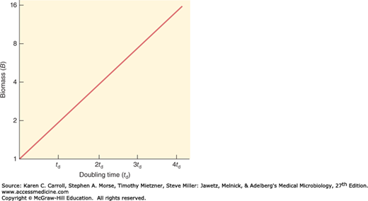
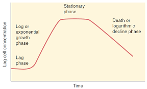
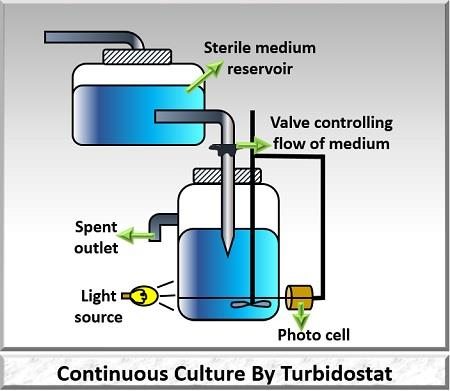
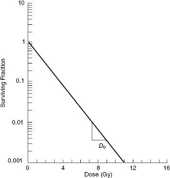

# فیزیولوژی رشد باکتری‌ها

**درس:** فیزیولوژی باکتری‌ها
**مبحث:** میکروبیولوژی - رشد، کشت، مرگ و نیازمندی‌های رشد باکتری‌ها - جلسه چهارم
**استاد:** دکتر مریم متوسل
**تاریخ تولید جزوه:** 2026-10-28T06:43:01

## ۱. مقدمه و کلیات

ادیتور😉🌹:(مرگ باکتری، پایان کار نیست؛ بازگشتِ ماده است به چرخه‌ای که رشد، بهای گزافِ آن را از نفسِ تک‌تک سلول‌ها میگیرد.) پرقدرت ادامه بده،بجنگ و به اون چیزی که لیاقتش رو داری برس💪✌

این درس به مفهوم و اندازه‌گیری رشد باکتری‌ها، منحنی رشد، سیستم‌های کشت بسته و مداوم، رشد در بیوفیلم، مرگ باکتری‌ها، زمان تقسیم دوتایی و نیازمندی‌های رشد می‌پردازد. وابستگی رشد و فعالیت باکتری به شرایط کشت، مراحل رشد و زمان تولید محصولات نیز بررسی می‌شود.

## ۲. متن اصلی جزوه

### مفهوم رشد باکتری

> [BOX:DEFINITION]
> **رشد**
> افزایش منظم همهٔ اجزای ارگانیسم است و نتیجهٔ آن تکثیر سلولی است.

افزایش اندازهٔ سلول بر اثر جذب آب یا ذخیرهٔ چربی و پلی‌ساکارید، رشد واقعی محسوب نمی‌شود. رشد باید منظم باشد؛ یعنی همهٔ اجزا با هم افزایش یابند و تکثیر رخ دهد.

در تکثیر سلولی، تعداد سلول‌های باکتری به‌صورت منظم و قابل‌شمارش افزایش می‌یابد. باکتری‌ها در مدت‌زمان معینی به روش تقسیم دوتایی (binary fission) تکثیر می‌شوند.

> [BOX:EXAMPLE]
> برای مثال، دو سلول به چهار سلول و سپس به هشت و شانزده سلول تبدیل می‌شوند.

### اندازه‌گیری تودهٔ میکروارگانیسم‌ها

برای اندازه‌گیری تودهٔ میکروارگانیسم‌ها دو روش وجود دارد:

1. اندازه‌گیری تراکم سلولی
2. اندازه‌گیری تراکم تودهٔ زیستی (biomass density)

#### تراکم سلولی

در اندازه‌گیری تراکم سلولی، تعداد سلول‌ها در واحد حجم محیط کشت اندازه‌گیری می‌شود. این کار با کدورت‌سنجی (turbidometry) و دستگاه فتو‌الکتریک، مانند اسپکتروفتومتر (spectrophotometer)، انجام می‌شود. در جمعیت‌های بزرگ نمی‌توان باکتری‌ها را تک‌تک شمرد؛ به همین دلیل از کدورت‌سنجی یا اسپکتروفتومتری استفاده می‌کنند. این روش در مطالعات ژنتیکی نیز کاربرد دارد.

سلول‌های مرده هم کدورت ایجاد می‌کنند؛ بنابراین، کدورت به‌تنهایی نشان نمی‌دهد که همهٔ سلول‌ها زنده‌اند.

برای درک تفاوت سلول و کلونی، محیط کشت مایع را در نظر بگیرید: سلول‌ها در حجم مشخصی از محیط کشت حضور دارند. اما اگر باکتری را روی محیط آگار کشت دهیم، معمولاً به‌جای شمارش سلول‌های منفرد، کلونی‌ها را می‌شماریم؛ هر کلونی از یک واحد باکتریایی به وجود آمده است.

> [BOX:DEFINITION]
> **CFU/mL**
> واحد شمارش، CFU/mL نامیده می‌شود؛ یعنی واحد تشکیل‌دهندهٔ کلونی در هر میلی‌لیتر (colony-forming unit per mL).

#### تراکم تودهٔ زیستی

> [BOX:DEFINITION]
> **تراکم تودهٔ زیستی (biomass density)**
> در اندازه‌گیری تراکم تودهٔ زیستی، وزن خشک سلول‌ها در واحد حجم محیط کشت اندازه‌گیری می‌شود.

- **روش مستقیم:** تعیین وزن خشک توده پس از شست‌وشو با آب. شستن توده و سپس خشک‌کردن آن دشوار، وقت‌گیر و تقریباً غیرممکن است.
- **روش غیرمستقیم:** اندازه‌گیری یکی از اجزای مهم توده، مانند پروتئین‌ها.

اندازه‌گیری وزن خشک یا یکی از اجزای تودهٔ سلولی در مطالعات بیوشیمیایی و تغذیهٔ باکتری‌ها کاربرد دارد.

#### بررسی محصولات و فعالیت‌های باکتری

در کار با باکتری‌ها گاهی به‌جای خود سلول، محصول آن را بررسی می‌کنند. برای نمونه، می‌توان تولید پروتئین را دنبال کرد؛ در بررسی بیان ژن نیز تولید پروتئین پیگیری می‌شود.

> [BOX:EXAMPLE]
> در بررسی بیان ژن، تولید پروتئین پیگیری می‌شود.

فعالیت‌های بیوشیمیایی باکتری و اثر آن‌ها بر محیط کشت برای شناسایی باکتری اهمیت دارد. تغییر رنگ محیط‌های کشت، از جمله تغییراتی که در pHهای مختلف رخ می‌دهد، می‌تواند ناشی از رشد و تغذیهٔ باکتری و فعالیت‌های بیوشیمیایی آن باشد. از این تغییرات می‌توان در تشخیص (diagnosis) و شناسایی باکتری استفاده کرد.

*تصویر ۱*

### سیستم‌های کشت باکتری

سیستم‌های کشت باکتری به دو دسته تقسیم می‌شوند:

- سیستم کشت بسته (closed system یا batch culture)
- سیستم کشت مداوم (continuous culture)

#### سیستم کشت بسته

سیستم کشت بسته، مخزنی دربسته و حاوی محیط کشت است که باکتری‌ها در آن رشد می‌کنند. باکتری را در زمان معینی وارد محیط می‌کنند و پس از بسته‌شدن سیستم، چیزی به آن اضافه یا از آن کم نمی‌شود. باکتری‌ها به‌طور هم‌زمان در همان محیط رشد می‌کنند.

محیط کشت می‌تواند جامد یا مایع باشد؛ نکته این است که پس از شروع کشت، چیزی وارد سیستم یا از آن خارج نمی‌شود. در این سیستم، رویدادهای رشد را در سطح جمعیت سلولی بررسی می‌کنند، نه در یک سلول منفرد. برای مثال، یک کلونی روی پلیت می‌تواند جمعیتی از باکتری‌ها باشد که بررسی می‌شود.

> [BOX:EXAMPLE]
> یک کلونی روی پلیت می‌تواند جمعیتی از باکتری‌ها باشد که در سیستم کشت بسته بررسی می‌شود.

#### رسم منحنی رشد

برای رسم منحنی رشد باکتری، باکتری‌هایی را که به رشد اشباع رسیده‌اند به حجم معینی از محیط مایع منتقل می‌کنند. سپس در فواصل زمانی مشخص، تعداد سلول‌های زنده را در هر میلی‌لیتر ثبت می‌کنند. نقاط مربوط به زمان‌ها و تعداد سلول‌ها را به هم وصل می‌کنند تا منحنی رشد به دست آید. در آزمایشگاه می‌توان اندازه‌گیری‌ها را در زمان‌های مختلف انجام داد، نقاط را رسم کرد و نمودار رشد میکروب را بررسی کرد. این نمودار مراحل مختلف رشد جمعیت باکتری را نشان می‌دهد.

### مراحل منحنی رشد

#### فاز تأخیری (lag phase)

در این مرحله سرعت رشد صفر است، اما باکتری‌ها در حال تطبیق با محیط‌اند و آنزیم‌ها و متابولیت‌های لازم را تولید می‌کنند. سلول‌ها با محیط جدید سازگار می‌شوند تا بتوانند از مواد غذایی آن استفاده کنند. بنابراین، «سرعت رشد صفر» به‌معنی بی‌فعالیتی کامل سلول نیست؛ سلول در حال آماده‌سازی شرایط رشد است. در این مرحله، سلول‌ها معمولاً از نظر شکل و اندازه یک‌شکل‌اند.

#### فاز لگاریتمی (log phase) یا فاز رشد نمایی (exponential growth phase)

در این فاز سرعت رشد ثابت است و باکتری‌ها در کوتاه‌ترین زمان ممکن تقسیم می‌شوند. تعداد باکتری‌ها به‌صورت لگاریتمی افزایش می‌یابد.

> [BOX:EXAMPLE]
> در فاز لگاریتمی، دو سلول به چهار، سپس هشت و شانزده سلول تبدیل می‌شوند.

سلول‌ها در کوچک‌ترین اندازه و شکل تیپیک خود قرار دارند و به آنتی‌بیوتیک‌ها حساس‌اند. در اواخر فاز لگاریتمی، رشد به‌تدریج کاهش می‌یابد؛ مواد غذایی و اکسیژن کم می‌شوند و تولید بعضی محصولات، از جمله اغلب توکسین‌ها، در اواخر فاز اهمیت پیدا می‌کند.

بعضی محصولات در زمان‌های معینی از رشد ساخته می‌شوند؛ ژن‌ها در زمان‌های مشخص روشن یا خاموش می‌شوند و محصول ژنی تولید می‌شود. بنابراین، زمان رشد باکتری می‌تواند برای بررسی محصول و اثر آنتی‌بیوتیک اهمیت داشته باشد. در آزمایشگاه نیز باید مشخص باشد باکتری را در چه زمانی به مرحلهٔ مناسب می‌رسانند تا پاسخ دارویی بررسی و نتیجه به پزشک گزارش شود.

*تصویر ۲*

نمودار منحنی رشد، مراحل lag phase، log or exponential growth phase، stationary phase و death or logarithmic decline phase را در برابر زمان نشان می‌دهد و محور دیگر آن «Log cell concentration» است.

#### فاز سکون (stationary phase)

مواد غذایی تمام یا بسیار کم شده‌اند و مواد سمی تجمع پیدا می‌کنند. تعداد سلول‌های زنده ثابت می‌ماند، زیرا تعداد سلول‌هایی که می‌میرند با تعداد سلول‌هایی که زنده می‌مانند یا تکثیر می‌شوند به تعادل می‌رسد. سلول‌ها ممکن است چندشکلی شوند؛ بنابراین، شکل و اندازهٔ آن‌ها می‌تواند با شکل تیپیک قبلی متفاوت باشد.

#### فاز کاهش یا مرگ (decline phase)

سرعت مرگ از سرعت تکثیر بیشتر می‌شود. باکتری‌ها آنزیم‌های اتولیزین (autolysin) تولید می‌کنند که در مرگ سلول نقش دارند. تعداد سلول‌های زنده به صفر نمی‌رسد؛ بعضی سلول‌های زنده می‌توانند از مواد سلولی آزادشده بر اثر متلاشی‌شدن سلول‌های دیگر تغذیه کنند. این فرایند در اسلاید و توضیح درس turnover نامیده شده است.

در این فاز ممکن است اگزوتوکسین نیز تولید شود.

> [BOX:EXAMPLE]
> برای مثال، Corynebacterium diphtheriae، عامل دیفتری، در فاز کاهش اگزوتوکسین تولید می‌کند.

اسلاید برای این فاز مرگ با سرعت ثابت را نیز ذکر می‌کند.

### کشت مداوم (continuous culture)

کشت مداوم به سیستمی نیاز دارد که باکتری‌ها را در فاز لگاریتمی نگه دارد. روش‌های آن شامل کموستات (chemostat) و توربیدوستات (turbidostat) است.

- در **کموستات**، مواد غذایی و ترکیبات شیمیایی محیط کشت ثابت نگه داشته می‌شوند. چنین وضعیتی در جهان پیرامون و در بدن انسان نیز رخ می‌دهد.
- در **توربیدوستات**، تراکم باکتری‌های در حال رشد ثابت نگه داشته می‌شود.

در کشت مداوم، مواد غذایی به‌طور پیوسته وارد و مواد زائد خارج می‌شوند. محیط کشت مایع است و هم‌زدن سیستم، از جمله با جریان هوای استریل، به یکنواختی محیط کمک می‌کند. در کموستات، یک مادهٔ غذایی به‌عنوان عامل محدودکنندهٔ رشد در نظر گرفته می‌شود و سرعت رشد با سرعت جریان محیط کشت رابطهٔ مستقیم دارد.

*تصویر ۳*

در شکل، اجزای سیستم شامل Sterile medium، reservoir، valve controlling flow of medium، spent outlet، light source و عبارت Continuous Culture By Turbidostat دیده می‌شوند.

#### تولید پیوستهٔ محصول

اگر بخواهیم محصولی را که در زمان یا مرحلهٔ مشخصی از رشد تولید می‌شود به دست آوریم، باکتری را در همان شرایط نگه می‌داریم. محیط کشت تازه وارد می‌شود و بخشی از محیط کشت، همراه با محصول، خارج می‌شود. با تنظیم ورود و خروج، شرایط سیستم حفظ می‌شود و محصول به‌طور مداوم جمع‌آوری می‌شود. از این روش می‌توان برای تولید محصولاتی مانند توکسین استفاده کرد.

> [BOX:EXAMPLE]                                                                                                                                          *محض اطلاع*   
> در نمونه‌ای که در درس شرح داده شد، خانم دکتر نسرین معظمی در شهرک تحقیقاتی در شهریار از فرمنترهای بزرگ برای تولید توکسین Bacillus thuringiensis استفاده کرده بودند. این توکسین برای از بین بردن لارو پشهٔ آنوفل و کمک به کنترل مالاریا به کار می‌رود. این روش، مبارزهٔ بیولوژیک است: لاروها از توکسین تغذیه می‌کنند و از بین می‌روند. روش خانم دکتر معظمی در رقابت با روش‌های دیگر، از جمله روش اسرائیلی، برگزیده شده بود و ایشان روش را به نام کشور ثبت کردند. اجرای چنین کاری به آماده‌سازی سیستم‌های بزرگ و کار تیمی نیاز دارد.

### رشد در بیوفیلم (biofilm)

بسیاری از باکتری‌های پاتوژن به‌صورت جوامع پیچیده رشد می‌کنند و با یکدیگر ارتباط دارند. جمعیت‌های باکتریایی به سطوح مختلف متصل می‌شوند و بیوفیلم تشکیل می‌دهند.

> [BOX:DEFINITION]
> **بیوفیلم (biofilm)**
> بیوفیلم جمعیتی باکتریایی متصل به سطح است که ماتریکس و گلیکوکالیکس (glycocalyx) به محافظت از آن کمک می‌کنند.

باکتری‌ها با کمک ساختارهای اتصال‌دهنده، از جمله pili، و ماتریکس به سطح می‌چسبند و به‌سادگی شسته نمی‌شوند.

سطحی که بیوفیلم روی آن تشکیل می‌شود می‌تواند دندان، بافت یا وسیلهٔ پزشکی باشد. نمونه‌ها عبارت‌اند از:

- پلاک دندانی؛ اگر پاک‌سازی نشود، باکتری‌ها می‌توانند بیماری لثه ایجاد کنند.
- لنز، دریچهٔ مصنوعی قلب، شانت، کاتتر، سوند فولی و دیگر وسایلی که در بدن قرار می‌گیرند.
- زخم و بافت‌های بدن.
- سطوح در صنایع کشتی‌سازی و نفت.

> [BOX:EXAMPLE]
> نمونه‌های سطوحی که بیوفیلم روی آن‌ها تشکیل می‌شود عبارت‌اند از پلاک دندانی، لنز، دریچهٔ مصنوعی قلب، شانت، کاتتر، سوند فولی، زخم و بافت‌های بدن و سطوح صنایع کشتی‌سازی و نفت.

باکتری‌های داخل بیوفیلم به کمک گلیکوکالیکس محافظت می‌شوند و نسبت به عوامل محیطی و آنتی‌بیوتیک‌ها مقاومت بیشتری دارند. جمعیت‌های باکتریایی به هم متصل‌اند و با یکدیگر ارتباط برقرار می‌کنند؛ این ارتباط از راه سیگنال‌های شیمیایی انجام می‌شود. از مولکول‌های کوچک مطرح در این ارتباط، هموسرین لاکتون‌ها (homoserine lactones) هستند که در جمعیت تولید می‌شوند.

بیوفیلم و مقاومت به درمان از مشکلات مهم عفونت‌های مزمن و عفونت‌های بیمارستانی‌اند. عفونتی که به دارو پاسخ ندهد می‌تواند برای بیمار بسیار خطرناک باشد. باکتری‌ها در قالب جمعیت و اجتماع میکروبی بررسی می‌شوند.

#### نمونه‌های بالینی بیوفیلم

- استرپتوکوک‌ها می‌توانند روی دریچهٔ قلب بیوفیلم تشکیل دهند؛ استرپتوکوک‌های مقیم دهان نیز می‌توانند دریچهٔ مصنوعی قلب را آلوده کنند.
- Staphylococcus aureus می‌تواند روی شانت، کاتتر و سوند فولی بیوفیلم تشکیل دهد.
- Pseudomonas aeruginosa می‌تواند در بافت ریهٔ بیماران بیوفیلم ایجاد کند. این باکتری در محیط‌های آزمایشگاهی و حتی در صابون مایع مورد استفاده برای شست‌وشوی بیمار نیز می‌تواند رشد کند، به ریه برسد و بیماری ایجاد کند. همچنین به مقاومت‌های چندگانهٔ دارویی آن اشاره شده است.
- Legionella pneumophila به سیستم‌های سرمایش مرطوب تمایل دارد و می‌تواند عفونت تنفسی ایجاد کند. سیستم‌های سرمایش و چیلرها از محل‌هایی هستند که باید به آن‌ها توجه کرد.

### مرگ باکتری‌ها

> [BOX:DEFINITION]
> **مرگ باکتری**
> مرگ باکتری عبارت است از دست‌دادن برگشت‌ناپذیر توانایی تکثیر.

برای اطمینان از مرگ، باکتری مشکوک را روی محیط کشت غنی کشت می‌دهند؛ اگر رشد نکند، آن را مرده در نظر می‌گیرند.

ممکن است باکتری زنده باشد، اما به‌دلیل ضعیف‌بودن یا مناسب‌نبودن شرایط نتواند کلونی تشکیل دهد. در این حالت باید از محیط کشت مناسب و غنی استفاده کرد تا امکان رشد فراهم شود؛ اگر باکتری در شرایط مناسب هم رشد نکند، شواهد به نفع مرگ آن است. بعضی باکتری‌ها کلونی‌های بسیار کوچک تشکیل می‌دهند و برای رشد به محیط غنی نیاز دارند؛ بنابراین، نتیجهٔ تشکیل‌نشدن کلونی باید با توجه به شرایط کشت تفسیر شود.

#### منحنی‌های مرگ باکتری

مرگ را در سطح جمعیت باکتری‌ها ارزیابی می‌کنند.

- در منحنی یک‌ضربه‌ای (one-hit)، آسیب به یک هدف سلولی، مانند DNA کروموزومی یا غشای سلولی، برای مرگ کل سلول کافی است.
- در منحنی چندضربه‌ای (multiple-hit)، آسیب‌دیدن چند هدف سلولی برای مرگ سلول لازم است؛ برای مثال، چند آنزیم ممکن است هدف آسیب باشند.

*تصویر ۴* تصویر منحنی یک ضربه ای

#### اهمیت بالینی تشخیص مرگ

تشخیص مرگ برای درمان اهمیت دارد، چون باید دانست باکتری زنده است یا مرده و درمان واقعاً اثر کرده است یا نه. در بعضی موارد، باکتری ممکن است توانایی تکثیر یا تشکیل کلونی را از دست بدهد، اما همچنان اهمیت بالینی داشته باشد.

باکتری‌هایی ممکن است در کلیه و در شرایط خاص باقی بمانند. در جریان درمان، باکتری ممکن است دیوارهٔ سلولی خود را از دست بدهد؛ در این توضیح، برای باکتری گرم‌مثبت از پروتوپلاست و برای باکتری گرم‌منفی از اسفروپلاست یاد شده است. به‌دلیل شرایط اسمزی محیط کلیه، این شکل‌ها ممکن است باقی بمانند و از دسترس داروهای هدف‌گیرندهٔ دیواره دور بمانند. در چنین شرایطی ممکن است کشت ادرار منفی باشد، اما پزشک با توجه به علائم و احتمال وجود باکتری، درمان را ادامه دهد؛ این وضعیت درمان کورکورانه (blind treatment) نامیده شده است.

#### روش‌های مولکولی برای شناسایی

برای شناسایی می‌توان از روش‌های مولکولی نیز استفاده کرد. PCR بر تکثیر ژن‌های مشخص تکیه دارد. اگر باکتری موردنظر قابل‌کشت نباشد، می‌توان ژن آن را در نمونهٔ بیمار جست‌وجو کرد.

> [BOX:EXAMPLE]
> برای مثال، به احتمال وجود Ureaplasma در نمونهٔ ادرار اشاره شده است.

برای یک ژن می‌توان از روش مونوپلکس و برای چند ژن از روش مولتی‌پلکس استفاده کرد. در PCR، توالی هدف تکثیر می‌شود تا شناسایی آن ممکن شود.

اگر میکروارگانیسم در کشت دیده نشود، پزشک ممکن است با توجه به علائم و احتمال وجود عامل بیماری‌زا، داروی وسیع‌الطیف تجویز کند.

### محاسبهٔ زمان تقسیم دوتایی

فرمول محاسبهٔ تودهٔ نهایی پس از تقسیم دوتایی چنین است:

**B = B₀ × 2ⁿ**

در این فرمول✨:                                                                                                                                                                    Bt:توده یا تعداد نهایی باکتری‌ها در زمان  t                                                                                                                                Bo: توده یا تعداد اولیه باکتری‌ها                                                                                                                                                     n: تعداد دفعات تقسیم (نسل‌ها) که حاصل ← تقسیم زمان کل به زمان دوبرابر شدن سلول است (بچه ها دقت کنید تمام زمان ها به دقیقه باشه😊)

برای مثال، اگر تعداد اولیهٔ باکتری ۲۰ باشد و زمان تقسیم آن ۲۰ دقیقه طول بکشد، پس از سه ساعت تعداد تقسیم‌ها ۹ است:

> [BOX:EXAMPLE]
> **B = 20 × 2⁹ = 10240
> n=180/20=9**

زمان‌های تقسیم باکتری‌ها با هم تفاوت دارند:

| باکتری | زمان تقسیم |
|---|---:|
| E. coli | ۲۰ دقیقه |
| Borrelia | ۱۷ تا ۱۸ ساعت |
| Treponema | ۳۰ ساعت |
| M. tuberculosis | ۱۲ تا ۱۳ ساعت |
| M. leprae | ۱۱ تا ۱۳ روز |
| Clostridium perfringens | ۸ دقیقه |

E. coli در حدود ۲۰ دقیقه تقسیم می‌شود؛ بنابراین، اگر شرایط محدودکننده‌ای وجود نداشته باشد، جمعیت آن به‌سرعت افزایش پیدا می‌کند. Borrelia، عامل بیماری‌های خونی، زمان تقسیم طولانی‌تری دارد. Treponema عامل سیفلیس است و زمان تکثیرش بیش از یک روز است. M. tuberculosis عامل سل است و زمان تکثیر آن طولانی است؛ بنابراین، ممکن است مدتی از ورود باکتری بگذرد تا عفونت به حد قابل‌تشخیص برسد. این فاصله می‌تواند با دورهٔ کمون (incubation period) ارتباط داشته باشد. M. leprae نیز زمان تکثیر بسیار طولانی دارد؛ ممکن است ابتلا در کودکی رخ دهد و علائم سال‌ها بعد آشکار شوند. در مقابل، Clostridium perfringens با زمان تقسیم ۸ دقیقه، در صورت نبود کنترل می‌تواند به‌سرعت افزایش پیدا کند.

### نیازمندی‌های رشد

نیازمندی‌های رشد شامل ترکیبات آلی، ترکیبات معدنی، فاکتورهای رشد و منابع انرژی است.

#### ترکیبات آلی و معدنی

ترکیبات آلی عناصر کربن، هیدروژن، اکسیژن، نیتروژن، گوگرد و فسفر را در بر می‌گیرند. ترکیبات معدنی شامل یون‌های آهن، سدیم، کلسیم، منیزیم، پتاسیم و کلرید هستند.

#### منابع انرژی

از منابع انرژی، ATP، ADP و AMP دارای باند پرانرژی فسفاته‌اند. NAD برابر با ۳ مول ATP و FAD برابر با ۲ مول ATP ذکر شده‌اند.

> [BOX:DEFINITION]
> **نیروی محرک پروتونی (proton motive force; PMF)**
> شیب غلظت الکتروشیمیایی یون هیدروژن است.

#### تقسیم‌بندی بر اساس منبع کربن و انرژی

- اتوتروف‌ها شامل فتواتوتروف و کمواتوتروف‌اند.
- هتروتروف‌ها در تقسیم‌بندی اسلاید با لیتوتروف و ارگانوتروف آمده‌اند و به فتوهتروتروف و کموهتروتروف نیز اشاره شده است.

#### فسفر

فسفر به‌شکل یون سه‌ظرفیتی فسفات به کار می‌رود و در ساختار موارد زیر استفاده می‌شود:

- ATP، NAD، NADP و FAD
- اسیدهای نوکلئیک
- متابولیت‌ها و آنزیم‌ها
- لیپیدها و فسفولیپیدها، از جمله لیپید A
- اجزای دیوارهٔ سلولی، مانند تیکوئیک اسید
- فسفوپروتئین‌ها
- پلی‌ساکاریدهای کپسولی

#### گوگرد

گوگرد به‌شکل یون دوظرفیتی سولفات برای بعضی پاتوژن‌ها قابل‌استفاده است و می‌تواند با تولید H₂S ارتباط داشته باشد. گوگرد در سنتز کوآنزیم‌ها و پروتئین‌ها کاربرد دارد. تولید یا عدم تولید ترکیبات گوگردی در آزمایشگاه نیز می‌تواند در شناسایی باکتری‌ها به کار رود.

#### نیتروژن

نیتروژن در ساختار اسیدهای نوکلئیک و پروتئین‌ها وجود دارد. بعضی باکتری‌ها از NH₃ و N₂ موجود در طبیعت استفاده می‌کنند.

- **تثبیت نیتروژن (nitrogen fixation):** در اسلاید به جذب نیتروژن از آمونیاک و N₂ اشاره دارد.
- **آمونیفیکاسیون (ammonification):** تولید آمونیاک از دآمیناسیون آمینواسیدها.
- **احیای جذبی نیترات (assimilatory reduction):** تولید آمونیاک از یون‌های نیترات و نیتریت.
- **دنیتریفیکاسیون (denitrification):** در بیشتر منابع د**نیتریفیکاسیون را تبدیل نیترات به N2 ذکر کردن**

باکتری‌ها در فرایندهای مربوط به نیتروژن، از جمله تثبیت نیتروژن و فرایندهای خاک و کودهای شیمیایی، نقش دارند و می‌توانند به کشاورزی کمک کنند.

#### فاکتورهای رشد

> [BOX:DEFINITION]
> **فاکتورهای رشد**
> فاکتورهای رشد ترکیبات آلی موردنیازی هستند که سلول قادر به سنتز آن‌ها نیست.

به‌طور کلی، فقدان هر مادهٔ تغذیه‌ای لازم برای ساخت ماکرومولکول‌های ساختمانی یا آنزیمی می‌تواند آن ماده را به‌عنوان فاکتور رشد مطرح کند.

## ۳. جداول مرور سریع

### روش‌های اندازه‌گیری رشد و تودهٔ میکروارگانیسم‌ها

| روش اندازه‌گیری | چه چیزی اندازه‌گیری می‌شود؟ | نکته یا کاربرد ذکرشده |
|---|---|---|
| تراکم سلولی | تعداد سلول‌ها در واحد حجم محیط کشت | در جمعیت‌های بزرگ از کدورت‌سنجی یا اسپکتروفتومتری استفاده می‌شود؛ در مطالعات ژنتیکی نیز کاربرد دارد. سلول‌های مرده هم کدورت ایجاد می‌کنند. |
| تراکم تودهٔ زیستی (biomass density) | وزن خشک سلول‌ها در واحد حجم محیط کشت | در روش مستقیم، توده شسته و خشک می‌شود؛ در روش غیرمستقیم، یکی از اجزای مهم توده، مانند پروتئین، اندازه‌گیری می‌شود. کاربرد آن در مطالعات بیوشیمیایی و تغذیهٔ باکتری‌ها ذکر شده است. |

| روش تعیین تراکم تودهٔ زیستی | شیوه | محدودیت یا نکته |
|---|---|---|
| مستقیم | تعیین وزن خشک توده پس از شست‌وشو با آب | شست‌وشو و خشک‌کردن دشوار، وقت‌گیر و تقریباً غیرممکن است. |
| غیرمستقیم | اندازه‌گیری یکی از اجزای مهم توده، مانند پروتئین‌ها | اندازه‌گیری یکی از اجزای تودهٔ سلولی در مطالعات بیوشیمیایی و تغذیهٔ باکتری‌ها کاربرد دارد. |

### فازهای منحنی رشد

| فاز رشد | وضعیت رشد و جمعیت | ویژگی‌های دیگر ذکرشده |
|---|---|---|
| فاز تأخیری (lag phase) | سرعت رشد صفر است. | باکتری با محیط سازگار می‌شود و آنزیم‌ها و متابولیت‌های لازم را تولید می‌کند؛ سلول‌ها معمولاً از نظر شکل و اندازه یک‌شکل‌اند. |
| فاز لگاریتمی (log phase) یا فاز رشد نمایی (exponential growth phase) | سرعت رشد ثابت است و تعداد باکتری‌ها به‌صورت لگاریتمی افزایش می‌یابد. | تقسیم در کوتاه‌ترین زمان ممکن؛ سلول‌ها در کوچک‌ترین اندازه و شکل تیپیک‌اند و به آنتی‌بیوتیک‌ها حساس‌اند. در اواخر فاز، رشد کاهش می‌یابد، مواد غذایی و اکسیژن کم می‌شوند و تولید بعضی محصولات، از جمله اغلب توکسین‌ها، اهمیت پیدا می‌کند. |
| فاز سکون (stationary phase) | تعداد سلول‌های زنده ثابت می‌ماند؛ مرگ با زنده‌ماندن یا تکثیر سلول‌ها به تعادل می‌رسد. | مواد غذایی تمام یا بسیار کم و مواد سمی تجمع پیدا می‌کنند؛ سلول‌ها ممکن است چندشکلی شوند. |
| فاز کاهش یا مرگ (decline phase) | سرعت مرگ از سرعت تکثیر بیشتر می‌شود؛ تعداد سلول‌های زنده به صفر نمی‌رسد. | تولید autolysin؛ استفادهٔ بعضی سلول‌های زنده از مواد سلولی آزادشده از سلول‌های متلاشی‌شده (turnover)؛ امکان تولید اگزوتوکسین؛ اسلاید مرگ با سرعت ثابت را نیز ذکر می‌کند. |

### مقایسهٔ سیستم‌های کشت

| ویژگی | سیستم کشت بسته (closed system یا batch culture) | سیستم کشت مداوم (continuous culture) |
|---|---|---|
| ورود و خروج مواد پس از شروع کشت | چیزی به سیستم اضافه یا از آن کم نمی‌شود. | مواد غذایی پیوسته وارد و مواد زائد خارج می‌شوند. |
| محیط کشت | می‌تواند جامد یا مایع باشد. | محیط کشت مایع است. |
| نحوهٔ رشد یا کنترل | باکتری‌ها در همان محیط رشد می‌کنند؛ رویدادها در سطح جمعیت بررسی می‌شوند. | سیستم برای نگه‌داشتن باکتری‌ها در فاز لگاریتمی به کار می‌رود؛ هم‌زدن به یکنواختی محیط کمک می‌کند. |
| نمونه یا روش مرتبط | یک کلونی روی پلیت می‌تواند جمعیتی باشد که بررسی می‌شود. | روش‌های آن کموستات و توربیدوستات‌اند. |

| روش کشت مداوم | متغیری که ثابت نگه داشته می‌شود | نکتهٔ دیگر |
|---|---|---|
| کموستات (chemostat) | مواد غذایی و ترکیبات شیمیایی محیط کشت | یک مادهٔ غذایی به‌عنوان عامل محدودکنندهٔ رشد در نظر گرفته می‌شود و سرعت رشد با سرعت جریان محیط کشت رابطهٔ مستقیم دارد. چنین وضعیتی در جهان پیرامون و در بدن انسان نیز رخ می‌دهد. |
| توربیدوستات (turbidostat) | تراکم باکتری‌های در حال رشد | به‌عنوان یکی از روش‌های کشت مداوم ذکر شده است. |

### نمونه‌های بیوفیلم

| باکتری یا گروه | محل یا وسیلهٔ مرتبط با بیوفیلم در درس | توضیح همراه |
|---|---|---|
| استرپتوکوک‌ها | دریچهٔ قلب؛ دریچهٔ مصنوعی قلب | استرپتوکوک‌های مقیم دهان نیز می‌توانند دریچهٔ مصنوعی قلب را آلوده کنند. |
| Staphylococcus aureus | شانت، کاتتر و سوند فولی | توانایی تشکیل بیوفیلم روی این وسایل ذکر شده است. |
| Pseudomonas aeruginosa | بافت ریهٔ بیماران؛ محیط آزمایشگاهی؛ صابون مایع مورد استفاده برای شست‌وشوی بیمار | می‌تواند رشد کند، به ریه برسد و بیماری ایجاد کند؛ به مقاومت‌های چندگانهٔ دارویی آن اشاره شده است. |
| Legionella pneumophila | سیستم‌های سرمایش مرطوب، از جمله سیستم‌های سرمایش و چیلرها | به این سیستم‌ها تمایل دارد و می‌تواند عفونت تنفسی ایجاد کند. |

### منحنی‌های مرگ باکتری

| نوع منحنی مرگ | آسیب لازم برای مرگ سلول | نمونهٔ هدف یا توضیح ذکرشده |
|---|---|---|
| یک‌ضربه‌ای (one-hit) | آسیب به یک هدف سلولی کافی است. | DNA کروموزومی یا غشای سلولی |
| چندضربه‌ای (multiple-hit) | آسیب‌دیدن چند هدف سلولی لازم است. | برای مثال، چند آنزیم ممکن است هدف آسیب باشند. |

### زمان تقسیم باکتری‌ها

| باکتری | زمان تقسیم |
|---|---:|
| E. coli | ۲۰ دقیقه |
| Borrelia | ۱۷ تا ۱۸ ساعت |
| Treponema | ۳۰ ساعت |
| M. tuberculosis | ۱۲ تا ۱۳ ساعت |
| M. leprae | ۱۱ تا ۱۳ روز |
| Clostridium perfringens | ۸ دقیقه |

### نیازمندی‌ها و عناصر مطرح‌شده در رشد

| دسته | موارد ذکرشده |
|---|---|
| ترکیبات آلی | کربن، هیدروژن، اکسیژن، نیتروژن، گوگرد و فسفر |
| ترکیبات معدنی | یون‌های آهن، سدیم، کلسیم، منیزیم، پتاسیم و کلرید |
| منابع انرژی و ترکیبات پرانرژی | ATP، ADP و AMP دارای باند پرانرژی فسفاته‌اند؛ NAD برابر با ۳ مول ATP و FAD برابر با ۲ مول ATP ذکر شده‌اند. |

| گروه در تقسیم‌بندی منبع کربن و انرژی | زیرگروه‌ها یا موارد همراه در اسلاید |
|---|---|
| اتوتروف‌ها | فتواتوتروف، کمواتوتروف |
| هتروتروف‌ها | لیتوتروف، ارگانوتروف؛ همچنین فتوهتروتروف و کموهتروتروف |

| فرایند مرتبط با نیتروژن | عبارت منبع دربارهٔ فرایند |
| --- | --- |
| تثبیت نیتروژن (nitrogen fixation) | در اسلاید به جذب نیتروژن از آمونیاک و N₂ اشاره دارد. |
| آمونیفیکاسیون (ammonification) | تولید آمونیاک از دآمیناسیون آمینواسیدها. |
| احیای جذبی نیترات (assimilatory reduction) | تولید آمونیاک از یون‌های نیترات و نیتریت. |
| دنیتریفیکاسیون (denitrification) | تبدیل نیترات به N2 |

## ۴. اصطلاحات و تعاریف

> [BOX:DEFINITION]
> **رشد**
> افزایش منظم همهٔ اجزای ارگانیسم است و نتیجهٔ آن تکثیر سلولی است.

> [BOX:DEFINITION]
> **CFU/mL**
> واحد شمارش، CFU/mL نامیده می‌شود؛ یعنی واحد تشکیل‌دهندهٔ کلونی در هر میلی‌لیتر (colony-forming unit per mL).

> [BOX:DEFINITION]
> **تراکم تودهٔ زیستی (biomass density)**
> در اندازه‌گیری تراکم تودهٔ زیستی، وزن خشک سلول‌ها در واحد حجم محیط کشت اندازه‌گیری می‌شود.

> [BOX:DEFINITION]
> **بیوفیلم (biofilm)**
> بیوفیلم جمعیتی باکتریایی متصل به سطح است که ماتریکس و گلیکوکالیکس (glycocalyx) به محافظت از آن کمک می‌کنند.

> [BOX:DEFINITION]
> **مرگ باکتری**
> مرگ باکتری عبارت است از دست‌دادن برگشت‌ناپذیر توانایی تکثیر.

> [BOX:DEFINITION]
> **نیروی محرک پروتونی (proton motive force; PMF)**
> شیب غلظت الکتروشیمیایی یون هیدروژن است.

> [BOX:DEFINITION]
> **فاکتورهای رشد**
> فاکتورهای رشد ترکیبات آلی موردنیازی هستند که سلول قادر به سنتز آن‌ها نیست.

## ۵. خود‌ارزیابی

### سوالات تشریحی

> [QUESTION:ESSAY:1]
> رشد باکتری را تعریف کنید و توضیح دهید چرا افزایش اندازهٔ سلول بر اثر جذب آب یا ذخیرهٔ چربی و پلی‌ساکارید به‌تنهایی رشد واقعی محسوب نمی‌شود.
> [ANSWER]
> رشد، افزایش منظم همهٔ اجزای ارگانیسم است که نتیجهٔ آن تکثیر سلولی است. افزایش اندازه بر اثر جذب آب یا ذخیرهٔ چربی و پلی‌ساکارید، بدون افزایش منظم همهٔ اجزا و تکثیر، رشد واقعی محسوب نمی‌شود.

> [QUESTION:ESSAY:2]
> تفاوت اندازه‌گیری تراکم سلولی و تراکم تودهٔ زیستی را بیان کنید و یک محدودیت یا نکتهٔ مربوط به هر روش ذکر کنید.
> [ANSWER]
> در اندازه‌گیری تراکم سلولی، تعداد سلول‌ها در واحد حجم محیط کشت اندازه‌گیری می‌شود و می‌توان از کدورت‌سنجی یا اسپکتروفتومتری استفاده کرد؛ سلول‌های مرده نیز کدورت ایجاد می‌کنند. در اندازه‌گیری تراکم تودهٔ زیستی، وزن خشک سلول‌ها در واحد حجم سنجیده می‌شود؛ روش مستقیمِ شست‌وشو و خشک‌کردن دشوار، وقت‌گیر و تقریباً غیرممکن است و در روش غیرمستقیم یکی از اجزای مهم، مانند پروتئین‌ها، اندازه‌گیری می‌شود.

> [QUESTION:ESSAY:3]
> چهار فاز منحنی رشد باکتری را از نظر وضعیت رشد و جمعیت توصیف کنید.
> [ANSWER]
> در فاز تأخیری سرعت رشد صفر است، اما سلول‌ها با محیط سازگار می‌شوند و آنزیم‌ها و متابولیت‌های لازم را می‌سازند. در فاز لگاریتمی رشد با سرعت ثابت و به‌شکل لگاریتمی افزایش می‌یابد. در فاز سکون تعداد سلول‌های زنده ثابت می‌ماند، چون مرگ با زنده‌ماندن یا تکثیر به تعادل می‌رسد. در فاز کاهش یا مرگ، سرعت مرگ از سرعت تکثیر بیشتر می‌شود، اما تعداد سلول‌های زنده به صفر نمی‌رسد.

> [QUESTION:ESSAY:4]
> کموستات و توربیدوستات را از نظر متغیری که ثابت نگه می‌دارند مقایسه کنید و توضیح دهید در کشت مداوم چه اتفاقی برای مواد غذایی و مواد زائد می‌افتد.
> [ANSWER]
> در کموستات مواد غذایی و ترکیبات شیمیایی محیط کشت ثابت نگه داشته می‌شوند؛ در توربیدوستات تراکم باکتری‌های در حال رشد ثابت نگه داشته می‌شود. در کشت مداوم، مواد غذایی به‌طور پیوسته وارد و مواد زائد خارج می‌شوند.

> [QUESTION:ESSAY:5]
> بیوفیلم را تعریف کنید و توضیح دهید چه ویژگی‌هایی به چسبیدن و محافظت باکتری‌های داخل آن کمک می‌کنند.
> [ANSWER]
> بیوفیلم جمعیتی باکتریایی متصل به سطح است که ماتریکس و گلیکوکالیکس به محافظت از آن کمک می‌کنند. باکتری‌ها با ساختارهای اتصال‌دهنده، از جمله pili، و ماتریکس به سطح می‌چسبند و به‌سادگی شسته نمی‌شوند؛ گلیکوکالیکس نیز از آن‌ها محافظت می‌کند و باکتری‌ها نسبت به عوامل محیطی و آنتی‌بیوتیک‌ها مقاومت بیشتری دارند.

### سوالات تستی

> [QUESTION:MCQ:1]
> کدام گزینه تعریف رشد باکتری را مطابق درس بیان می‌کند؟
> [OPTION:A] هرگونه افزایش اندازهٔ سلول، حتی بدون تکثیر
> [OPTION:B] افزایش منظم همهٔ اجزای ارگانیسم که نتیجهٔ آن تکثیر سلولی است
> [OPTION:C] افزایش ذخیرهٔ چربی یا پلی‌ساکارید در سلول
> [OPTION:D] ایجاد کدورت در محیط کشت، بدون توجه به افزایش سلول‌ها
> [ANSWER]
> [CORRECT:B]
> رشد، افزایش منظم همهٔ اجزای ارگانیسم است و نتیجهٔ آن تکثیر سلولی است.

> [QUESTION:MCQ:2]
> کدام نکته دربارهٔ کدورت‌سنجی درست است؟
> [OPTION:A] فقط سلول‌های زنده کدورت ایجاد می‌کنند.
> [OPTION:B] کدورت به‌تنهایی زنده‌بودن همهٔ سلول‌ها را نشان می‌دهد.
> [OPTION:C] سلول‌های مرده هم کدورت ایجاد می‌کنند.
> [OPTION:D] این روش فقط برای اندازه‌گیری وزن خشک به کار می‌رود.
> [ANSWER]
> [CORRECT:C]
> سلول‌های مرده هم کدورت ایجاد می‌کنند؛ بنابراین، کدورت به‌تنهایی زنده‌بودن همهٔ سلول‌ها را نشان نمی‌دهد.

> [QUESTION:MCQ:3]
> در فاز تأخیری (lag phase) کدام توصیف درست است؟
> [OPTION:A] سرعت رشد صفر است، اما سلول‌ها با محیط سازگار می‌شوند و مواد لازم را تولید می‌کنند.
> [OPTION:B] سرعت مرگ از سرعت تکثیر بیشتر است.
> [OPTION:C] تعداد سلول‌های زنده به‌دلیل تعادل مرگ و تکثیر ثابت می‌ماند.
> [OPTION:D] سلول‌ها با کوتاه‌ترین زمان ممکن تقسیم می‌شوند و تعدادشان لگاریتمی افزایش می‌یابد.
> [ANSWER]
> [CORRECT:A]
> در فاز تأخیری سرعت رشد صفر است، اما باکتری‌ها در حال تطبیق با محیط و تولید آنزیم‌ها و متابولیت‌های لازم‌اند.

> [QUESTION:MCQ:4]
> در کدام فاز تعداد سلول‌های زنده ثابت می‌ماند، چون مرگ با زنده‌ماندن یا تکثیر به تعادل می‌رسد؟
> [OPTION:A] فاز تأخیری
> [OPTION:B] فاز لگاریتمی
> [OPTION:C] فاز سکون
> [OPTION:D] فاز کاهش یا مرگ
> [ANSWER]
> [CORRECT:C]
> در فاز سکون تعداد سلول‌های زنده ثابت می‌ماند، زیرا تعداد سلول‌های در حال مرگ با تعداد سلول‌هایی که زنده می‌مانند یا تکثیر می‌شوند به تعادل می‌رسد.

> [QUESTION:MCQ:5]
> کدام ویژگی برای سیستم کشت بسته ذکر شده است؟
> [OPTION:A] مواد غذایی پیوسته وارد سیستم و مواد زائد خارج می‌شوند.
> [OPTION:B] پس از شروع کشت چیزی وارد سیستم یا از آن خارج نمی‌شود.
> [OPTION:C] تراکم باکتری‌ها با توربیدوستات ثابت نگه داشته می‌شود.
> [OPTION:D] سیستم فقط برای محیط کشت مایع قابل‌استفاده است.
> [ANSWER]
> [CORRECT:B]
> در سیستم کشت بسته پس از شروع کشت چیزی به سیستم اضافه یا از آن کم نمی‌شود و محیط کشت می‌تواند جامد یا مایع باشد.

> [QUESTION:MCQ:6]
> کدام گزینه تفاوت کموستات و توربیدوستات را درست بیان می‌کند؟
> [OPTION:A] کموستات تراکم باکتری‌ها را ثابت نگه می‌دارد و توربیدوستات مواد غذایی را.
> [OPTION:B] کموستات مواد غذایی و ترکیبات شیمیایی را ثابت نگه می‌دارد و توربیدوستات تراکم باکتری‌های در حال رشد را.
> [OPTION:C] هر دو فقط برای محیط کشت جامد به کار می‌روند.
> [OPTION:D] در هر دو، چیزی به محیط وارد یا از آن خارج نمی‌شود.
> [ANSWER]
> [CORRECT:B]
> در کموستات مواد غذایی و ترکیبات شیمیایی محیط کشت ثابت نگه داشته می‌شوند؛ در توربیدوستات تراکم باکتری‌های در حال رشد ثابت نگه داشته می‌شود.

> [QUESTION:MCQ:7]
> کدام عبارت دربارهٔ بیوفیلم با محتوای درس سازگار است؟
> [OPTION:A] جمعیتی از باکتری‌هاست که به سطح متصل می‌شود و ماتریکس و گلیکوکالیکس به محافظت از آن کمک می‌کنند.
> [OPTION:B] جمعیتی است که فقط در محیط کشت مایع وجود دارد و به سطح متصل نمی‌شود.
> [OPTION:C] به‌سادگی شسته می‌شود، چون باکتری‌ها ساختارهای اتصال‌دهنده ندارند.
> [OPTION:D] باکتری‌های آن نسبت به آنتی‌بیوتیک‌ها مقاومت کمتری دارند.
> [ANSWER]
> [CORRECT:A]
> بیوفیلم جمعیتی باکتریایی متصل به سطح است؛ ماتریکس و گلیکوکالیکس در محافظت از آن نقش دارند و باکتری‌ها با ساختارهایی مانند pili به سطح می‌چسبند.

> [QUESTION:MCQ:8]
> طبق درس، در منحنی مرگ یک‌ضربه‌ای (one-hit) چه چیزی برای مرگ کل سلول کافی است؟
> [OPTION:A] آسیب‌دیدن چندین هدف سلولی
> [OPTION:B] آسیب به یک هدف سلولی، مانند DNA کروموزومی یا غشای سلولی
> [OPTION:C] تشکیل کلونی‌های بسیار کوچک
> [OPTION:D] کاهش مواد غذایی و تجمع مواد سمی در محیط
> [ANSWER]
> [CORRECT:B]
> در منحنی یک‌ضربه‌ای، آسیب به یک هدف سلولی مانند DNA کروموزومی یا غشای سلولی برای مرگ کل سلول کافی است.

> [QUESTION:MCQ:9]
> زمان تقسیم E. coli در جدول درس چقدر ذکر شده است؟
> [OPTION:A] ۸ دقیقه
> [OPTION:B] ۲۰ دقیقه
> [OPTION:C] ۱۲ تا ۱۳ ساعت
> [OPTION:D] ۱۱ تا ۱۳ روز
> [ANSWER]
> [CORRECT:B]
> زمان تقسیم E. coli در جدول ۲۰ دقیقه ذکر شده است.

> [QUESTION:MCQ:10]
> کدام گزینه تعریف فاکتورهای رشد را مطابق درس بیان می‌کند؟
> [OPTION:A] ترکیبات آلی موردنیازی که سلول قادر به سنتز آن‌ها نیست.
> [OPTION:B] هر یون معدنی که در محیط کشت وجود دارد.
> [OPTION:C] مواد زائدی که در کشت مداوم از سیستم خارج می‌شوند.
> [OPTION:D] ترکیباتی که فقط در فاز کاهش تولید می‌شوند.
> [ANSWER]
> [CORRECT:A]
> فاکتورهای رشد ترکیبات آلی موردنیازی هستند که سلول قادر به سنتز آن‌ها نیست.

## ۷. ادیتور و منابع استفاده‌شده

**ادیتور:** علیرضا اسفندیاری نیا

**منابع استفاده‌شده:**

- صوت درس
- منبع کتاب‌شناختی درج‌شده در اسلاید: Karen C. Carroll, Stephen A. Morse, Timothy Mietzner, Steve Miller, *Jawetz, Melnick, & Adelberg’s Medical Microbiology*, 27th Edition، www.accessmedicine.com؛ Copyright © McGraw-Hill Education. All rights reserved.

## ۸. گزارش تکمیل بودن محتوا

**برآورد تقریبی تکمیل محتوا:** حدود 99٪

- ✓ پوشش محتوای اسلایدهای در دسترس: محتوای متنی، داده‌های قابل‌خواندن و تصاویر موجود گنجانده شده‌اند.
- ✓ پوشش صوت درس: توضیحات، مثال‌ها و نکات صوتیِ ارائه‌شده در متن حفظ شده‌اند.
- ⚠هشدار:سعی شده این جزوه در بهترین حالت خود باشد با این وجود درصورت مشاهده هرگونه مشکل به ادیتور ا یا صاحبین سایت اطلاع دهید