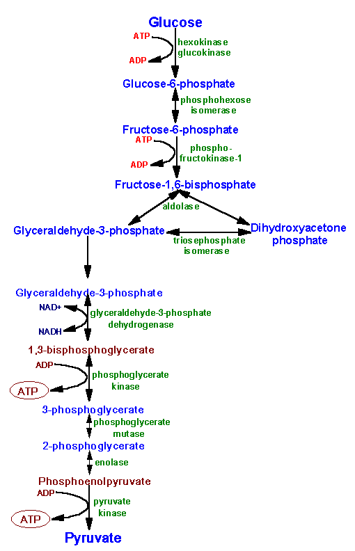

# متابولیسم باکتریایی (Bacterial Metabolism)

**درس:** باکتری‌شناسی
**مبحث:** میکروبیولوژی - متابولیسم باکتریایی (Bacterial Metabolism)-جلسه 5
**استاد:** Dr. Maryam Motevasel
**تاریخ تولید جزوه:** 2026-11-11T19:04:41

## ۱. مقدمه و کلیات

ادیتور😉:(در خاموشیِ هر سلول باکتریایی، جهانی از انتخاب و بقا جریان دارد؛ جایی که متابولیسم، فلسفه‌ی زنده‌ماندن در ساده‌ترین شکل حیات است)✌💕

شناخت متابولیسم برای فهم باکتری‌شناسی اساسی است و به دنبال‌کردن مسیرهای متابولیکی کمک می‌کند. این مبحث نیازهای باکتری به حرارت، اکسیژن، pH، کربن و انرژی را بررسی می‌کند و سپس به متابولیت‌های مرکزی، مسیرهای تولید انرژی و تخمیر، چرخه‌های کسب انرژی و بیوسنتز پپتیدوگلیکان می‌پردازد.

## ۲. متن اصلی جزوه

### اهمیت متابولیسم در باکتری‌شناسی

در میکروب‌شناسی عمومی، محیط کشت تهیه می‌شود و کارهای عملی انجام می‌گیرد. سپس در باکتری‌شناسی، خانواده‌ها و بیماری‌های باکتریایی، پاتوژنز و آزمایش‌های مربوط بررسی می‌شوند و در نهایت به تشخیص، درمان و دارو می‌رسیم.

برای تشخیص، اطلاعات کتاب‌ها و جدول‌ها باید با مسئلهٔ همان بیمار مرتبط شوند؛ موارد بالینی از بیماری به بیمار دیگر تفاوت دارند. برای مثال، ممکن است بیمار دیابت داشته باشد، باردار باشد و به عفونت ادراری ناشی از Staphylococcus aureus مبتلا باشد. توانایی تشخیص این تفاوت‌ها از پایه‌هایی آغاز می‌شود که متابولیسم یکی از آن‌هاست.

> [BOX:EXAMPLE]
> ممکن است بیمار دیابت داشته باشد، باردار باشد و به عفونت ادراری ناشی از Staphylococcus aureus مبتلا باشد.

برای بررسی مسیرهای متابولیکی باکتری، ابتدا باید نیازهای باکتری را شناخت:

- حرارت؛
- اکسیژن؛
- غلظت یون هیدروژن یا pH؛
- منبع کربن و انرژی.

این نیازها از گونه‌ای به گونهٔ دیگر متفاوت‌اند.

### نیاز باکتری‌ها به حرارت

باکتری‌ها بر اساس نیاز به حرارت به سه گروه تقسیم می‌شوند:

- **Psychrophile (سرمادوست):** در دمای کمتر از ۲۰ درجه رشد می‌کند و دمای اپتیمم آن ۵ تا ۱۰ درجهٔ سانتی‌گراد است. این باکتری‌ها در طبیعت و محیط‌های معمول یافت می‌شوند. دمایی که باکتری در آن توان رشد دارد با دمای اپتیمم آن یکی نیست؛ ممکن است باکتری در دمایی زنده بماند، اما آن دما برایش بهینه نباشد. در یخچال نیز باکتری‌هایی وجود دارند که سرما را تحمل می‌کنند و ممکن است در مواد غذایی رشد و تکثیر کنند؛ بنابراین یخچال لزوماً مانع رشد همهٔ باکتری‌ها نیست.
- **Mesophile (میان‌دوست):** در دمای ۲۰ تا ۴۵ درجه رشد می‌کند و دمای اپتیمم آن ۳۵ تا ۳۷ درجه است. این محدوده با دمای بدن انسان و حیوانات متناسب است و باکتری‌های پاتوژن در این گروه قرار می‌گیرند. باکتری‌های پاتوژن معمولاً Mesophile هستند.
- **Thermophile (گرمادوست):** در محیط‌های گرم، از جمله چشمه‌های آب گرم، رشد می‌کند و دمای اپتیمم آن ۴۵ تا ۶۰ درجه است. دماهای بالا در محیط‌های خاصی مانند اطراف نواحی آتشفشانی یا کف اقیانوس‌ها یافت می‌شوند. از باکتری‌هایی که دمای بسیار بالا را تحمل می‌کنند، آنزیم‌هایی به دست آمده است که در دستگاه‌های مولکولی، از جمله PCR، استفاده می‌شوند.

> [BOX:EXAMPLE]
> چشمه‌های آب گرم نمونه‌ای از محیط‌های گرم محل رشد Thermophile هستند؛ آنزیم‌های به‌دست‌آمده از باکتری‌های تحمل‌کنندهٔ دمای بسیار بالا در دستگاه‌های مولکولی، از جمله PCR، استفاده می‌شوند.

### نیاز باکتری‌ها به اکسیژن

گروه‌های باکتریایی بر اساس نیاز به اکسیژن عبارت‌اند از:

- **Obligate aerobe (هوازی اجباری):** برای زندگی به اکسیژن نیاز دارد.
- **Obligate anaerobe (بی‌هوازی اجباری):** در حضور اکسیژن می‌میرد.
- **Facultative anaerobe (بی‌هوازی اختیاری):** هم با اکسیژن و هم بدون آن می‌تواند زندگی کند. در حضور اکسیژن از آن استفاده می‌کند و در غیاب اکسیژن به روش دیگری ادامه می‌دهد.
- **Microaerophile (میکروائروفیل):** اکسیژن را می‌خواهد، اما مقدار کم آن را ترجیح می‌دهد.
- **Aerotolerant (تحمل‌کنندهٔ هوا):** اکسیژن را تحمل می‌کند، ولی از آن برای تنفس استفاده نمی‌کند.

#### فرآورده‌های سمی اکسیژن و آنزیم‌های خنثی‌کننده

در باکتری‌های هوازی اجباری، اکسیژن پذیرندهٔ نهایی الکترون در زنجیرهٔ انتقال الکترونِ غشای پلاسمایی است. با دریافت الکترون به‌وسیلهٔ اکسیژن، یون سوپراکسید (O₂⁻) تشکیل می‌شود. سوپراکسید سمی است و آنزیم **superoxide dismutase (SOD)** آن را به H₂O₂ تبدیل می‌کند. H₂O₂ نیز سمی است و به‌وسیلهٔ **catalase** و **peroxidase** به آب تبدیل می‌شود.

بنابراین، باکتری‌های هوازی اجباری SOD، کاتالاز و پراکسیداز دارند و با کمک این آنزیم‌ها فرآورده‌های سمی حاصل از حضور اکسیژن را حذف می‌کنند. این واکنش‌ها در محیط‌های آبی، از جمله چرک، زخم یا کیست، اهمیت دارند؛ باکتری می‌تواند این ترکیبات را با آنزیم‌های خود تجزیه کند.

واکنش‌های نشان‌داده‌شده برای این فرایندها عبارت‌اند از:

- تشکیل سوپراکسید از اکسیژن با مشارکت الکترون‌ها و پروتون‌ها:  
  `2e⁻ + 2O₂ → 2O₂⁻ + 2H⁺`
- واکنش کاتالاز:  
  `2H₂O₂ → 2H₂O + O₂`
- واکنش پراکسیداز:  
  `H₂O₂ + NADH + H⁺ → 2H₂O + NAD⁺`

| ترکیب یا آنزیم | نقش یا واکنش ذکرشده |
|---|---|
| سوپراکسید (O₂⁻) | فرآوردهٔ سمی حاصل از دریافت الکترون به‌وسیلهٔ اکسیژن؛ SOD آن را به H₂O₂ تبدیل می‌کند. |
| H₂O₂ | ترکیب سمی؛ catalase و peroxidase آن را به آب تبدیل می‌کنند. |
| SOD | تبدیل سوپراکسید به H₂O₂. |
| Catalase | `2H₂O₂ → 2H₂O + O₂` |
| Peroxidase | `H₂O₂ + NADH + H⁺ → 2H₂O + NAD⁺` |

#### Microaerophile

> [BOX:DEFINITION]
> **Microaerophile**
> میکروارگانیسمی است که مقدار کمی اکسیژن را ترجیح می‌دهد و برای رشد به فشار اکسیژن پایین‌تر نیاز دارد.

در اسلاید، استفاده از اکسیژن به‌عنوان پذیرندهٔ نهایی الکترون در حضور ۲ تا ۵ درصد اکسیژن ذکر شده است؛ همچنین نیاز به نیتروژن نیز ذکر شده است. اسلاید وجود SOD و کاتالاز را در Microaerophile بیان می‌کند.

نمونه‌ها:

- **Helicobacter** و **Campylobacter**؛
- **Helicobacter pylori** با بیماری‌های معده ارتباط دارد و در بعضی افراد ممکن است به بیماری‌های جدی‌تر گوارشی منجر شود؛
- **Campylobacter** با بیماری‌های منتقله از حیوانات ارتباط دارد و مرغ می‌تواند منبع آن باشد.

> [BOX:EXAMPLE]
> **Helicobacter pylori** با بیماری‌های معده ارتباط دارد و **Campylobacter** با بیماری‌های منتقله از حیوانات ارتباط دارد؛ مرغ می‌تواند منبع **Campylobacter** باشد.

آلودگی متقاطع، مانند پاشیدن قطره‌های مرغ خام روی سبزی یا کاهو، می‌تواند موجب انتشار بیماری شود؛ بنابراین رعایت بهداشت و جلوگیری از آلودگی متقاطع اهمیت دارد.

> [BOX:EXAMPLE]
> پاشیدن قطره‌های مرغ خام روی سبزی یا کاهو نمونه‌ای از آلودگی متقاطع است که می‌تواند موجب انتشار بیماری شود.

#### Obligate anaerobe و Aerotolerant

در باکتری‌های بی‌هوازی اجباری، پذیرندهٔ نهایی الکترون ترکیبات معدنی یا آلی است. بسیاری از باکتری‌های بی‌هوازی فاقد SOD، کاتالاز و پراکسیداز هستند؛ بنابراین اکسیژن برای آن‌ها سمی است.

بعضی از آن‌ها فقط SOD دارند و می‌توانند در حضور هوا زنده بمانند، اما از اکسیژن برای تنفس استفاده نمی‌کنند؛ به این گروه **Aerotolerant** یا تحمل‌کنندهٔ هوا گفته می‌شود.

#### Facultative anaerobe و اثر پاستور

باکتری‌های **Facultative anaerobe** توانایی تنفس هوازی، تنفس بی‌هوازی و تخمیر را دارند. در حضور اکسیژن تنفس هوازی انجام می‌دهند و در غیاب آن، بسته به پذیرندهٔ الکترون، تنفس بی‌هوازی یا تخمیر انجام می‌دهند. این تغییر روش متابولیکی **اثر پاستور (Pasteur effect)** نامیده می‌شود. لوئی پاستور این نوع باکتری‌ها را در ارتباط با فرایندهای تخمیر و فساد شراب شناسایی کرد.

> [BOX:DEFINITION]
> **اثر پاستور (Pasteur effect)**
> تغییر روش متابولیکی در Facultative anaerobe: در حضور اکسیژن تنفس هوازی انجام می‌دهد و در غیاب آن، بسته به پذیرندهٔ الکترون، تنفس بی‌هوازی یا تخمیر انجام می‌دهد.

در این گروه SOD، کاتالاز و پراکسیداز وجود دارند. نمونه‌ها:

- **Staphylococcus**؛
- **Streptococcus**؛
- خانوادهٔ **Enterobacteriaceae**.

> [BOX:EXAMPLE]
> **Staphylococcus**، **Streptococcus** و خانوادهٔ **Enterobacteriaceae** نمونه‌های ذکرشده برای **Facultative anaerobe** هستند.

بعضی از این باکتری‌ها پاتوژن‌اند و بعضی نیز در فرایندهای صنعتی یا به‌عنوان پروبیوتیک اهمیت دارند.

#### پتانسیل اکسیداسیون ـ احیا

پتانسیل اکسیداسیون ـ احیا (**Eh**) در باکتری‌های هوازی حدود ‎+0.2 تا ‎+0.4 V و در باکتری‌های بی‌هوازی حدود ‎−0.2 V است. برای ایجاد Eh پایین و فراهم‌کردن شرایط رشد بی‌هوازی‌ها از ترکیبات حاوی گروه **sulfhydryl** استفاده می‌شود؛ محیط **thioglycollate** نمونه‌ای از این محیط‌هاست.

### نیاز باکتری‌ها به pH

بر اساس غلظت یون هیدروژن یا **pH**، باکتری‌ها به گروه‌های زیر تقسیم می‌شوند:

- **Acidophile (اسیددوست):** در pH حدود ۳ رشد می‌کند و pH داخلی باکتری حدود ۶٫۵ است. **Lactobacillus** و **Coxiella** مثال‌های ذکرشده‌اند. **Lactobacillus** می‌تواند در فرایندهای مربوط به مواد لبنی و تولید ترکیبات اسیدی نقش داشته باشد؛ **Coxiella** نیز پاتوژن است.
- **Neutralophile (خنثی‌دوست):** محدودهٔ رشد در اسلاید ۶٫۸ تا ۷٫۲ ذکر شده و pH داخلی باکتری حدود ۵٫۵ تا ۸٫۵ گزارش شده است. بیشتر باکتری‌های پاتوژن در این گروه‌اند.
- **Alkalophile (قلیادوست):** در pH حدود ۱۰٫۵ رشد می‌کند و pH داخلی آن حدود ۹٫۵ است. **Vibrio cholerae** نمونهٔ آن است.

> [BOX:EXAMPLE]
> **Lactobacillus** و **Coxiella** مثال‌های **Acidophile** هستند؛ **Vibrio cholerae** نمونهٔ **Alkalophile** است.

هنگام بررسی pH باید بین pH محیط کشت و pH داخل باکتری تفاوت گذاشت. برای پاسخ‌دادن به پرسش‌های مربوط به این دسته‌بندی، باید هم نام گروه‌ها و هم مثال‌های باکتریایی را شناخت و pH محیط را با pH داخلی باکتری اشتباه نگرفت.

### منبع کربن و انرژی

دسته‌بندی باکتری‌ها بر اساس منبع کربن و انرژی بر دو پرسش استوار است: منبع انرژی چیست و منبع کربن چیست؟

- اگر منبع انرژی نور باشد، اصطلاح با **photo** شروع می‌شود.
- اگر منبع انرژی ترکیبات شیمیایی باشد، از **chemo** استفاده می‌شود.
- استفاده از CO₂ به‌عنوان منبع کربن با **auto** مشخص می‌شود.
- استفاده از مواد آلی به‌عنوان منبع کربن با **hetero** مشخص می‌شود.
- **organo** به مواد آلی و **litho** به مواد معدنی اشاره می‌کنند.

گروه‌های اصلی و مثال‌های ذکرشده عبارت‌اند از:

- **Photoautotroph:** انرژی از نور و کربن از CO₂؛ سیانوباکتری‌ها مثال‌اند.
- **Photoheterotroph:** انرژی از نور و کربن از مواد آلی؛ در جدول اسلاید «باکتری‌های سبز آبی» نام دیگر:  «فتوارگانوتروف ـ فتولیتوتروف
- **Chemoautotroph:** انرژی از ترکیبات معدنی و کربن از CO₂؛ باکتری‌های گوگردی مثال زده شده‌اند.
- **Chemoheterotroph:**  منبع انرژی از مواد معدنی منبع کربن از مواد آلی؛ بیشتر باکتری‌های بیماری‌زا در این گروه قرار داده شده‌اند .

> [BOX:EXAMPLE]
> سیانوباکتری‌ها مثال Photoautotroph و باکتری‌های گوگردی مثال Chemoautotroph هستند. جدول اسلاید برای Photoheterotroph «باکتری‌های سبز آبی» را ذکر می‌کند و بیشتر باکتری‌های بیماری‌زا را در گروه Chemoheterotroph قرار می‌دهد.

در جدول اسلاید، برای ردیف «باکتری‌های سبز آبی» منبع کربن «مواد آلی» و منبع انرژی «نور خورشید» ثبت شده است. برای باکتری‌های گوگردی، CO₂ و مواد معدنی درج شده‌اند. در ردیف «بیشتر باکتری‌های بیماری‌زا»، مواد آلی و مواد معدنی به‌ترتیب در ستون‌های منبع کربن و منبع انرژی آمده‌اند و دستهٔ «کموهتروتروف» همراه با «کموارگانوتروف ـ کمولیتوتروف» ذکر شده است.

این جدول باید در کنار توضیح واژه‌ها خوانده شود: **chemo** به منبع انرژی شیمیایی اشاره می‌کند، **organo** به مواد آلی و **litho** به مواد معدنی. باکتری‌های پاتوژن معمولاً **chemoheterotroph** هستند و از مواد آلی استفاده می‌کنند؛ در برابر آن‌ها، باکتری‌هایی وجود دارند که انرژی را از مواد معدنی می‌گیرند. در بیان شفاهی نیز گفته شد که بعضی باکتری‌های فتوهتروتروف علاوه بر نور به مواد آلی نیاز دارند و باکتری‌های گوگردی در گروه‌های استفاده‌کننده از ترکیبات معدنی قرار می‌گیرند.

در طبیعت، این میکروارگانیسم‌ها را در محیط‌هایی مانند چشمه‌های آب گرم، لجن و باتلاق هم می‌توان یافت. در ستون **وینوگرادسکی**، باکتری‌ها در لایه‌های مختلف رشد می‌کنند و هر لایه شرایط و بوی خاص خود را دارد. ساخت این ستون در دورهٔ دکتری می‌تواند تمرینی برای مشاهدهٔ این تفاوت‌ها باشد.

> [BOX:EXAMPLE]
> ستون **وینوگرادسکی** نمونه‌ای از محیطی است که در آن باکتری‌ها در لایه‌های مختلف و با شرایط و بوی خاص هر لایه رشد می‌کنند.

### متابولیت‌های مرکزی و مسیرهای عمومی متابولیسم

#### واحدهای ساختمانی و نیازهای رشد

برای بیوسنتز و رشد باکتری، باید واحدهای ساختمانی (**building blocks**) مانند پروتئین‌ها، اسیدهای نوکلئیک، پلی‌ساکاریدها و لیپیدها در دسترس باشند. این مواد از متابولیت‌های مرکزی ساخته می‌شوند. کوآنزیم‌ها برای کاتالیز آنزیمی و منبع انرژی متابولیک، یعنی ATP، نیز لازم‌اند.

چهار متابولیت مرکزی (**focal metabolites**) که در اسلاید به‌عنوان منشأ همهٔ واحدهای ساختمانی و کوآنزیم‌ها معرفی شده‌اند، عبارت‌اند از:

1. فسفوئنول‌پیروات (**PEP**)؛
2. اگزالواستات (**oxaloacetate**)؛
3. گلوکز ۶-فسفات (**G-6-P**)؛
4. آلفا‌کتوگلوتارات (**α-ketoglutarate**).

#### چهار مسیر عمومی متابولیسم میکروبی

1. **Assimilatory pathway:** مسیرهایی برای تولید متابولیت‌های مرکزی.
2. **Inter conventional pathway:** مسیرهای تبدیل متابولیت‌های مرکزی به یکدیگر.
3. **Structural biosynthetic pathway:** مسیرهای تبدیل متابولیت‌های مرکزی به محصولات نهایی و ساختاری، مانند فلاژل.
4. **Energy production pathway:** مسیرهای تأمین انرژی متابولیک، از جمله ATP.

> [BOX:EXAMPLE]
> فلاژل نمونه‌ای از محصول نهایی و ساختاری است که در توضیح Structural biosynthetic pathway ذکر شده است.

#### ترکیبات حاصل از G-6-P و 3-PG

از **G-6-P** ترکیبات کربوهیدراتی مختلفی حاصل می‌شوند:

- هگزوز منوفسفات‌ها در ساخت کربوهیدرات‌ها نقش دارند؛
- پنتوزفسفات‌ها در ساخت اسیدهای نوکلئیک نقش دارند؛
- تتروزفسفات‌ها در ساخت اسیدهای آمینه نقش دارند؛
- تریوزفسفات‌ها در ساخت لیپیدها نقش دارند.

**3-phosphoglycerate (3-PG)** نیز در ساخت اسیدهای آمینه به کار می‌رود.

#### مسیرهای مربوط به PEP، پیروات و اگزالواستات

در مسیرهای مربوط به **PEP**، تریوزفسفات با مصرف **Pi** و تولید **NADH** به **1,3-bisphosphoglycerate** تبدیل می‌شود. سپس 1,3-bisphosphoglycerate یک Pi از دست می‌دهد و **3-phosphoglycerate** ایجاد می‌شود؛ در این مرحله ATP تولید می‌شود. PEP نیز با ازدست‌دادن Pi یک مولکول ATP تولید می‌کند و به پیروات تبدیل می‌شود.

***دی فسفو گلیسرات =بیس فسفو گلیسرات***

در ارتباط میان پیروات و اگزالواستات:

- PEP با تولید ATP و رهاسازی Pi به پیروات تبدیل می‌شود.
- سپس، پیروات با مصرف ATP، acetyl-CoA و CO₂  تولید اگزالواستات میکند.
- پیروات علاوه بر تولید اگزالواستات، در تولید **acetyl-CoA** نیز مؤثر است؛ در این تبدیل، **HS-CoA** و **NADH** نیاز دارد
- اگزالواستات و acetyl-CoA در مسیری قرار می‌گیرند تا آلفا‌کتوگلوتارات را تولید کنند. همچنین در این مسیر ترکیباتی مانند سیترات، آکونیتات، ایزوسیترات تولید میشود

#### مصرف استات و CO₂

در مسیرهای جذبی، بعضی میکروارگانیسم‌ها از استات رشد می‌کنند؛ تعداد این میکروارگانیسم‌ها محدود است. استات از طریق **acetyl-CoA** متابولیزه می‌شود و برای اهداف بیوسنتزی، از جمله در چرخهٔ **tricarboxylic acid**، به کار می‌رود. در این چرخه سوکسینات، اگزالواستات، آلفا‌کتوگلوتارات، PEP و در نهایت G-6-P می‌توانند تولید شوند.

بعضی میکروارگانیسم‌ها نیز CO₂ را از طریق چرخهٔ **Calvin** به‌عنوان تنها منبع کربن به کار می‌برند.

### تولید انرژی در باکتری‌ها

تولید انرژی در باکتری‌ها شامل فتوسنتز، **phosphorylation at substrate level** و **oxidative phosphorylation** است. در باکتری‌هایی که فتوسنتز نمی‌کنند، دو روش اصلی تولید ATP، فسفریلاسیون سوبسترا و فسفریلاسیون اکسیداتیو هستند.

#### فسفریلاسیون سوبسترا

در **فسفریلاسیون سوبسترا**، اتصال پرانرژی فسفر از طریق واکنش‌های متابولیکی به دست می‌آید. نمونه‌های مطرح‌شده عبارت‌اند از:

- اکسیداسیون **3-phosphoglyceraldehyde** با ADP و فسفر معدنی و تشکیل **1,3-diphosphoglyceric acid**؛
- دهیدراتاسیون **2-phosphoglyceric acid** و تشکیل PEP؛ در ادامه فسفر به ATP منتقل می‌شود.

> [BOX:EXAMPLE]
> در نمونه‌های فسفریلاسیون سوبسترا، اکسیداسیون **3-phosphoglyceraldehyde** با ADP و فسفر معدنی به تشکیل **1,3-diphosphoglyceric acid** می‌انجامد؛ همچنین دهیدراتاسیون **2-phosphoglyceric acid**، PEP ایجاد می‌کند و در ادامه فسفر به ATP منتقل می‌شود.

در این بحث باید دانست سوبسترا چیست، آنزیم روی کدام سوبسترا عمل می‌کند و چه محصولی به وجود می‌آید. فسفریلاسیون یعنی افزودن فسفات و دفسفریلاسیون یعنی برداشتن فسفات. در مسیرهایی که فسفات بین ترکیبات جابه‌جا می‌شود، انرژی آزاد و ATP تولید می‌شود.

#### فسفریلاسیون اکسیداتیو و زنجیرهٔ تنفس

در **فسفریلاسیون اکسیداتیو**، ATP از راه انتقال الکترون‌ها به پذیرندهٔ نهایی الکترون از طریق زنجیرهٔ تنفس تولید می‌شود و این فرایند در غشا انجام می‌گیرد. انتقال‌دهنده‌های الکترون در غشا به‌صورت منظم قرار گرفته‌اند. در زنجیرهٔ تنفس، **dehydrogenases، quinones** و **cytochromes** نقش دارند و در پایان، الکترون به پذیرندهٔ نهایی می‌رسد.

در توضیح اسلاید، هنگام انتقال دو الکترون از NADH به گیرندهٔ الکترون، انرژی آزادشده برای تبدیل سه مولکول ADP به ATP کافی دانسته شده است.

پذیرندهٔ نهایی الکترون بر اساس مسیر به این صورت توصیف شده است:

- در تنفس هوازی، پذیرندهٔ نهایی اکسیژن است.
- در تنفس بی‌هوازی، پذیرنده می‌تواند ترکیبی مانند نیترات، سولفات یا بیکربنات باشد.
- اگر پذیرندهٔ نهایی ترکیبی آلی مانند فومارات، مالات یا سوکسینات باشد، مسیر در اسلاید در دستهٔ تخمیر قرار گرفته است.

بنابراین، باکتری‌ها از نظر پذیرندهٔ نهایی الکترون و مسیر کسب انرژی تنوع دارند. در اسلاید، عنوان «آنزیم‌های زنجیرهٔ تنفس» همراه با سوبستراها و اکسیدازهای نهایی آمده است: اکسیژن (O₂) برای تنفس هوازی؛ نیترات، سولفات و بیکربنات برای تنفس بی‌هوازی؛ و فومارات، مالات و سوکسینات برای تخمیر.

### مسیرهای تخمیر

برای تولید انرژی از تخمیر، دو دستهٔ کلی مطرح است:

- مسیرهای مبتنی بر گلیکولیز، از جمله **Embden–Meyerhof**؛
- مسیرهای غیرگلیکولیزی، از جمله تخمیر هتروالکتیک و **Entner–Doudoroff**.

مسیرهای مبتنی بر گلیکولیز در اسلاید شامل تخمیر همولاکتیک، تخمیر اسیدی مختلط، تخمیر بوتاندیول، تخمیر بوتیرات و تخمیر اسید پروپیونیک نیز هستند.

#### گلیکولیز یا Embden–Meyerhof pathway

در مسیر گلیکولیز (**Embden–Meyerhof pathway**)، مطابق شکل اسلاید، گلوکز با مصرف ATP به گلوکز-۶-فسفات تبدیل می‌شود. سپس گلوکز-۶-فسفات و فروکتوز-۶-فسفات، با نقش آنزیم‌های **hexokinase/glucokinase، phosphohexose isomerase** و **phosphofructokinase-1**، وارد مراحل بعد می‌شوند.

فروکتوز-۱،۶-بیس‌فسفات به ترکیبات سه‌کربنه، از جمله glyceraldehyde-3-phosphate، تبدیل می‌شود. مراحل بعدی با نقش آنزیم‌های زیر به تشکیل پیروات می‌انجامند:

- **triose phosphate isomerase**؛
- **glyceraldehyde-3-phosphate dehydrogenase**؛
- **phosphoglycerate kinase**؛
- **phosphoglycerate mutase**؛
- **enolase**؛
- **pyruvate kinase**.

اسلاید برای بازده انرژی مسیر نوشته است که به‌ازای هر مول گلوکز ۴ مول ATP تولید می‌شود، در مراحل اولیه ۲ مول ATP مصرف می‌شود و برآیند کلی ۲ مول ATP به‌ازای هر مول گلوکز است.

*تصویر 4*

## ۳. جداول مرور سریع

ادیتور:برخی از بخش های جدول و تعاریف مربوط به جلسه اینده هست اگر نکته ای جدید بود براتون نترسید😊

### نیازهای باکتری‌ها و طبقه‌بندی‌های محیطی

| دسته | ویژگی یا محدودهٔ ذکرشده | مثال یا نکته |
|---|---|---|
| Psychrophile | رشد در کمتر از ۲۰ درجه؛ دمای اپتیمم ۵ تا ۱۰ درجهٔ سانتی‌گراد | بعضی باکتری‌های مقاوم به سرما ممکن است در یخچال و مواد غذایی رشد کنند. |
| Mesophile | رشد در ۲۰ تا ۴۵ درجه؛ دمای اپتیمم ۳۵ تا ۳۷ درجه | با دمای بدن انسان و حیوانات متناسب است؛ باکتری‌های پاتوژن معمولاً در این گروه‌اند. |
| Thermophile | رشد در محیط‌های گرم؛ دمای اپتیمم ۴۵ تا ۶۰ درجه | چشمه‌های آب گرم؛ آنزیم‌های باکتری‌های تحمل‌کنندهٔ دمای بسیار بالا در دستگاه‌های مولکولی، از جمله PCR، استفاده می‌شوند. |
| Obligate aerobe | برای زندگی به اکسیژن نیاز دارد. | اکسیژن پذیرندهٔ نهایی الکترون است. |
| Obligate anaerobe | در حضور اکسیژن می‌میرد. | بسیاری از باکتری‌های بی‌هوازی فاقد SOD، کاتالاز و پراکسیداز هستند. |
| Facultative anaerobe | با اکسیژن و بدون آن زندگی می‌کند؛ در حضور اکسیژن از آن استفاده می‌کند. | در غیاب اکسیژن به تنفس بی‌هوازی یا تخمیر روی می‌آورد. |
| Microaerophile | اکسیژن را می‌خواهد، اما مقدار کم آن را ترجیح می‌دهد. | در اسلاید ۲ تا ۵ درصد اکسیژن و وجود SOD و کاتالاز ذکر شده است. |
| Aerotolerant | اکسیژن را تحمل می‌کند، ولی از آن برای تنفس استفاده نمی‌کند. | بعضی از این باکتری‌ها فقط SOD دارند. |

### آنزیم‌ها و فرآورده‌های سمی اکسیژن

| ترکیب یا آنزیم | نقش یا واکنش ذکرشده |
|---|---|
| سوپراکسید (O₂⁻) | فرآوردهٔ سمی حاصل از دریافت الکترون به‌وسیلهٔ اکسیژن؛ SOD آن را به H₂O₂ تبدیل می‌کند. |
| H₂O₂ | ترکیب سمی؛ catalase و peroxidase آن را به آب تبدیل می‌کنند. |
| SOD | تبدیل سوپراکسید به H₂O₂. |
| Catalase | `2H₂O₂ → 2H₂O + O₂` |
| Peroxidase | `H₂O₂ + NADH + H⁺ → 2H₂O + NAD⁺` |

### گروه‌های pH و نمونه‌ها

| گروه | pH رشد یا محدودهٔ رشد | pH داخلی ذکرشده | مثال‌ها یا نکته‌ها |
|---|---:|---:|---|
| Acidophile | حدود ۳ | حدود ۶٫۵ | *Lactobacillus* و *Coxiella*؛ *Lactobacillus* می‌تواند در فرایندهای مربوط به مواد لبنی و تولید ترکیبات اسیدی نقش داشته باشد و *Coxiella* پاتوژن است. |
| Neutralophile | ۶٫۸ تا ۷٫۲ | حدود ۵٫۵ تا ۸٫۵ | بیشتر باکتری‌های پاتوژن در این گروه‌اند. |
| Alkalophile | حدود ۱۰٫۵ | حدود ۹٫۵ | *Vibrio cholerae* |

### واژه‌های منبع کربن و انرژی و گروه‌های مرتبط

| جزء اصطلاح | معنای ذکرشده |
|---|---|
| **photo** | منبع انرژی نور است. |
| **chemo** | منبع انرژی ترکیبات شیمیایی است. |
| **auto** | منبع کربن CO₂ است. |
| **hetero** | منبع کربن مواد آلی است. |
| **organo** | به مواد آلی اشاره می‌کند. |
| **litho** | به مواد معدنی اشاره می‌کند. |

| گروه یا ردیف جدول اسلاید | منبع انرژی طبق توضیح یا جدول | منبع کربن طبق توضیح یا جدول | نام‌گذاری یا مثال ذکرشده |
|---|---|---|---|
| Photoautotroph | نور | CO₂ | سیانوباکتری‌ها مثال‌اند. |
| Photoheterotroph | نور خورشید | مواد آلی | در جدول «باکتری‌های سبز آبی» و در پرانتز «فتوارگانوتروف ـ فتولیتوتروف» آمده است؛ بیان شفاهی می‌گوید بعضی از این باکتری‌ها علاوه بر نور به مواد آلی نیاز دارند. |
| Chemoautotroph | ترکیبات معدنی | CO₂ | باکتری‌های گوگردی مثال زده شده‌اند؛ جدول برای این ردیف CO₂ و مواد معدنی را درج می‌کند. |
| Chemoheterotroph | در توضیح واژه‌ها، انرژی از ترکیبات شیمیایی؛ در ردیف جدول برای بیشتر باکتری‌های بیماری‌زا «مواد معدنی» آمده است. | در توضیح گروه، مواد آلی؛ در ردیف جدول برای بیشتر باکتری‌های بیماری‌زا «مواد آلی» آمده است. | بیشتر باکتری‌های بیماری‌زا معمولاً Chemoheterotroph معرفی شده‌اند؛ جدول همچنین «کموارگانوتروف ـ کمولیتوتروف» را درج می‌کند. |

### متابولیت‌های مرکزی و مسیرهای عمومی

| موضوع | موارد یا نقش‌های ذکرشده |
|---|---|
| واحدهای ساختمانی (building blocks) | پروتئین‌ها، اسیدهای نوکلئیک، پلی‌ساکاریدها و لیپیدها |
| کوآنزیم‌ها و ATP | کوآنزیم‌ها برای کاتالیز آنزیمی و ATP به‌عنوان منبع انرژی متابولیک لازم‌اند. |
| متابولیت‌های مرکزی (focal metabolites) | PEP، oxaloacetate، G-6-P و α-ketoglutarate؛ در اسلاید منشأ همهٔ واحدهای ساختمانی و کوآنزیم‌ها معرفی شده‌اند. |
| Assimilatory pathway | تولید متابولیت‌های مرکزی |
| Inter conventional pathway / Interconventional pathway | تبدیل متابولیت‌های مرکزی به یکدیگر |
| Structural biosynthetic pathway | تبدیل متابولیت‌های مرکزی به محصولات نهایی و ساختاری، مانند فلاژل |
| Energy production pathway | تأمین انرژی متابولیک، از جمله ATP |

| ترکیب | نقش یا محصول ساختی ذکرشده |
|---|---|
| هگزوز منوفسفات‌ها از G-6-P | ساخت کربوهیدرات‌ها |
| پنتوزفسفات‌ها از G-6-P | ساخت اسیدهای نوکلئیک |
| تتروزفسفات‌ها از G-6-P | ساخت اسیدهای آمینه |
| تریوزفسفات‌ها از G-6-P | ساخت لیپیدها |
| 3-phosphoglycerate (3-PG) | در ساخت اسیدهای آمینه به کار می‌رود. |

### تولید انرژی و پذیرنده‌های نهایی الکترون

| فرایند | ویژگی‌های ذکرشده |
|---|---|
| فتوسنتز | یکی از فرایندهای تولید انرژی در باکتری‌ها |
| Phosphorylation at substrate level | یکی از دو روش اصلی تولید ATP در باکتری‌هایی که فتوسنتز نمی‌کنند؛ انتقال فسفات در واکنش‌های متابولیکی می‌تواند انرژی آزاد و ATP تولید کند. |
| Oxidative phosphorylation | یکی از دو روش اصلی تولید ATP در باکتری‌هایی که فتوسنتز نمی‌کنند؛ انتقال الکترون به پذیرندهٔ نهایی از طریق زنجیرهٔ تنفس در غشا انجام می‌شود. |
| زنجیرهٔ تنفس | در آن dehydrogenases، quinones و cytochromes نقش دارند؛ در توضیح اسلاید انرژی انتقال دو الکترون از NADH برای تبدیل سه مولکول ADP به ATP کافی دانسته شده است. |

| مسیر | پذیرندهٔ نهایی الکترون ذکرشده |
|---|---|
| تنفس هوازی | اکسیژن (O₂) |
| تنفس بی‌هوازی | ترکیباتی مانند نیترات، سولفات یا بیکربنات |
| تخمیر، طبق دسته‌بندی اسلاید | ترکیبات آلی مانند فومارات، مالات یا سوکسینات |

### مسیرهای تخمیر و فرآورده‌ها

| مسیر | مواد یا تبدیل‌های ذکرشده | فرآورده یا بازده ذکرشده | مثال‌ها، آزمون یا نکته |
|---|---|---|---|
| Embden–Meyerhof / گلیکولیز | گلوکز به پیروات؛ نقش چندین آنزیم در مسیر | برآیند ۲ مول ATP به‌ازای هر مول گلوکز طبق اسلاید | مسیر مبتنی بر گلیکولیز |
| تخمیر همولاکتیک | پیروات با lactate dehydrogenase احیا می‌شود؛ NADH دهندهٔ هیدروژن است. | اسید لاکتیک تجمع می‌یابد. | *Streptococcus* و *Pediococcus*؛ در عضلهٔ جانوران نیز رخ می‌دهد. |
| تخمیر الکلی | پیروات به استالدئید و سپس به اتانول تبدیل می‌شود. | اتانول | در اسلاید قدیمی‌ترین نوع تخمیر معرفی شده است. |
| تخمیر هتروالکتیک | نیمی از گلوکز به اسید لاکتیک و نیم دیگر به CO₂، الکل، اسید فرمیک و اسید استیک تبدیل می‌شود. | بازده انرژی به‌ازای هر مول گلوکز حدود یک‌سوم کمتر از تخمیر همولاکتیک است. | *Lactobacillus* و *Leuconostoc* |
| تخمیر اسید پروپیونیک | باکتری‌های بی‌هوازی از گلوکز پروپیونات تولید می‌کنند. | پروپیونات؛ پیوند پرانرژی acetyl-CoA برای سنتز ATP به کار می‌رود. | *Propionibacterium*؛ پروپیونات مزه و بوی خاص پنیر سوئیسی را ایجاد می‌کند. |
| تخمیر اسیدی مختلط | پیرووات به مخلوطی از اسیدها تبدیل می‌شود. | اسید لاکتیک، اسید سوکسینیک و اسید فرمیک | *Escherichia*، *Salmonella* و *Shigella*؛ آزمون MR |
| تخمیر بوتاندیول | `2 pyruvate → acetyl methyl carbinol → acetoin → 2,3-butanediol` | acetoin و 2,3-butanediol | *Enterobacter*، *Klebsiella* و *Serratia*؛ آزمون VP |
| تخمیر اسید بوتیریک | به‌جای NAD، ferredoxin احیا می‌شود؛ ترکیب چهارکربنه‌ای با نام ناخوانای «استواستیل» مطرح است. | اسید بوتیریک، بوتانول، استون، ایزوپروپانول و اتانول | باکتری‌های بی‌هوازی اجباری مانند *Clostridium*؛ جزئیات ناخوانا در متن اسلاید |
| Entner–Doudoroff | مسیر مورد استفادهٔ بعضی باکتری‌های هوازی اجباریِ فاقد phosphofructokinase | یک ATP از هر مولکول گلوکز | *Pseudomonas*، *Neisseria* و *Azotobacter* |

### چرخه‌ها و مصرف مواد

| مسیر یا ماده | اطلاعات ذکرشده |
|---|---|
| چرخهٔ tricarboxylic acid | در ارتباط با مصرف استات و acetyl-CoA؛ می‌تواند سوکسینات، اگزالواستات، α-ketoglutarate، PEP و در نهایت G-6-P تولید کند. |
| چرخهٔ Calvin | بعضی میکروارگانیسم‌ها CO₂ را از طریق این چرخه به‌عنوان تنها منبع کربن به کار می‌برند. |
| چرخهٔ گلی‌اکسیلات | چرخهٔ تغییریافتهٔ TCA با آنزیم‌های isocitrate lyase و malate synthase؛ اسیدهای چرب یا استات به‌عنوان تنها منبع کربن مطرح شده‌اند. |
| واکنش Stickland | ترکیبات نیتروژن‌دار منبع انرژی‌اند؛ یک اسید آمینه احیا و اسید آمینهٔ دیگر اکسید می‌شود. مثال‌ها: *Clostridium difficile* و *Clostridium botulinum*. |

### بیوسنتز پپتیدوگلیکان

| مرحله | رویدادها و اجزای ذکرشده |
|---|---|
| سیتوپلاسمی | سنتز UDP-NAM pentapeptide؛ پنتاپپتید شامل `L-ala — D-glu — L-lys — D-ala — D-ala` است. |
| غشایی | bactoprenol، ناقل لیپیدی غشایی، به UDP-NAM pentapeptide متصل می‌شود؛ اسلاید اتصال NAG و Glu با پیوند β1-4 به بخش N-acetylmuramic acid–pentapeptide را نیز ذکر می‌کند، اما عبارت دقیق مبهم است. |
| دیواره‌ای | دی‌ساکارید تشکیل‌شده به‌وسیلهٔ bactoprenol به دیواره منتقل می‌شود؛ amidases پپتیدوگلیکان را می‌شکنند و دی‌ساکاریدهای تازه‌سنتزشده به پپتیدوگلیکان منتقل می‌شوند. |
| اجزای نشان‌داده‌شده در شکل | cytoplasm، periplasm، Lipid I، Lipid II، transglycosylase و transpeptidase |

## ۴. اصطلاحات و تعاریف

> [BOX:DEFINITION]
> **Microaerophile**
> میکروارگانیسمی است که مقدار کمی اکسیژن را ترجیح می‌دهد و برای رشد به فشار اکسیژن پایین‌تر نیاز دارد.

> [BOX:DEFINITION]
> **اثر پاستور (Pasteur effect)**
> تغییر روش متابولیکی در Facultative anaerobe: در حضور اکسیژن تنفس هوازی انجام می‌دهد و در غیاب آن، بسته به پذیرندهٔ الکترون، تنفس بی‌هوازی یا تخمیر انجام می‌دهد.

> [BOX:DEFINITION]
> **تخمیر الکلی**
> در این مسیر، اسید پیرویک به‌وسیلهٔ pyruvate decarboxylase به استالدئید و سپس با کمک آنزیم دهیدروژناز به اتانول تبدیل می‌شود.

> [BOX:DEFINITION]
> **واکنش Stickland**
> ترکیبات نیتروژن‌دار به‌عنوان منبع انرژی به کار می‌روند؛ یک اسید آمینه احیا و اسید آمینهٔ دیگر اکسید می‌شود.

> [BOX:DEFINITION]
> **بیوسنتز پپتیدوگلیکان**
> فرایندی سه‌مرحله‌ای شامل مرحلهٔ سیتوپلاسمی، مرحلهٔ غشایی و مرحلهٔ دیواره‌ای است.

## ۵. خود‌ارزیابی

### سوالات تشریحی

> [QUESTION:ESSAY:1]
> باکتری‌ها از نظر نیاز به حرارت به چه گروه‌هایی تقسیم می‌شوند؟ برای هر گروه، محدودهٔ رشد یا دمای اپتیمم و نکتهٔ همراه ذکرشده را بیان کنید.
> [ANSWER]
> Psychrophile در دمای کمتر از ۲۰ درجه رشد می‌کند و دمای اپتیمم آن ۵ تا ۱۰ درجهٔ سانتی‌گراد است؛ بعضی از این باکتری‌ها سرما را تحمل می‌کنند و ممکن است در یخچال نیز در مواد غذایی رشد کنند. Mesophile در دمای ۲۰ تا ۴۵ درجه رشد می‌کند و دمای اپتیمم آن ۳۵ تا ۳۷ درجه است؛ باکتری‌های پاتوژن معمولاً در این گروه‌اند. Thermophile در محیط‌های گرم رشد می‌کند و دمای اپتیمم آن ۴۵ تا ۶۰ درجه است؛ آنزیم‌های باکتری‌های تحمل‌کنندهٔ دمای بسیار بالا در دستگاه‌های مولکولی، از جمله PCR، استفاده می‌شوند.

> [QUESTION:ESSAY:2]
> تفاوت Obligate anaerobe و Aerotolerant را از نظر تحمل اکسیژن و استفاده از آن برای تنفس توضیح دهید.
> [ANSWER]
> بسیاری از باکتری‌های بی‌هوازی فاقد SOD، کاتالاز و پراکسیداز هستند و اکسیژن برایشان سمی است. بعضی از آن‌ها فقط SOD دارند و می‌توانند در حضور هوا زنده بمانند، اما از اکسیژن برای تنفس استفاده نمی‌کنند؛ به این گروه Aerotolerant گفته می‌شود.

> [QUESTION:ESSAY:3]
> چهار اصطلاح photo، chemo، auto و hetero به چه ویژگی‌هایی از منبع انرژی یا کربن اشاره می‌کنند؟ دو گروه باکتریایی را همراه با منبع انرژی، منبع کربن و مثال‌های ذکرشده توضیح دهید.
> [ANSWER]
> photo به استفاده از نور به‌عنوان منبع انرژی، chemo به استفاده از ترکیبات شیمیایی، auto به استفاده از CO₂ به‌عنوان منبع کربن و hetero به استفاده از مواد آلی به‌عنوان منبع کربن اشاره می‌کند. برای نمونه، Photoautotroph انرژی را از نور و کربن را از CO₂ می‌گیرد و سیانوباکتری‌ها مثال آن‌اند. Chemoautotroph انرژی را از ترکیبات معدنی و کربن را از CO₂ می‌گیرد و باکتری‌های گوگردی مثال آن‌اند.

> [QUESTION:ESSAY:4]
> مسیرهای تخمیر همولاکتیک و هتروالکتیک را از نظر سرنوشت گلوکز، فرآورده‌ها و مثال‌های ذکرشده مقایسه کنید.
> [ANSWER]
> در تخمیر همولاکتیک، پیروات به‌وسیلهٔ lactate dehydrogenase و با استفاده از NADH به اسید لاکتیک احیا می‌شود و اسید لاکتیک تجمع می‌یابد؛ *Streptococcus* و *Pediococcus* از این مسیر استفاده می‌کنند. در تخمیر هتروالکتیک، فقط نیمی از گلوکز به اسید لاکتیک تبدیل می‌شود و نیم دیگر به CO₂، الکل، اسید فرمیک و اسید استیک تبدیل می‌شود؛ بازده انرژی آن به‌ازای هر مول گلوکز حدود یک‌سوم کمتر از تخمیر همولاکتیک است و *Lactobacillus* و *Leuconostoc* از آن استفاده می‌کنند.

> [QUESTION:ESSAY:5]
> سه مرحلهٔ بیوسنتز پپتیدوگلیکان را به‌ترتیب شرح دهید و اجزای ذکرشده در هر مرحله را بیاورید.
> [ANSWER]
> در مرحلهٔ سیتوپلاسمی، UDP-NAM pentapeptide ساخته می‌شود و پنتاپپتید شامل `L-ala — D-glu — L-lys — D-ala — D-ala` است. در مرحلهٔ غشایی، bactoprenol به UDP-NAM pentapeptide متصل می‌شود و اسلاید اتصال NAG و Glu با پیوند β1-4 به بخش N-acetylmuramic acid–pentapeptide را نیز ذکر می‌کند؛ عبارت دقیق اتصال در اسلاید مبهم است. در مرحلهٔ دیواره‌ای، دی‌ساکارید به‌وسیلهٔ bactoprenol به دیواره منتقل می‌شود؛ amidases و انتقال دی‌ساکاریدهای تازه‌سنتزشده به پپتیدوگلیکان نیز ذکر شده‌اند. شکل این بخش cytoplasm، periplasm، Lipid I، Lipid II، transglycosylase و transpeptidase را نشان می‌دهد.

### سوالات تستی

> [QUESTION:MCQ:1]
> دمای اپتیمم ذکرشده برای Mesophile کدام است؟
> [OPTION:A] ۵ تا ۱۰ درجهٔ سانتی‌گراد
> [OPTION:B] ۲۰ تا ۴۵ درجه
> [OPTION:C] ۳۵ تا ۳۷ درجه
> [OPTION:D] ۴۵ تا ۶۰ درجه
> [ANSWER]
> [CORRECT:C]
> دمای اپتیمم Mesophile برابر ۳۵ تا ۳۷ درجه است.

> [QUESTION:MCQ:2]
> کدام گزینه نقش SOD را در حذف فرآورده‌های سمی اکسیژن درست بیان می‌کند؟
> [OPTION:A] تبدیل H₂O₂ به سوپراکسید
> [OPTION:B] تبدیل سوپراکسید به H₂O₂
> [OPTION:C] تبدیل اکسیژن به نیترات
> [OPTION:D] تبدیل NAD⁺ به NADH در واکنش کاتالاز
> [ANSWER]
> [CORRECT:B]
> SOD سوپراکسید را به H₂O₂ تبدیل می‌کند.

> [QUESTION:MCQ:3]
> کدام توصیف برای Aerotolerant مطابق درس است؟
> [OPTION:A] اکسیژن را تحمل می‌کند، ولی از آن برای تنفس استفاده نمی‌کند.
> [OPTION:B] برای زندگی به اکسیژن نیاز دارد.
> [OPTION:C] در حضور اکسیژن می‌میرد.
> [OPTION:D] فقط در فشار اکسیژن پایین رشد می‌کند.
> [ANSWER]
> [CORRECT:A]
> Aerotolerant اکسیژن را تحمل می‌کند، اما از آن برای تنفس استفاده نمی‌کند.

> [QUESTION:MCQ:4]
> در کدام گروه، pH رشد حدود ۱۰٫۵ و pH داخلی حدود ۹٫۵ ذکر شده است؟
> [OPTION:A] Acidophile
> [OPTION:B] Neutralophile
> [OPTION:C] Alkalophile
> [OPTION:D] Mesophile
> [ANSWER]
> [CORRECT:C]
> این مقادیر برای Alkalophile ذکر شده‌اند؛ *Vibrio cholerae* نیز مثال آن است.

> [QUESTION:MCQ:5]
> «auto» در نام‌گذاری گروه‌ها به چه ویژگی‌ای اشاره می‌کند؟
> [OPTION:A] منبع انرژی نور است.
> [OPTION:B] منبع کربن CO₂ است.
> [OPTION:C] منبع کربن مواد آلی است.
> [OPTION:D] انرژی از مواد معدنی به دست می‌آید.
> [ANSWER]
> [CORRECT:B]
> استفاده از CO₂ به‌عنوان منبع کربن با auto مشخص می‌شود.

> [QUESTION:MCQ:6]
> کدام مجموعه، چهار متابولیت مرکزی ذکرشده در اسلاید را در بر دارد؟
> [OPTION:A] PEP، oxaloacetate، G-6-P و α-ketoglutarate
> [OPTION:B] ATP، NADH، NAD⁺ و CO₂
> [OPTION:C] سیترات، فومارات، مالات و اتانول
> [OPTION:D] NAG، Glu، Lipid I و Lipid II
> [ANSWER]
> [CORRECT:A]
> چهار متابولیت مرکزی عبارت‌اند از PEP، oxaloacetate، G-6-P و α-ketoglutarate.

> [QUESTION:MCQ:7]
> برآیند کلی ATP به‌ازای هر مول گلوکز در Embden–Meyerhof pathway طبق اسلاید چقدر است؟
> [OPTION:A] ۱ مول ATP
> [OPTION:B] ۲ مول ATP
> [OPTION:C] ۴ مول ATP
> [OPTION:D] ۱۲ مول ATP
> [ANSWER]
> [CORRECT:B]
> اسلاید ۴ مول ATP تولید، ۲ مول ATP مصرف و برآیند ۲ مول ATP به‌ازای هر مول گلوکز را ذکر می‌کند.

> [QUESTION:MCQ:8]
> کدام گزینه دربارهٔ مسیر Entner–Doudoroff درست است؟
> [OPTION:A] فقط باکتری‌های فاقد SOD از آن استفاده می‌کنند و بازده آن ۴ ATP از هر گلوکز است.
> [OPTION:B] بعضی باکتری‌های هوازی اجباریِ فاقد phosphofructokinase از آن استفاده می‌کنند و از هر گلوکز یک ATP تولید می‌شود.
> [OPTION:C] مسیر اصلی باکتری‌های تخمیرکنندهٔ هتروالکتیک است و ۱۲ NADPH تولید می‌کند.
> [OPTION:D] در آن پیروات فقط به اسید لاکتیک تبدیل می‌شود.
> [ANSWER]
> [CORRECT:B]
> این مسیر برای بعضی باکتری‌های هوازی اجباریِ فاقد phosphofructokinase ذکر شده و بازده آن یک ATP از هر مولکول گلوکز است.

> [QUESTION:MCQ:9]
> کدام آزمون برای تشخیص محصولات تخمیر اسیدی مختلط ذکر شده است؟
> [OPTION:A] Voges–Proskauer (VP)
> [OPTION:B] Methyl Red (MR)
> [OPTION:C] PCR
> [OPTION:D] thioglycollate
> [ANSWER]
> [CORRECT:B]
> آزمون آزمایشگاهی Methyl Red (MR) برای تشخیص محصولات تخمیر اسیدی مختلط به کار می‌رود.

> [QUESTION:MCQ:10]
> در واکنش Stickland، چه تغییری میان دو اسید آمینه رخ می‌دهد؟
> [OPTION:A] هر دو اسید آمینه احیا می‌شوند.
> [OPTION:B] هر دو اسید آمینه اکسید می‌شوند.
> [OPTION:C] یک اسید آمینه احیا و اسید آمینهٔ دیگر اکسید می‌شود.
> [OPTION:D] یک اسید آمینه به CO₂ و دیگری به ATP تبدیل می‌شود.
> [ANSWER]
> [CORRECT:C]
> در واکنش Stickland، ترکیبات نیتروژن‌دار منبع انرژی‌اند؛ یک اسید آمینه احیا و اسید آمینهٔ دیگر اکسید می‌شود.

## ۷. ادیتور و منابع استفاده‌شده

**ادیتور:** علیرضا اسفندیاری

**منابع استفاده‌شده:**

- صوت درس

## ۸. گزارش تکمیل بودن محتوا

**برآورد تقریبی تکمیل محتوا:** حدود 99٪

- ✓ پوشش محتوای اسلایدها: بخش‌های متنی، جدول‌ها، ترکیبات و تصاویر موجود بازتاب داده شده‌اند.
- ✓ پوشش محتوای صوت درس: توضیحات شفاهی و نکته‌های افزوده‌شده در محتوای جزوه گنجانده شده‌اند.
- ⚠ این جزوه با دقت زیاد ویرایش شده است در صورت مشاهده هر گونه مشکل به ادیتور ها یا صاحبین سایت گزارش دهید